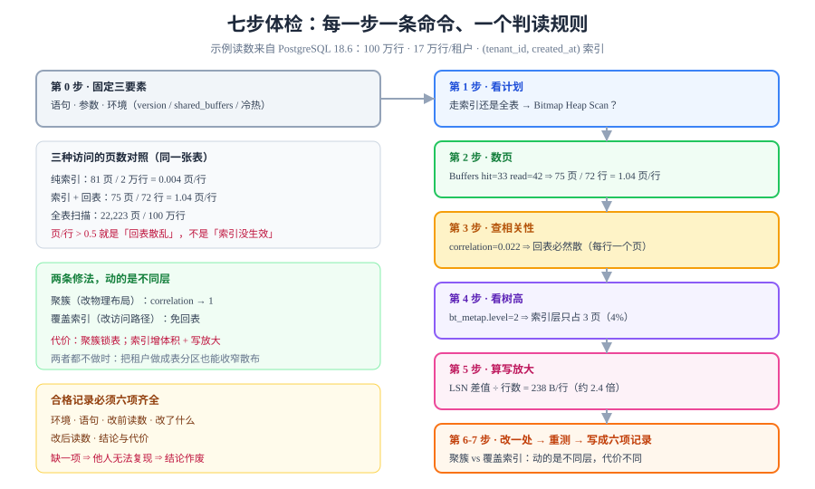

# 实战：给一条慢查询做内核级体检

前七页讲的是「每一层在做什么」。这一页把它们串成一条**可照做的流程**：拿到一条慢查询，按七个步骤往下走，每一步只回答一个问题、只跑一条命令。走完七步，你会得到一份能解释「为什么慢」并且**能验证改完有没有用**的记录。



## 判据族声明

本页判据族 `DPR-A` ~ `DPR-H`，共 8 条。定义表在第九节。

## 场景

一条经常被投诉的查询（本页全部读数来自本机 PostgreSQL 18.6 实测）：

```sql
-- 查询 A：某租户一天内的全部事件
select * from events
where tenant_id = 7 and created_at >= '2026-01-05' and created_at < '2026-01-06';
```

表：100 万行、17 万行/租户、`(tenant_id, created_at)` 上有索引。

## 第 0 步：先确认你测的是同一条语句

在动手前必须固定三件事，否则后面所有读数都不可比：

| 要固定 | 怎么固定 | 为什么 |
| --- | --- | --- |
| 语句文本 | 原样复制，不改空格与参数写法 | 不同文本是不同查询，计划可能不同 |
| 参数值 | 用真实的高频值，不用 `?` | 参数决定选择率，选择率决定计划 |
| 环境 | 记录 `shared_buffers`、`work_mem`、版本 | 换台机器读数就不一样 |

```sql
select version();
show shared_buffers; show work_mem; show effective_cache_size;
```

**本机读数**：`PostgreSQL 18.6`、`shared_buffers=128MB`、`effective_cache_size=4GB`。

::: warning 冷热缓存会让读数差 10 倍
第一次跑是「冷」，第二次是「热」。**必须声明你测的是哪一种**，并且两次测量用同一种。本文所有读数都是「热缓存 + 已 analyze」。
:::

## 第 1 步：看计划——它选了哪条路

```sql
explain (analyze, buffers, costs on, timing on) <查询 A>;
```

```text
 Bitmap Heap Scan on events (actual time=0.034..2.054 rows=72 loops=1)
   Recheck Cond: ((tenant_id = 7) AND (created_at >= ...) AND (created_at < ...))
   Heap Blocks: exact=72
   Buffers: shared hit=33 read=42
   ->  Bitmap Index Scan on idx_events_tenant_created (actual rows=72)
         Buffers: shared hit=3
 Execution Time: 2.077 ms
```

**这一步只回答一个问题：走的是索引还是全表？** 三个信号：

| 信号 | 本机读数 | 判读 |
| --- | --- | --- |
| 访问方式 | `Bitmap Heap Scan` | 走索引，且按页号排序回表 |
| `Heap Blocks` | `exact=72`，无 `lossy` | 位图精确，`work_mem` 够用 |
| `Buffers` | `hit=33 read=42` | 75 个页里有 42 个要读盘 |

## 第 2 步：数页——这次查询到底碰了多少页

这是最容易被跳过、也最关键的一步。**`actual time` 说「多久」，`Buffers` 说「碰了多少页」，两者结合才能判断是 CPU 还是 I/O**。

```text
Buffers: shared hit=33 read=42   →  75 个页
actual rows=72                   →  72 行
每行摊到 75 ÷ 72 ≈ 1.04 个页
```

对照一下「理想的索引访问」：

| 访问类型 | 页数 | 本机实测 |
| --- | --- | --- |
| 纯索引（Index Only Scan） | 3 层 + 少量叶页 | 按租户计数：**81 页 / 2 万行**（0.004 页/行） |
| 索引 + 回表（本页查询） | 3 层 + 每行 1 个堆页 | **75 页 / 72 行**（1.04 页/行） |
| 全表扫描 | 全部页 | **22,223 页** |

**结论已经出来了**：这次查询的瓶颈不是「索引没生效」，而是**回表太散**——每行一个堆页。

## 第 3 步：查相关性——为什么回表这么散

```sql
select attname, n_distinct, round(correlation::numeric, 3) as corr
from pg_stats where tablename = 'events';
```

```text
 attname    | n_distinct |  corr
------------+------------+-------
 tenant_id  |         50 | 0.022
 created_at |         -1 | 1.000
```

`tenant_id` 的物理相关性只有 **0.022**：同一个租户的行**随机散布在整张表里**。所以「取 72 行」必然等于「取 72 个不同页」。

::: tip 这一步的判读规则
`correlation > 0.9` → 回表几乎顺序，页数 ≈ 行数 ÷ 每页行数；
`correlation < 0.3` → 回表随机，页数 ≈ 行数；
介于两者之间 → 按 `行数 × (1 - correlation)` 粗略估额外页数。
:::

## 第 4 步：看树高——索引层贡献了几个页

```sql
select * from bt_metap('idx_events_tenant_created');
```

```text
 root | level
------+-------
  209 |     2      ← level=2 即 3 层
```

索引层贡献 **3 页**（根 + 内部 + 叶），在 75 个页里占 4%。**剩下的 72 页全是回表**——这印证了第 3 步。

若索引层就占了十几页，说明**树太胖**（叶页利用率低），应走[B+ 树](BPlusTree/index.md)那一页的碎片处置。

## 第 5 步：算写放大——这条查询的「隐形账单」

读查询本身不写 WAL，但**支撑它的写入**在持续产生 WAL。一次 10 万行插入的实测：

```sql
select pg_current_wal_lsn() as before \gset
-- 插入 10 万行
select pg_current_wal_lsn() as after \gset
select pg_size_pretty(pg_wal_lsn_diff(:'after', :'before')) as wal;
```

```text
 wal   | bytes/row
-------+-----------
 23 MB |     238.0
```

| 判读 | 阈值 | 处置 |
| --- | --- | --- |
| 正常 | 每行 WAL ≈ 1.5～3 倍行宽 | 无需处理 |
| 偏高 | > 5 倍行宽 | 查 `wal_fpi` 是否过高（全页写多）、索引是否过多 |
| 异常 | > 10 倍行宽 | 检查是否有大量更新、或 `full_page_writes` + 频繁检查点叠加 |

## 第 6 步：改一个变量，重测

体检的目的是**改**。本页场景有两条修法，各自动的是不同的一层：

| 修法 | 动哪一层 | 预期效果 | 代价 |
| --- | --- | --- | --- |
| **按 `tenant_id` 聚簇**（`cluster events using idx_events_tenant_created`） | 存储层（物理布局） | `correlation` 从 0.02 升到接近 1，回表页数从 72 降到个位数 | 聚簇期间锁表；后续插入会重新打散 |
| **加覆盖索引** `(tenant_id, created_at, id, kind)` | 索引层（免回表） | 变成 `Index Only Scan`，页数从 75 降到 3～5 | 索引体积增加、写放大上升 |

::: danger 改完必须重测，且用同一份数据
「改完感觉快了」不是结论。必须回到第 1、2 步，用**同样的 SQL、同样的参数、同样的缓存状态**重跑，并记录 `Buffers` 与 `actual time` 的前后对比。

否则你无法回答「是改动生效了，还是缓存刚好热了」。
:::

## 第 7 步：复核——把读数写成可复现的记录

一份合格的体检记录必须包含六项，缺一项就无法被他人复现：

| 项 | 示例 |
| --- | --- |
| 环境 | PG 18.6，`shared_buffers=128MB`，热缓存 |
| 语句 | 原样 SQL |
| 改前读数 | `75 页 / 2.08 ms / Bitmap Heap Scan` |
| 改了什么 | 加了覆盖索引 `(tenant_id, created_at, id, kind)` |
| 改后读数 | 预期 `Index Only Scan`、页数 ≤ 5、`Heap Fetches=0` |
| 结论与代价 | 读放大从 75 → ~5（降 15 倍）；索引体积 +X MB、写放大 +Y% |

## 八、七步速查表

| 步 | 命令 | 回答什么问题 | 判读规则 |
| --- | --- | --- | --- |
| 0 | `select version(); show shared_buffers;` | 测的是不是同一条、同一环境 | 三项都记录才算固定 |
| 1 | `explain (analyze, buffers, costs on)` | 走索引还是全表 | 看节点名 + `Heap Blocks` |
| 2 | 同上，读 `Buffers` | 碰了多少页 | 页数 ÷ 行数 > 0.5 就是回表问题 |
| 3 | `pg_stats.correlation` | 回表为什么散 | <0.3 即随机回表 |
| 4 | `bt_metap()` | 索引层占几页 | `level+1` 即层数 |
| 5 | LSN 差值 | 写放大多大 | 每行 WAL 应 < 3 倍行宽 |
| 6 | 改一个变量重测 | 改动是否生效 | 前后读数同口径对比 |
| 7 | 写成记录 | 别人能不能复现 | 六项齐全 |

## 九、判据表

| 编号 | 约定 | 定错了会怎样 | 怎么验证没被破坏 |
| --- | --- | --- | --- |
| `DPR-A` | 体检记录必须固定「语句 / 参数 / 环境」三要素 | 读数不可比，前后对比无效 | 记录里有六项字段，缺一项即不合格 |
| `DPR-B` | 必须声明冷或热缓存 | 同一查询读数差 10 倍 | 记录里有「缓存状态」一栏 |
| `DPR-C` | 必须同时给出页数与耗时 | 单看耗时误判 CPU / I/O | 每步读数都成对出现 |
| `DPR-D` | 回表散乱的结论必须由 `correlation` 支撑 | 凭感觉判断，改错方向 | 记录里附 `pg_stats.correlation` 读数 |
| `DPR-E` | 改动必须只动一个变量 | 多个变量同改，无法归因 | 改动清单里每次只有一项 |
| `DPR-F` | 改动必须附「代价」一栏 | 只报收益，留下写放大/体积隐患 | 记录里有索引体积或写放大的变化 |
| `DPR-G` | 不得把 `cost` 当作改前改后的对比指标 | cost 与实际时间可能反向 | 对比表里只有 `actual time` 与 `Buffers` |
| `DPR-H` | 体检结论必须能被他人用同样命令复现 | 结论无法被证伪，也无法被继承 | 换一个人照跑，得到同量级读数 |

## 如何验证

七步全部可以在这台机器上跑通。最短路径：

```sql
-- 0 环境
select version(); show shared_buffers;

-- 1~2 计划与页数
explain (analyze, buffers, costs on)
select * from events where tenant_id = 7
  and created_at >= '2026-01-05' and created_at < '2026-01-05 01:00';

-- 3 相关性
select attname, n_distinct, round(correlation::numeric,3)
from pg_stats where tablename='events';

-- 4 树高
create extension if not exists pageinspect;
select level from bt_metap('idx_events_tenant_created');

-- 5 写放大
select pg_current_wal_lsn();
```

**预期输出**（与本文读数一致）：`PostgreSQL 18.6` / `128MB`；`Bitmap Heap Scan`、`Buffers: hit=33 read=42`、`Heap Blocks: exact=72`、`Execution Time ≈ 2 ms`；`tenant_id` 的 `correlation ≈ 0.02`；`level = 2`（三层）；LSN 为 `0/xxxxxxx` 形式。

::: warning 本页没有做的事
本文**没有真的执行第 6 步的两种改法**（聚簇会锁表、加索引会改变实验数据），因此「改后读数 ≤ 5 页」是**基于结构的推算**，不是实测。要验证它，请在你的测试库上执行并记录真实读数——**这正是 `DPR-H` 要求的那件事**。
:::

## 参考资料

- [PostgreSQL 18 · Using EXPLAIN](https://www.postgresql.org/docs/18/using-explain.html)——`Buffers`、`Heap Blocks`、`loops` 的官方含义
- [PostgreSQL 18 · Statistics Used by the Planner](https://www.postgresql.org/docs/18/planner-statistics.html)——`correlation` 如何影响索引代价
- [PostgreSQL 18 · CLUSTER](https://www.postgresql.org/docs/18/sql-cluster.html)——聚簇的锁粒度与后续打散问题
- [PostgreSQL 18 · pageinspect](https://www.postgresql.org/docs/18/pageinspect.html)——`bt_metap` 等函数的字段定义
- [Use The Index, Luke · Which Index](https://use-the-index-luke.com/sql/where-clause)——从查询形状推索引形状的通用方法
