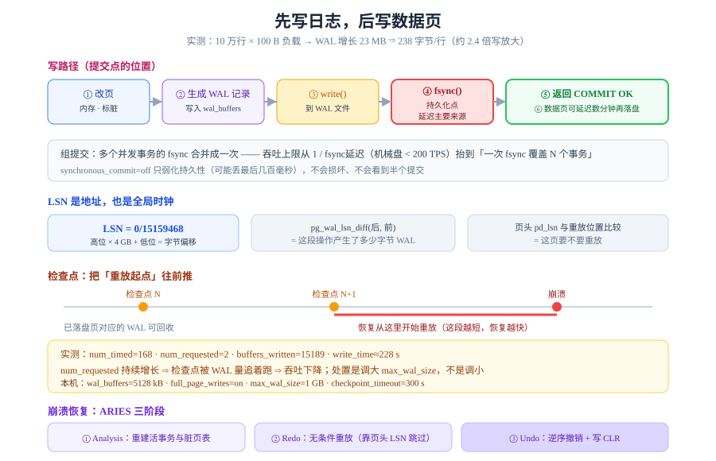

# WAL 与崩溃恢复：提交之后凭什么不丢

`commit` 返回的那一刻，数据库向你承诺了一件事：**即使下一秒整台机器掉电，这次提交也不会丢**。这个承诺不是靠「赶紧把数据页写回磁盘」实现的——那太慢了。它是靠**先写一份顺序追加的日志并 `fsync`** 实现的，数据页可以晚几分钟甚至几小时再落盘。



## 判据族声明

本页判据族 `WAL-A` ~ `WAL-H`，共 8 条。定义表在第八节。

## 一、WAL 是什么：不是日志，是主数据流

很多人把 WAL 当「出问题时给运维看的日志」，于是敢在磁盘紧张时删它。这是**最危险的一个误解**：删除 WAL 文件等于删掉「还没落盘的那些已提交数据」。

| 误解 | 事实 |
| --- | --- |
| WAL 是辅助日志，可清理 | WAL 是**已提交事务的唯一持久副本**，直到对应数据页落盘 |
| 数据页落盘了才安全 | 恰恰相反：**WAL 落了盘才安全**，数据页晚落盘不影响 |
| 归档只是为了备份 | 归档是 PITR（时间点恢复）的唯一依据；没有归档只能恢复到备份点 |

::: danger 一句话记住
**顺序写 WAL + `fsync` = 提交完成。** 数据页什么时候落盘，是后台的事，与「提交成不成功」无关。
:::

## 二、LSN：WAL 的地址与全局时钟

每条 WAL 记录有一个 **LSN（Log Sequence Number）**，是一个单调递增的字节偏移：

```text
LSN = 0/15159468
      └┬┘ └──┬──┘
     高位   低位    完整值 = 高位 × 4GB + 低位
```

LSN 有三个用途：

| 用途 | 怎么用 |
| --- | --- |
| **定位** | 「从哪个位置开始重放」——恢复的起点 |
| **比较** | 页头 `pd_lsn` 与重放位置比较，决定「这页要不要重放」 |
| **计量** | `pg_wal_lsn_diff(lsn2, lsn1)` 直接算出这段操作产生了多少字节 WAL |

```sql
select pg_current_wal_lsn();                                  -- 当前写入位置
select pg_current_wal_insert_lsn();                           -- 已插入但未必刷盘
select pg_size_pretty(pg_wal_lsn_diff(pg_current_wal_lsn(), '0/0'));  -- 累计 WAL 量
```

::: tip 用 LSN 差值当作「写放大计」
不需要任何外部工具：取一次 LSN、做一批写、再取一次，差值 ÷ 行数就是**每行产生的 WAL 字节**。这是最便宜、最准确的写放大测量法。
:::

## 三、写路径：从 `insert` 到 `fsync`

```text
① 在缓冲池里改页（标脏）        ← 内存操作
② 生成 WAL 记录，写入 wal_buffers（共享内存，默认 5 MB 量级）
③ 提交时：把 wal_buffers 里 ≤ 本次 LSN 的记录 write() 到 WAL 文件
④ fsync()  ← 真正的持久化点，也是延迟的主要来源
⑤ 返回客户端 "COMMIT OK"
⑥ 之后任意时刻，checkpointer 把脏页刷回数据文件
```

### 本机实测：一次 10 万行插入的 WAL 量

环境：PostgreSQL **18.6**，`wal_level=replica`、`full_page_writes=on`、`wal_buffers=5128kB`、`checkpoint_timeout=300s`、`max_wal_size=1024MB`。

```sql
create table wal_lab (id bigserial primary key, v text not null);
select pg_current_wal_lsn() as lsn_before \gset
insert into wal_lab (v) select repeat('y', 100) from generate_series(1, 100000);
select pg_current_wal_lsn() as lsn_after \gset
select pg_size_pretty(pg_wal_lsn_diff(:'lsn_after', :'lsn_before')) as wal;
```

```text
   before   |   after    |  wal  | bytes/row
------------+------------+-------+-----------
 0/15159468 | 0/1680C0B0 | 23 MB |     238.0
```

**读数解读**：

| 数字 | 含义 |
| --- | --- |
| 23 MB | 这次插入产生的 WAL 总量 |
| **238 字节/行** | 用户数据只有约 100 字节 ⇒ **写放大约 2.4 倍** |
| `0/15159468 → 0/1680C0B0` | LSN 差值 = 23 MB，两端可直接相减 |

写放大的来源可以拆开看：

| 来源 | 占比量级 | 说明 |
| --- | --- | --- |
| 堆元组插入记录 | 主体 | 每行一条 `Heap/INSERT` 记录，含表空间、页号、行号、元组数据 |
| 索引插入记录 | 视索引数 | 每个索引各一条记录 |
| **全页写（FPI）** | 与检查点周期相关 | 检查点后**第一次**修改某页时，把整页 8 KB 写进 WAL，用于防「页写一半」 |
| 事务提交记录 | 每事务一条 | 很小，但高频小事务时累积明显 |

本机累计 `wal_fpi = 8782`——即发生过 8782 次全页写，每次 8 KB，约 **70 MB**。这就是「大批量写入为什么 WAL 比数据大得多」的主要原因之一。

::: info 为什么要有全页写
磁盘一次写 8 KB 不保证原子。如果掉电时页只写了一半，这个页就是「既不是旧版本也不是新版本」的坏页。全页写把**整页的完整镜像**存进 WAL，恢复时先用它覆盖坏页，再重放后续记录。

代价就是上面那 70 MB。`wal_compression=on` 可以把全页写压缩，通常能压掉一半以上——**这是「WAL 太大」最直接的一个开关**。
:::

## 四、组提交：把 N 次 `fsync` 合成 1 次

`fsync` 是写路径上最贵的一步（机械盘约 5～10 ms，SSD 约 0.1～1 ms）。如果每个事务都独立 `fsync`，吞吐上限就是 `1 / fsync延迟`——机械盘上不到 200 TPS。

**组提交（group commit）** 的做法：多个并发事务的提交请求在 `wal_buffers` 里排队，**一次 `write` + 一次 `fsync` 覆盖全部**。

```text
时刻 t:  T1 提交 ─┐
        T2 提交 ─┼→ 合并为一次 fsync → 三个事务同时返回
        T3 提交 ─┘
```

| 参数 | 取值 | 含义 |
| --- | --- | --- |
| `synchronous_commit` | `on`（默认） | 提交必须等 `fsync` 完成 |
| | `local` | 等本地刷盘，不等备库 |
| | `off` | **不等刷盘就返回**，崩溃可能丢最近几百毫秒的事务（但**不会损坏**） |
| | `remote_apply` | 等备库应用完，最强也最慢 |

::: warning `synchronous_commit=off` 不是「不安全」
它保证的弱化版本叫 **一致性优先于持久性**：事务之间不会互相看到「半个提交」，数据库也不会损坏，只是**掉电可能丢掉最后一段时间内已返回成功的事务**。

适用：日志、埋点、可重放的导入。不适用：钱、库存、任何「丢了要人工补」的写入。
:::

### `wal_buffers` 满了会怎样

实测这台实例累计 `wal_buffers_full = 32192`——即 3 万多次「缓冲区满，写进程被迫自己刷」。这个计数器不为零是正常的（写入集中时必然发生），但**持续快速增长**说明：

1. `wal_buffers` 太小（默认自动取 `shared_buffers/32`，上限 16 MB）；
2. 或者事务太大（单个事务产生的 WAL 装不进缓冲区）。

## 五、检查点：把「重放起点」往前推

WAL 不能无限增长，因为恢复时要重放它。**检查点做两件事**：

1. 把当前所有脏页刷到数据文件；
2. 记录一个「到此为止，之前的 WAL 都不再需要（除非要归档）」的位置。

```text
     ┌─────────── 检查点 N ───────────┐         ┌──── 崩溃 ────┐
─────┴────────────────────────────────┴─────────┴──────────────→
     已落盘的页对应的 WAL 可回收       ↑ 恢复从这里开始重放
```

| 触发方式 | 条件 | 计数器 |
| --- | --- | --- |
| **定时** | `checkpoint_timeout`（默认 5 min）到了 | `num_timed` |
| **强制** | WAL 量接近 `max_wal_size`，必须推进检查点才能回收 | `num_requested` |

### 本机实测

```sql
select num_timed, num_requested, buffers_written, write_time from pg_stat_checkpointer;
```

```text
 num_timed | num_requested | buffers_written | write_time
-----------+---------------+-----------------+------------
       168 |             2 |           15189 |     227617
```

| 读数 | 含义 | 健康判据 |
| --- | --- | --- |
| `num_timed=168` | 定时检查点 168 次（约 14 小时的 5 分钟节奏） | 应占绝大多数 |
| `num_requested=2` | 仅 2 次被 WAL 量逼出来 | **应接近 0 且不持续增长** |
| `buffers_written=15189` | 检查点累计写了 15189 个页 | 与写入量成比例 |
| `write_time=227617`（ms） | 累计刷盘耗时约 228 秒 | 单次平均约 1.3 秒，可控 |

::: danger `num_requested` 持续增长是吞吐杀手
它意味着「WAL 生成速度 > `max_wal_size` 允许的窗口」，检查点被追着跑：刷得更频繁、每次刷更多、`fsync` 更密集，**整体吞吐下降**，而且**恢复时间并不会因此变短**（因为检查点太多，每个都很小，重放起点反而更近——但代价是把 I/O 打散了）。

正确处置顺序：**先调大 `max_wal_size`**（给 WAL 更多回旋空间）→ 再考虑缩短 `checkpoint_timeout`（让检查点更平滑）。**不要调小 `max_wal_size`。**
:::

## 六、崩溃恢复：ARIES 三阶段

恢复的目标只有一个：**把所有「已提交但未落盘」的改动补上（redo），把所有「未提交」的改动撤掉（undo）**。

```text
① Analysis（分析）
   从最后一个检查点开始扫 WAL，重建「哪些事务活着、哪些页是脏的」

② Redo（重做）
   从最小 recLSN 开始，把所有记录**无条件重放一遍**
   （即使页已经比记录新，也要重放——用页头 LSN 比较来跳过，这叫「重复历史」）

③ Undo（撤销）
   把崩溃时仍未提交的事务，按**逆序**回滚
   每撤销一步，写一条 CLR（Compensation Log Record）——「撤销本身也要记日志」
```

三个设计要点：

| 要点 | 为什么 |
| --- | --- |
| **Redo 无条件重放** | 恢复时无法知道哪些页落了盘、哪些没落，唯一安全的做法是「全部重放」，靠幂等保证正确 |
| **CLR 记录撤销过程** | 撤销途中再次崩溃时，不能重复撤销——CLR 让「撤销到哪一步」也可恢复 |
| **Undo 逆序** | 事务内的操作有依赖，正序撤销会破坏中间状态 |

::: tip PostgreSQL 的实际差异
PostgreSQL 没有 undo 段（它是 MVCC + 死元组设计）：**未提交的改动直接丢弃即可**（那些元组对其他事务不可见）。所以 PG 的恢复只有 **redo 一遍**，undo 由「可见性规则 + 后续 vacuum」代劳。这也解释了为什么 PG 崩溃后可能留下膨胀——**撤销是逻辑上的，空间要等 vacuum 才回来**。
:::

### 恢复时间由什么决定

```text
恢复耗时 ≈ 需重放的 WAL 量 ÷ 重放速度
需重放的 WAL 量 ≈ 距上次检查点的 WAL 生成量
```

推论：

1. **检查点越稀，恢复越慢**。`checkpoint_timeout` 调大能提高吞吐，但崩溃后要重放更多；
2. **`max_wal_size` 越大，单次检查点间隔可越长，但最坏恢复时间也越长**；
3. 想让「恢复时间可预期」，应定期主动做检查点并监控 `pg_control_checkpoint()` 的 `checkpoint_time`。

```sql
select checkpoint_time, redo_lsn, timeline_id from pg_control_checkpoint();
```

## 七、五个高频坑

| 坑 | 现象 | 根因 | 正确做法 |
| --- | --- | --- | --- |
| 删 `pg_wal` 里的文件「腾空间」 | 数据库起不来 / 备库断流 / 归档断链 | 删了未归档的 WAL，主数据流断裂 | 只能删**已归档且已过恢复点**的文件，靠归档策略与 `pg_archivecleanup` |
| 按 PG 16 的字段查 `pg_stat_wal` | 报 `column "wal_write_time" does not exist` | **PG 18 起 `pg_stat_wal` 只剩 5 列**，时间类字段移到 `pg_stat_io` | 时间类看 `pg_stat_io`（`object='wal'`），PG 18 专用脚本要版本分支 |
| 检查点统计查 `pg_stat_bgwriter` | 报 `column "checkpoints_timed" does not exist` | **PG 17 起检查点统计拆到 `pg_stat_checkpointer`** | 检查点看 `pg_stat_checkpointer`（字段名也改为 `num_timed` / `num_requested`） |
| 大批量导入时 WAL 暴涨 | WAL 比数据大好几倍 | 每次检查点后首次改页触发全页写 | 开 `wal_compression`；或导入时临时调大 `max_wal_size` |
| 高频小事务吞吐上不去 | TPS 卡在 `1/fsync` | 每个事务各自 `fsync`，组提交没生效 | 合并小事务；或在可容忍的场景用 `synchronous_commit=off` |

::: danger 版本边界一定要写进脚本
PostgreSQL 17 把检查点统计搬走，18 又把 WAL 计时搬走。**同一个监控脚本跨 16/17/18 三个版本必然有一处报错。** 生产脚本里应按 `server_version_num` 分支，或直接查 `pg_settings` 判断字段是否存在，而不是「在我这儿能跑就行」。
:::

## 八、判据表

| 编号 | 约定 | 定错了会怎样 | 怎么验证没被破坏 |
| --- | --- | --- | --- |
| `WAL-A` | 必须能给出「每行写操作产生多少 WAL 字节」 | 容量规划把磁盘带宽当业务带宽，差 2～3 倍 | 取两次 LSN 差值 ÷ 行数，写进容量文档 |
| `WAL-B` | 不得以「腾空间」为由删除未归档 WAL | 数据不可恢复、备库断流 | 归档目录中有连续 WAL，`pg_wal` 无手工删除痕迹 |
| `WAL-C` | `synchronous_commit` 的取值必须按业务分级，不得全局关闭 | 关键写入在掉电时丢失 | 配置里有关键库 = `on` 的记录；非关键库单独说明 |
| `WAL-D` | `num_requested`（强制检查点）应接近 0 且不持续增长 | 检查点被追着跑，吞吐整体下降 | `pg_stat_checkpointer.num_requested` 在稳定负载下的增量 |
| `WAL-E` | 必须知道当前「最坏恢复时间」的量级 | 故障时误判「几分钟就好」，实际要半小时 | `max_wal_size ÷ WAL 生成速率` 与 `checkpoint_timeout` 取大者 |
| `WAL-F` | 大字段/大批量写入必须评估全页写的影响 | WAL 体积远超预期，磁盘被打满 | `pg_stat_wal.wal_fpi` 增量与数据写入量对比 |
| `WAL-G` | 监控脚本必须按 PG 大版本分支 | 升级后监控静默失效（字段不存在，脚本报错被吞） | 脚本里有 `server_version_num` 判断；升级演练中监控仍出数 |
| `WAL-H` | 崩溃恢复必须做过演练并记录实测时长 | 真故障时无法预估停机窗口 | 演练记录里有「kill -9 → 重启 → 可用」的实测秒数 |

## 如何验证

```sql
-- ① 写放大：两次 LSN 差值
select pg_current_wal_lsn() as before;
-- 执行一批已知行数的插入
select pg_current_wal_lsn() as after;
select pg_size_pretty(pg_wal_lsn_diff(pg_current_wal_lsn(), '0/0')) as cumulative;

-- ② 检查点健康度
select num_timed, num_requested, buffers_written from pg_stat_checkpointer;

-- ③ 全页写比例
select wal_records, wal_fpi, wal_bytes, wal_buffers_full from pg_stat_wal;

-- ④ 恢复起点
select checkpoint_time, redo_lsn from pg_control_checkpoint();
```

**预期输出**：① 每行 WAL 约 **200～250 字节**（行宽 100 字节时）；② `num_requested` 远小于 `num_timed`；③ `wal_fpi ÷ wal_records` 通常低于 1%（本机累计 8782 ÷ 2,405,148 ≈ **0.37%**）；④ `checkpoint_time` 应在最近 5 分钟内（默认 `checkpoint_timeout=300s`）。

::: warning 本页实测的边界
以上读数全部来自**本机实际运行的 PostgreSQL 18.6**（容器内），可直接复现。但**崩溃恢复时长没有实测**——那需要真的 `kill -9` 一个库并重启，会破坏当前实验环境，故本页只给公式与判据，不给「恢复用了 N 秒」这类没有跑过的数字。
:::

## 参考资料

- [PostgreSQL 18 · Write-Ahead Logging (WAL)](https://www.postgresql.org/docs/18/wal.html)——WAL 配置与 `fsync` 语义
- [PostgreSQL 18 · Continuous Archiving and PITR](https://www.postgresql.org/docs/18/continuous-archiving.html)——归档与时间点恢复的官方流程
- [PostgreSQL 18 · pg_stat_checkpointer](https://www.postgresql.org/docs/18/monitoring-stats.html#MONITORING-PG-STAT-CHECKPOINTER-VIEW)——PG 17 起的新检查点视图
- [ARIES: A Transaction Recovery Method](https://dl.acm.org/doi/10.1145/128765.128770)——Mohan 等，1992，分析/重做/撤销三阶段与 CLR 的原始论述
- [MySQL 8.4 · InnoDB Redo Log](https://dev.mysql.com/doc/refman/8.4/en/innodb-redo-log.html)——对照阅读：InnoDB 的 redo + undo 双日志设计
