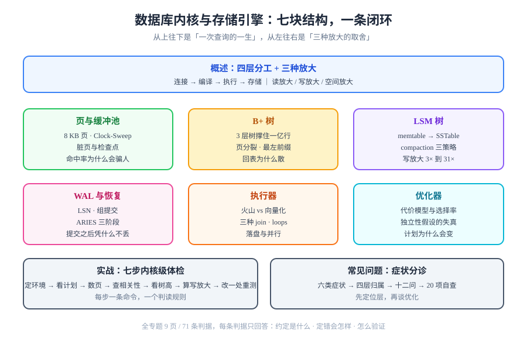

# 数据库内核与存储引擎

**一条 `select` 从发出到拿到行，中间至少过四层；一次 `insert` 从提交到掉电不丢，中间至少写两处。** 本专题不讲 SQL 怎么写，也不讲索引怎么建，只回答一个更靠下的问题：**这两件事在存储引擎里到底发生了什么，以及当它变慢、变脏、崩溃以后，你手上的命令能读出什么。**

<p style="text-align:center;"></p>

这个专题面向已经会写 SQL、但遇到「计划和我预期的不一样」「缓冲池打满」「WAL 涨得比数据快」「崩溃恢复要十分钟」时说不清原因的后端与 DBA。它把「页、缓冲池、B+ 树、LSM、WAL、执行器、优化器」这七块拆成七页，每一页都配**本机可复现的读数**——不是「大概三层」，而是「我这个库上就是三层，根页 19 个条目、叶页平均 262 个条目」。

::: tip 一句话理解
存储引擎做的所有事情，本质是在**三种放大**之间做交换：**读放大**（查一行要碰几个页）、**写放大**（写一行要落几次盘）、**空间放大**（一个字节要占几个字节的盘）。B+ 树把读放大压到 3、把写放大抬高；LSM 反过来；WAL 用顺序写换随机写；缓冲池用内存换 I/O。**你遇到的所有「性能问题」，几乎都是某一种放大失控。**
:::

## 为什么单独成一个专题

因为库内已有的数据库内容，绝大多数是**「怎么用」**，缺的是**「为什么」**：

- 索引那几页会告诉你「最左前缀」，但不会告诉你**为什么**跳过前导列就用不上（页内是有序的、跨页不是）；
- 执行计划那几页会告诉你「看 `cost`」，但不会告诉你 `cost` 只是**估算**，而 `rows` 与实际差 2 倍时计划就可能整个翻掉；
- 备份恢复那几页会告诉你「要备份」，但不会告诉你**为什么必须有 WAL**：没有它，备份出来的文件永远对不上时间点。

这三件事的共同点是：**会用的人很多，能解释「为什么这样」的人很少，而调优只能从「为什么」下手。**

## 与相邻专题的分工

先把边界写死，避免读者以为在看同一件事：

| 相邻专题 | 那边讲什么 | 本专题讲什么 | 为什么不互相替代 |
| --- | --- | --- | --- |
| [MySQL 索引深入](../Relational/MySQL/IndexDeepDive/index.md) | InnoDB 的聚簇索引、回表、覆盖索引怎么用 | **B+ 树这个结构本身**怎么长、怎么分裂、树高由什么决定 | 那边是「在一个具体引擎里怎么用索引」，本专题是「索引这个结构凭什么 O(log n)」 |
| [SQL 优化](../Relational/SQLOptimization/index.md) | 执行计划怎么读、慢查询怎么改写 | 计划**怎么被生成**：选择率、代价模型、统计信息失真 | 那边教你看结果，本专题教你判断结果**可不可信** |
| [MySQL 基础](../Relational/MySQL/index.md) | 安装、库表、事务、隔离级别 | 事务的**持久性**一侧：WAL、检查点、崩溃恢复三阶段 | 隔离级别讲并发看得见什么，WAL 讲掉电以后还在不在 |
| [ClickHouse · MergeTree](../ClickHouse/MergeTree/index.md) | 列存引擎的分区、排序键、TTL | **LSM 一族**的通用模型：memtable、SSTable、compaction | ClickHouse 的 MergeTree 是列存变体，不是 LSM；两者常被混为一谈 |
| [数据建模](../DataModeling/index.md) | 范式、ER 图、表怎么拆 | 表拆完以后**物理上怎么存**：页、行指针、TOAST | 逻辑模型与物理存储是两层，混着讲会导致「范式正确但查询很慢」 |
| [时间序列数据库](../TimeSeries/index.md) | 时序场景的建模与压缩 | 通用存储结构（页 / 树 / WAL） | 时序库是「为特定访问模式特化的引擎」，本专题是它的地基 |
| [性能与容量工程](/docs/Ops/PerformanceEngineering/index.md) | 压测、水位线、SLO 怎么定 | 单条查询在引擎内部的成本构成 | 那边算「能扛多少」，本专题算「这一条为什么慢」 |

::: warning 防重复核查（2026-10-17 实测）
开工前用 `git grep` 在 `docs/` 与 `project/` 全库检索过：`缓冲池` 仅 2 篇（Java NIO 的 `ByteBuffer`、MySQL `IndexDeepDive/BTree` 里各一句）、`B+ 树` 13 篇（全部是「用索引」语境，无一篇讲结构本身）、`LSM` 只在 ClickHouse 与数据湖相关页面顺带出现、`WAL` 出现在 PostgreSQL 与备份类页面但都只讲「要开归档」。**「存储引擎内部结构」这一层在库内是空白**，因此独立建档，并在每页写死与上述专题的边界。
:::

## 专题地图

| 页面 | 回答什么问题 | 适合谁读 |
| --- | --- | --- |
| [概述：一次查询的一生与三种放大](Overview/index.md) | 一条 SQL 经过哪四层、三种放大怎么互相交换、什么时候该换引擎 | 所有人，先读这页 |
| [页与缓冲池：内存里的那一份数据](BufferPool/index.md) | 页长什么样、缓冲池怎么淘汰、脏页什么时候落盘、命中率怎么算 | 排查「内存够不够」的人 |
| [B+ 树：三层树怎么撑住一亿行](BPlusTree/index.md) | 树高由什么决定、页分裂与填充因子、为什么跳过前导列就用不上 | 建索引与评估索引收益的人 |
| [LSM 树：用写放大换写吞吐](LsmTree/index.md) | memtable / SSTable / compaction、三种放大的公式、墓碑与空间回收 | 用时序库、KV 库、日志型存储的人 |
| [WAL 与崩溃恢复：提交之后凭什么不丢](WalRecovery/index.md) | WAL 记录、LSN、组提交、检查点、ARIES 三阶段 | 关心数据安全与恢复时间的人 |
| [执行器：算子是流水线还是批处理](Executor/index.md) | 火山模型与向量化、三种 join、内存与落盘、并行执行 | 看执行计划看不懂算子的人 |
| [优化器：代价模型为什么会算错](Optimizer/index.md) | 逻辑/物理优化、选择率、独立性假设、统计信息失真 | 遇到「计划突然变了」的人 |
| [实战：给一条慢查询做内核级体检](Practice/index.md) | 七步流程，每步一条命令、一个判读规则 | 想直接照做的人 |
| [常见问题与最佳实践](FAQ/index.md) | 症状分诊表、十二问、上线自查清单 | 所有人 |



## 判据族声明

本专题每一页的约定都编号，每条只回答三件事：**约定是什么 / 定错了会怎样 / 怎么验证它没被破坏**。前缀取三位，避开库内已用的 60 余个两位前缀。

| 页面 | 判据族 | 数量 |
| --- | --- | --- |
| 概述 | `DBI-A` ~ `DBI-H` | 8 |
| 页与缓冲池 | `BFP-A` ~ `BFP-H` | 8 |
| B+ 树 | `BPT-A` ~ `BPT-H` | 8 |
| LSM 树 | `LSM-A` ~ `LSM-H` | 8 |
| WAL 与恢复 | `WAL-A` ~ `WAL-H` | 8 |
| 执行器 | `EXE-A` ~ `EXE-H` | 8 |
| 优化器 | `OPT-A` ~ `OPT-H` | 8 |
| 实战 | `DPR-A` ~ `DPR-H` | 8 |
| 常见问题 | `DFQ-A` ~ `DFQ-G` | 7 |

合计 **71 条**。其中**文档级判据**（本机一条命令就能判）约占七成；其余是**运行期判据**，页面里一律标 `⏳ 未跑 + 原因`，不把期望值抄进实测列。

## 2026-10 事实与规格速览

命令与参数会过期，版本与结构不会。下表是本文写作时的核对结果，出处一律官方：

| 事实 | 口径 | 出处 |
| --- | --- | --- |
| PostgreSQL 最新稳定版 | **18.x**（18.0 发布于 2025-09-25；本文实测环境 **18.6**） | [Release 18](https://www.postgresql.org/docs/18/release-18.html) |
| PG 默认页大小 | **8192 字节**（`block_size`，编译期决定，建库后不可改） | `show block_size` |
| PG 18 新增 I/O 子系统 | `io_method` 可为 `sync` / `worker` / `io_uring`；新增 `pg_aios` 视图看飞行中的 I/O | [Press Kit 18](https://www.postgresql.org/about/press/presskit18/en/) |
| PG 18 新增索引能力 | 多列 B-tree 的 **skip scan**（前导列低基数时可跳过） | 同上 |
| PG 18 统计视图变化 | `pg_stat_wal` **只剩 5 列**（时间类字段移到 `pg_stat_io`）；检查点统计从 `pg_stat_bgwriter` 拆到 `pg_stat_checkpointer` | 实测 `\d pg_stat_wal` |
| InnoDB 默认页大小 | **16 KB**（`innodb_page_size`） | MySQL 官方手册 |
| LSM-Tree 原始论文 | O'Neil 等，1996，*The Log-Structured Merge-Tree* | ACM |
| 崩溃恢复三阶段 | **ARIES**，Mohan 等，1992（analysis / redo / undo + CLR） | ACM TODS |
| RocksDB 最新版 | **v11.8.1**（2026-10 前后发布，月更节奏） | [facebook/rocksdb](https://github.com/facebook/rocksdb) |

::: info 为什么本专题不建版本目录
库内 `Spring5/Spring6`、`Vue2/Vue3`、SpringBoot `v2/v3` 这些先例，共同特征是「**同一产品有两条以上并行维护的内容线，且旧版命令在新版里不成立**」。本专题三条都不满足：

1. 它讲的是**结构**（页、树、日志），B+ 树在 1972 年和 2026 年是同一个东西，不存在「B+ 树 2.0」；
2. 结构层没有「旧版命令仍要被查阅」的场景——旧版本只要改一个 `show` 参数名就能对齐，不值得为此复制整页；
3. 所有会随版本漂移的事实，都已经收进上面那张「事实与规格速览」和每页的 `::: info` 版本说明里，**改一处即可**。

因此本专题只维护一条线，版本差异一律在页内用 `::: info` 标注。
:::

## 三条最容易踩的坑（先看，能省一下午）

1. **把 `cost` 当性能**。`cost` 是无量纲的估算值，`cost=100` 与 `cost=200` 只在**同一个查询、同一份统计**下可比。真正的读数是 `Buffers` 与 `actual time`。
2. **把「命中率高」当成「内存够」**。缓冲池的命中率是按**访问次数**算的，一个每秒被读十万次的小表会把命中率抬到 99.9%，而真正的大表可能一次都没缓存住。
3. **把 WAL 当「日志」**。WAL 不是给运维看的日志，它是**数据库的主数据流**：先写 WAL 再改页，是「提交即持久」的唯一依据。删 WAL 等于删数据。

## 阅读顺序

```text
Overview（四层与三种放大）
   ├─ 想搞清「内存」 → BufferPool（页 → 缓冲池 → 脏页）
   ├─ 想搞清「索引」 → BPlusTree（树高 → 分裂 → 为什么用不上）
   │                    └─ 想写多读少 → LsmTree（对照着看）
   ├─ 想搞清「不丢」 → WalRecovery（LSN → 组提交 → 恢复三阶段）
   └─ 想搞清「为什么慢」 → Executor（算子）→ Optimizer（估算）
                              └─ 都看完 → Practice（七步体检）
```

## 参考资料

- [PostgreSQL 18 文档 · 存储与索引](https://www.postgresql.org/docs/18/storage.html)——页布局、TOAST、空闲空间映射的官方说明
- [PostgreSQL 18 Release Notes](https://www.postgresql.org/docs/18/release-18.html)——AIO、skip scan、`uuidv7()` 的权威出处
- [MySQL 8.4 Reference Manual · InnoDB Architecture](https://dev.mysql.com/doc/refman/8.4/en/innodb-architecture.html)——缓冲池、change buffer、doublewrite 的整体图
- [The Log-Structured Merge-Tree (LSM-Tree)](https://www.cs.umb.edu/~poneil/lsmtree.pdf)——O'Neil 等，1996
- [ARIES: A Transaction Recovery Method](https://dl.acm.org/doi/10.1145/128765.128770)——Mohan 等，1992
- [Architecture of a Database System](https://db.cs.berkeley.edu/papers/fntdb07-architecture.pdf)——Hellerstein、Stonebraker、Hamilton，2007，本章四层划分的来源
- [RocksDB Wiki · Compaction](https://github.com/facebook/rocksdb/wiki/Compaction)——leveled / universal / FIFO 三种 compaction 的取舍
- [Use The Index, Luke · B-tree anatomy](https://use-the-index-luke.com/sql/anatomy)——面向开发者的 B 树解剖
