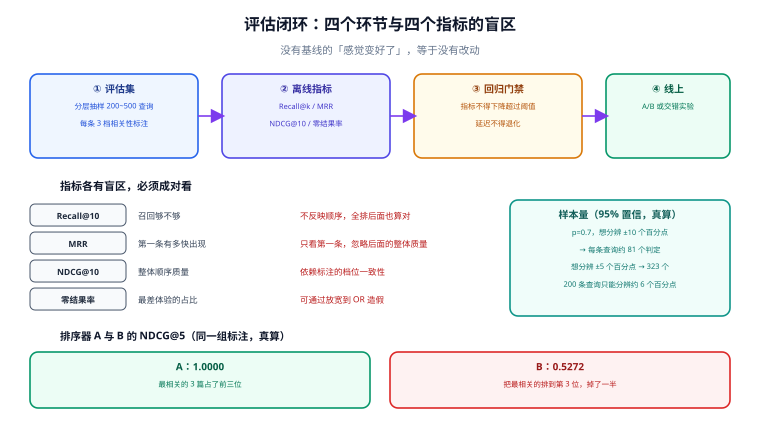

# 召回评估：没有基线就没有改动

搜索的所有调整都是**交换**：加同义词会让一部分查询变好、另一部分变差；调 `k1` 会让短文档上升、长文档下降。没有评估集时，你只能看到自己随手试的那几个查询——而人挑的查询，通常恰好是变好的那些。

这一页给一套最小可用的评估方法：**200 条查询 + 三档标注 + 四个指标 + 一条门禁**。它的目标不是「学术上的完备」，而是「让下一次改动可以被证伪」。

## 判据族声明

本页判据族 `FEV-A` ~ `FEV-H`，共 8 条。定义表在第六节。

## 本页不讲什么

- 不讲排序公式本身，归 [相关性排序](../Relevance/index.md)。
- 不讲 RAG 场景下的检索评估（那是「给模型的上下文够不够」），归 [RAG 的检索评估](/docs/AI/RAG/Evaluation/index.md)。
- 不讲实验平台的实现，只讲搜索场景下**必须固定的变量**。



## 一、评估集：怎么抽样比抽多少更重要

评估集的敌人不是「条数少」，而是**分布偏**。全部从热门查询里抽，评估集会系统性忽略长尾——而长尾恰恰是「搜不到」的高发区。

推荐的抽样分层（按优先级）：

| 层 | 来源 | 占比 | 为什么必须有 |
| --- | --- | --- | --- |
| **高频查询** | 搜索日志 top 1000 | 30% | 影响面最大，改动必须先保证这批不退化 |
| **零结果查询** | 结果数为 0 的查询 | 25% | 最差体验集中在这里；也是纠错/同义词的靶子 |
| **长尾查询** | 频次 1~5 的查询随机抽 | 25% | 分词与召回的真实压力测试 |
| **业务关键查询** | 产品指定的「必须搜到」清单 | 10% | 商业价值最高，允许人工干预 |
| **对抗样本** | 拼写错误、混中英、超长句 | 10% | 检验鲁棒性 |

两条硬规则：

1. **查询原文不许脱敏成「关键词」**。评估集要保存用户真实输入（含错别字、空格、标点），否则测不出查询理解的问题。脱敏只处理其中的个人信息。
2. **标注标准必须写成文档**，且标注人间的一致性要抽检。3 档定义建议：
   - `2` = 完全满足（点进去就能解决问题）
   - `1` = 部分相关（同主题，但不是要找的那篇）
   - `0` = 不相关

::: warning 评估集会「腐化」
三个月后，文档库变了、产品变了，评估集里的标准答案却还是旧的。表现是指标一直很高，但用户投诉变多。**每季度必须重标 20%**，并把「已下线文档」的标注替换掉。腐化的评估集比没有评估集更危险——它给出的是虚假的安全感。
:::

## 二、四个指标与各自的盲区

| 指标 | 定义 | 回答什么 | 盲区 |
| --- | --- | --- | --- |
| **Recall@k** | 前 k 条里包含的相关文档数 / 全部相关文档数 | 召回够不够 | 不反映顺序；全排第 k 位也算命中 |
| **MRR** | 第一条相关结果排名的倒数的平均 | 第一条有多快出现 | 只看第一条，忽略整体质量 |
| **NDCG@k** | 折损累计增益 / 理想折损累计增益 | 整体顺序质量 | 依赖标注档位的一致性 |
| **零结果率** | 结果数为 0 的查询占比 | 最差体验的占比 | 可以被「放宽到 OR」人为压低 |

**必须成对看**，理由很直接：把 `AND` 全改成 `OR`，零结果率立刻归零、Recall 上升，但 NDCG 会掉——因为前几条全是噪声。只看一个指标，任何改动都能「变好」。

### NDCG 的一个具体算例

同一组标注（`[3,0,2,1,0,0,1,0]`），两个排序器（**本机 Python 计算**）：

```text
排序器 A：把最相关的 3 篇放在前三位 → NDCG@5 = 1.0000
排序器 B：把最相关的排到第 3 位    → NDCG@5 = 0.5272
```

**只是把最相关的那篇从第 1 位挪到第 3 位，指标掉了近一半。** 这就是 NDCG 的敏感点：它用 `log2(rank+1)` 折损，越靠前权重越大。所以 NDCG 适合衡量「第一屏」，不适合衡量「有没有找到」。

## 三、样本量：200 条能测出多大的差异

这是最容易被跳过的一步，也是最容易得出错误结论的一步。比例估计的样本量公式：

```text
n ≈ z² · p(1 − p) / δ²
```

取 95% 置信（`z = 1.96`），基线命中率 `p`，想分辨的差异 `δ`（**本机 Python 计算**）：

| 基线 `p` | `δ = ±10 个百分点` | `δ = ±5` | `δ = ±2` |
| --- | --- | --- | --- |
| 0.5 | 97 | 385 | 2,401 |
| 0.7 | 81 | 323 | 2,017 |
| 0.9 | 35 | 139 | 865 |

读法：**基线越好，越容易分辨小差异**（因为方差小）。所以「200 条评估集」在 `p≈0.7` 时能分辨约 6 个百分点的差异——这足够发现「改动让效果明显变差」，但**不足以证明「改动好了 2 个百分点」**。想让后者成立，得把评估集扩到 2000 条以上。

::: danger 三个会让评估结论失效的做法
1. **在评估集上调参，再用同一份评估集验收**：这叫过拟合。正确做法是**留出 20% 作为测试集**，调参只看训练部分。
2. **只比平均值，不比分布**：平均 NDCG 提升 3 个百分点，可能是「10 条查询大幅提升 + 40 条轻微下降」。必须看「变好/变差/不变」的条数分布。
3. **忽略查询权重**：1000 次/天的查询和 1 次/天的查询等权平均，会得出与用户体感完全不同的结论。至少按频次加权再看一遍。
:::

## 四、离线回放与线上实验

| 阶段 | 做法 | 能回答 | 不能回答 |
| --- | --- | --- | --- |
| **离线回放** | 用评估集重放，算四个指标 | 改动是否让已知查询变好 | 新查询、真实点击行为 |
| **灰度** | 5% 流量走新排序，比指标 | 线上指标是否一致 | 长期留存 |
| **A/B** | 50/50 分流，比点击与转化 | 用户是否真的更喜欢 | 需要样本量与周期 |
| **交错实验** | 同一用户同时看两个排序的结果混合 | 小流量下更快得到结论 | 实现复杂，解释成本高 |

搜索场景下，A/B 有一个特殊困难：**点击率受排序位置影响极大**（位置越靠前点击越多），所以不能直接比 CTR。常用替代是**倒数排名加权点击**（点击位置越靠后权重越低），或者直接看「有没有点」而不是「点了几个」。

## 五、回归门禁：把指标写进 CI

评估的价值在于「自动拦住退化」。门禁规则建议三条，全部是**相对基线**而非绝对值：

| 门禁 | 阈值 | 触发动作 |
| --- | --- | --- |
| NDCG@10 不得下降超过 2% | 相对基线 | 阻断合并 |
| 零结果率不得上升超过 1 个百分点 | 绝对差 | 阻断合并 |
| P99 延迟不得上升超过 20% | 相对基线 | 阻断合并（可用性能预算替代） |

**阈值必须来自基线，不能拍脑袋。** 第一次跑出来的指标就是基线，之后每次改动与它比。基线文件要进仓库，与评估集同版本管理。

## 六、判据表

| 编号 | 规则 | 违反时的样子 | 怎么验证 |
| --- | --- | --- | --- |
| `FEV-A` | 评估集 ≥ 200 条，且按五层抽样 | 指标很好但用户投诉长尾搜不到 | 评估集元数据里有分层统计 |
| `FEV-B` | 查询保存原文，不脱敏成关键词 | 测不出拼写与格式问题 | 评估集里有含错别字的样本 |
| `FEV-C` | 标注标准有文档，且有一致性抽检 | 不同人标出的档位差别大 | 双人标注 50 条，一致率 ≥ 80% |
| `FEV-D` | 指标至少两两成对报告 | 单指标「变好」但体验变差 | 报告里同时有 NDCG 与零结果率 |
| `FEV-E` | 有留出测试集（20%） | 调参过拟合 | 训练/测试划分有记录 |
| `FEV-F` | 门禁阈值相对基线，且基线进仓库 | 阈值随人变，无法比较 | 仓库里有 `baseline.json` |
| `FEV-G` | 评估集每季度重标 20% | 指标虚高，与体感背离 | 有重标记录与版本号 |
| `FEV-H` | 报告「变好/变差/不变」的条数分布 | 平均值掩盖大面积退化 | 报告有三分类计数 |

## 验证方式

NDCG 的计算可以直接用一段不依赖数据库的脚本验证（判据 `FEV-D` / `FEV-H` 的基础）：

```python
import math

def dcg(gains):
    return sum((2 ** g - 1) / math.log2(i + 2) for i, g in enumerate(gains))

def ndcg(ranked, ideal, k=5):
    return dcg(ranked[:k]) / dcg(sorted(ideal, reverse=True)[:k])

labels = [3, 0, 2, 1, 0, 0, 1, 0]
print(ndcg([3, 2, 1, 1, 0, 0, 0, 0], labels))   # 1.0000
print(ndcg([0, 0, 3, 2, 1, 1, 0, 0], labels))   # 0.5272
```

判据：两个数值必须复现为 `1.0000` 与 `0.5272`。若不同，说明评估口径（档位或 k）与本文不一致——**先对齐口径，再谈比较**。

样本量验证：

```python
import math
for p, d in [(0.7, 0.10), (0.7, 0.05), (0.7, 0.02)]:
    print(p, d, math.ceil(1.96**2 * p * (1 - p) / d**2))
# 0.7 0.1 81 / 0.7 0.05 323 / 0.7 0.02 2017
```

## 参考资料

- [NDCG · 定义与折损函数](https://en.wikipedia.org/wiki/Discounted_cumulative_gain)——`(2^rel − 1) / log2(rank + 1)`
- [Elasticsearch 9 · Rank evaluation API](https://www.elastic.co/guide/en/elasticsearch/reference/current/search-rank-eval.html)——`precision` / `recall` / `mean_reciprocal_rank` / `dcg` / `ndcg`
- [TREC · 评测规范](https://trec.nist.gov/)——池化（pooling）与相关性标注的经典做法
- 本站 [RAG · 检索评估](/docs/AI/RAG/Evaluation/index.md) · [多模态检索 · 评估集](/docs/AI/MultimodalRetrieval/Evaluation/index.md)
- 相邻：[相关性排序](../Relevance/index.md) · [查询理解](../QueryUnderstanding/index.md) · [实战](../Practice/index.md)
