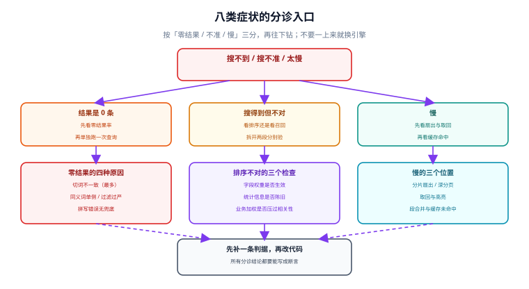

# 常见问题与分诊

搜索的问题有一个共同特征：**用户说的是「搜不到」，日志里什么异常都没有**。所以这一页按「症状 → 最可能的原因 → 一条能证伪的命令」组织，而不是按概念组织。

分诊的第一条纪律：**别一上来就换引擎**。八类症状里有六类换引擎也不会好——因为它们出在数据、分析链或产品口径上。

## 判据族声明

本页判据族 `FFQ-A` ~ `FFQ-H`，共 8 条。定义表在第四节。

## 本页不讲什么

- 不讲具体配置语法，各页有完整示例：[文本分析](../TextAnalysis/index.md)、[索引设计](../IndexDesign/index.md)、[索引更新](../IndexUpdate/index.md)。
- 不讲排序公式推导，归 [相关性排序](../Relevance/index.md)。
- 不讲评估集怎么标，归 [召回评估](../Evaluation/index.md)。



## 一、八类症状的分诊表

| # | 症状 | 最可能的原因（按概率） | 一条能证伪的命令 |
| --- | --- | --- | --- |
| 1 | 某些词永远搜不到，其他词正常 | ① 切词不一致 ② 词典缺词 ③ 索引是旧分析器建的 | `SELECT * FROM ts_debug('zhcfg', '那个词')` 看切片 |
| 2 | 刚写入的搜不到，过一会儿能搜到 | 近实时延迟（ES 1 s / PG 不该出现） | 等待 2 s 再查；PG 方案若也这样，查是否走了只读副本 |
| 3 | 搜得到但排序很奇怪 | ① 权重数组顺序错 ② 字段权重没设 ③ 业务因子量级过大 | 关掉业务因子重排一次 |
| 4 | 翻到后面几页结果重复或丢失 | `ORDER BY` 没有唯一键 | 检查排序是否以 `id` 收尾 |
| 5 | 越翻越慢 | 深 offset | 看 `EXPLAIN` 里 `Buffers` 是否随 OFFSET 增长 |
| 6 | 结果里出现别的租户的数据 | 缓存 key 少维度 / 过滤写在精排后 | 用另一租户身份查同一条 query |
| 7 | 总数与列表对不上 | 计数与列表用了不同条件 | 对比两条 SQL 的 `WHERE` |
| 8 | 高峰期延迟翻倍、低峰正常 | 段合并 / `VACUUM` / page cache 被挤出 | 看 merge 与 autovacuum 的时间分布 |

三条使用说明：

- **症状 1 与症状 2 最容易混**：前者「永远搜不到」，后者「过一会儿能搜到」。用时间维度一把切开。
- **症状 3 先怀疑权重数组，不是先怀疑 BM25 公式**。PG 的数组顺序是 `{D,C,B,A}`，写反了整条排序颠倒，这个错误极其常见。
- **症状 8 不要先加机器**：merge 与 `VACUUM` 是周期性 I/O，加机器不改变它们的发生。

## 二、十二问

### 关于选型

**Q1：数据量 10 万，要不要上 Elasticsearch？**
不需要。10 万条在 PG 的 GIN 上通常是个位数毫秒到几十毫秒。上 ES 的判据是「千万级 + 高 QPS + 需要复杂聚合」，见 [总览](../Overview/index.md) 的决策树。真要上，先算清多一套集群的运维成本。

**Q2：PG 的 `ts_rank` 和 BM25 哪个好？**
`ts_rank` 不是 BM25（没有词频饱和与长度归一），`ts_rank_cd` 稍好一些。在「标题 + 短正文」的工单场景里够用；在「长文档 + 关键词堆砌」的场景里，BM25 的表现更稳。要 BM25 就得换引擎或装第三方扩展。

**Q3：向量检索能替代全文检索吗？**
不能。向量擅长「说法不同但意思相近」，字面检索擅长「精确术语、编号、代码」。真实系统几乎都是两路并联再用 RRF 之类融合，见 [混合检索](/docs/DB/VectorDatabase/HybridSearch/index.md)。

### 关于分词

**Q4：中文能不能直接用 `simple` 配置？**
能跑，但连续 CJK 会被当成**一个词项**，等于只能整段匹配。要在 `simple` 上做中文，得用二元组（应用层预切分或 `pg_bigm`）。见 [文本分析](../TextAnalysis/index.md) 的三条路线。

**Q5：换了词典，为什么只有新文档能搜到？**
因为旧文档的词项是按旧词典切的、已经落盘了。热加载只影响新查询的切词，不改变已索引的词项。**任何影响分词结果的变更都是重建事件**。

**Q6：同义词加在索引侧还是查询侧？**
默认查询侧。改同义词不用重建索引，且带权重更自然（`看板^2 OR 面板`）。只有在「同义词极其稳定、且查询性能极度敏感」时才考虑索引侧。

### 关于排序

**Q7：为什么 `setweight(..., 'A')` 之后标题反而排在后面？**
大概率是 `ts_rank` 的权重数组写反了。数组顺序是 `{D,C,B,A}`，第一位是 D。默认 `{0.1,0.2,0.4,1.0}` 里 A 是最高的，但自定义时很容易按 `{A,B,C,D}` 的直觉传值。

**Q8：相关性得分能不能当业务阈值？**
不能。得分是同一查询内不同文档之间的相对量，跨查询、跨索引版本都不可比。要卡阈值只能卡**归一化后的**分（如 `ts_rank(..., 32)`），且阈值必须随索引一起版本化。

**Q9：置顶应该怎么实现？**
两种：加分（与相关性同量级）或分组（置顶组在前，组内按相关性）。**加分方式在置顶条目多时会失控**，超过 3 条建议用分组。

### 关于运维

**Q10：重建索引要停服吗？**
不需要。加新列 → `CREATE INDEX CONCURRENTLY` → 切换读取列 → 观察 → 删旧列。全程不停写，代价是磁盘要能放下两份索引。ES 侧对应「新索引 + 别名切换」。

**Q11：删除的文档为什么还能搜到？**
三种可能：软删没加过滤条件、缓存没失效、ES 的软删除要等 merge 才真正回收（但**查询层面应该立刻不可见**）。若查询层面还能看到，就是前两种。

**Q12：怎么证明「这次改动变好了」？**
200 条分层抽样的评估集 + NDCG@10 基线 + 「变好/变差/不变」的条数分布。只有平均值不算证明，见 [召回评估](../Evaluation/index.md)。

## 三、十二项上线自查

上线前逐条打勾，全部可机器判：

| # | 自查项 | 判据 |
| --- | --- | --- |
| 1 | 索引侧与查询侧分析链同名 | 同一文本两侧词项流相同 |
| 2 | 中文路线已选定并写入契约 | 文档里有路线名与版本 |
| 3 | 每个可搜字段有权重档位 | 权重配置存在且非全默认 |
| 4 | 权重数组顺序正确 | 标题命中的对照用例通过 |
| 5 | 查询直接作用在索引列上 | `EXPLAIN` 走 `Bitmap Index Scan` |
| 6 | 租户/权限过滤在召回前 | 越权查询返回 0 行 |
| 7 | 排序带唯一键，分页用游标 | 深页无重复无丢失 |
| 8 | 写后可见性有契约与测试 | 契约文档 + 一条断言 |
| 9 | 删除后列表与计数同时归零 | 一条删除用例 |
| 10 | 有 ≥ 200 条评估集与基线 | 基线文件进仓库 |
| 11 | 有帮助结果缓存的 key 含全部维度 | key 构造有单测 |
| 12 | 有慢查询采集与阈值告警 | `pg_stat_statements` 或 profile 可用 |

## 四、判据表

| 编号 | 规则 | 违反时的样子 | 怎么验证 |
| --- | --- | --- | --- |
| `FFQ-A` | 分诊先按「零结果 / 不准 / 慢」三分 | 所有问题都往「索引没同步」上猜 | 工单模板里有这三类 |
| `FFQ-B` | 每个症状有一条能证伪的命令 | 排查靠猜、靠试 | 分诊表每一行都有命令 |
| `FFQ-C` | 换引擎前先排除数据与口径问题 | 换了引擎问题还在 | 决策记录里有「已排除项」 |
| `FFQ-D` | 症状 1 与症状 2 用时间维度切开 | 把近实时当同步失败 | 有「等待 2 s 再查」的验证步骤 |
| `FFQ-E` | 排序异常先查权重数组顺序 | 反复调 `k1` 无效 | 有权重数组的对照用例 |
| `FFQ-F` | 高峰期问题先看 merge / `VACUUM` | 盲目扩容 | 有 I/O 与 autovacuum 的时间分布 |
| `FFQ-G` | 十二项自查进上线清单 | 上线后才发现租户条件漏了 | 发布检查表里有这 12 项 |
| `FFQ-H` | 术语在团队内统一 | 「召回」被当成「返回」 | 有术语表且评审时引用 |

## 五、术语表

| 术语 | 含义 | 最容易混淆的点 |
| --- | --- | --- |
| **召回（recall）** | 从全集中找出候选集 | 不是「返回给用户」，返回是「呈现」 |
| **精确率（precision）** | 候选里真正相关的比例 | 与召回是此消彼长，不是同时提升 |
| **倒排索引** | 词项 → 文档号列表 | 与 B+ 树的「键 → 行」不是一回事 |
| **posting list** | 某个词项对应的文档号列表 | 长度由词频决定，高频词的最长 |
| **分析链（analyzer）** | 字符过滤 → 分词 → 词项过滤 | 索引侧与查询侧必须同一条 |
| **停用词** | 不参与检索的高频词 | 它是性能开关，不只是「语义噪声」 |
| **refresh** | 让新写入的文档可被搜索 | 不等于「写入成功」，也不等于「持久化」 |
| **段（segment）** | 不可变的索引分片单元 | merge 之后才会真正回收被删文档 |
| **别名（alias）** | 指向索引的间接名字 | 切换是原子操作，是零停机重建的关键 |
| **NDCG** | 带位置折损的相关性指标 | 对前几位极其敏感 |
| **扇出（fan-out）** | 一次查询打到的分片数 | 直接放大尾延迟 |
| **游标分页** | 用「上一页最后一行」定位下一页 | 与 offset 分页的代价完全不同 |

## 验证方式

本页的判据以「文档与流程」为主，其中 `FFQ-D` / `FFQ-E` 可以用两条 SQL 直接验证：

```sql
-- FFQ-D：区分「永远搜不到」与「过一会儿能搜到」
-- 写入后立刻查一次，等待 2 秒再查一次，两次结果不同的才是可见性问题
SELECT count(*) FROM ticket WHERE search_vec @@ websearch_to_tsquery('zhcfg', '刚写入的词');

-- FFQ-E：权重数组顺序（A 档必须在最后一位才能拿到 1.0）
SELECT
  ts_rank('{0.1,0.2,0.4,1.0}', setweight(to_tsvector('simple','看板'),'A'), to_tsquery('simple','看板')) AS a_w,
  ts_rank('{0.1,0.2,0.4,1.0}', setweight(to_tsvector('simple','看板'),'D'), to_tsquery('simple','看板')) AS d_w;
-- 期望：a_w > d_w
```

## 参考资料

- [PostgreSQL 18 · Text Search](https://www.postgresql.org/docs/18/textsearch.html)——`ts_debug` 与配置排查
- [PostgreSQL 18 · Routine Vacuuming](https://www.postgresql.org/docs/18/routine-vacuuming.html)——高峰期 I/O 的常见来源
- [Elasticsearch 9 · Troubleshooting search](https://www.elastic.co/guide/en/elasticsearch/reference/current/troubleshooting-searches.html)——慢查询与结果异常
- 本站 [Elasticsearch · 常见问题](/docs/DB/NoRelational/Elasticsearch/FAQ/index.md) · [PostgreSQL · 常见问题](/docs/DB/Relational/PostgreSQL/FAQ/index.md)
- 相邻：[总览](../Overview/index.md) · [实战](../Practice/index.md) · [召回评估](../Evaluation/index.md)
