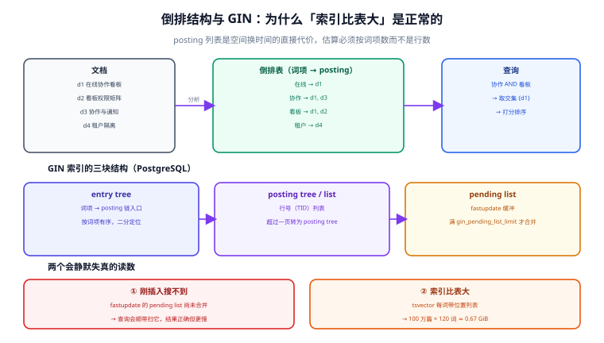

# 索引设计：倒排、字段与体积

倒排索引回答的只有一个问题：**「这个词项出现在哪些文档里」**。所有设计决策——字段怎么切、权重怎么给、索引有多大、复合条件能不能走同一个索引——都是这个问题的推论。

这一页的目标是让你在**建索引之前**就能算出三件事：索引大概多大、哪些查询能走它、哪些查询会退化成全表扫。

## 判据族声明

本页判据族 `FID-A` ~ `FID-H`，共 8 条。定义表在第六节。

## 本页不讲什么

- 不讲分词器怎么选，归 [文本分析](../TextAnalysis/index.md)。
- 不讲 BM25 参数怎么调，归 [相关性排序](../Relevance/index.md)。
- 不讲 ES 的 `mapping` 语法细节，那是 [Elasticsearch · 索引映射](/docs/DB/NoRelational/Elasticsearch/IndexMapping/index.md) 的范围。
- 不讲 B+ 树的页与分裂，那在 [数据库内核 · B+ 树](/docs/DB/DatabaseInternals/BPlusTree/index.md)。



## 一、倒排表到底存了什么

```text
d1  在线协作看板
d2  看板权限矩阵
d3  协作与通知

倒排表：
  在线  → d1
  协作  → d1, d3
  看板  → d1, d2
  权限  → d2
  通知  → d3
```

一次查询「协作 AND 看板」的执行过程是：取 `协作` 的 posting（d1, d3）与 `看板` 的 posting（d1, d2），求交集得 d1，再对 d1 打分。**没有任何一步需要读原文**——除非要算 BM25 的字段长度，那需要额外的统计信息。

这解释了三个常见现象：

| 现象 | 原因 |
| --- | --- |
| 索引比表大 | posting 列表是「每个词项一份文档号列表」，词项多则条目多 |
| 查询很快但排序慢 | 求交是集合运算，打分要读统计信息与位置列表 |
| 前缀搜索很慢 | 倒排按**完整词项**索引，`看板%` 要扫一遍词项字典 |

## 二、PostgreSQL 的 GIN：三块结构与一个缓冲

PG 的 GIN（Generalized Inverted Index）由三部分组成：

| 部分 | 作用 | 关键参数 |
| --- | --- | --- |
| **entry tree** | 词项 → posting 链入口，按词项有序，可二分 | 由 B+ 树实现，通常只有几层 |
| **posting tree / list** | 文档号（TID）列表；条目少时是 list，多时转成 tree | 无直接参数，由条目数决定 |
| **pending list** | `fastupdate` 打开时的写入缓冲，新条目先堆在这里 | `gin_pending_list_limit`（默认 4 MB） |

`fastupdate` 默认是开的，这带来两个后果，都会让读数变得反直觉：

1. **刚插入的文档查询会顺带扫 pending list**：结果是对的，但延迟比「全部合并后」更高。所以「刚写完时查询慢、过一会儿变快」是正常现象。
2. **`pg_relation_size()` 看到的索引大小不含 pending list**：估算索引体积时要把这一块加回去，否则会低估。

```sql
-- 看 GIN 的 pending list 状态
SELECT * FROM gin_metapage_info('kb_doc_search_idx');
-- 也可以直接看是否开启了 fastupdate
SELECT reloptions FROM pg_class WHERE relname = 'kb_doc_search_idx';
```

生产上有一个常见取舍：**写入密集的表关掉 `fastupdate`**（每次插入直接进 posting，写变慢、读变稳），**读密集的表保持开启**。这条决定要写在索引注释里，否则下一个人不知道为什么。

## 三、字段建模：权重档位与多字段

搜索排序的第一大杀手是「所有字段同权重」。字段建模的目标是让**「命中在哪」**这件事进入索引，而不是等到排序阶段再补救。

### PG 侧：`setweight` 的四个档位

```sql
ALTER TABLE kb_doc ADD COLUMN search_vec tsvector
  GENERATED ALWAYS AS (
    setweight(to_tsvector('zhcfg', coalesce(title, '')), 'A') ||
    setweight(to_tsvector('zhcfg', coalesce(tags, '')),  'B') ||
    setweight(to_tsvector('zhcfg', coalesce(summary, '')), 'C') ||
    setweight(to_tsvector('zhcfg', coalesce(body, '')),  'D')
  ) STORED;
```

四个档位是 PG 的硬上限（A/B/C/D）。默认权重向量是 `{0.1, 0.2, 0.4, 1.0}`，对应顺序是 **`{D, C, B, A}`**——也就是说 **`A` 档默认最重（1.0）**，字母序在这里是从轻到重，很容易记反。要自定义权重时必须按同一个顺序传数组：

```sql
SELECT ts_rank('{0.1, 0.2, 0.4, 1.0}', search_vec, query);  -- 默认：A 最重
SELECT ts_rank('{1.0, 0.4, 0.2, 0.1}', search_vec, query);  -- 反过来：D 最重
```

这一条踩过的人很多：想「让标题更重要」，于是顺手传了 `{1.0, 0.4, 0.2, 0.1}`，以为第一位是 A——实际第一位是 D，结果正文压过了标题。**判断方法**：数组第一位永远是 D 档，`A` 永远在最后一位。

### ES 侧：多字段（multi-fields）与 `copy_to`

```json
{
  "mappings": {
    "properties": {
      "title":   { "type": "text", "analyzer": "ik_max_word",
                   "fields": { "raw": { "type": "keyword" } } },
      "body":    { "type": "text", "analyzer": "ik_max_word" },
      "all":     { "type": "text", "analyzer": "ik_max_word" }
    }
  }
}
```

`copy_to: "all"` 把多个字段拼进一个「全字段」字段，用于兜底召回；但它会让**同一个词项在 `all` 里出现多次**（标题一次、正文一次），词频被放大，排序反而失真。经验做法：`all` 只用于「召回兜底」的低权重查询，主排序仍按字段分别查、分别 boost。

### 权重档位的经验值

| 字段 | PG 档位 | ES boost | 说明 |
| --- | --- | --- | --- |
| 标题 | `A`（权重 1.0） | 3.0 | 用户最可能在找标题 |
| 标签 / 分类 | `B`（0.4） | 2.0 | 结构化语义，命中即强相关 |
| 摘要 | `C`（0.2） | 1.0 | 人工写的概括，质量高 |
| 正文 | `D`（0.1） | 0.5~1.0 | 篇幅长，容易「碰巧命中」 |
| 附件 OCR 文本 | `D`（0.05 以下） | 0.2 | 噪声最大，只用于兜底 |

**这套数字不是标准答案，是起点。** 它们的意义是「有一个明确的、可被评估集检验的先验」，而不是「靠默认值碰运气」。

## 四、复合条件：让一个索引同时满足「搜索 + 过滤」

真实查询从来不只是全文条件，一定是「在某租户内、某状态下、某时间段内搜索关键词」。这带来一个索引设计上的硬问题：**GIN 能不能带普通列条件？**

| 做法 | 能否走同一索引 | 代价 |
| --- | --- | --- |
| GIN 只建在 `search_vec` 上，其他条件用普通 B-tree | 可以（BitmapAnd 合并两个索引） | 两个索引各自扫，取交集；选择率高时很快 |
| 把租户 ID 拼进 `tsvector`（当成一个词项） | 可以（单索引） | 每个文档多一个词项；租户 ID 必须能被解析成词项 |
| 建**部分索引**（`WHERE tenant_id = ?`） | 可以，且最省 | 每个租户一个索引，租户数不能太多 |
| 建复合 GIN（`btree_gin` 扩展） | 可以 | 扩展依赖；复合列的 GIN 体积更大 |

百万级文档、租户数在千级时，**第一种（BitmapAnd）通常已经够用**：B-tree 先把租户条件缩到几千行，再与 GIN 的 posting 求交，代价可接受。真正需要「单索引」的是租户数很少但每租户数据极大的场景——那时第三种（部分索引）更划算。

::: danger 一个会让索引完全失效的写法
```sql
-- 错：对生成列再做函数运算
WHERE to_tsvector('zhcfg', title) @@ query
-- 对：直接用生成列
WHERE search_vec @@ query
```

前者让优化器无法使用 GIN（它不知道 `to_tsvector(title)` 与 `search_vec` 等价），退化成**全表扫 + 每行现算分词**。表现是「索引建了但查询还是 2 秒」，`EXPLAIN` 里是 `Seq Scan` + `Filter`。这条与 [分区分表](../../PartitionArchival/CrossPartition/index.md) 里「对分区键做函数导致裁剪失效」是同一类错误：**索引只认它自己建在上面的那个表达式**。
:::

## 五、体积估算：三个数就能算出来

索引体积不是「试试看」，可以在建之前算：

```text
GIN 体积 ≈ 文档数 × 平均词项数 × 每 posting 条目字节数（约 6 B）
tsvector 列 ≈ 文档数 × 平均词项数 × 每词项字节数（词 + 位置，约 4 B）
```

本机用 Python 按上式算的三档（**公式计算，非数据库实测**）：

| 平均词项/篇 | GIN 估算 | `tsvector` 列估算 | 合计 |
| --- | --- | --- | --- |
| 60 | 0.34 GiB | 0.22 GiB | 约 0.56 GiB |
| 120 | 0.67 GiB | 0.45 GiB | 约 1.12 GiB |
| 300 | 1.68 GiB | 1.12 GiB | 约 2.80 GiB |

三个读数背后的判断：

1. **「平均词项数」要按分词结果数，不是字数**。一篇 1000 字的中文文档，分词后约 400~600 个词项（去重前），二元组方案则接近 1000 个。
2. **`tsvector` 列本身也占空间**，且会被 TOAST 处理（超过约 2 KB 的值压缩后存到侧表）。所以「只建 GIN 不存列」在 PG 里做不到——生成列必须 `STORED`。
3. **索引通常比原表大 1~2 倍是正常的**。如果算出「索引是表的 10 倍」，先怀疑词项数估错了（比如把停用词也算进去了）。

## 六、判据表

| 编号 | 规则 | 违反时的样子 | 怎么验证 |
| --- | --- | --- | --- |
| `FID-A` | 查询条件直接作用在生成列 / 索引列上，不套函数 | 索引存在但走 `Seq Scan` | `EXPLAIN` 里必须是 `Bitmap Index Scan` |
| `FID-B` | 每个可搜字段有权重档位，且 `ts_rank` 的权重数组顺序正确 | 标题命中排在正文命中之后 | 构造两篇对照文档，标题命中者必须在前 |
| `FID-C` | 索引体积在估算的 ±50% 内 | 上线三天磁盘告警 | 建索引后 `pg_total_relation_size` 与估算对比 |
| `FID-D` | `fastupdate` 的取舍有书面理由 | 写入高峰查询抖动，无人知道原因 | 索引注释或设计文档里有说明 |
| `FID-E` | 复合条件能被 `BitmapAnd` 合并，或有部分索引 | 搜索 20 ms，加租户条件变 800 ms | `EXPLAIN (ANALYZE, BUFFERS)` 看两个索引是否都被用上 |
| `FID-F` | 生成列表达式只引用 `IMMUTABLE` 函数 | 建表直接失败，或升级后数据错乱 | `CREATE TABLE` 成功且 `pg_proc.provolatile = 'i'` |
| `FID-G` | 字段数量与索引数量有上界（单表 ≤ 3 个 GIN） | 写入放大约 3 倍，`VACUUM` 变慢 | 统计表上的索引数量与写 TPS |
| `FID-H` | 索引命名包含字段与用途 | 半年后没人敢删任何索引 | 索引名形如 `kb_doc_search_idx` / `kb_doc_tenant_created_idx` |

## 验证方式

```sql
-- 1) FID-A：必须走 Bitmap Index Scan
EXPLAIN (ANALYZE, BUFFERS)
SELECT id, title FROM kb_doc
WHERE search_vec @@ websearch_to_tsquery('zhcfg', '看板 权限')
ORDER BY ts_rank('{1.0,0.4,0.2,0.1}', search_vec, websearch_to_tsquery('zhcfg','看板 权限')) DESC
LIMIT 20;
-- 期望：Bitmap Index Scan on kb_doc_search_idx；Buffers 里 shared read 不应随表增长而线性上升

-- 2) FID-B：默认权重下 A 档必须比 D 档得分高
SELECT
  ts_rank('{0.1,0.2,0.4,1.0}', setweight(to_tsvector('simple','看板'),'A'),
          to_tsquery('simple','看板')) AS a_weight,
  ts_rank('{0.1,0.2,0.4,1.0}', setweight(to_tsvector('simple','看板'),'D'),
          to_tsquery('simple','看板')) AS d_weight;
-- 期望：a_weight > d_weight（A 在数组最后一位，权重 1.0）

-- 3) FID-C：体积估算与实际对比
SELECT pg_size_pretty(pg_total_relation_size('kb_doc')) AS total,
       pg_size_pretty(pg_relation_size('kb_doc_search_idx')) AS gin;

-- 4) FID-E：复合条件是否合并
EXPLAIN (ANALYZE, BUFFERS)
SELECT id FROM kb_doc
WHERE tenant_id = '...' AND search_vec @@ websearch_to_tsquery('zhcfg','看板');
-- 期望：BitmapAnd(Bitmap Index Scan tenant_idx, Bitmap Index Scan search_idx)
```

`EXPLAIN` 的读法与 [分区分表](../../PartitionArchival/CrossPartition/index.md) 一致：只信「访问方式 / rows / Buffers」，不看 `cost`（代价是估算，不是耗时）。

## 参考资料

- [PostgreSQL 18 · GIN Indexes](https://www.postgresql.org/docs/18/gin.html)——`fastupdate`、`gin_pending_list_limit`、内置操作符类
- [PostgreSQL 18 · Text Search Indexes](https://www.postgresql.org/docs/18/textsearch-indexes.html)——GIN vs GiST 的取舍
- [PostgreSQL 18 · Generated Columns](https://www.postgresql.org/docs/18/ddl-generated-columns.html)——为什么表达式必须 `IMMUTABLE`
- [PostgreSQL 18 · `ts_rank`](https://www.postgresql.org/docs/18/textsearch-controls.html#TEXTSEARCH-RANKING)——权重数组顺序 `{D,C,B,A}`
- [Elasticsearch 9 · Mapping](https://www.elastic.co/guide/en/elasticsearch/reference/current/mapping.html)——`fields`、`copy_to`、`boost`
- 本站 [Elasticsearch · 索引映射](/docs/DB/NoRelational/Elasticsearch/IndexMapping/index.md) · [数据库内核 · B+ 树](/docs/DB/DatabaseInternals/BPlusTree/index.md)
- 相邻：[文本分析](../TextAnalysis/index.md) · [相关性排序](../Relevance/index.md) · [性能与容量](../Performance/index.md)
