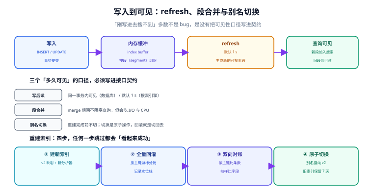

# 索引更新：写完多久能搜到

「刚发的文章搜不到」是搜索工单里的第一大来源。它几乎从来不是同步失败，而是三件不同的事之一：**可见性延迟**（默认近实时）、**重建期间的旧索引**（别名还没切）、**写路径漏了某个字段**。

这一页把「索引从写入到可搜索」的完整链路拆开，并给出重建、对账、回滚的可执行步骤。

## 判据族声明

本页判据族 `FUP-A` ~ `FUP-H`，共 8 条。定义表在第六节。

## 本页不讲什么

- 不讲分区与归档的数据生命周期，归 [分区分表与冷热分离](../../PartitionArchival/index.md)。
- 不讲 CDC 的 binlog 订阅细节，归 [数据同步与 CDC](/docs/DB/CDC/index.md)。
- 不讲缓存的穿透与击穿，归 [分布式缓存](/docs/Backend/DistributedCache/index.md)；本页只讲**搜索结果缓存**这一处的特殊风险。



## 一、三个「多久可见」的口径

先把三个概念分开，混着说就永远对不上账：

| 口径 | 含义 | ES 的表现 | PG 的表现 |
| --- | --- | --- | --- |
| **写后读** | 同一个客户端写完后立刻读，能否看到 | 默认 1 s；`refresh=wait_for` 可等到可见 | **同事务可见**（生成列随行一起写入） |
| **搜索可见** | 其他客户端能否搜到 | 同 `refresh_interval` | 提交后即可见（MVCC） |
| **索引一致** | 搜索索引与主数据是否一致 | 取决于同步链路，可能滞后数分钟 | 同一个事务，天然一致 |

PG 方案在这一点上有结构性优势：`tsvector` 是**生成列**，与业务行在同一个事务里落盘，不存在「主表写了、索引没写」的中间态。代价是写入变慢（每次都要算分词），以及**任何影响分词结果的变更都必须重算全表**。

ES 方案的灵活性来自「可以独立决定刷新频率」：

| `refresh_interval` | 写入吞吐 | 写后可见延迟 | 适用 |
| --- | --- | --- | --- |
| `1s`（默认） | 中 | ≤ 1 s | 常规业务 |
| `30s` | 高 | ≤ 30 s | 日志、可接受延迟的场景 |
| `-1`（关闭） | 最高 | 手动 `_refresh` 才可见 | 批量导入阶段 |
| 查询参数 `refresh=wait_for` | 低（写请求阻塞） | 写完即可见 | 发布后立刻要能搜到的强需求 |

::: warning `refresh=wait_for` 的真实代价
它不是「免费地让写入立刻可见」，而是**让写请求等到下一次 refresh 完成**。批量导入时用它会退化成逐条等待，吞吐可能下降一个数量级。正确用法是：**只有「用户主动发布、且立刻会去搜」的那一条**用 `wait_for`，批量场景一律关掉。
:::

## 二、段合并：看不见的 I/O 开销

ES 的索引由多个**段（segment）**组成，refresh 产生新段，后台 merge 把小段合并成大段。合并期间：

- 查询不阻塞（旧段仍可读）；
- 但会吃大量磁盘 I/O 与 CPU，且**合并完成的瞬间，被删文档才真正从磁盘消失**。

这解释了两个现象：

1. **删除文档后磁盘不降**：软删除只是标记，要等 merge 才回收。`_forcemerge` 可以强制合并，但它对线上集群是重操作，只能在低峰做。
2. **写入高峰后查询变慢**：merge 抢了 page cache，热点 posting 被挤出内存。

PG 侧有同构的现象：`UPDATE` 一行会在表尾写新版本，并使该行的 GIN 条目失效；`VACUUM` 才回收。**更新 `search_vec` 时尤其贵**，因为这会重建该行的全部词项条目——所以「正文可变」的字段要谨慎放进 `tsvector`。

## 三、全量重建：四步，一步都不能省

重建是搜索里最危险的操作：它同时涉及数据、别名和流量。四步的顺序不能换：

```text
① 建新索引（新分析器 / 新映射），不接入流量
② 全量回灌（按主键游标分批，记录水位线）
③ 双向对账（条数 → 抽样字段 → 抽样搜索结果）
④ 原子切换别名（旧索引保留 7 天，可一键切回）
```

### ① 建新索引

新索引必须**从第一天起就带上完整映射**。ES 的动态映射会把一个数字猜成 `long`，之后想改成 `keyword` 只能重建；PG 的生成列表达式一旦建好，改它要 `DROP COLUMN` + 重加（等于重写全表）。

```sql
-- 新列 + 新索引的写法（PG）：先加列，再建索引，最后切换查询
ALTER TABLE kb_doc ADD COLUMN search_vec_v2 tsvector
  GENERATED ALWAYS AS (setweight(to_tsvector('zhcfg_v2', coalesce(title,'')), 'A') ||
                       setweight(to_tsvector('zhcfg_v2', coalesce(body,'')),  'D')) STORED;
CREATE INDEX CONCURRENTLY kb_doc_search_v2_idx ON kb_doc USING gin (search_vec_v2);
```

`CREATE INDEX CONCURRENTLY` 不锁写，但**不能放在事务块里**，且失败会留下 `INVALID` 索引——必须检查 `pg_index.indisvalid` 再继续。

### ② 回灌与水位线

回灌必须**可断点续传**，判据是「中断后重跑不会重复、不会漏」：

```text
游标 = 上一批的最大主键（或 (updated_at, id) 复合游标）
每批 1000 条，提交后记录 progress 表：{job_id, last_key, updated_at}
重跑时从 last_key 之后继续
```

**不要用 offset 翻页做回灌**：回灌过程中数据在变，offset 会漂移，结果是「有的文档灌了两次、有的漏了」。

### ③ 对账：三级，逐级加严

| 级别 | 做法 | 能发现什么 | 代价 |
| --- | --- | --- | --- |
| L1 条数 | `SELECT count(*)` 两边对比 | 大批量漏灌 | 秒级 |
| L2 抽样字段 | 随机 1000 个主键，比对 `updated_at` 与关键字段 | 字段级漏写、类型错 | 分钟级 |
| L3 抽样搜索 | 取 50 条评估集查询，在新旧索引上跑，比对 top 10 交集 | 分析链不一致 | 分钟级 |

三级全过才能切。只做 L1 是最常见的错误：条数对得上，但新索引里 `body` 全是空字符串——因为回灌脚本漏了一个字段映射。

### ④ 别名切换

ES 的别名切换是**原子**的（一次 `_aliases` 请求里 `remove` + `add`），切换瞬间没有「两个索引都不是当前」的窗口：

```json
POST _aliases
{
  "actions": [
    { "remove": { "index": "kb_doc_v1", "alias": "kb_doc" } },
    { "add":    { "index": "kb_doc_v2", "alias": "kb_doc" } }
  ]
}
```

**不要写成两次独立请求**：中间那几十毫秒里，别名可能不存在，所有查询 404。

PG 侧没有别名，等价物是**视图**或**查询里的表名切换**：

```sql
CREATE VIEW kb_doc_search AS SELECT * FROM kb_doc_v2;
-- 切换 = CREATE OR REPLACE VIEW（需要短暂锁，通常毫秒级）
```

## 四、同步链路：三种做法与各自的失效

| 做法 | 一致性 | 复杂度 | 典型失效 |
| --- | --- | --- | --- |
| **同事务生成列**（PG） | 强一致 | 低 | 分词变更要重算全表 |
| **应用内双写** | 最终一致 | 中 | 一边成功一边失败；重试顺序错乱 |
| **CDC 订阅**（binlog / WAL） | 最终一致 | 高 | 位点回退导致重复；DDL 变更未同步 |

双写的两个硬要求：

1. **写失败要能重试且幂等**：用主键 upsert，不要用「先删后插」。
2. **顺序不能乱**：同一文档的两次更新若乱序到达，旧版本会覆盖新版本。解决办法是带版本号（`updated_at` 或单调递增的 `version`），写入时比较版本，旧版本直接丢弃。

CDC 的两个硬要求：

1. **位点要持久化**，且消费端必须幂等（同一事件重复投递的结果一致）。
2. **表结构变更要走同一条通道**：新增可搜字段时，如果 CDC 只同步数据不同步 mapping，新字段永远搜不到。

## 五、删除：软删、硬删与墓碑

搜索结果里出现已删除内容，是仅次于越权的严重问题。三种做法：

| 做法 | 实现 | 优点 | 风险 |
| --- | --- | --- | --- |
| **硬删** | 直接 `DELETE` 文档 | 立即消失 | 大量删除时索引碎片多；误删不可恢复 |
| **软删** | 加 `deleted_at` 字段并过滤 | 可恢复；批量安全 | 过滤条件漏一处就泄漏；索引持续变大 |
| **墓碑 + 定期清理** | 标记删除 + 定时任务批量清 | 兼顾 | 清理任务失败会累积 |

**无论哪种，判据都一样**：删除后的**下一次查询**必须查不到，且**总数**要同步减少。只改列表不改计数，会出现「显示 0 条但总数 1」的诡异状态。

## 六、判据表

| 编号 | 规则 | 违反时的样子 | 怎么验证 |
| --- | --- | --- | --- |
| `FUP-A` | 可见性口径写进契约，并有对应测试 | 写完立刻搜不到被当成 bug | 契约文档有「写后 N 秒可搜到」；测试断言等待后能搜到 |
| `FUP-B` | 重建走「新索引 → 回灌 → 对账 → 切别名」四步 | 重建期间搜索降级或数据错乱 | 重建 runbook 存在，且对账三级都有命令 |
| `FUP-C` | 别名切换是单次原子请求 | 切换瞬间 404 | 切换脚本里只有一次 `_aliases` 调用 |
| `FUP-D` | 回灌可断点续传，用游标不用 offset | 中断重跑后条数对不上 | 进度表有 `last_key`，重跑不重复 |
| `FUP-E` | 对账至少做到 L2（抽样字段） | 条数对但字段全空 | 回灌报告里有 L1/L2 结果 |
| `FUP-F` | 双写幂等且带版本比较 | 旧版本覆盖新版本 | 写入语句是 upsert + 版本条件 |
| `FUP-G` | 删除后查询与计数同时生效 | 「0 条结果但总数 1」 | 删除后断言列表为空且 total 减 1 |
| `FUP-H` | 旧索引保留可回滚窗口（≥ 7 天） | 切换后发现映射错，无法回退 | 旧索引在切换后仍存在，回滚命令可用 |

## 验证方式

```sql
-- 1) FUP-A（PG 方案）：同事务可见——写完立刻能搜到
BEGIN;
INSERT INTO kb_doc (id, tenant_id, title, body, created_at)
VALUES ('t1', 'tenant-a', '看板权限矩阵', '角色与权限的对应关系', now());
SELECT count(*) FROM kb_doc WHERE search_vec @@ websearch_to_tsquery('zhcfg','看板 权限') AND id = 't1';
-- 期望：1（同一事务内可见；这是 PG 方案相对 ES 的核心优势）
ROLLBACK;

-- 2) FUP-E：对账 L1（条数与最大更新时间）
SELECT count(*) AS n, max(updated_at) AS watermark FROM kb_doc;
-- 与回灌进度表的 last_key / 条数对比，必须一致

-- 3) FUP-G：删除后列表与计数同时归零
UPDATE kb_doc SET deleted_at = now() WHERE id = 't1';
SELECT count(*) FROM kb_doc WHERE deleted_at IS NULL AND id = 't1';
-- 期望：0（列表与计数用同一个条件，不能一个查 deleted_at、一个不查）
```

ES 侧的对应验证是一条命令：`GET kb_doc/_count` 与 `GET kb_doc/_search` 的 `hits.total` 必须一致；重建后用 `GET _cat/aliases/kb_doc?v` 确认别名指向新索引。

## 与「代码搜索与索引工程」的分工

| 问题 | 归谁 | 关键差别 |
| --- | --- | --- |
| 段合并、refresh、副本同步 | 本页（检索引擎的索引更新） | 引擎内部机制，调参为主 |
| 「删掉的文档还能搜到」的应用侧兜底 | [代码搜索与索引工程](../../../Tools/CodeSearch/IncrementalUpdate/index.md) | 墓碑 + 存活表反查 + 压缩 |
| 「改一个文件要多久能被搜到」 | 两页都要看 | 引擎侧是 refresh 间隔，应用侧是增量队列 |

**这一页特有的一个坑**：删除在多数检索引擎里是**软删除**——文档被标记进 `.del` 文件（或等价结构），直到段合并才真正释放磁盘与倒排项。于是「删了 100 GB 文档，磁盘没变小」是正常现象，而「删了还能被搜到」要看 `refresh` 是否已经发生（默认 1 s 量级）。两个现象都容易被误判成 bug，判据分别是「段合并进度」与「refresh 间隔」，而不是「删除请求有没有发出去」。

## 参考资料

- [Elasticsearch 9 · Refresh](https://www.elastic.co/guide/en/elasticsearch/reference/current/docs-refresh.html)——`refresh` 参数与 `wait_for` 的语义
- [Elasticsearch 9 · Aliases](https://www.elastic.co/guide/en/elasticsearch/reference/current/aliases.html)——原子切换与 `is_write_index`
- [Elasticsearch 9 · `_forcemerge`](https://www.elastic.co/guide/en/elasticsearch/reference/current/indices-forcemerge.html)——为什么只能在低峰做
- [PostgreSQL 18 · `CREATE INDEX`](https://www.postgresql.org/docs/18/sql-createindex.html)——`CONCURRENTLY` 的限制与 `INVALID` 索引
- [PostgreSQL 18 · Routine Vacuuming](https://www.postgresql.org/docs/18/routine-vacuuming.html)——更新索引列的代价与膨胀回收
- 本站 [数据同步与 CDC](/docs/DB/CDC/index.md) · [分区分表 · 在线归档](/docs/DB/PartitionArchival/OnlineArchive/index.md)
- 相邻：[索引设计](../IndexDesign/index.md) · [性能与容量](../Performance/index.md) · [实战](../Practice/index.md)
