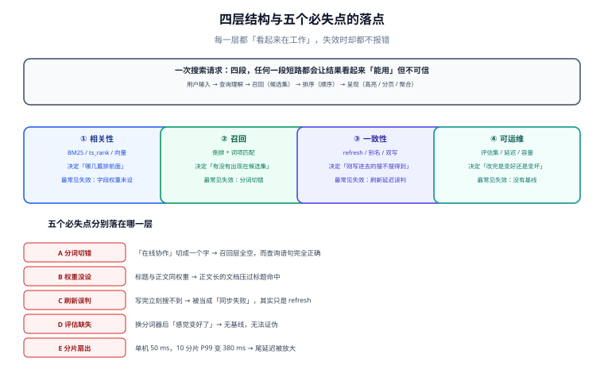

# 总览：四段结构与五个必失点

搜「看板权限」返回了 0 条，而库里明明有一篇标题叫《看板权限矩阵》。这时候大多数人的第一反应是「索引没同步」——实际上四种完全不同的原因都会表现为「0 条」，其中只有一种是同步问题。分清这四种，是本专题其余九页存在的理由。

搜索不是「一条 SQL 换了个写法」，它是一条**四段流水线**：查询理解 → 召回 → 排序 → 呈现。每一段都有自己的失效方式，而**每一段的失效都不抛异常**。

## 判据族声明

本页判据族 `FSO-A` ~ `FSO-H`，共 8 条。定义表在第六节。

## 本页不讲什么

- 不讲分词器怎么配、中文走哪条路线，归 [文本分析](../TextAnalysis/index.md)。
- 不讲倒排索引与 GIN 的内部结构，归 [索引设计](../IndexDesign/index.md)。
- 不讲 BM25 的参数怎么调，归 [相关性排序](../Relevance/index.md)。
- 不讲多租户鉴权怎么实现，那是应用层的事，见 [搜索隔离](/project/Complete/TeamBoard/SearchIsolation/index.md)。



## 一、四段结构：每一段只回答一个问题

| 段 | 回答的问题 | 典型实现 | 失效时的表象 |
| --- | --- | --- | --- |
| **① 查询理解** | 用户打的这串字，到底想找什么？ | 归一化、切词、同义词、纠错 | 「搜不到」但其实是查询被改坏了 |
| **② 召回** | 哪些文档**可能**相关？ | 倒排求交（`tsquery` / ES `bool`） | 候选集里根本没有那篇文档 |
| **③ 排序** | 候选集里谁排前面？ | BM25 / `ts_rank_cd` / 业务加权 | 文档在，但排到第三页 |
| **④ 呈现** | 怎么给用户看？ | 高亮、分页、聚合、去重 | 前端显示的片段是错的，或翻页丢数据 |

四段是**串联**的：召回没救回来的文档，排序再好也没用；排序错了，召回再准用户也看不见。所以定位问题必须**从后往前**：先确认文档在不在候选集里（用最宽的条件单独查一次），再谈顺序。

::: tip 一句话判断
**「搜不到」先查召回，「搜不准」先查排序，「搜得慢」先查呈现。** 三者混在一起查，最常见的结果是把排序问题当成索引问题，重建一遍索引，问题还在。
:::

## 二、搜索与数据库查询的四处结构性差别

把搜索当成「带 `WHERE` 的 `SELECT`」是绝大多数选型错误的起点。四处差别决定了它们不能互相替代：

| 维度 | 数据库查询 | 全文检索 |
| --- | --- | --- |
| **匹配方式** | 精确 / 范围 / 前缀（`LIKE 'x%'` 能走索引，`'%x%'` 不能） | 词项匹配：先切词，再按词项求交，**与原文顺序无关** |
| **结果的「正确」** | 集合语义：命中就是命中，没有「更命中」 | 排序语义：几乎所有结果都「命中」，差别在顺序 |
| **成本模型** | 由行数、索引选择率决定，`EXPLAIN` 能看懂 | 由**词项的 posting 长度**决定，高频词（停用词）才是真正的敌人 |
| **一致性** | 事务内可见（读己之写） | 默认**近实时**：写入到可搜索之间有 1 秒级延迟（可调） |

第三点最容易被低估。搜索里最贵的不是「罕见词」，而是「的」「怎么」「为什么」这类高频词——它们的 posting list 可能覆盖全表。所以分析链里**停用词不是可选项**，而是性能开关。

第四点决定了接口契约：如果产品要求「发布后立刻能搜到」，那么要么用 `refresh=wait_for`（写请求变慢），要么在应用层做「最近 N 分钟的新数据叠加查询」，二选一，没有第三种免费方案。

## 三、五个必失点

这五件事都满足「代码正确、构建通过、监控没红」，但**结果就是错的**。

### 必失点 1：分词切错——查询语句完全正确，候选集为空

PG 内置解析器把连续的 CJK 当一个词：

```sql
SELECT to_tsvector('simple', '在线协作任务看板');
-- '在线协作任务看板':1
```

于是查「协作」时，`to_tsquery('simple','协作')` 与这一整串词项**不相等**，交集为空。而 ES 若索引侧用 `ik_max_word`、查询侧用 `standard`，会出现同构的问题：索引里是 `在线`、`协作`，查询里是 `在线协作`。

**判据**：索引侧与查询侧的分析链必须是**同一个名字的配置**，且有一条自动化断言证明「把文档标题原样当查询词，能召回它自己」。

### 必失点 2：字段权重没设——长文永远压过标题命中

标题是《看板权限》，正文里出现十次「权限」的万字文档，在默认权重下会排在标题精确命中的那篇前面。这不是 BM25 的缺陷，是**没告诉它哪个字段更重要**。

PG 用 `setweight(..., 'A')`，ES 用 `boost`，本质都是给「同一词项在不同字段的命中」一个先验倍数。经验值：标题 `A`、摘要/标签 `B`、正文 `C`、附件文本 `D`；`D` 的权重通常设为 `A` 的 `1/4` 以下。

### 必失点 3：可见性误判——写完立刻搜不到，被当成同步失败

默认 `refresh_interval` 是 1 秒。写完立刻查询，看到旧结果，于是加了一层「写后主动刷索引」或者「双写补偿」，把一个问题变成了两处不一致。

**正确做法**：先把可见性口径写进契约（「写后 1 秒内可搜到」或「写后立即可搜到，写延迟 +5 ms」），再决定实现。数据库原生方案（生成列 + GIN）是**同事务可见**的，天然满足「读己之写」——这正是它在中小规模下比 ES 更省心的原因。

### 必失点 4：没有评估集——「感觉变好了」无法证伪

换分词器、调 `k1`、加同义词，任意一次改动都会让一部分查询变好、另一部分变差。没有评估集时，你只能看到自己随手试的那三个查询——而它们通常恰好是变好的那三个。

**最小可行评估集**：200 条分层抽样的真实查询 + 每条 3 档相关性标注（2 = 完全满足、1 = 部分相关、0 = 不相关）。这个规模能分辨约 6 个百分点的差异（见 [召回评估](../Evaluation/index.md) 的样本量计算）。

### 必失点 5：分片扇出——单机 50 ms，10 分片 P99 变 380 ms

一次查询打到 N 个分片，协调节点要等**最慢的那个**。尾延迟因此被系统性地放大：单分片 P99 是 50 ms 时，10 分片的整体 P99 通常在 150~250 ms 区间（取决于各分片延迟的相关性），而不是 50 ms。

**判据**：压测必须按**目标分片数**跑，不能用单机结果外推。分片数在索引创建时就固定了（ES 的 `number_of_shards` 不可改），这是搜索里少数「事后无法补救」的决定之一。

## 四、要不要上独立搜索引擎

这是本专题最贵的一个决定：引入 ES / OpenSearch 意味着多一套集群、一套权限、一套监控、一套备份，以及**跨系统一致性**。按下面五个问题走：

| 问题 | 若答「是」 | 若答「否」 |
| --- | --- | --- |
| 数据量在千万级以内，且搜索是「辅助功能」？ | 先用**数据库原生**（PG `tsvector` + GIN / MySQL 全文索引） | 继续问下一题 |
| 需要中文分词、同义词、拼写纠错？ | 数据库侧可用扩展（`zhparser` / `pg_jieba` / `pg_trgm`）覆盖大部分需求 | 继续问下一题 |
| 需要多字段加权、复杂过滤、聚合、高亮一体完成？ | 数据库侧可以拼出来，但 SQL 会变得很长 | ES / OpenSearch 的主场 |
| 查询 QPS 在数百以上，且对 P99 有硬要求？ | 独立集群才能做分片与副本隔离 | 数据库原生足够 |
| 团队有人能长期维护集群（容量、分片、mapping 演进、升级）？ | 可以上 | **不要上**：没人维护的搜索集群，半年后就是黑盒 |

::: warning 一个常被忽略的中间选项
**同一套 PG，两种检索并存**：`tsvector` 负责字面召回，`pg_trgm` 负责模糊/拼写容错，再用一条 SQL 做两段式排序。这套组合在百万级文档、百级 QPS 的场景下完全够用，而且**没有跨系统一致性问题**。[实战](../Practice/index.md) 就是按这条路线写的，十条验收全部可以在本地 PG 上跑。
:::

五种方案的对照：

| 方案 | 中文分词 | 相关性可调 | 近实时 | 运维成本 | 适用规模 |
| --- | --- | --- | --- | --- | --- |
| `LIKE '%x%'` | 不需要 | 无 | 同事务 | 极低 | 万级以下，且只做兜底 |
| PG `tsvector` + GIN | 需扩展或 bigram | `ts_rank` + 权重 | 同事务 | 低 | 百万级 |
| PG + `pg_trgm` | 二元组天然支持 | 相似度阈值 | 同事务 | 低 | 百万级，容错场景 |
| Elasticsearch / OpenSearch | 内置 CJK / 插件 | BM25 全参数 + 函数评分 | 1 s 可调 | 高 | 千万级以上 |
| 向量 / 混合检索 | 取决于 embedding | 余弦相似度 + 融合 | 取决于索引 | 高 | 语义召回场景 |

## 五、四种不该做全文检索的场景

反过来，有些需求根本不该用搜索解决，硬上只会得到「一个查不准的搜索框」：

1. **精确编码查询**（订单号、工单号、身份证后四位）：用户要的是**精确匹配**，走 B+ 树索引比倒排快一个量级，而且不会有「搜出相似号码」的困扰。
2. **结构化筛选为主**（按状态 + 时间 + 负责人筛列表）：这是 `WHERE` 的活，加了全文检索反而让索引选择变复杂。
3. **数据量小于一万行**：`ILIKE` 全表扫通常也在 10 ms 内，引入倒排索引的维护成本大于收益。
4. **合规要求「必须能证明没有遗漏」**：倒排索引的召回依赖分词，分词必然有遗漏；需要「一条不漏」时只能用精确条件 + 全量扫描。

## 六、判据表

| 编号 | 规则 | 违反时的样子 | 怎么验证 |
| --- | --- | --- | --- |
| `FSO-A` | 索引侧与查询侧共用同一条分析链 | 「某些词永远搜不到」，两侧都无报错 | 把文档标题原样当查询词，必须召回该文档 |
| `FSO-B` | 每个可搜字段有明确权重档位（A/B/C/D 或 boost） | 长篇正文压过标题精确命中 | 构造「标题命中」与「正文 10 次命中」两篇，前者必须在前 |
| `FSO-C` | 可见性口径写进接口契约 | 写完立刻搜不到 → 被误判为同步失败 | 契约文档里有「写后 N 秒可搜到」；实现有对应测试 |
| `FSO-D` | 存在 ≥ 200 条分层抽样的评估集与基线指标 | 「改完感觉变好了」，无法证伪 | `eval` 目录下有基线文件，且能重算出同一数值 |
| `FSO-E` | 压测按**目标分片数**执行 | 单机 50 ms 外推，上线 P99 超 3 倍 | 压测报告里写明分片数与副本数 |
| `FSO-F` | 停用词表存在且被两侧共用 | 高频词把 posting 全扫一遍，延迟随数据量线性上升 | `EXPLAIN (ANALYZE)` 里高频词查询的 `rows removed` 极大 |
| `FSO-G` | 选型有书面理由（五问决策树过一遍） | 引入 ES 只为「排序好看一点」，无人维护 | 决策记录里能回答五问，且写明运维责任人 |
| `FSO-H` | 命中数口径与分页一致，允许近似 | 页码越翻越空，或计数请求比列表还慢 | 总数与最后一页的实际条数对得上（或明确标注「约」） |

## 验证方式

本页的判据 `FSO-A` / `FSO-B` / `FSO-F` / `FSO-H` 都可以在本地 PostgreSQL 18 上直接验证，不需要任何外部服务。最小验证序列：

```sql
-- 1) 证明「中文整段是一个词项」（FAN-A 的前置事实）
SELECT to_tsvector('simple', '在线协作任务看板');
-- 期望：'在线协作任务看板':1

-- 2) 证明「标题原样当查询词搜不到自己」（FSO-A 的反例）
SELECT to_tsvector('simple', '看板权限矩阵') @@ to_tsquery('simple', '看板权限');
-- 期望：f（字符串不相等，不是前缀匹配）

-- 3) 权重差异（FSO-B）：同一词项在不同字段可以带不同权重
SELECT setweight(to_tsvector('simple', '看板权限'), 'A') ||
       setweight(to_tsvector('simple', '权限 权限 权限'), 'C');
-- 期望：'看板' 带 A，'权限' 同时出现 A 与 C 两种权重（位置由拼接规则顺延）
-- 判读：只要 '权限' 上既有 A 又有 C，就说明「标题命中」与「正文命中」可被区分
```

`FSO-C` / `FSO-D` / `FSO-E` / `FSO-G` 属于流程与契约类判据，验证方式是**文档存在性 + 可复算**：契约里有数字、评估目录有基线文件、压测报告有分片数、决策记录能回答五问。

::: warning 关于「本机实测」的边界
本专题所有**数据库行为**的结论都标注了依据来源：标注「本机实测」的需要 PostgreSQL 实例，标注「按公式计算」的是纯 Python 运算（本页的 BM25 数值、样本量、索引体积估算属于此类）。**没有跑过的一律写「未跑」并说明原因**，不把期望值抄进实测列。
:::

## 参考资料

- [PostgreSQL 18 · Text Search Types](https://www.postgresql.org/docs/18/datatype-textsearch.html)——`tsvector` 的词项与位置结构
- [PostgreSQL 18 · Controlling Text Search](https://www.postgresql.org/docs/18/textsearch-controls.html)——`setweight`、`ts_rank` 的归一化
- [Elasticsearch 9 · Search your data](https://www.elastic.co/guide/en/elasticsearch/reference/current/search-your-data.html)——召回、排序、分页的整体模型
- [Lucene · BM25Similarity](https://lucene.apache.org/core/10_0_0/core/org/apache/lucene/search/similarities/BM25Similarity.html)——k1 / b 的默认值
- 相邻：[文本分析](../TextAnalysis/index.md) · [相关性排序](../Relevance/index.md) · [召回评估](../Evaluation/index.md)
