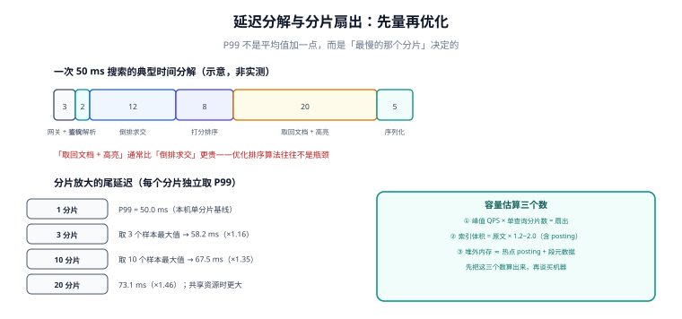

# 性能与容量：先量再优化

搜索的延迟有两个反直觉之处：**你以为最贵的不是最贵的**（排序算法往往不是瓶颈，取回与高亮才是），**你以为的 P99 不是 P99**（分片扇出让「最慢的那个分片」决定了整体尾延迟）。

这一页给一套「先量」的顺序：把 50 ms 拆开看、按目标分片数压测、算清三个容量数，再决定优化哪里。

## 判据族声明

本页判据族 `FPF-A` ~ `FPF-H`，共 8 条。定义表在第六节。

## 本页不讲什么

- 不讲索引结构的空间利用率，归 [索引设计](../IndexDesign/index.md)。
- 不讲缓存穿透/击穿的通用方案，归 [分布式缓存](/docs/Backend/DistributedCache/index.md)；本页只讲搜索缓存的**租户 key 风险**。
- 不讲数据库连接池与容量规划的整体方法论，归 [容量规划与成本治理](/docs/Ops/CapacityCost/index.md)。



## 一、把一次搜索拆成六段

下面是一个**典型分解（示意，非实测）**，用于说明「瓶颈通常在哪」：

| 段 | 量级 | 随什么增长 | 优化手段 |
| --- | --- | --- | --- |
| 网关 + 鉴权 | 2~5 ms | 鉴权方式（本地校验 vs 远程调用） | 令牌本地校验、缓存权限 |
| 查询解析 | 1~3 ms | 查询词数、纠错是否启用 | 纠错只在零结果时启用 |
| **倒排求交** | 5~20 ms | posting 长度（高频词） | 停用词、字段裁剪 |
| 打分排序 | 5~10 ms | 候选集大小（top k 的 k） | 粗排只取 top 200，精排不重查 |
| **取回文档 + 高亮** | 10~25 ms | 返回条数、正文字段大小 | 只取需要的列、高亮基于摘要 |
| 序列化 | 2~6 ms | 返回体积 | 字段裁剪、压缩 |

两个判断：

1. **「倒排求交」通常不是最大头**。除非查询里全是高频词（停用词没配），否则求交是集合运算，很快。
2. **「取回 + 高亮」经常是最大头**。返回 20 条、每条正文 5 KB、还要做片段高亮，这一段的 I/O 与字符串处理远超索引查找。

所以「优化搜索」的第一步不是换引擎或调 `k1`，而是：**少取字段、高亮基于摘要、限制返回条数**。

## 二、尾延迟：分片扇出的真实倍数

一次查询打到 N 个分片，协调节点等**最慢的那个**返回。数学上：

```text
P(整体 ≤ x) = P(单分片 ≤ x)^N
→ 整体 P99 对应单分片的 0.99^(1/N) 分位
```

把单分片延迟按对数正态拟合（P50 = 20 ms、P99 = 50 ms），**本机 Python 计算**：

| 分片数 | 整体 P99 对应的单分片分位 | 整体 P99 | 相对单分片 |
| --- | --- | --- | --- |
| 1 | 99.0% | 50.0 ms | 1.00× |
| 3 | 99.67% | 58.2 ms | 1.16× |
| 10 | 99.90% | 67.5 ms | 1.35× |
| 20 | 99.95% | 73.1 ms | 1.46× |

这张表的假设是**各分片延迟相互独立**。现实中它们共享磁盘、网络、JVM GC 与 page cache，相关性会让放大更明显：一次 GC 停顿会让所有分片同时变慢，整体 P99 可能到 1.5~2.5 倍。

**结论**：分片数不是「越多越并行」，它同时是**尾延迟的乘数**。10 分片是常见起点，20 以上要非常谨慎；副本能提升可用性与读吞吐，但**不降低单次查询的扇出**（协调节点仍然只问每个分片的主或某个副本）。

::: danger 用单机结果外推线上 P99
「本地 20 ms，线上 10 分片，所以 P99 大约 25 ms」——这个推算漏掉了三件事：扇出放大、协调节点合并、网络抖动。

正确做法：**压测必须按目标分片数 + 目标副本数执行**，且压测数据量要与生产同量级（posting 长度直接决定求交成本）。分片数在索引创建时固定，事后改只能重建——这是搜索里少数「不可补救」的决定。
:::

## 三、三档缓存：命中的位置决定了收益

| 档 | 位置 | 命中什么 | 典型收益 | 风险 |
| --- | --- | --- | --- | --- |
| **① page cache** | 操作系统 | 索引文件的热页 | 最大（几乎免费） | 受内存总量与 merge 干扰 |
| **② 缓冲池 / 堆内缓存** | PG `shared_buffers` / ES 堆 | posting 与段元数据 | 中 | 配置不当导致频繁换出 |
| **③ 应用层结果缓存** | Redis / 本地 | 整个查询的 top N | 高（跳过全部计算） | **租户串号、结果过期** |

第三档最有效，也最危险。搜索结果的缓存 key 必须包含**所有影响结果的维度**：

```text
search:{tenant_id}:{normalized_query}:{filters_hash}:{sort}:{page}:{page_size}:{acl_version}
```

少一个维度就是数据泄漏：

| 漏掉的维度 | 后果 |
| --- | --- |
| `tenant_id` | 甲租户搜到乙租户的文档（最严重） |
| `filters_hash` | 加了筛选条件仍返回未筛选结果 |
| `acl_version` | 权限被回收后，用户仍能看到旧结果（缓存未失效） |
| `page` | 第二页返回第一页内容 |

`acl_version` 这一条最容易被忽略：权限变更时若只清了「文档缓存」而没清「搜索结果缓存」，被移出项目的人还能在缓存 TTL 内搜到内容。**搜索缓存的 TTL 应短于权限变更的期望生效时间**，或者权限变更时按 `tenant_id` 前缀批量失效。

## 四、深分页：两种引擎，同一个坑

| 方案 | ES | PG |
| --- | --- | --- |
| `from + size` | 默认上限 10,000（`index.max_result_window`），超过报错 | `OFFSET` 越大越慢（要跳过 N 行） |
| 游标 | `search_after` + `sort` 上的唯一键 | keyset 分页：`WHERE (sort_key, id) > (?, ?)` |
| 导出 | `scroll` / PIT（point in time） | 服务端游标 + 批量取 |

**判据只有一条**：翻到第 200 页的耗时，不应显著高于第 1 页。若高，说明还在用 offset 类分页。

跳过 `n` 行的代价是线性的：`OFFSET 100000` 意味着放弃 10 万行。搜索场景下这个代价还包括**每一行都要算分**（如果排序表达式里有打分函数），所以往往比普通列表分页更贵。

## 五、容量估算：三个数

| 数 | 公式 | 用途 |
| --- | --- | --- |
| **扇出** | 峰值 QPS × 单查询分片数 | 决定集群需要多少核（每次查询会在 N 个分片上各跑一次） |
| **索引体积** | 文档数 × 平均词项数 × 每条目字节（见 [索引设计](../IndexDesign/index.md)） | 决定磁盘与 page cache 命中率 |
| **热集内存** | 热点 posting + 段元数据 | 决定 `shared_buffers` / 堆大小 |

一个常被忽略的换算：**QPS × 分片数 = 集群内部的查询次数**。100 QPS、10 分片，就是每秒 1000 次分片级查询。按「100 QPS 很轻松」去选机器，通常会在压测时发现 CPU 打满。

## 六、判据表

| 编号 | 规则 | 违反时的样子 | 怎么验证 |
| --- | --- | --- | --- |
| `FPF-A` | 延迟按六段拆开测过，知道最大头在哪 | 盲目优化排序算法，总延迟不变 | 有分段耗时埋点或 profile 结果 |
| `FPF-B` | 压测按目标分片数与副本数执行 | 上线 P99 是压测的 2 倍以上 | 压测报告写明分片/副本/数据量 |
| `FPF-C` | 搜索结果缓存 key 含租户、筛选、权限版本 | 跨租户串结果或权限回收不生效 | key 构造集中在一处，有单测覆盖各维度 |
| `FPF-D` | 翻页用游标，不用深 offset | 第 200 页比第 1 页慢 10 倍 | 分页实测：深页耗时 ≤ 首页 2 倍 |
| `FPF-E` | 返回字段按需取，高亮基于摘要 | 单次响应几百 KB | 响应体大小有上限告警 |
| `FPF-F` | 高频词有停用词或长度上限 | 某些查询延迟随数据量线性上升 | 最高频查询的 `EXPLAIN` 里 `rows removed` 可控 |
| `FPF-G` | 容量按「扇出 = QPS × 分片」估算 | CPU 打满但 QPS 不高 | 容量文档里有这个乘法 |
| `FPF-H` | 慢查询有采集与阈值 | 用户投诉慢，日志里查不到 | 有 > 200 ms 的搜索日志与采样 |

## 验证方式

```sql
-- 1) FPF-D：深分页的代价（PG 侧，offset 越大越慢）
EXPLAIN (ANALYZE, BUFFERS)
SELECT id, title FROM kb_doc
WHERE search_vec @@ websearch_to_tsquery('zhcfg','看板')
ORDER BY ts_rank_cd(search_vec, websearch_to_tsquery('zhcfg','看板')) DESC
OFFSET 100000 LIMIT 20;
-- 判读：Buffers 的 shared hit/read 与 actual time 随 OFFSET 线性增长

-- 对照：keyset 分页
EXPLAIN (ANALYZE, BUFFERS)
SELECT id, title FROM kb_doc
WHERE search_vec @@ websearch_to_tsquery('zhcfg','看板')
  AND (rank_key, id) > (12345.6, 'c-000123')
ORDER BY rank_key, id
LIMIT 20;
-- 期望：耗时与页码无关

-- 2) FPF-F：高频词的 posting 规模（用词频近似）
SELECT count(*) FROM kb_doc WHERE search_vec @@ to_tsquery('zhcfg','的');
-- 若这个数接近总行数，说明停用词没配

-- 3) FPF-H：慢查询采集
SELECT query, calls, mean_exec_time, max_exec_time
FROM pg_stat_statements
WHERE query ILIKE '%search_vec%'
ORDER BY mean_exec_time DESC LIMIT 10;
```

ES 侧对应的是 `profile: true` 查看各阶段耗时，以及 `GET _nodes/stats/indices/search` 里的 `query_time` 与 `fetch_time` 比例——**这个比例能直接告诉你瓶颈在求交还是在取回**。

## 参考资料

- [Elasticsearch 9 · `search_after`](https://www.elastic.co/guide/en/elasticsearch/reference/current/paginate-search-results.html)——深分页的游标方案与 `max_result_window`
- [Elasticsearch 9 · Profile API](https://www.elastic.co/guide/en/elasticsearch/reference/current/search-profile.html)——分阶段耗时
- [PostgreSQL 18 · `pg_stat_statements`](https://www.postgresql.org/docs/18/pgstatstatements.html)——按平均耗时定位慢查询
- [PostgreSQL 18 · `EXPLAIN`](https://www.postgresql.org/docs/18/using-explain.html)——`BUFFERS` 与 `ANALYZE` 的读法
- 本站 [容量规划与成本治理](/docs/Ops/CapacityCost/index.md) · [分布式缓存](/docs/Backend/DistributedCache/index.md)
- 相邻：[索引设计](../IndexDesign/index.md) · [索引更新](../IndexUpdate/index.md) · [实战](../Practice/index.md)
