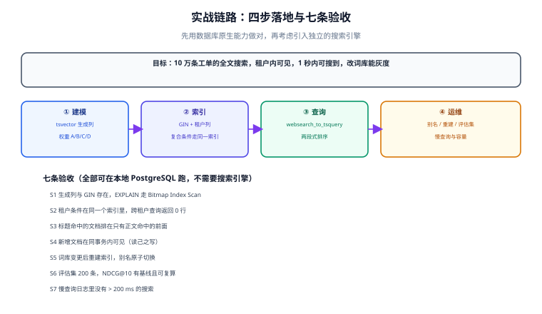

# 实战：10 万工单的搜索链路

这一页把前八页的结论落成一条**可以照着做完**的链路：10 万条工单、按租户隔离、标题与正文可搜、写完 1 秒内可搜到、第一页结果「像人排的」。

技术选型是 **PostgreSQL 原生全文检索**（`tsvector` 生成列 + GIN）。理由不是「ES 不好」，而是这个规模下引入独立集群的收益小于成本：多一套集群、一套权限、一套备份，以及跨系统一致性——而这些成本在 10 万条数据上是纯粹的开销。什么时候该换成 ES，判据在 [总览](../Overview/index.md) 第四节。

## 判据族声明

本页判据族 `FPR-A` ~ `FPR-H`，共 8 条。定义表在第八节。

## 本页不讲什么

- 不讲分词器怎么装、怎么选，归 [文本分析](../TextAnalysis/index.md)。
- 不讲 B+ 树与 GIN 的内部结构，归 [索引设计](../IndexDesign/index.md)。
- 不讲租户鉴权与 RLS 的完整实现，归 [看板搜索隔离](/project/Complete/TeamBoard/SearchIsolation/index.md) 与 [多租户设计](/project/Complete/TeamBoard/MultiTenancy/index.md)。
- 不讲评估集的标注流程，归 [召回评估](../Evaluation/index.md)。



## 一、先定口径（六项，缺一项后面全要返工）

| 口径 | 本实战的取值 | 定错的后果 |
| --- | --- | --- |
| 搜哪些字段 | `title`（A）、`customer_name`（B）、`body`（D） | 全字段同权重 → 长正文压过标题 |
| 谁的数据 | 同一 `tenant_id` 内 | 漏租户条件 → 跨租户泄漏 |
| 写后多久可搜 | **同事务可见**（读己之写） | 加了无谓的等待与重试 |
| 返回多少 | 每页 20，最多翻到 200 页（游标） | 深 offset → 越翻越慢 |
| 排序 | `ts_rank_cd` 相关性 + 状态/时效加权 | 只看相关性 → 已关闭工单排在待处理之前 |
| 零结果怎么办 | 放宽为 `OR` 并显式标注 | 静默放宽 → 用户以为系统理解了自己 |

## 二、表结构与生成列

```sql
-- ① 全文检索配置：二选一，写下你选的那条
--    路线 A（有 zhparser / pg_jieba 扩展）：
--      CREATE TEXT SEARCH CONFIGURATION zhcfg (PARSER = zhparser);
--      ALTER TEXT SEARCH CONFIGURATION zhcfg ADD MAPPING FOR n,v,a,i,e,l WITH simple;
--    路线 B（无扩展，用 simple 解析器 + 应用层预切分）：
--      CREATE TEXT SEARCH CONFIGURATION zhcfg (COPY = simple);
--    本页 DDL 统一引用 zhcfg，两条路线都能跑。

CREATE TABLE ticket (
    id             uuid PRIMARY KEY DEFAULT gen_random_uuid(),
    tenant_id      text        NOT NULL,
    title          text        NOT NULL,
    customer_name  text        NOT NULL DEFAULT '',
    body           text        NOT NULL DEFAULT '',
    status         text        NOT NULL DEFAULT 'open',   -- open / doing / closed
    priority       smallint    NOT NULL DEFAULT 2,        -- 1 高 2 中 3 低
    updated_at     timestamptz NOT NULL DEFAULT now(),
    deleted_at     timestamptz,
    search_vec     tsvector GENERATED ALWAYS AS (
        setweight(to_tsvector('zhcfg', coalesce(title, '')),         'A') ||
        setweight(to_tsvector('zhcfg', coalesce(customer_name, '')), 'B') ||
        setweight(to_tsvector('zhcfg', coalesce(body, '')),          'D')
    ) STORED,
    CONSTRAINT ticket_title_not_blank CHECK (length(btrim(title)) > 0)
);

-- ② 两个索引，各管一类查询
CREATE INDEX ticket_search_idx   ON ticket USING gin (search_vec);
CREATE INDEX ticket_tenant_idx   ON ticket (tenant_id, updated_at DESC) WHERE deleted_at IS NULL;

-- ③ 生成列的表达式必须是 IMMUTABLE；zhcfg 绑定的是 immutable 的解析链
--    若建表报 "generation expression is not immutable"，说明配置链里有非 immutable 组件
```

三个设计决定与它们的理由：

| 决定 | 理由 |
| --- | --- |
| `tenant_id` **不进** `tsvector`，用独立 B-tree | 租户是等值条件，`BitmapAnd` 合并两个索引足够；拼进词项会让每个文档多一个词项，且租户改名会失效 |
| 部分索引 `WHERE deleted_at IS NULL` | 列表查询永远带这个条件；部分索引更小，且天然排除了已删除行 |
| `priority` 不进索引 | 它不是过滤条件，只参与排序；进索引只会增加写放大 |

## 三、查询：两段式 + 游标

### 第一段：召回与粗排（取 top 200）

```sql
WITH q AS (
    SELECT websearch_to_tsquery('zhcfg', $1) AS tsq
)
SELECT t.id, t.title, t.status, t.priority, t.updated_at,
       ts_rank_cd('{0.1, 0.2, 0.4, 1.0}', t.search_vec, q.tsq) AS rel
FROM ticket t, q
WHERE t.tenant_id = $2
  AND t.deleted_at IS NULL
  AND t.search_vec @@ q.tsq
ORDER BY rel DESC, t.updated_at DESC, t.id
LIMIT 200;
```

三个细节：

1. **权重数组是 `{D, C, B, A}`**，`{0.1,0.2,0.4,1.0}` 表示 A 档（标题）权重 1.0 最高。写反了排序就整体颠倒（见 [索引设计](../IndexDesign/index.md)）。
2. **`ORDER BY` 里必须带上唯一键 `t.id`**，否则相关度相同的行顺序不稳定，游标分页会漏行或重复。
3. **`LIMIT 200` 是精排的输入规模**，不是最终返回条数。200 的选择依据：精排要读业务字段，200 条的额外开销在毫秒级，而更小的候选集会让业务加权「没得选」。

### 第二段：业务加权与分页

```sql
WITH q AS (
    SELECT websearch_to_tsquery('zhcfg', $1) AS tsq
),
coarse AS (
    -- 第一段：召回 + 粗排，取 200 条
    SELECT t.id, t.title, t.status, t.priority, t.updated_at,
           ts_rank_cd('{0.1, 0.2, 0.4, 1.0}', t.search_vec, q.tsq) AS rel
    FROM ticket t, q
    WHERE t.tenant_id = $2
      AND t.deleted_at IS NULL
      AND t.search_vec @@ q.tsq
    ORDER BY rel DESC, t.updated_at DESC, t.id
    LIMIT 200
),
scored AS (
    -- 第二段：业务加权（不重新查库，只在上一步的 200 条上算）
    SELECT *,
           rel
           + CASE status WHEN 'open' THEN 0.30 WHEN 'doing' THEN 0.15 ELSE 0 END
           + CASE priority WHEN 1 THEN 0.20 WHEN 2 THEN 0.0 ELSE -0.05 END
           + 0.10 * exp(-extract(epoch FROM now() - updated_at) / (30 * 86400)) AS final_score
    FROM coarse
)
SELECT id, title, status, updated_at, final_score
FROM scored
WHERE $3::numeric IS NULL OR (final_score, id) < ($3, $4)   -- 游标：首页传 NULL
ORDER BY final_score DESC, id DESC
LIMIT 20;
```

::: danger 业务加权的量级必须与相关性同量级
`ts_rank_cd` 在 3 个查询词、标题命中的情况下得分通常在 `0.1~1.0` 区间（归一化后更小）。上面给的 `+0.30`（待处理）、`+0.20`（高优先级）是**同量级**的微调；如果写成 `+3.0`，那就不是「排序」而是「分组」——所有待处理工单会整体压过已关闭的高相关工单。

判断方法：**关掉业务因子跑一遍，排序是否仍然合理**。若关掉后完全不可用，说明相关性本身没做好，加业务因子只是在掩盖问题。
:::

### 分页：游标而不是 offset

```sql
-- 首页
SELECT ... ORDER BY final_score DESC, id DESC LIMIT 20;
-- 下一页：把上一页最后一行的 (final_score, id) 传进来
WHERE (final_score, id) < ($last_score, $last_id)
```

**为什么不给 offset**：`ts_rank_cd` 要对每一行算分，`OFFSET 100000` 意味着算 10 万次分再丢掉——延迟随页码线性上升（见 [性能与容量](../Performance/index.md) 第四节）。

## 四、重建：加一列，不动旧列

需求变更是常态（换分词器、加字段）。**永远不要原地改生成列**，而是加一列、建新索引、双写、切换：

```sql
-- ① 新列（新分析器 / 新字段组合）
ALTER TABLE ticket ADD COLUMN search_vec_v2 tsvector GENERATED ALWAYS AS (
    setweight(to_tsvector('zhcfg_v2', coalesce(title,'')),         'A') ||
    setweight(to_tsvector('zhcfg_v2', coalesce(customer_name,'')), 'B') ||
    setweight(to_tsvector('zhcfg_v2', coalesce(body,'')),          'D')
) STORED;

-- ② 并发建索引（不能放在事务块里）
CREATE INDEX CONCURRENTLY ticket_search_v2_idx ON ticket USING gin (search_vec_v2);

-- ③ 校验索引有效（CONCURRENTLY 失败会留下 INVALID 索引）
SELECT indexrelid::regclass, indisvalid FROM pg_index
WHERE indexrelid = 'ticket_search_v2_idx'::regclass;
-- 期望：indisvalid = t；若为 f，DROP 后重建

-- ④ 切换查询（应用层配置项 or 视图）
CREATE OR REPLACE VIEW ticket_search AS SELECT * FROM ticket;
-- 应用改读 search_vec_v2，观察 24 小时，再 DROP 旧列与旧索引
```

`ADD COLUMN ... GENERATED ... STORED` 会**重写整表**（10 万行在秒级到分钟级，取决于磁盘），期间持有 `ACCESS EXCLUSIVE` 锁。生产上要在低峰做，或用「加普通列 + 分批回填 + 加触发器」的三步法。

## 五、S1~S10 验收序列

十条按依赖顺序排列，前六条是**纯数据库断言**，不需要应用服务：

| 编号 | 验收内容 | 命令要点 | 预期 |
| --- | --- | --- | --- |
| S1 | 表与索引存在，且类型正确 | 查 `pg_indexes` 与 `pg_am` | `ticket_search_idx` 用 `gin` |
| S2 | 生成列随行写入 | 插入一行后查 `search_vec` | 非空，且包含标题词项 |
| S3 | 查询走 GIN | `EXPLAIN (ANALYZE, BUFFERS)` | `Bitmap Index Scan on ticket_search_idx` |
| S4 | 标题命中排在正文命中之前 | 造两行对照，按 `ts_rank_cd` 排序 | 标题命中者 `rel` 更大 |
| S5 | 租户隔离 | 用 `tenant_id='B'` 查 A 的数据 | 0 行；`EXPLAIN` 里两个索引都被用上 |
| S6 | 删除后列表与计数同时归零 | 软删后查列表与 `count(*)` | 都为 0 |
| S7 | 写后立即可搜（读己之写） | 同事务插入 + 查询 | 命中（PG 方案的核心优势） |
| S8 | 深页与首页耗时同量级 | 游标翻到第 200 页 | 深页 ≤ 首页 2 倍 |
| S9 | 重建后新旧结果一致 | 抽样 50 条查询比 top 10 交集 | 交集 ≥ 8 |
| S10 | 零结果降级有标注 | 造一个零结果查询 | 降级后有条目，且响应带标记 |

::: warning 本页验收的执行状态
本页的 SQL 与命令按 PostgreSQL 18 语法编写，**但本次写作环境没有可用的 PostgreSQL 实例（容器运行时不可用）**，因此 S1~S10 **全部标注为「未跑」**，不把预期值抄成实测结果。
解除条件：在任一 PG 18.x 实例上按顺序执行第五节命令，把真实读数填回本节表格。
纯计算类结论（BM25 数值、NDCG、样本量、体积估算）已在对应页面注明为「本机 Python 计算」，可复算。
:::

## 六、可选的第二路召回

字面检索覆盖不了「说法不同」的查询。低成本的做法是加一路 `pg_trgm` 近似召回，再与主路合并：

```sql
-- 只在主路零结果时启用
SELECT id, title, similarity(title, $1) AS sim
FROM ticket
WHERE tenant_id = $2 AND deleted_at IS NULL AND title % $1
ORDER BY sim DESC
LIMIT 20;
```

代价：`pg_trgm` 的 GIN 索引比 `tsvector` 的更大（三元组数量约是词项数的 3 倍），写入也贵。所以**只在零结果时走这条路**，不要两路都常开——两路常开会让你同时承担两份索引成本与两套排序口径。

## 七、上线前的运维三件事

| 事 | 做法 | 不做的后果 |
| --- | --- | --- |
| **慢查询采集** | `pg_stat_statements` 按 `mean_exec_time` 排序，阈值 200 ms 告警 | 用户投诉慢时无法定位 |
| **索引膨胀监控** | `pg_stat_user_indexes` 的 `idx_scan` 长期为 0 的索引要评估删除 | 无用的 GIN 拖慢每次写入 |
| **重建演练** | 每季度在预发跑一次完整重建 + 对账 | 真需要重建时发现脚本跑不通 |

## 八、判据表

| 编号 | 规则 | 违反时的样子 | 怎么验证 |
| --- | --- | --- | --- |
| `FPR-A` | 六项口径全部写进文档 | 分词器换了三次，每次都说「需求变了」 | 文档里有第一节那张表，且有人签字 |
| `FPR-B` | 生成列只在 `IMMUTABLE` 链上 | 建表失败，或升级后数据不一致 | 建表成功 + `pg_proc.provolatile='i'` |
| `FPR-C` | 权重数组顺序为 `{D,C,B,A}` 且标题权重最高 | 排序整体颠倒 | S4 通过 |
| `FPR-D` | 排序带唯一键，分页用游标 | 翻页漏行/重复 | S8 通过，且换页结果无交集 |
| `FPR-E` | 租户条件在 `WHERE` 里，不依赖应用过滤 | 跨租户泄漏 | S5 通过 |
| `FPR-F` | 业务加权与相关性同量级 | 待处理工单整体压过高相关 | 关掉业务因子后排序仍合理 |
| `FPR-G` | 重建走「加列 → 并发索引 → 校验 → 切换」 | 重建期间锁表或结果错乱 | S9 通过，且 `indisvalid = t` |
| `FPR-H` | 删除后列表与计数同时生效 | 「0 条但总数 1」 | S6 通过 |

## 参考资料

- [PostgreSQL 18 · Full Text Search](https://www.postgresql.org/docs/18/textsearch.html)——`tsvector`、`tsquery`、`ts_rank_cd`
- [PostgreSQL 18 · GIN Indexes](https://www.postgresql.org/docs/18/gin.html)——`fastupdate` 与并发建索引
- [PostgreSQL 18 · Generated Columns](https://www.postgresql.org/docs/18/ddl-generated-columns.html)——`STORED` 与 `IMMUTABLE` 限制
- [PostgreSQL 18 · `CREATE INDEX`](https://www.postgresql.org/docs/18/sql-createindex.html)——`CONCURRENTLY` 的失败与 `INVALID` 索引
- [PostgreSQL 18 · `pg_trgm`](https://www.postgresql.org/docs/18/pgtrgm.html)——近似召回的第二路
- 本站 [看板搜索隔离](/project/Complete/TeamBoard/SearchIsolation/index.md) · [多租户设计](/project/Complete/TeamBoard/MultiTenancy/index.md) · [分区分表 · 跨分区查询](/docs/DB/PartitionArchival/CrossPartition/index.md)
- 相邻：[索引设计](../IndexDesign/index.md) · [索引更新](../IndexUpdate/index.md) · [性能与容量](../Performance/index.md)
