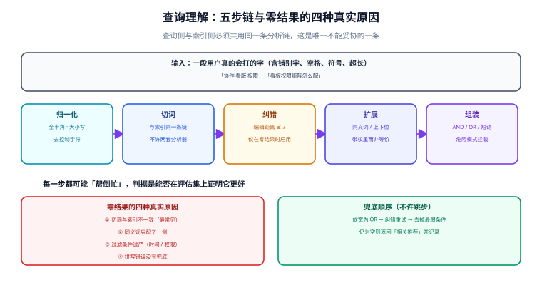

# 查询理解：纠错、扩展与兜底

用户输入的不是「查询」，是「一串想找东西的字」。中间隔着一层翻译：把「看版权限怎么配」翻译成 `看板 AND 权限`，把「看版」翻译回「看板」，把「协作工具」扩展成「协作 OR 协同 OR 看板」。

这一层最容易做过头：加得越多，查询越偏离原意，而**每一步都「看起来更智能」**。所以本页的写法是「先给判据，再给手段」——任何一步只有在评估集上证明了更好，才允许上线。

## 判据族声明

本页判据族 `FQU-A` ~ `FQU-H`，共 8 条。定义表在第六节。

## 本页不讲什么

- 不讲分析链本身（分词、归一化在索引侧的实现），归 [文本分析](../TextAnalysis/index.md)。
- 不讲排序公式，归 [相关性排序](../Relevance/index.md)。
- 不讲意图识别模型的训练，那属于 NLP 模型层；本页只讲「规则能覆盖的 80%」。



## 一、五步链

```text
输入 → ① 归一化 → ② 切词 → ③ 纠错（可选） → ④ 扩展（可选） → ⑤ 组装查询
```

| 步 | 做什么 | 不做会怎样 | 做过头会怎样 |
| --- | --- | --- | --- |
| ① 归一化 | 全半角、大小写、去控制字符、截断超长 | 复制粘贴的查询不命中 | 几乎不会过头 |
| ② 切词 | **必须与索引侧同一条链** | 词项对不上，0 条 | —— |
| ③ 纠错 | 编辑距离 / trigram 近似匹配 | 错别字查询全空 | 把正确的专有名词「纠正」成常用词 |
| ④ 扩展 | 同义词、上下位词、缩写展开 | 说法不同就搜不到 | 召回爆炸，精确率下降 |
| ⑤ 组装 | `AND` / `OR` / 短语 / 权重 | 语义错（把「A 且 B」当成「A 或 B」） | 查询过于复杂，规划器选错计划 |

### ③ 纠错：只在零结果时启用

这是本页最重要的一条工程建议：

```text
if (原始查询的结果数 > 0) {
    不纠错，按原查询返回
} else {
    纠错后重试
}
```

理由：纠错必然有假阳性。若每次查询都纠错，「PostgreSQL」会被「纠正」成某个更常见的中文词，而用户其实打对了。**只在零结果时纠错**，把假阳性的影响限制在「本来也没有结果」的那部分查询上。

PG 侧的近似匹配有现成工具：

```sql
CREATE EXTENSION IF NOT EXISTS pg_trgm;

-- 相似度（0~1），用于「看版」→「看板」
SELECT similarity('看版', '看板');          -- 二元组重合度
SELECT word_similarity('看版', '看板 权限');  -- 词级相似度

-- 阈值查询（% 运算符走 GIN/GiST 的 trgm 索引）
SELECT title FROM kb_doc WHERE title % '看版';
```

ES 侧对应的是 `fuzzy` 查询（基于编辑距离，`fuzziness: "AUTO"`）与 `term suggester`。两者的共同点是**都要算候选词**，所以都贵——又一次说明「只在零结果时启用」是必要的。

::: danger 纠错的三个必踩坑
1. **专有名词被纠正**：产品名、代码标识符、人名。解法是维护一份「不纠错词表」，命中即跳过纠错。这份表必须与业务词表同源，不能靠代码里写死几个。
2. **纠正后仍然 0 条**：多发生在「错字在停用词位置」或「纠错后仍不符合 `AND` 语义」。解法是纠错后把 `AND` 放宽成 `OR`，并明确标注「已放宽条件」。
3. **静默纠正**：用户打了「看版」，系统悄悄换成「看板」，用户以为系统理解了自己。**必须显式提示**「已按『看板』搜索」，否则用户永远学不会正确写法，词表也永远补不上。
:::

### ④ 扩展：带权重，不带等价

同义词扩展的两种写法，效果差别很大：

| 写法 | 含义 | 后果 |
| --- | --- | --- |
| `看板 OR 面板`（等价） | 两者同权 | 标题写「面板」的文档与写「看板」的同分 |
| `看板^2 OR 面板^1`（带权） | 原词更重要 | 原词命中的排在前面 |

PG 侧可以在构造 `tsquery` 时用权重运算符表达（`ts_rank` 的权重数组只作用于**文档字段**，不作用于查询词，所以查询词加权要在应用层做两段查询再合并得分，或者直接用 `ts_rank_cd` 的字段权重配合「查询词分组」实现）。这一点必须写清楚：**查询词加权在 PG 原生 FTS 里没有直接语法**，需要应用层合并，或使用第三方扩展。

### ⑤ 组装：AND 还是 OR

| 场景 | 组装 | 理由 |
| --- | --- | --- |
| 短查询（≤ 3 个词） | `AND` | 词少，用户意图明确 |
| 长查询（自然语言） | 先 `AND`，零结果再降级为 `OR` | 长查询里必然有冗余词 |
| 引号包裹 | 短语查询 `phraseto_tsquery` | 用户显式要求精确 |
| 带 `-` 前缀 | 排除（`!`） | 符合命令行直觉 |
| 带 `site:` 之类语法 | 解析成过滤条件，不进入全文 | 避免被当普通词项 |

PG 的 `websearch_to_tsquery` 已经实现了上述大部分规则（支持引号短语、`or`、`-` 排除），**优先用它，不要自己拼 `to_tsquery`**——手拼容易在用户输入含 `&`、`|`、`!` 时直接报语法错误。

## 二、零结果的四种真实原因

「搜不到」不是一个问题，是四类问题，处理方式完全不同：

| 原因 | 判别方法 | 处理 |
| --- | --- | --- |
| **① 切词不一致** | 用 `ts_debug` 看查询词切片，与索引词项比对 | 统一分析链（见 [文本分析](../TextAnalysis/index.md)） |
| **② 同义词只有一侧** | 把同义词表逐条当查询词试 | 补齐映射，且加在查询侧 |
| **③ 过滤条件过严** | 去掉 `WHERE` 里的其他条件再查 | 放宽条件或提示「已限定在 XX 范围内」 |
| **④ 拼写错误无兜底** | 人工看查询日志 | 零结果时启用纠错 |

**分诊顺序不能乱**：先查 ①（最常见、最便宜），再查 ③（一条 `EXPLAIN` 就能看出），最后才怀疑 ②④。反过来先上纠错，会把 ① 的问题掩盖成「纠错生效了但结果还是不对」。

## 三、危险查询：必须在入口拦住

搜索框是最容易被构造异常输入的地方。四类必须在**进入检索之前**拦掉：

| 类型 | 例子 | 后果 | 拦截 |
| --- | --- | --- | --- |
| 超长输入 | 10 KB 的粘贴文本 | 切出上千词项，查询计划爆炸 | 截断到 200 字符，并提示 |
| 纯通配 / 前缀 | `*`、`a*`、`%` | 退化成全表扫 | 长度 < 2 的通配直接拒绝 |
| 语法字符 | `&`、`\|`、`!`、`:` | `to_tsquery` 直接抛语法错 | 用 `websearch_to_tsquery`（它会容错） |
| 深层嵌套 | `((((((a))))))` | 解析栈过深 | 限制括号深度与词项数 |

ES 侧还有一类：**正则与脚本查询**。生产环境应关闭 `script` 与 `regexp` 的对外暴露，或限制其长度与超时。

## 四、短查询与长查询要分开处理

| 维度 | 短查询（1~3 词） | 长查询（自然语言） |
| --- | --- | --- |
| 用户意图 | 明确，就是要找这个词 | 模糊，可能在描述一个问题 |
| 组装策略 | `AND`，严格 | 先 `AND`，零结果降 `OR` |
| 纠错 | 谨慎（短词纠错假阳性高） | 可以放宽 |
| 扩展 | 少量同义词 | 可加停用词过滤与短语识别 |
| 排序 | 强依赖字段权重 | 强依赖覆盖度（命中词数） |

**用同一个策略处理两类查询，必然有一类体验差**。分流依据可以简单到「词项数 ≤ 3」——不需要模型。

## 五、判据表

| 编号 | 规则 | 违反时的样子 | 怎么验证 |
| --- | --- | --- | --- |
| `FQU-A` | 归一化在查询侧与索引侧一致 | 复制粘贴的查询不命中 | 同一串文本两侧词项流相同 |
| `FQU-B` | 纠错只在零结果时启用 | 正确专有名词被改坏 | 有结果的查询不触发纠错（日志可证） |
| `FQU-C` | 纠错结果必须显式提示用户 | 用户不知道系统改了词 | 响应里有 `corrected_from` 字段 |
| `FQU-D` | 同义词带权重，不是等价集合 | 扩展词命中的排在原词前面 | 配置里有方向与权重 |
| `FQU-E` | 长查询零结果时降级为 `OR`，并标注 | 长句永远 0 条 | 降级逻辑有单测，响应有标记 |
| `FQU-F` | 入口拦截超长 / 纯通配 / 语法字符 | 一次粘贴把数据库打满 | 有长度上限与字符白名单 |
| `FQU-G` | 短查询与长查询走不同组装策略 | 一类查询体验明显更差 | 分流阈值写在配置里，有对照数据 |
| `FQU-H` | 使用 `websearch_to_tsquery` 而非手拼 `to_tsquery` | 用户输入 `&` 直接 500 | 代码里没有字符串拼接 `tsquery` |

## 验证方式

```sql
-- 1) FQU-A：两侧词项流一致（同配置必然一致；不一致说明配置不同）
SELECT to_tsvector('simple','看板　权限') = to_tsvector('simple','看板　权限');
-- 期望：t

-- 2) FQU-D：pg_trgm 相似度（纠错候选的排序依据）
SELECT w, similarity(w, '看版') AS sim
FROM (VALUES ('看板'),('看版'),('面板'),('权限')) AS t(w)
ORDER BY sim DESC;
-- 期望：'看板' 与 '看版' 的相似度明显高于 '权限'

-- 3) FQU-H：语法字符不会让查询报错
SELECT websearch_to_tsquery('simple', '看板 & 权限 | 矩阵');
-- 期望：正常返回 tsquery（不抛 syntax error），而 to_tsquery 会抛

-- 4) FQU-E：长查询降级前后结果数对比
SELECT count(*) FROM kb_doc WHERE search_vec @@ websearch_to_tsquery('zhcfg','看板 权限 矩阵 配置 方法 步骤');
SELECT count(*) FROM kb_doc WHERE search_vec @@ to_tsquery('zhcfg','看板 | 权限 | 矩阵 | 配置 | 方法 | 步骤');
-- 判读：后者通常远大于前者；降级策略只在后者 > 0 且前者 = 0 时启用
```

## 参考资料

- [PostgreSQL 18 · `websearch_to_tsquery`](https://www.postgresql.org/docs/18/textsearch-controls.html#TEXTSEARCH-PARSING-QUERIES)——引号短语、`or`、`-` 排除的语义
- [PostgreSQL 18 · `pg_trgm`](https://www.postgresql.org/docs/18/pgtrgm.html)——`similarity` / `word_similarity` / `%` 运算符与索引
- [Elasticsearch 9 · Fuzzy query](https://www.elastic.co/guide/en/elasticsearch/reference/current/query-dsl-fuzzy-query.html)——编辑距离与 `fuzziness: AUTO`
- [Elasticsearch 9 · Suggesters](https://www.elastic.co/guide/en/elasticsearch/reference/current/search-suggesters.html)——`term` / `phrase` suggester 的代价
- 本站 [Elasticsearch · 查询 DSL](/docs/DB/NoRelational/Elasticsearch/QueryDSL/index.md) · [PostgreSQL · 高级特性](/docs/DB/Relational/PostgreSQL/Advanced/index.md)
- 相邻：[文本分析](../TextAnalysis/index.md) · [相关性排序](../Relevance/index.md) · [召回评估](../Evaluation/index.md)
