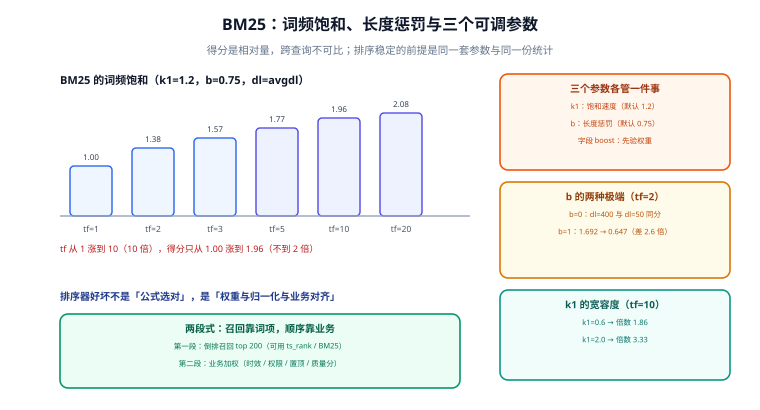

# 相关性排序：BM25 与业务加权

召回解决「有没有」，排序解决「第几」。而排序最容易出的问题不是公式选错，是**把得分当成绝对量**：拿一个阈值卡「相关 / 不相关」，或者拿两个不同查询的得分互相比较。BM25 的得分是**同一查询内不同文档之间的相对量**，出了这个范围就没有意义。

这一页讲三件事：BM25 到底在算什么、PG 的 `ts_rank` 与它差在哪、以及真实系统里怎么把「相关性」和「业务规则」拼成一条可解释的排序。

## 判据族声明

本页判据族 `FRL-A` ~ `FRL-H`，共 8 条。定义表在第六节。

## 本页不讲什么

- 不讲分词与字段建模，归 [文本分析](../TextAnalysis/index.md) 与 [索引设计](../IndexDesign/index.md)。
- 不讲向量相似度与语义重排模型，归 [向量检索与混合检索](/docs/DB/VectorDatabase/HybridSearch/index.md) 与 [多模态检索的排序](/docs/AI/MultimodalRetrieval/Serving/index.md)。
- 不讲 ES 的 `function_score` 全部语法，只讲它在两段式里的位置。



## 一、BM25 在算什么

```text
score(D, Q) = Σ over terms q in Q:
                IDF(q) · [ tf · (k1 + 1) ] / [ tf + k1 · (1 − b + b · |D| / avgdl) ]
```

三个因子各管一件事：

| 因子 | 作用 | 调它的后果 |
| --- | --- | --- |
| `IDF(q)` | 罕见词更值钱 | 不可直接调，由文档集合决定；**删文档会改变历史得分** |
| `k1` | 词频饱和速度 | 越大越奖励重复出现；Lucene 默认 1.2 |
| `b` | 文档长度惩罚 | 0 = 不惩罚长文，1 = 完全按长度归一；默认 0.75 |

### 词频饱和：真实的数值

固定 `k1=1.2`、`b=0.75`、文档长度等于平均长度，把 tf 从 1 拉到 20（**本机 Python 计算**）：

| tf | BM25 贡献 | 相对 tf=1 的倍数 | 若按线性（tf 直接当分） |
| --- | --- | --- | --- |
| 1 | 1.0000 | 1.00× | 1 |
| 2 | 1.3750 | 1.38× | 2 |
| 3 | 1.5714 | 1.57× | 3 |
| 5 | 1.7742 | 1.77× | 5 |
| 10 | 1.9643 | 1.96× | 10 |
| 20 | 2.0755 | 2.08× | 20 |

**tf 涨 10 倍，得分只涨不到 2 倍。** 这就是「饱和」：一个词出现 10 次和 20 次，对相关性的意义差不多；但线性计分会把「堆关键词」的文档顶到第一。BM25 的这个设计本身就是一层的反作弊。

### 长度惩罚：`b` 的两个极端

固定 `tf=2`、`k1=1.2`，比较「短文档（50 词）」与「长文档（400 词）」：

| `b` | 短文档得分 | 长文档得分 | 比值 |
| --- | --- | --- | --- |
| 0.0 | 1.375 | 1.375 | 1.00（完全不惩罚） |
| 0.75（默认） | 1.600 | 0.746 | 2.14 |
| 1.0 | 1.692 | 0.647 | 2.62 |

`b=0` 在「短文档是精华、长文档是噪声」的场景下会失效；`b=1` 则会让「长文档里真的讲了这个主题」被过度惩罚。默认 0.75 是折中，改动它必须用评估集证明。

### `k1` 的宽容度

固定 `b=0.75`、长文档（`dl=2×avgdl`），看「tf=10 相对 tf=1」的倍数：

| `k1` | tf=10 | tf=1 | 倍数 |
| --- | --- | --- | --- |
| 0.6 | 1.448 | 0.780 | 1.86× |
| 1.2（默认） | 1.818 | 0.710 | 2.56× |
| 2.0 | 2.222 | 0.667 | 3.33× |

`k1` 越小，排序越「只看有没有命中」；越大越「奖励重复」。标题党内容多的场景应调小 `k1`。

## 二、PG 的 `ts_rank` 不是 BM25

这一点必须说清楚，否则会拿错误的直觉去调参数：

| 维度 | BM25（Lucene / ES） | PG `ts_rank` | PG `ts_rank_cd` |
| --- | --- | --- | --- |
| 词频饱和 | 有（`k1`） | **无**：按词频线性累加 | 无，但按「覆盖密度」聚合 |
| 文档长度归一 | 有（`b`） | **无** | 部分：用「最小覆盖区间」的长度 |
| 字段权重 | `boost` | `setweight` + 权重数组 | 同左 |
| 归一化 | 无（得分天然可比性差） | 可选 1/2/4/8/16/32 | 同左 |

`ts_rank` 的归一化选项值得单独说：`normalization` 是一个位掩码，常用的是 `1`（除以 `1 + log(文档长度)`）与 `32`（除以自身加 1，把得分压到 0~1）。**加了归一化之后，同一查询下的排序会变，跨查询的可比性仍然不存在。**

```sql
-- 三种打分方式的对照（同一查询、同一批文档）
SELECT id,
       ts_rank(search_vec, q)            AS rank_raw,
       ts_rank(search_vec, q, 1)         AS rank_len_norm,
       ts_rank_cd(search_vec, q)         AS rank_cd
FROM kb_doc, websearch_to_tsquery('zhcfg','看板 权限') AS q
WHERE search_vec @@ q
ORDER BY rank_raw DESC
LIMIT 20;
```

经验结论：**PG 原生方案里 `ts_rank_cd` 通常比 `ts_rank` 更接近人的判断**，因为它奖励「多个查询词出现在相邻位置」——这正是「标题里几个词连在一起」的形态。代价是它更贵（要算覆盖区间）。

## 三、两段式排序：召回靠词项，顺序靠业务

真实系统里，纯相关性排序几乎从来不是最终顺序。业务至少要叠加：置顶、时效、质量分、权限可见性、个性化。把这些塞进 BM25 公式里是灾难，正确做法是**两段式**：

```text
第一段（召回 + 粗排）：倒排求交，取 top 200，按 ts_rank_cd / BM25 排
第二段（精排）：在 200 条上叠加业务因子，取 top 20 返回
```

第二段的因子必须**可解释、可关闭、可单独测试**：

| 因子 | 实现 | 注意 |
| --- | --- | --- |
| 置顶 | 布尔字段，命中则加固定分或直接提到最前 | 「直接提到最前」要限条数，否则置顶会淹没搜索 |
| 时效 | 按 `created_at` 做指数衰减（半衰期 30 天） | 衰减参数是产品决策，不是技术参数 |
| 质量分 | 已有的 `quality_score`（0~1），乘一个系数 | 系数过大会让搜索退化成「热榜」 |
| 可见性 | 先过滤再排序 | **不能**用低分代替过滤，否则越权内容会出现在结果里 |

ES 侧的 `function_score` 就是把第二段写成查询的一部分：

```json
{
  "query": {
    "function_score": {
      "query": { "multi_match": { "query": "看板 权限", "fields": ["title^3", "tags^2", "body"] } },
      "functions": [
        { "filter": { "term": { "pinned": true } }, "weight": 3 },
        { "gauss": { "updated_at": { "origin": "now", "scale": "30d", "decay": 0.5 } } }
      ],
      "score_mode": "sum",
      "boost_mode": "sum"
    }
  }
}
```

PG 侧用一条 `ORDER BY` 表达式表达同一件事：

```sql
ORDER BY (
  ts_rank_cd('{0.1,0.2,0.4,1.0}', search_vec, q) * 1.0
  + CASE WHEN pinned THEN 3.0 ELSE 0 END
  + 0.5 * exp(-extract(epoch from now() - updated_at) / (30 * 86400))
) DESC
```

::: danger 两段式最常见的三个错误
1. **第二段重新召回**：在精排阶段又查了一次数据库，把「200 条」变成「200 次查询」。正确做法是第一段就把排序要用的字段一起取回来。
2. **业务因子盖过相关性**：置顶 +3.0 而相关性得分区间只有 0~2，结果是「置顶的永远第一」。因子量级必须与相关性得分同量级，或者显式做「先分组再排序」。
3. **精排阶段做权限过滤**：过滤放在精排之后，会出现「取 20 条，过滤掉 15 条，返回 5 条」；正确顺序是**先过滤再召回**（条件进 `WHERE`），或者用 `LIMIT` 放大后回填。
:::

## 四、学习排序（LTR）的边界

LTR 用标注数据训练一个排序模型，把「相关性 + 业务因子」一起学出来。它的适用边界很硬：

| 条件 | 不满足时的后果 |
| --- | --- |
| 有 ≥ 1 万条带点击/标注的训练样本 | 模型学不到东西，效果不如手调 |
| 有稳定的特征管道（BM25、时效、质量分都要能取到） | 特征缺失时线上得分与离线不一致 |
| 有在线实验能力 | 无法验证「模型更好」，只能看离线指标 |
| 有回滚方案 | 模型退化时无法快速切回规则排序 |

四个条件里缺两个以上，**手调权重 + 评估集**的收益更高。LTR 不是「更先进的排序」，它是「有数据、有管道、有实验能力时的一种选择」。

## 五、判据表

| 编号 | 规则 | 违反时的样子 | 怎么验证 |
| --- | --- | --- | --- |
| `FRL-A` | 得分只用于**同一查询内**的比较 | 用 `score > 8` 做过滤，换索引后全失效 | 代码里不存在把得分与固定阈值比较的逻辑 |
| `FRL-B` | 字段权重档位与业务语义一致 | 长正文压过标题命中 | 两篇对照文档的排序符合预期 |
| `FRL-C` | 排序方式（`ts_rank` / `ts_rank_cd` / BM25）有书面选择理由 | 两套代码各用一种，结果不可比 | 排序表达式集中在一处，有注释 |
| `FRL-D` | 两段式的第二段不重新查库 | 列表页 N+1，P99 抖动 | 查询次数 = 1（或固定的常数） |
| `FRL-E` | 业务因子与相关性得分同量级 | 置顶/热榜淹没搜索 | 关掉业务因子后排序仍合理 |
| `FRL-F` | 权限过滤在召回前，不在精排后 | 返回条数随权限变化剧烈 | 越权用户查到的条数为 0，且分页总数一致 |
| `FRL-G` | 归一化选项（`ts_rank` 的 1/2/4/8/16/32）有明确取舍 | 得分区间随文档长度剧烈漂移 | 归一化后得分落在可预期区间 |
| `FRL-H` | 引入 LTR 前四条前提全部满足 | 模型上线后指标反而下降 | 训练样本量、特征管道、实验平台、回滚方案四项均有证据 |

## 验证方式

```sql
-- 1) FRL-B：标题命中必须排在「正文多次命中」之前
-- 造两篇：A 标题含「看板权限」，B 正文含「看板」「权限」各 5 次
SELECT id, ts_rank_cd('{0.1,0.2,0.4,1.0}', search_vec, websearch_to_tsquery('zhcfg','看板 权限')) AS s
FROM kb_doc
WHERE search_vec @@ websearch_to_tsquery('zhcfg','看板 权限')
ORDER BY s DESC;
-- 期望：标题命中的那篇在前；若不在，先查权重数组顺序（见索引设计）

-- 2) FRL-C：两种打分在同一批文档上的排序差异
SELECT id,
       rank() OVER (ORDER BY ts_rank(search_vec, q) DESC)    AS by_rank,
       rank() OVER (ORDER BY ts_rank_cd(search_vec, q) DESC) AS by_rank_cd
FROM kb_doc, websearch_to_tsquery('zhcfg','看板 权限') AS q
WHERE search_vec @@ q;
-- 判读：两个 rank 差异很大的前几条，人工看哪一版更符合预期，据此定用哪个

-- 3) FRL-A：证明得分是相对量（同一文档、不同查询，得分不可比）
SELECT ts_rank(to_tsvector('simple','看板 权限 矩阵'), to_tsquery('simple','看板')) AS one_term,
       ts_rank(to_tsvector('simple','看板 权限 矩阵'), to_tsquery('simple','看板 | 权限 | 矩阵')) AS three_terms;
-- 判读：后者通常明显更大——因为查询词更多，不是因为「更相关」
```

## 参考资料

- [Lucene · BM25Similarity](https://lucene.apache.org/core/10_0_0/core/org/apache/lucene/search/similarities/BM25Similarity.html)——公式与默认参数
- [Elasticsearch 9 · Function score](https://www.elastic.co/guide/en/elasticsearch/reference/current/query-dsl-function-score-query.html)——`gauss` / `weight` / `score_mode`
- [PostgreSQL 18 · Ranking Search Results](https://www.postgresql.org/docs/18/textsearch-controls.html#TEXTSEARCH-RANKING)——`ts_rank` / `ts_rank_cd` 与归一化位掩码
- [PostgreSQL 18 · `setweight`](https://www.postgresql.org/docs/18/functions-textsearch.html)——A/B/C/D 四档与默认权重向量
- 本站 [向量检索与混合检索](/docs/DB/VectorDatabase/HybridSearch/index.md) · [RAG · 检索与重排](/docs/AI/RAG/Retrieval/index.md)
- 相邻：[索引设计](../IndexDesign/index.md) · [召回评估](../Evaluation/index.md) · [实战](../Practice/index.md)
