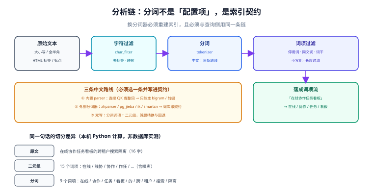

# 文本分析：分词是索引契约

「索引建好了，搜不到」——排查到最后一层，十次里有七次是分词。原因不是配置写错了，而是**分词结果被写进了索引**：一旦建好索引，里面的词项就固定了。之后改词典、改同义词、换分词器，都只影响**新的查询**，不会回头修改旧文档里已经落盘的词项。

所以分词不是「一个可以随时调的配置项」，它是一份**双向契约**：索引侧按它落词项，查询侧按它切查询词，两边必须逐字一致。

## 判据族声明

本页判据族 `FAN-A` ~ `FAN-H`，共 8 条。定义表在第六节。

## 本页不讲什么

- 不讲倒排索引与 posting list 的结构，归 [索引设计](../IndexDesign/index.md)。
- 不讲 BM25 打分，归 [相关性排序](../Relevance/index.md)。
- 不讲词库怎么做业务治理（谁维护、怎么评审），那属于内容运营，本页只讲**技术契约**。



## 一、分析链的三件套

任何全文检索引擎的分析链都是同一形状，只是叫法不同：

| 阶段 | Elasticsearch | PostgreSQL | 作用 | 典型误用 |
| --- | --- | --- | --- | --- |
| **字符过滤** | `char_filter` | 无直接对应（用表达式预处理） | 去 HTML 标签、全角转半角、`&` 转 `and` | 把「去标签」放到应用层，结果索引里混进了 `<p>` |
| **分词** | `tokenizer` | `parser`（`default` / `zhparser` / `jieba`） | 把字符串切成词项 | 中文用默认解析器，整段成一个词 |
| **词项过滤** | `filter` | `dictionary` + `template` | 小写化、去停用词、同义词、词干 | 索引侧去了停用词，查询侧没去，短语查询永远不命中 |

ES 里这套组合叫 `analyzer`，PG 里叫 `text search configuration`。**两边的共同点是：它作用于「文本 → 词项流」这一步，且结果会被持久化。**

验证一条分析链是否正确，ES 侧不需要建索引：

```json
POST _analyze
{
  "analyzer": "ik_max_word",
  "text": "在线协作任务看板的跨租户搜索隔离"
}
```

PG 侧同理：

```sql
SELECT * FROM ts_debug('simple', '在线协作任务看板');
-- 期望看到一整串 CJK 被切成 1 个 word 词项
```

`ts_debug` 是 PG 侧最有用的一个函数：它把「解析器怎么切、词典怎么归一」逐词打印出来，比猜快得多。

## 二、中文的三条路线（必须选一条并写进契约）

中文没有空格，所以「切词」这一步必然要做决策。三条路线的取舍完全不同：

| 路线 | 做法 | 优点 | 代价 | 适用 |
| --- | --- | --- | --- | --- |
| **① 二元组（bigram）** | 每两个相邻汉字组成一个词项 | 零词典、零维护；召回率高 | 索引膨胀约 2~3 倍；产生大量噪声词项（「线协」「作任」） | 数据量中等、不想维护词库、召回优先 |
| **② 外部分词器** | `zhparser` / `pg_jieba`（PG）、`ik` / `smartcn`（ES） | 词项贴近语义，索引更小，排序更准 | 词典即契约：新词不进词典就搜不到；升级词典要重建 | 有明确领域词表、能长期维护 |
| **③ 双写（分词 + 二元组）** | 同一字段建两个子字段，查询时合并 | 精确与回退兼顾 | 索引最大；查询要合并两路得分，调参复杂 | 搜索是核心功能，且召回率有硬指标 |

本机用 Python 对同一句话做两种切分（**纯计算，不是数据库实测**）：

```text
原文    在线协作任务看板的跨租户搜索隔离（16 字）
二元组  15 个词项：在线 / 线协 / 协作 / 作任 / …（含噪声）
分词    9 个词项：在线 / 协作 / 任务 / 看板 / 的 / 跨 / 租户 / 搜索 / 隔离
```

同一条查询「协作 权限」，二元组会产生 4 个词项（协作、作权、权限…），分词只产生 2 个。**二元组的召回更高、精确率更低**——因为它把「作权」这种跨词边界的组合也当成候选。

::: danger 二元组最容易被忽略的两个后果
1. **索引膨胀**：16 字标题产生 15 个词项，而分词只有 9 个。按词项数估算索引体积时，用「字数」而不是「词数」，会低估 40% 以上。体积公式见 [索引设计](../IndexDesign/index.md)。
2. **短语查询变贵**：`phraseto_tsquery` 在二元组索引上要校验的位置对更多、更密，命中判断的代价随之上升。**短语查询在二元组方案里通常是不可用的**，产品如果要求「精确短语」，就不要选路线 ①。
:::

### 路线选择的一条硬判据

不要按「哪个更先进」选，按**「词表谁维护」**选：

| 问题 | 回答 | 结论 |
| --- | --- | --- |
| 领域里有没有大量专有名词（产品名、代码、工单术语）？ | 有，且每周都在新增 | 走 ②，且必须有词表更新流程 |
| 有没有人能每周看一次「零结果查询」并补词？ | 没有 | 走 ①，接受精度损失 |
| 搜索是不是产品的核心竞争力？ | 是 | 走 ③，并准备为调参投入人力 |
| 数据量小于 10 万且查询以短词为主？ | 是 | 走 ① 足够 |

## 三、归一化：五件必须在两侧同时做的事

归一化（normalization）是「把不同的写法映射到同一个词项」。它比分词更容易出错，因为**它往往只做了一侧**。

| 归一化 | 做法 | 只做一侧的后果 |
| --- | --- | --- |
| 大小写 | 全部小写（`lowercase` filter） | 索引存 `API`、查询 `api`，搜不到 |
| 全角 / 半角 | `ＡＰＩ` → `API`；`１２３` → `123` | 从文档复制粘贴的查询永远不命中 |
| 繁简 | 统一转简体（需要 `opencc` 类工具） | 「看板」与「看闆」互不相通 |
| 标点与空白 | 统一折叠为分隔符 | 「看板，权限」被切成一个词项 |
| 数字与单位 | `1,000` → `1000`；`10kg` → `10 kg` | 编号类查询大面积失败 |

归一化必须**幂等**：`normalize(normalize(x)) == normalize(x)`。这条性质可以用一条断言守住——把同一批文档跑两遍归一化，词项流必须完全相同。

## 四、词典变更：热加载只影响「以后」，不改「以前」

这是本页最重要的一条工程事实：

```text
T0  词典 v1 → 索引了 100 万篇文档（词项按 v1 切分落盘）
T1  词典 v2 上线（新增 500 个专有名词）
T2  用户搜「新增的那个词」
    → 查询侧按 v2 切成 1 个词项
    → 索引侧 100 万篇里没有这个词项（它们是 v1 切的）
    → 0 条结果
```

**热加载（reload）解决的是「新查询按新词典切」，不解决「旧文档按旧词典切」。** 所以词典变更的正确处理是：

1. 判断影响面：新增词是否可能出现在已有文档里？
2. 若会 → **必须重建索引**（或至少重跑受影响文档的 `tsvector` 生成列）。
3. 若不会（纯新词，旧文档里不存在）→ 可以只更新查询侧配置。

::: warning 「生成列」让重建变得便宜，但不改变结论
PG 的 `GENERATED ALWAYS AS (to_tsvector(...)) STORED` 依赖的函数必须标记 `IMMUTABLE`，所以**改词典不会自动重算已存的行**。要重算只能：

```sql
UPDATE kb_doc SET search_vec = to_tsvector('zhcfg', title || ' ' || body);
-- 这会重写全表 + 全部索引，代价与「重建索引」相同
```

换句话说：**任何影响分词结果的变更，都是一次重建事件**，必须走 [索引更新](../IndexUpdate/index.md) 的别名切换流程。
:::

## 五、同义词：加在查询侧，还是索引侧

| 位置 | 做法 | 优点 | 缺点 |
| --- | --- | --- | --- |
| **查询侧** | 把「看板」扩展成「看板 OR 看版 OR 面板」 | 改完立刻生效，**不需要重建索引** | 每次查询多几个词项，延迟略增 |
| **索引侧** | 建索引时就把同义词写入 | 查询简单、得分稳定 | 每次改同义词都要重建；容易把不相关的词写进文档 |

工程上的默认答案是**查询侧**，理由只有一条：同义词表的变更频率远高于索引重建的承受频率。

同义词扩展必须**带权重**，不能等价替换。把「面板」当成「看板」的同义词后，如果两者等权，那么标题写「面板」的文档会和标题写「看板」的文档同分——而用户打的字是「看板」，后者才该排前面。ES 的 `synonym_graph` 支持这种「单向 + 低权重」的写法；PG 侧需要在查询构造时用 `tsquery` 的 `|` 与权重运算符手动表达。

## 六、判据表

| 编号 | 规则 | 违反时的样子 | 怎么验证 |
| --- | --- | --- | --- |
| `FAN-A` | 索引侧与查询侧使用**同名**分析配置 | 某些词永远 0 条，两侧无报错 | 用 `_analyze` / `ts_debug` 对同一串文本跑两侧配置，词项流必须逐项相同 |
| `FAN-B` | 中文路线已选定并写入契约（bigram / 分词 / 双写） | 不同人各写一套，索引与查询不一致 | 契约文档里有「路线 + 分词器名 + 版本」 |
| `FAN-C` | 归一化完整且幂等（大小写、全半角、繁简、标点、数字） | 复制粘贴的查询不命中 | 对同一文本归一化两次，词项流完全相同 |
| `FAN-D` | 停用词表存在且被两侧共用 | 高频词拖慢查询 | 高频词查询的 posting 长度有上限，或 `EXPLAIN` 显示可接受 |
| `FAN-E` | 词典变更走「评估 → 重建 → 切换」，不走热加载 | 新词只有新文档能搜到 | 变更记录里有重建步骤与切换时间 |
| `FAN-F` | 同义词默认加在查询侧，且带权重 | 改同义词导致大面积重排 | 同义词配置有方向与权重，不是等价集合 |
| `FAN-G` | 分析链有版本号，随索引元数据一起存 | 半年后没人知道索引是哪个词典切的 | 索引元数据表里有 `analyzer_version` |
| `FAN-H` | 短语查询能力与所选路线匹配 | 选了二元组却承诺「精确短语」 | 产品需求清单里「精确短语」与路线一致 |

## 验证方式

四条命令覆盖 `FAN-A` / `FAN-C` / `FAN-D` / `FAN-H`：

```sql
-- 1) FAN-A：看解析器怎么切（PG 侧）
SELECT alias, token, dictionaries FROM ts_debug('simple', '在线协作任务看板');
-- 期望：只有一行 alias=word，token='在线协作任务看板'

-- 2) FAN-A：两侧词项流是否相同（把查询词与文档标题当同一串文本）
SELECT to_tsvector('simple', '看板权限矩阵') = to_tsvector('simple', '看板权限矩阵');
-- 期望：t（同一个配置必然是 t；若两侧配置不同，这里就会是 f）

-- 3) FAN-C：归一化幂等（归一化函数必须写成一个可重跑的 SQL 表达式）
SELECT lower('ＡＰＩ　网关') = lower(lower('ＡＰＩ　网关'));
-- 期望：t

-- 4) FAN-H：短语查询在所选路线下是否可用
SELECT to_tsquery('simple', '在线 <-> 协作');
-- 在 bigram 索引上，这条查询的命中语义与分词索引不同，必须实测确认
```

ES 侧的对应验证是一条 `_analyze` 调用（见第一节），判据是**两个 analyzer 名字下的 `tokens` 数组逐项相同**。

`FAN-B` / `FAN-E` / `FAN-F` / `FAN-G` 属于契约类判据，验证方式是「文档 + 元数据存在且可核对」。

## 参考资料

- [PostgreSQL 18 · Parsers](https://www.postgresql.org/docs/18/textsearch-parsers.html)——解析器与 `ts_debug`
- [PostgreSQL 18 · Dictionaries](https://www.postgresql.org/docs/18/textsearch-dictionaries.html)——`simple` / `synonym` / `stopwords`
- [PostgreSQL 18 · text search configuration](https://www.postgresql.org/docs/18/textsearch-configuration.html)——`ALTER TEXT SEARCH CONFIGURATION` 与词典绑定
- [Elasticsearch 9 · Analyze API](https://www.elastic.co/guide/en/elasticsearch/reference/current/indices-analyze.html)——在不建索引的前提下验证分析链
- [Elasticsearch 9 · Synonym graph token filter](https://www.elastic.co/guide/en/elasticsearch/reference/current/analysis-synonym-graph-tokenfilter.html)——单向同义词与多词同义词
- 本站 [PostgreSQL 高级特性 · 全文检索](/docs/DB/Relational/PostgreSQL/Advanced/index.md) · [Elasticsearch · 中文分词](/docs/DB/NoRelational/Elasticsearch/ChineseAnalyzer/index.md)
- 相邻：[总览](../Overview/index.md) · [索引设计](../IndexDesign/index.md) · [索引更新](../IndexUpdate/index.md)
