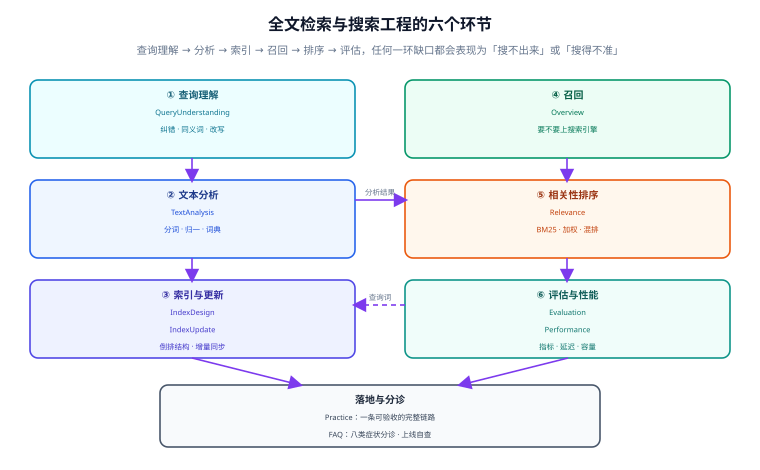

# 全文检索与搜索工程

搜索最常见的失败不是「搜不出来」，而是**搜出来了、顺序不对，而且没人能证明它比上周更差**。前者是词项匹配问题，改一行 `to_tsquery` 就能看到结果；后者是工程问题：没有评估集、没有基线、没有把「可见性」写进契约，于是每次调整词库、权重、分片都只能靠感觉验收。

本专题讲的是**搜索的工程层**：一条查询从输入到结果要经过哪几段、每一段的失效长什么样、怎么用一组可执行的断言把「搜得对」固定下来。SQL 语法与 DSL 语法不在这里——它们在 [PostgreSQL 高级特性](/docs/DB/Relational/PostgreSQL/Advanced/index.md) 与 [Elasticsearch 专题](/docs/DB/NoRelational/Elasticsearch/index.md)。

::: tip 一句话理解
搜索 = **召回**（能不能出现在候选集里）+ **排序**（出现了排第几）+ **一致性**（写完多久能搜到）+ **可评估**（改完怎么知道变好）。四件事里任何一件没有判据，另外三件的努力都会随机失效。
:::

## 与相邻专题的分工

「全文检索」「搜索引擎」「向量检索」「模糊匹配」四个词经常混着用，边界必须先写死：

| 专题 | 讲什么 | 与本专题的关系 |
| --- | --- | --- |
| 本专题 | **搜索的工程层**：分析链契约、索引建模与更新、相关性调优、查询理解、召回评估、延迟与容量 | —— |
| [Elasticsearch 专题](/docs/DB/NoRelational/Elasticsearch/index.md) | ES 的**用法**：DSL、mapping、聚合、集群、`match` 与 `term` 的区别 | 那边回答「这条 DSL 怎么写」，本专题回答「**为什么这条查询会把长文档排到前面、怎么证明改完更好**」 |
| [PostgreSQL 高级特性 · 全文检索](/docs/DB/Relational/PostgreSQL/Advanced/index.md) | `tsvector` / `tsquery` 的**入门语法**、生成列、`ts_rank` | 那边是语法，本专题是**选型、权重、评估与运维**；本专题的 [实战](./Practice/index.md) 只用 PG 原生能力跑通全链路 |
| [向量检索与混合检索](/docs/DB/VectorDatabase/HybridSearch/index.md) | 语义召回、向量索引、RRF 融合 | 那边解决「字面不匹配但意思相近」；本专题解决「**字面匹配里那 90% 的流量**」，两者是串联关系，不是替代 |
| [RAG 的检索环节](/docs/AI/RAG/Retrieval/index.md) | 面向大模型上下文的召回、切片、重排 | 那边的消费者是模型（要的是「够用的几段」），本专题的消费者是人（要的是「第一页就对」）；评估口径完全不同 |
| [多模态检索与重排](/docs/AI/MultimodalRetrieval/index.md) | 图文向量、视觉文档、重排模型 | 那边处理跨模态召回；本专题处理纯文本检索链路的工程细节，重排模型在这里只作为「第二段」的一种实现 |
| [数据库内核与存储引擎](/docs/DB/DatabaseInternals/index.md) | 页、B+ 树、LSM、WAL | 倒排索引是另一种存取结构：那边讲**行定位**，本专题讲**词项定位**；GIN 的 posting list 与 B+ 树的叶页解决的是同一类问题 |
| [分区分表与冷热分离](/docs/DB/PartitionArchival/index.md) | 单库内的数据生命周期 | 搜索索引也有生命周期：热索引、冷索引、重建与下线，思路相通但**索引不能分区**，只能分片或分索引 |
| [ClickHouse 分区与索引](/docs/DB/ClickHouse/PartitionIndex/index.md) | OLAP 的主键稀疏索引与跳数索引 | 那边为**扫描**优化（跳过大块数据），本专题为**定位**优化（找到命中的少数文档）；两者的索引结构不能互相替代 |
| [缓存设计](/docs/Backend/DistributedCache/index.md) | 缓存穿透、击穿、一致性 | 搜索结果缓存是最容易「串租户」的位置之一，本专题的 [性能](./Performance/index.md) 只讲搜索侧的三档缓存，租户隔离引用那边 |
| [在线协作任务看板 · 搜索隔离](/project/Complete/TeamBoard/SearchIsolation/index.md) | 真实项目里的读路径隔离：租户条件、游标签名、导出条件复用 | 那边是**施工**，本专题是**判据**；[实战](./Practice/index.md) 的租户过滤与那边逐条对齐，不重复讲鉴权 |

## 专题地图

| 页面 | 内容 | 适合谁读 |
| --- | --- | --- |
| [总览：四层结构与五个必失点](./Overview/index.md) | 查询理解 / 召回 / 排序 / 一致性四段分工；五个「不报错但结果错」的失效；要不要上搜索引擎的决策树 | 所有人，先读 |
| [文本分析：分词是索引契约](./TextAnalysis/index.md) | 分析链三件套、中文三条路线、词典热更新、同义词与归一化、切分差异的实测 | 建索引的人，**重点读** |
| [索引设计：倒排、字段与体积](./IndexDesign/index.md) | 倒排结构、GIN 的三块结构、字段权重 A/B/C/D、生成列、索引体积估算 | 建索引与估容量的人，**重点读** |
| [相关性排序：BM25 与业务加权](./Relevance/index.md) | BM25 三参数的真实数值、字段 boost、`ts_rank_cd`、两段式排序、学习排序的边界 | 调排序的人，**必读** |
| [索引更新：写完多久能搜到](./IndexUpdate/index.md) | refresh 三档、段合并、别名原子切换、全量重建四步、双写与对账、软删除 | 做同步与重建的人，**重点读** |
| [查询理解：纠错、同义词与兜底](./QueryUnderstanding/index.md) | 五步链、零结果的四种真实原因、纠错只在零结果时启用、危险查询拦截 | 做搜索入口的人 |
| [召回评估：没有基线就没有改动](./Evaluation/index.md) | 评估集构建、四个指标的盲区、样本量计算、离线回放与线上实验 | 要改词库或权重的人，**必读** |
| [性能与容量：先量再优化](./Performance/index.md) | 延迟分解、分片扇出对 P99 的放大、三档缓存、深分页、容量三个数 | 运维与容量规划 |
| [实战：10 万工单的搜索链路](./Practice/index.md) | 完整 DDL + 生成列 + GIN + 租户过滤 + 两段式排序 + 别名重建 + S1~S10 验收 | 要照着做的人 |
| [常见问题与分诊](./FAQ/index.md) | 八类症状分诊表、十二问、十二项上线自查、术语表 | 所有人 |

## 四条底层判断（先记住这四句）

| 判断 | 含义 | 违反它的典型后果 |
| --- | --- | --- |
| **分词是契约，不是配置** | 索引侧与查询侧必须共用同一条分析链；换分词器 = 重建索引 | 只改了一侧的插件，线上表现为「某些词永远搜不到」，而两边都「没有报错」 |
| **相关性是相对量** | BM25 得分不可跨查询比较，也不可跨索引版本比较 | 用「得分 > 0.8」做业务过滤，换一次索引后阈值全部失效 |
| **可见性要写进契约** | 「写完多久能搜到」是一个 SLA 数字，不是「应该很快」 | 写完立刻查、查不到，于是加了一层双写补偿，把问题变成两处不一致 |
| **没有评估集的改动是赌博** | 200 条分层抽样的查询就能分辨 6 个百分点的差异 | 调完权重「感觉好了」，两周后发现长尾查询全部归零 |

## 成熟度五档

搜索这件事最容易「上线即完工」：接口通了、能返回结果，就再没人动过。按下面五档对照，只补当前档位的下一件事：

| 档位 | 特征 | 只补一件事 |
| --- | --- | --- |
| L0 | `LIKE '%关键词%'`，数据量一过十万就开始全表扫 | 先明确「要搜哪几个字段、怎么切词」，见 [总览](./Overview/index.md) 的决策树 |
| L1 | 用了 `tsvector` 或 ES，但分词靠默认配置，中文整段当一个词 | 补 [文本分析](./TextAnalysis/index.md)：选定一条中文路线并写进契约 |
| L2 | 能搜到，但标题命中与正文命中同权重，长文永远压过短文 | 补 [相关性排序](./Relevance/index.md)：字段权重 + 两段式排序 |
| L3 | 排序调好了，但改了词库要停机重建，期间搜索降级成 `LIKE` | 补 [索引更新](./IndexUpdate/index.md)：别名 + 全量重建 + 对账 |
| L4 | 重建不停机，但每次调整都靠「搜几个词看看」 | 补 [召回评估](./Evaluation/index.md)：200 条评估集 + NDCG 基线 + 回归门禁 |

## 判据族总览

十个页面各八条，共 **80** 条。写法统一为「规则 + 违反时的样子 + 怎么验证」，每页末尾给出可执行命令与预期读数。

| 页面 | 判据族 | 覆盖的约定 | 条数 |
| --- | --- | --- | --- |
| [总览](./Overview/index.md) | `FSO-A` ~ `FSO-H` | 四段分工、五个必失点、选型决策 | 8 |
| [文本分析](./TextAnalysis/index.md) | `FAN-A` ~ `FAN-H` | 分析链、中文路线、词典、归一化 | 8 |
| [索引设计](./IndexDesign/index.md) | `FID-A` ~ `FID-H` | 倒排结构、字段建模、体积、复合条件 | 8 |
| [相关性](./Relevance/index.md) | `FRL-A` ~ `FRL-H` | BM25 参数、字段权重、两段式、归一化 | 8 |
| [索引更新](./IndexUpdate/index.md) | `FUP-A` ~ `FUP-H` | 可见性、重建、对账、软删除 | 8 |
| [查询理解](./QueryUnderstanding/index.md) | `FQU-A` ~ `FQU-H` | 归一、纠错、扩展、兜底、拦截 | 8 |
| [评估](./Evaluation/index.md) | `FEV-A` ~ `FEV-H` | 评估集、指标、样本量、门禁 | 8 |
| [性能](./Performance/index.md) | `FPF-A` ~ `FPF-H` | 延迟分解、扇出、缓存、深分页 | 8 |
| [实战](./Practice/index.md) | `FPR-A` ~ `FPR-H` | 10 万工单全链路与验收 | 8 |
| [常见问题](./FAQ/index.md) | `FFQ-A` ~ `FFQ-H` | 分诊、自查、术语 | 8 |

## 事实与版本速览（2026-10 核对）

| 事实 | 口径 | 出处 |
| --- | --- | --- |
| PostgreSQL **18.0** 发布于 **2025-09-25**，当前小版本 **18.6**（2026-08-13） | 本专题的 SQL 全部以 18.x 为准，`tsvector` / GIN 语法自 9.x 起未变 | PostgreSQL release notes |
| PG 内置全文检索**不做中文分词**：连续 CJK 字符会被当作**一个** `word` 词项 | 这就是「`to_tsvector('simple','在线协作')` 只有一个词项」的原因，中文必须选路线 | PG 文档 12.1 与实测 |
| PG 的 `ts_rank` **不是 BM25**：它按词频与权重累加，没有文档长度归一 | 想用 BM25 需要第三方扩展（如 ParadeDB `pg_search`）或换引擎 | PG 文档 12.3 |
| Elasticsearch **9.5.5**（2026-10-06），8.x 线仍在维护（**8.19.22**，2026-09-23） | ES 9 起基于 Lucene 10 | elastic.co 下载页 |
| OpenSearch **3.9.0**（2026-09-29）；3.0 起基于 Lucene 10.1，最低 JDK 21 | 与 ES 已不是同一套客户端：2.0 起不保证 ES 客户端兼容 | OpenSearch 项目页 |
| Elastic 于 **2024-08-29** 为源码增加 **AGPLv3** 选项，当前为 AGPLv3 / SSPL 1.0 / ELv2 三选一 | 「ES 不再开源」的旧结论已经过期 | Elastic 官方公告 |
| Meilisearch **1.55.0**（2026-10-12），社区版 MIT、企业版 BUSL 1.1 | 轻量方案，中文需额外配置分词 | 项目 release |
| Typesense **30.2**（2026-04-19），GPL-3.0 | 轻量方案，拼写容错是默认能力 | 项目 release |
| Lucene BM25 默认 **k1 = 1.2、b = 0.75** | ES / OpenSearch / Solr 的默认相似度都是它 | Lucene `BM25Similarity` |

::: warning 关于「版本目录」
本专题**不建版本目录**（没有 `v1/`、`v2/` 之类的并存版本），理由三条：① 本专题讲的是**跨引擎的工程模型**（分析链、召回、排序、评估），这些概念在 PG 9.x 到 18.x、ES 6.x 到 9.x 之间是**增量**演进，同一套判据可以覆盖，只需在表格里标注「最低版本」；② 真正存在大版本断层的部分属于**具体引擎专题**（[PostgreSQL](/docs/DB/Relational/PostgreSQL/index.md)、[Elasticsearch](/docs/DB/NoRelational/Elasticsearch/index.md) 各自维护多版本），拆到本专题会让同一条判据出现两份；③ 索引结构一旦变更就必须**重建**而不是「并存两套查询」，版本目录在这里没有对应的物理形态。
:::

## 学习路径

1. **先读总览**，把「四段分工」和「五个必失点」记住——后面九页都在补这五处的细节。
2. **建索引前读文本分析与索引设计**：分词器与分析链一旦定下，改它的代价是重建全部索引。
3. **调排序前先有评估集**：没有基线的调参只是把「感觉」换了个方向，见 [召回评估](./Evaluation/index.md)。
4. **上线前跑一遍 [实战](./Practice/index.md) 的 S1~S10**：十条验收里有一半是「不依赖搜索引擎」的数据库原生断言，本地就能跑。
5. **出问题时先分诊**：[常见问题](./FAQ/index.md) 的表按「零结果 / 不准 / 慢」三分，比从头读一遍索引结构快得多。

## 三条最容易踩的坑

::: danger 三个「不报错但结果错」的写法
1. **索引侧与查询侧用了不同的分析器**：写索引时 `ik_max_word`、查询时 `standard`，于是「在线协作」被切成 `在线/协作`，查询词却被切成 `在线协作` 一个词项，交集为空。**两边都没有异常，只是永远搜不到**。
2. **拿 BM25 得分做业务阈值**：`if (score > 8) { ... }` 在测试环境「刚好能用」，因为测试集只有 20 篇文档；上线后文档数变成 10 万，IDF 整体抬高，阈值全部失效。得分是**相对量**，可比较的只有同一查询下的不同文档。
3. **用 `count(*)` 代替命中数**：搜索页显示「共 12,345 条结果」，前端用它算分页；而 `count(*)` 走的是另一条执行路径（可能要扫全部 posting），响应时间比取第一页还长。命中数的口径必须与分页一致，且要允许「近似计数」。
:::

## 参考资料

- [PostgreSQL 18 · Full Text Search](https://www.postgresql.org/docs/18/textsearch.html)——`tsvector` / `tsquery`、`ts_rank` 的归一化选项
- [PostgreSQL 18 · GIN Indexes](https://www.postgresql.org/docs/18/gin.html)——`fastupdate`、`gin_pending_list_limit` 与查询时的合并行为
- [Lucene · BM25Similarity](https://lucene.apache.org/core/10_0_0/core/org/apache/lucene/search/similarities/BM25Similarity.html)——k1 / b 的默认值与公式
- [Elasticsearch 9 · Similarity settings](https://www.elastic.co/guide/en/elasticsearch/reference/current/similarity.html)——`BM25` 参数可调范围
- [Elasticsearch 9 · Refresh](https://www.elastic.co/guide/en/elasticsearch/reference/current/docs-refresh.html)——`refresh=wait_for` 与可见性口径
- 本站 [Elasticsearch 专题](/docs/DB/NoRelational/Elasticsearch/index.md) · [PostgreSQL 高级特性](/docs/DB/Relational/PostgreSQL/Advanced/index.md) · [向量检索与混合检索](/docs/DB/VectorDatabase/HybridSearch/index.md)
- 相邻：[总览](./Overview/index.md) · [实战](./Practice/index.md) · [常见问题](./FAQ/index.md)
