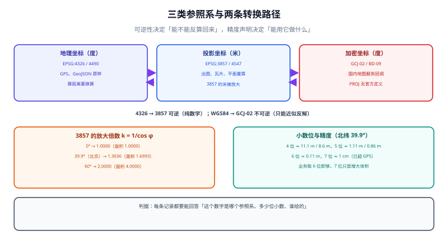

# 坐标系与投影：位置到底怎么记

一条「位置」记录至少包含三个东西：**两个（或三个）数字、一个参照系、一个精度声明**。少任何一个，它都不是位置，而是一组待解释的数字。这一页把三件事说清：有哪几类参照系、它们之间怎么换、换的时候会丢什么。

::: tip 一句话理解
坐标系不是「显示设置」，它是**数据的类型**。`4326` 与 `3857` 的差别不是「换个看法」，而是「同一个数字代表不同长度」——而数据库不会替你拦下这个错误。
:::



## 一、三类参照系

| 类别 | 单位 | 典型编号 | 用来做什么 | 用它算距离会怎样 |
| --- | --- | --- | --- | --- |
| **地理坐标（球面）** | 度 | `EPSG:4326`（WGS 84）、`EPSG:4490`（CGCS2000） | 存储、交换、GPS 原始输出 | 得到的是「度」，需要换算；球面/椭球距离要专门函数 |
| **投影坐标（平面）** | 米 | `EPSG:3857`（Web 墨卡托）、`EPSG:4547`（CGCS2000 / 3 度带高斯-克吕格） | 出图、瓦片、需要「平面米」的量算 | 得到的是平面米，**但可能被放大**（3857 只在赤道准确） |
| **加密/偏移坐标** | 度 | GCJ-02（俗称火星坐标）、BD-09 | 国内公开地图服务（高德/腾讯用 GCJ-02，百度用 BD-09） | 与 WGS84 混用 → 整体偏移数百米 |

**判断口径**：问「这个数字是从哪来的」。手机 GPS、北斗终端、无人机的原始输出是 WGS84；国内地图 App 的 SDK 回调多半是 GCJ-02；百度 SDK 是 BD-09；测绘成果可能是 CGCS2000。**来源决定坐标系，不能靠「看起来差不多」猜。**

::: danger 最贵的一次混用：把 GCJ-02 当 WGS84 直接入库
现象：地图上所有点位整体偏移，方向一致、距离相近（量级为**数百米**，随位置不同而异），但接口、数据库、日志全都没有报错。
根因：GCJ-02 的变换算法未公开发布，属于「同一地点两套坐标」的既成事实；它不是一个可以随手 `ST_Transform` 过去的 EPSG 编号——**PROJ 里没有 GCJ-02 的官方定义**。
正确做法：入库时**显式标注来源坐标系**（见下文的 `crs` 列），在边界处（接入第三方数据时）一次性转换，并保留原始值；绝不在数据库里混存两种坐标系。
:::

## 二、`EPSG:4326` 的两个陷阱

### 陷阱一：轴序

EPSG 对 4326 的官方定义是**纬度在前（lat, lon）**，而 GeoJSON（RFC 7946）与 PostGIS 的 `ST_MakePoint(x, y)` 都是**经度在前**。这两个约定同时存在于世界上：

| 场景 | 顺序 | 例子 |
| --- | --- | --- |
| EPSG 官方 / WMS 1.3.0 的 `CRS:84` 之外 | `lat, lon` | `EPSG:4326` 的权威轴序 |
| GeoJSON（RFC 7946） | `lon, lat` | `[116.3975, 39.9087]` |
| PostGIS | `x=lon, y=lat` | `ST_MakePoint(116.3975, 39.9087)` |
| 大多数前端地图库 | `[lng, lat]` | `new maplibregl.LngLat(lng, lat)` |

**后果**：`ST_MakePoint(39.9087, 116.3975)` 在语法上完全合法，落在「北纬 116°」——一个地球上不存在的位置（纬度上限 90°）。PostGIS 会直接报 `latitude or longitude exceeded limits` 吗？对 `geometry` **不会**，它只当作一个普通平面点存下；只有 `geography` 与部分函数才会校验。这就是为什么「北京的点跑到地图外」经常要等到出图才发现。

### 陷阱二：小数位与精度

| 小数位 | 纬度方向分辨率 | 北纬 39.9° 处经度方向 | 说明 |
| --- | --- | --- | --- |
| 4 位 | ≈ 11.1 m | ≈ 8.6 m | 城市级展示够用 |
| 5 位 | ≈ 1.11 m | ≈ 0.86 m | 门店、POI 的常见精度 |
| 6 位 | ≈ 0.111 m | ≈ 0.086 m | 门牌级；再细没有意义 |
| 7 位 | ≈ 1.1 cm | ≈ 0.9 cm | 测量级，超出普通 GPS 能力 |

上表按 `1° 纬度 = 111 042.3 m`、`1° 经度（39.9042°N）= 85 512.6 m` 折算（本机 Vincenty 反解实测，`python` 纯标准库，见[总览](../Overview/index.md)第三节）。**这两个数只在给出纬度的前提下有意义**——同样 1° 经度，赤道上是 111 319.5 m，北纬 60° 只剩 55 800 m 左右。**结论**：业务数据存 6 位小数已经过剩，存 7 位只是在增加存储与日志体积；反过来存 4 位会让「同一栋楼的两个入口」变成同一个点。

## 三、`EPSG:3857` 为什么会「变形」

3857 是等角圆柱投影，它保证**局部形状不变**（小范围内角度正确），代价是**长度与面积随纬度放大**：

| 纬度 | 长度放大 `k = 1/cos φ` | 面积放大 `k²` |
| --- | --- | --- |
| 0° | 1.0000 | 1.0000 |
| 20° | 1.0642 | 1.1325 |
| 30° | 1.1547 | 1.3333 |
| **39.9042°（北京）** | **1.3036** | **1.6993** |
| 45° | 1.4142 | 2.0000 |
| 60° | 2.0000 | 4.0000 |
| 85.0511°（上限） | 11.5919 | 134.3718 |

**用法结论**：
- 3857 **适合**：切瓦片、画线画面、需要「屏幕上一块方形」的场景。
- 3857 **不适合**：算距离、算面积、做「3 公里配送范围」判定。
- 必须在 3857 上算距离时，按 `真实距离 ≈ 平面距离 × cos(φ)` 修正——注意是**逐点**修正，跨纬度范围（如整省）不能用一个系数。

::: warning 「在 3857 上量面积」是最隐蔽的一类错
一个在 3857 上算出的「配送范围 20 km²」，在北京真实只有约 11.8 km²（`20 ÷ 1.6993`）。这个错误不会触发任何异常，只会让运营发现「说好的覆盖范围，实际少了一半」。
判据：任何面积字段都要能回答「这个数是哪个投影下的」。库里如果只有 `ST_Area(geom)` 而没有 SRID 说明，直接判不合格。
:::

## 四、转换：哪些可逆，哪些会丢

| 转换 | 可逆性 | 精度损失 | 说明 |
| --- | --- | --- | --- |
| 4326 → 3857 | **可逆**（纯数学） | 0（浮点舍入除外） | 不涉及基准面平移，PROJ 直接算 |
| 4326 → 4547（高斯-克吕格） | **可逆** | 厘米级（投影本身） | 国内工程坐标常用，注意带号与中央子午线 |
| WGS84 → CGCS2000 | **近似可逆** | 厘米级 | 两者差异在厘米量级，普通业务可忽略，测绘成果不可忽略 |
| WGS84 → GCJ-02 | **不可逆**（只能近似反解） | 反解误差可达米级 | 官方算法未公开，开源实现互不相同 |
| GCJ-02 → BD-09 | **可逆**（公开的加偏公式） | 米级 | 但反解回 WGS84 仍要经过 GCJ-02 的近似反解 |

```python
# pyproj 3.x：显式指定 always_xy，避免轴序踩坑
from pyproj import Transformer

t = Transformer.from_crs("EPSG:4326", "EPSG:3857", always_xy=True)
x, y = t.transform(116.3975, 39.9087)
print(round(x, 2), round(y, 2))     # 12957310.43 4852683.67

back = Transformer.from_crs("EPSG:3857", "EPSG:4326", always_xy=True)
print(back.transform(x, y))         # 回到 (116.3975, 39.9087)，误差 < 1e-9 度
```

```sql
-- PostGIS 侧：SRID 必须显式声明，ST_Transform 才能工作
SELECT ST_AsText(ST_Transform(ST_SetSRID(ST_MakePoint(116.3975, 39.9087), 4326), 3857));
-- 预期：POINT(12957310.43 4852683.67)

-- 反例：没有 SRID 的几何，ST_Transform 会报错而不是猜
SELECT ST_Transform(ST_MakePoint(116.3975, 39.9087), 3857);
-- ERROR:  ST_Transform: Input geometry has unknown (0) SRID
```

::: danger 三个关于转换的常见错误
1. **用 `always_xy=False`**：pyproj 默认遵循 EPSG 权威轴序，`Transformer.from_crs("EPSG:4326", "EPSG:3857")` 在 `always_xy=False` 时会把第一个参数当纬度。**统一写 `always_xy=True`**。
2. **拿 GCJ-02 的坐标去 `ST_Transform`**：数据库不知道 GCJ-02 是什么，它只会把「数字」当 4326 转换，偏移被原样保留，错误被「洗白」成合法数据。
3. **来回转换当无损**：4326 → 3857 → 4326 在浮点上确实几乎无损，但 **GCJ-02 的近似反解来回一次会漂几十厘米到几米**。需要「原始值」的场景必须单独存一列，不要指望能反算回来。
:::

## 五、一个能落地的表结构

```sql
CREATE TABLE place (
  id           bigserial PRIMARY KEY,
  name         text NOT NULL,
  -- 业务主坐标：统一到 4326 存储，供查询与出图
  geom         geometry(Point, 4326) NOT NULL,
  -- 来源追溯：这条坐标当初是什么坐标系来的
  src_crs      text NOT NULL CHECK (src_crs IN ('WGS84','GCJ02','BD09','CGCS2000')),
  -- 原始值：转换前原样保留，便于复算与对账
  src_lng      double precision NOT NULL,
  src_lat      double precision NOT NULL,
  -- 精度声明：米。GPS 原始 5~20，第三方 POI 常见 50~200
  accuracy_m   real,
  created_at   timestamptz NOT NULL DEFAULT now()
);
```

**这张表的三条设计决定**：
1. `geom` 只存一种坐标系（4326）——查询与出图都不需要再判断「这条是什么系」。
2. `src_crs` + `src_lng/lat` 让「偏移几百米」这类事故可以被批量重算，而不是靠回忆。
3. `accuracy_m` 不是装饰：围栏判定、聚合去重、地图缩放级别都要用它（见[地理围栏](../GeoFence/index.md)）。

## 六、本页判据

本页判据族 `GMC-A` ~ `GMC-H`，共 8 条。

| 编号 | 判据 | 判定方式 | 不满足时改哪里 |
| --- | --- | --- | --- |
| `GMC-A` | 每条空间记录都能追溯到来源坐标系 | 表里有 `src_crs` 或等价字段，且取值在枚举内 | 补字段；历史数据靠来源批次反推 |
| `GMC-B` | 主几何列只有一个 SRID，且写在列定义里 | `geometry(Point, 4326)` 这类 typmod 存在 | 补 typmod，禁止裸 `geometry` |
| `GMC-C` | 所有构造点的代码都显式写明轴序 | 代码里 `ST_MakePoint(lon, lat)` 且变量名不叫 `x/y` | 改名或加注释；`always_xy=True` |
| `GMC-D` | 对外坐标格式与内部存储的轴序有对照说明 | 文档里有「GeoJSON 是 [lon, lat]」这类句子 | 补文档；前端入口做一次断言 |
| `GMC-E` | 距离/面积字段标注了所在投影 | 字段名或注释含 `3857` / `4326` / `球面` | 补标注，或在接口层统一换算成米 |
| `GMC-F` | 不使用 GCJ-02 数据参与 `ST_Transform` | 代码检索 `ST_Transform` 的输入来源 | 在接入层转换并落 `src_crs` |
| `GMC-G` | 小数位与业务精度匹配（4~6 位），且入库做范围校验 | 经纬度范围检查（lat ∈ [-90,90]，lon ∈ [-180,180]） | 加 `CHECK` 约束；`geography` 会自动校验 |
| `GMC-H` | 转换链路的可逆性有结论（哪些可逆、哪些只近似） | 文档里有可逆性表，或代码里有「不反算」的注释 | 见本页第四节 |

## 七、验证方式

```shell
# 1) 坐标合法性（应返回 false 或报错，而不是静默接受）
psql -c "SELECT ST_Y(ST_SetSRID(ST_MakePoint(39.9087, 116.3975), 4326)) AS lat;"
# 预期：39.9087 —— 注意这里「纬度」被当成了 x，正是轴序错误的形状；
#       换成 geography 会直接报错：lng 116.3975 被当纬度时会超限

psql -c "SELECT ST_SRID(geom) FROM place LIMIT 3;"
# 预期：三行都是 4326

# 2) 转换往返一致性（误差应 < 1e-9 度）
psql -c "SELECT ST_X(g2) - 116.3975 AS dx
         FROM (SELECT ST_Transform(ST_Transform(
                 ST_SetSRID(ST_MakePoint(116.3975, 39.9087), 4326), 3857), 4326) AS g2) t;"

# 3) 3857 的放大倍数（应与本页表格一致）
python -c "import math; print(round(1/math.cos(math.radians(39.9042)), 4))"
# 预期：1.3036
```

**读法**：第 1 步如果「不报错」也不代表写对了——它可能只是把错误存了进去。要判死，得用 `geography` 版本再跑一次，或者加一条 `CHECK (ST_Y(geom) BETWEEN -90 AND 90)`。

## 参考资料

- [EPSG:4326](https://epsg.io/4326) / [EPSG:3857](https://epsg.io/3857)：官方定义与轴序
- [RFC 7946 · The GeoJSON Format](https://www.rfc-editor.org/rfc/rfc7946)：`[lon, lat]` 的规范来源
- [pyproj 文档 · Transformer](https://pyproj4.github.io/pyproj/stable/api/transformer.html)：`always_xy` 的语义
- [PROJ 官方文档](https://proj.org/)：投影与基准面转换的权威实现
- [本专题 · 空间建模与索引](../Modeling/index.md)
