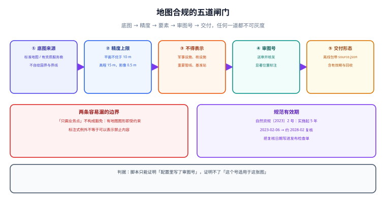

# 地图数据合规与离线交付

在国内做地图功能，「能显示」和「可以显示」是两条独立的门槛。这一页把前者之外的那条线讲清：**谁能画、画多细、什么不能画、画完要标什么**。它是本专题里唯一一页**不能靠技术手段补救**的内容——其余页面错了可以改，这一页错了是「上线即违规」。

::: tip 一句话理解
合规不是上线前的一次检查，而是**四条设计约束**：底图必须来自有资质的一方、精度有上限、部分要素不得表示、对外发布要带审图号。四条都落在架构里，而不是落在文案里。
:::



## 一、三份文件，各管一段

| 文件 | 性质 | 管什么 | 工程含义 |
| --- | --- | --- | --- |
| 《中华人民共和国测绘法》（2017 年修订，2017-07-01 施行） | 法律 | 测绘活动、资质、成果管理 | 从事测绘活动要有资质；成果使用有边界 |
| 《地图管理条例》（国务院令第 664 号，2015-11-26 公布，**2016-01-01 施行**） | 行政法规 | 地图编制、审核、出版、**互联网地图服务** | 公开地图要送审并核发审图号；互联网地图服务要资质 |
| 《公开地图内容表示规范》（**自然资规〔2023〕2 号**，2023-02-06 印发） | 行政规范性文件 | 具体「怎么表示」：疆域、边界、精度、禁止表示的内容 | 逐条落到数据与样式上 |

::: warning 这份规范有明确的有效期，必须进日历
《公开地图内容表示规范》第二十三条写明「本规范自颁布之日起实施，**有效期 5 年**」，同时废止 2003 年与 2009 年两份旧规定。按 2023-02-06 起算，**2028 年 2 月前后需要复核是否换版**。
工程做法：把「规范版本号 + 复核日期」写进地图服务的配置与发布检查单，而不是记在某个人的待办里。
:::

## 二、闸门一：底图从哪来

| 做法 | 合规性 | 说明 |
| --- | --- | --- |
| 用自然资源部**标准地图服务**（`bzdt.ch.mnr.gov.cn`）的图 | ✅ 可直接引用 | 仍需标注审图号；不得自行改动国界、行政区域界线 |
| 用有资质的互联网地图服务商（高德/腾讯/百度/天地图）的底图与 SDK | ✅ 由服务商承担底图合规 | 你的业务图层叠加在上面，仍受精度与要素条款约束 |
| 用 OpenStreetMap 瓦片 | ⚠️ 需评估 | 国界表示与国内规范不一致，**不能直接作为对外公开的中国地图底图** |
| 自己画国界/省界 | ❌ | 国界必须按国务院批准公布的标准样图绘制 |

**一句话**：**不要自己生产底图**。国内项目的正确姿势是「合规底图 + 自己的业务图层」，边界与疆域交给有资质的一方。

## 三、闸门二：精度上限（这是硬数字）

《公开地图内容表示规范》对表现地为我国境内的地图给出了明确上限：

| 项 | 上限 | 工程含义 |
| --- | --- | --- |
| 平面精度 | **不优于 10 m（不含）** | 不要提供优于 10 m 的坐标精度；坐标保留位数与「精度声明」要匹配 |
| 高程精度 | **不优于 15 m（不含）** | 有高程字段时同样受限 |
| 等高距 | **不小于 20 m（不含）** | 不做高精度等高线 |
| 遥感影像地面分辨率 | **不得优于 0.5 m** | 自采影像不能比 0.5 m 更清晰 |

::: danger 「精度」不只是坐标，还包括你的产品行为
- 坐标存 7 位小数（厘米级）本身就是一种「优于 10 m」的能力声明。业务上没必要，合规上也不必要——**存 6 位（约 0.1 m）已经过剩，建议按业务取下限**。
- 更隐蔽的是**产品行为**：如果页面提供「测距/测面积」并且结果精确到厘米，等于把高精度能力暴露给用户。对照规范，这类功能要收敛精度或明确标注「示意」。
- 遥感影像类底图（无人机航拍、卫星图）要单独核对分辨率条款，不能沿用矢量底图的结论。
:::

## 四、闸门三：不得表示的要素

规范第二十条列出了境内地图**不得表示**的内容（对社会公众开放的除外），包括但不限于：

- 军事设施：指挥机关、军用机场港口、营区、试验场、军用仓库、军用信息基础设施、边防海防管控设施等；
- 危险品与核设施：武器弹药与危险化学品集中存放地、核材料战略储备库、核电站等；
- 国家安全要害部门；
- 石油、天然气等重要管线；
- 军民合用机场、港口、码头的重要设施；
- **卫星导航定位基准站**；
- 国家禁止公开的其他内容。

第二十一条进一步限制**属性**：如重要桥梁的限高限宽净空载重、隧道高度宽度、江河通航能力与水深、水库库容、电力电信与给排水管廊等。

**工程含义**：如果你的 POI 表里带 `category`，需要一张「类别 → 是否可公开」的映射表，并且**在出图前过滤**，而不是等审核时人工看。这张表是产品与法务的共同产出，不是工程师自己定的。

## 五、闸门四：审图号

| 情形 | 要不要送审 | 要不要标审图号 |
| --- | --- | --- |
| 直接使用标准地图服务提供的图，未改动界线 | 不需要重复送审 | **要标** |
| 自行编制并向社会公开的地图 | **要送审**（有审核权的自然资源主管部门） | 要标，且「适当位置显著标注」；出版物在版权页标 |
| 景区图、街区图、地铁线路图等**内容简单**的地图 | 条例第十五条列为例外 | 按实际情况处理，但不得表示禁止内容 |
| 互联网地图服务（提供定位、上传标注、地图数据库开发） | 需依法取得相应**测绘资质** | 与服务资质一并管理 |

::: warning 「我们只画业务点，不画地图」不构成豁免
只要页面上出现了**地图图形**（哪怕是第三方底图截图、示意图、手绘轮廓），就落入「公开地图或者附着地图图形产品」的范围。判断标准不是「你有没有画国界」，而是「读者会不会把它当地图看」。
反过来，纯表格、纯坐标列表、不含地图图形的统计图表，不属于地图表示——这条边界要在需求评审时就写清，避免把「数据大屏」和「地图」混为一谈。
:::

## 六、闸门五：离线交付与出境

离线包（内网部署、车载、终端 SDK）在合规上比在线服务更容易出事，因为它**脱离了在线审核与巡查**。

| 项 | 要求 | 落地做法 |
| --- | --- | --- |
| 包内底图来源 | 必须是已审核的图 | 包内附 `source.json`：来源、审图号、版本、生成时间 |
| 包内边界数据 | 必须来自标准样图 | 禁止使用第三方抓取的行政区划边界 |
| 版本与回收 | 规范换版或审图号失效时要能停用 | 包内带 `expire_at`，客户端启动校验并提示升级 |
| 出境/对外提供 | 测绘成果的对外提供与出境依法管理 | 有境外用户的场景必须提前评估，不要默认「云端就能给」 |

```json
// 离线瓦片包的元数据（随包发布，可被校验脚本读取）
{
  "pack": "basemap-cn-v3",
  "generated_at": "2026-10-22T08:00:00+08:00",
  "map_review_no": "GS(2023)XXXX号",
  "spec_version": "自然资规〔2023〕2号",
  "spec_review_due": "2028-02-05",
  "crs": "GCJ-02",
  "min_resolution_m": 0.5,
  "max_zoom": 16,
  "expire_at": "2027-10-22"
}
```

## 七、上线前自查清单

1. 底图来源可追溯（服务商 / 标准地图 / 已审核的自有图），且有书面授权或公开许可依据。
2. 页面或产品上**能看到**审图号（截图留证）。
3. 坐标精度、影像分辨率、等高距三项都满足「不优于」条款。
4. POI 类别表里没有禁止表示的要素；出图链路有过滤，不是靠人眼。
5. 边界数据来自标准样图，没有被「美化」「简化」到失真。
6. 离线包带元数据与过期时间，客户端能校验。
7. 规范版本与复核日期已进日历（2028-02 前后）。
8. 有境外访问/对外提供的场景，已完成合规评估。

## 八、本页判据

本页判据族 `GML-A` ~ `GML-H`，共 8 条。

| 编号 | 判据 | 判定方式 | 不满足时改哪里 |
| --- | --- | --- | --- |
| `GML-A` | 底图来源、授权方式、审图号可在配置里读到 | 存在 `basemap.json` 之类的配置 | 补配置；不要只写在 wiki |
| `GML-B` | 页面上有审图号的可见位置 | 前端模板里能搜到审图号字段 | 补页脚或「关于地图」入口 |
| `GML-C` | 坐标精度声明与存储位数匹配，且不优于 10 m | 表结构 + 文档 | 收敛小数位；补精度声明 |
| `GML-D` | 影像/等高线类数据单独核对过分辨率条款 | 有评估记录 | 见第三节 |
| `GML-E` | 禁止表示要素有类别映射表，且出图前过滤 | 映射表存在、过滤在服务端 | 见第四节 |
| `GML-F` | 边界数据来源是标准样图，无自行绘制 | `source.json` 或数据字典 | 替换数据源 |
| `GML-G` | 离线包带元数据（来源、审图号、有效期） | 包内有 `source.json` | 见第六节 |
| `GML-H` | 规范版本与复核日期进日历（含 5 年有效期） | 有到期提醒或发布检查单条目 | 见第一节的 warning |

## 九、验证方式

```shell
# 1) 页面是否真的带审图号（应能命中）
grep -rn "GS(" --include="*.vue" --include="*.ts" --include="*.html" src/ | head -5

# 2) 底图配置是否可追溯（应能读出 source 与 review no）
cat public/config/basemap.json | python -m json.tool | head -20

# 3) 坐标位数自查：找出超过 6 位小数的坐标字段（业务上通常无必要）
python -c "
rows=['116.3975123','39.9087123','116.3975']
print([r for r in rows if len(r.split('.')[-1])>6])"
# 预期：['116.3975123', '39.9087123'] —— 这两条应被收敛或说明理由
```

```sql
-- 4) 禁止表示的类别是否还在出图链路里（应为 0）
SELECT count(*) FROM poi
WHERE category IN ('military', 'nuclear', 'pipeline', 'gnss_base_station')
  AND publishable IS NOT FALSE;
-- 预期：0；非 0 说明过滤没生效，属于上线阻断项
```

::: danger 这一页的判据不能只靠巡检脚本
上面 8 条里，只有 A/B/G/H 能被机械检查；C/D/E/F 需要**人与法务共同确认**。把「脚本全绿」当成「合规通过」是这个领域最危险的误判——脚本能证明「配置里写了审图号」，但证明不了「这个审图号适用于你现在这张图」。
:::

## 参考资料

- [中国政府网 · 地图管理条例（国务院令第 664 号）](https://www.gov.cn/govweb/gongbao/content/2016/content_2979707.htm)
- [中国政府网 · 公开地图内容表示规范（自然资规〔2023〕2 号）](https://www.gov.cn/gongbao/content/2023/content_5752310.htm)
- [自然资源部标准地图服务](http://bzdt.ch.mnr.gov.cn/)
- 《中华人民共和国测绘法》（2017 年修订，2017-07-01 施行）：建议以中国人大网 / 自然资源部公布的正式文本为准，本文不引用具体条号
- [本专题 · 瓦片服务与切片](../Tiles/index.md)
