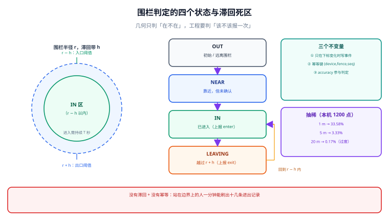

# 地理围栏与轨迹：判定、去抖与抽稀

地理围栏（Geofence）是「一个多边形 + 一条触发规则」，轨迹（Trajectory）是「一串带时间的位置」。两者结合，才有打卡、到店提醒、进出区域统计、配送签收这些功能。这一页的重点不是「怎么判断点在多边形内」，而是**怎么让判定结果稳定到可以计费**。

::: tip 一句话理解
围栏的难点不是几何，是**噪声**：GPS 会漂、点会重复、边界会来回跨。工程上要做的三件事是——**边沿触发、滞回去抖、幂等落库**。
:::



## 一、点是否在面内：三种判定与它们的差别

| 写法 | 边界点 | 索引可用 | 备注 |
| --- | --- | --- | --- |
| `ST_Covers(poly, pt)` | 算在内 | ✅（poly 上有 GiST） | 围栏默认用它 |
| `ST_Contains(poly, pt)` | 不算 | ✅ | 需要「严格内部」时用 |
| `ST_DWithin(pt::geography, center::geography, r)` | 圆边界算在内 | ✅ | 圆形围栏的首选，无需多边形 |

```sql
-- 候选 → 精判：先按外包框取候选，再逐条判（与瓦片/查询同一套两级过滤）
SELECT f.id, f.name
FROM geofence f
WHERE ST_Covers(f.geom, ST_SetSRID(ST_MakePoint(:lng, :lat), 4326))
  AND f.active
LIMIT 10;
```

**为什么不用先手写 `&&`**：`ST_Covers` 会自动加外包框预过滤，索引照样生效。手写 `&&` 只在「一个查询里要判多个不同谓词」时才需要提前收窄。

::: danger `geography` 上没有 `ST_Contains`，只有 `ST_Covers`
如果你的围栏表用的是 `geography` 列，写 `ST_Contains` 会直接报「函数不存在」。这不是版本问题，是设计如此——球面上「包含」的边界语义比平面上更难定义，PostGIS 只提供了 `ST_Covers`/`ST_CoveredBy`/`ST_Intersects`。
迁移建议：**围栏几何用 `geometry(4326)` 存**（保留全部函数），判定时按需 `::geography` 转；不要为了「自动有米」把整张表设成 `geography`，否则后面的面积、缓冲、简化全都会被卡住。
:::

## 二、四个状态与滞回：为什么「进出」必须带死区

| 状态 | 进入条件 | 退出条件 | 上报事件 |
| --- | --- | --- | --- |
| `OUT` | 初始 | 距离 < r − h | 进入 `NEAR` |
| `NEAR` | 距离 < r − h（h 为滞回带） | 距离 > r + h 或 距离 < r − h 持续 T | — |
| `IN` | 距离 < r − h 且持续 T | 距离 > r + h 持续 T | `enter` |
| `LEAVING` | 距离 > r + h | 回到 r − h 内 | `exit` |

- **h（滞回带）**：建议取 `max(30 m, 2 × accuracy_m)`。小于这个值，站在边界上的人会每分钟触发十几次进出。
- **T（持续时间）**：建议 30~60 s，且**只在客户端能稳定采样时生效**；打车/配送这类移动场景可以短到 10 s。

::: warning 只做「点在不在里面」的判定，一定会产生重复事件
GPS 采样点本身是带误差的：同一位置连续 10 个点，可能 6 个在里、4 个在外。如果每次「在里」都发一次 `enter`，一小时能产生上百条事件。
**最小修法**：在服务端维护「设备 × 围栏」的当前状态，只在**状态变化**时写入事件；客户端的上报一律带 `seq`（自增）与 `ts`，服务端按 `(device_id, geofence_id, seq)` 去重。
:::

## 三、幂等落库：一张表解决「重复上报」

```sql
CREATE TABLE fence_event (
  device_id   text        NOT NULL,
  fence_id    bigint      NOT NULL,
  seq         bigint      NOT NULL,       -- 客户端自增，重传时不变
  kind        text        NOT NULL CHECK (kind IN ('enter','exit')),
  occurred_at timestamptz NOT NULL,       -- 设备时间
  received_at timestamptz NOT NULL DEFAULT now(),
  lng         double precision NOT NULL,
  lat         double precision NOT NULL,
  accuracy_m  real,
  PRIMARY KEY (device_id, fence_id, seq)   -- 幂等键
);

CREATE TABLE fence_state (
  device_id   text   NOT NULL,
  fence_id    bigint NOT NULL,
  state       text   NOT NULL CHECK (state IN ('OUT','NEAR','IN','LEAVING')),
  updated_at  timestamptz NOT NULL DEFAULT now(),
  PRIMARY KEY (device_id, fence_id)
);
```

**两个设计决定**：
1. **事件表只追加、不改**：它是计费/考勤的证据，任何「修正」都应写新事件并注明覆盖关系。
2. **状态表可以覆盖**：它只是「现在在哪」，用来做边沿触发；丢了可以从事件表重建（这是它敢用 `UPSERT` 的原因）。

```sql
-- 边沿触发 + 幂等：一条语句完成「状态迁移 + 事件写入」
WITH cur AS (
  SELECT state FROM fence_state WHERE device_id = :d AND fence_id = :f FOR UPDATE
), next AS (
  SELECT CASE WHEN :inside THEN 'IN' ELSE 'OUT' END AS state
)
INSERT INTO fence_state (device_id, fence_id, state)
SELECT :d, :f, next.state FROM next
ON CONFLICT (device_id, fence_id)
DO UPDATE SET state = EXCLUDED.state, updated_at = now()
WHERE fence_state.state IS DISTINCT FROM EXCLUDED.state
RETURNING state;
-- 返回行即「状态真的变了」，此时才写 fence_event；无返回行说明是重复点
```

## 四、轨迹抽稀：抽多少、丢什么

轨迹点最贵的不是存储，是**查询与瓦片**（每个点都要进索引、进瓦片）。Douglas-Peucker 是最常用的抽稀算法，本机用 1 200 个模拟 GPS 点（北京，含 ±1.3e-5 度噪声）跑了一遍（脚本不入库）：

| 容差 | 保留点数 | 保留率 | 适用 |
| --- | --- | --- | --- |
| 1 m | 403 | 33.58% | 骑行/跑步轨迹的「高保真」展示 |
| 2 m | 167 | 13.92% | 步行导航回放 |
| 5 m | 40 | 3.33% | 配送路线概览 |
| 10 m | 16 | 1.33% | 行程统计、里程计算 |
| 20 m | 2 | 0.17% | 只剩起终点（**明显过度**） |

**读法**：5 m 容差就能把点数压到 1/30，而视觉上几乎看不出差别——这就是「抽稀是性价比最高的一步」。但 20 m 会把整条轨迹压成一条直线，**里程统计会严重偏小**。

::: danger 抽稀必须在「保留原始 + 生成简化版」的前提下做
- **原始轨迹**：全量入库（可按月分区/按冷热分层），用于纠纷复盘、算法重算。
- **简化轨迹**：由原始算出的物化结果，带 `simplify_eps` 与 `generated_at`，可随时重算。
把原始点直接覆盖成简化点，等于**扔掉唯一能重算的证据**，且不同业务（展示 / 里程 / 停留识别）需要的容差不同，一份简化结果满足不了全部。
:::

## 五、停留点识别：三个阈值缺一不可

| 参数 | 典型值 | 作用 |
| --- | --- | --- |
| 速度阈值 | < 1 m/s | 判断「没在移动」 |
| 时间阈值 | ≥ 180 s | 排除等红灯、堵车 |
| 距离半径 | ≤ 100 m | 把「在同一栋楼里走动」算作同一点 |

**为什么不只看速度**：GPS 静止时速度可能报 0.3 m/s，也可能报 2 m/s（漂移）。所以要「速度 + 持续时间 + 空间半径」三者同时满足，且最后按**时间排序**合并相邻簇。

**与围栏的关系**：停留点识别回答「他在哪待了多久」，围栏回答「他进出过哪些区域」。两者可以互相校验——「在围栏内停留 20 分钟，但没有任何 `enter` 事件」说明上报链路漏了。

## 六、本页判据

本页判据族 `GMF-A` ~ `GMF-H`，共 8 条。

| 编号 | 判据 | 判定方式 | 不满足时改哪里 |
| --- | --- | --- | --- |
| `GMF-A` | 围栏判定用 `ST_Covers` 且写明边界算内 | SQL 与文档一致 | 统一函数；补边界用例 |
| `GMF-B` | 事件有幂等键，重传不产生重复行 | 表上有唯一键 `(device, fence, seq)` | 补唯一键 |
| `GMF-C` | 只在状态变化时写事件（边沿触发） | 有 `fence_state` 或等价状态 | 见第三节 SQL |
| `GMF-D` | 滞回带 `h` 与持续时长 `T` 有取值依据 | 配置里可读出两个数，且 `h ≥ 2×accuracy` | 补配置；别写死 0 |
| `GMF-E` | `accuracy_m` 随点上报并参与判定 | 表里有字段，判定逻辑引用它 | 补字段 |
| `GMF-F` | 轨迹保留原始 + 物化简化版（两份） | 表结构或存储路径能看出两层 | 见第四节 |
| `GMF-G` | 抽稀容差与用途绑定（展示/里程/停留各一档） | 有「用途 → 容差」表 | 补表；20 m 那档要慎用 |
| `GMF-H` | 停留点识别三参数都配置化 | 速度/时间/半径三项可配 | 补配置；硬编码无法按场景调 |

## 七、验证方式

```python
# 滞回状态机的可执行自检（本机可跑，纯标准库）
def step(state, dist, r=500.0, h=60.0, t_ok=True):
    """返回新状态。r±h 构成死区：进用 r-h，出用 r+h。"""
    if state == "OUT":
        return "NEAR" if dist < r + h else "OUT"
    if state == "NEAR":
        if dist < r - h and t_ok:
            return "IN"
        return "OUT" if dist > r + h else "NEAR"
    if state == "IN":
        return "LEAVING" if dist > r + h else "IN"
    if state == "LEAVING":
        return "IN" if dist < r - h else "LEAVING"
    raise ValueError(state)

s = "OUT"
for d in (800, 480, 460, 445, 430, 500, 545, 570, 480):
    s = step(s, d, t_ok=True)
    print(d, s)
# 预期：
# 800 OUT / 480 NEAR / 460 NEAR / 445 NEAR / 430 IN
# 500 IN / 545 IN / 570 LEAVING / 480 IN
# 关键：445 与 460 都在 r-h 之外，不会触发 IN；545 在 r+h 之内，不会退出——
# 这就是死区挡住「在边界上来回抖」的作用。
```

```sql
-- 幂等自检：同一条事件重传两次，第二次不新增行
INSERT INTO fence_event (device_id, fence_id, seq, kind, occurred_at, lng, lat)
VALUES ('dev-1', 42, 7, 'enter', now(), 116.3975, 39.9087)
ON CONFLICT DO NOTHING;
INSERT INTO fence_event (device_id, fence_id, seq, kind, occurred_at, lng, lat)
VALUES ('dev-1', 42, 7, 'enter', now(), 116.3975, 39.9087)
ON CONFLICT DO NOTHING;
SELECT count(*) FROM fence_event WHERE device_id = 'dev-1' AND fence_id = 42 AND seq = 7;
-- 预期：1
```

## 参考资料

- [PostGIS 官方文档 · `ST_Covers`](https://postgis.net/docs/ST_Covers.html)
- [PostGIS 官方文档 · `ST_Simplify` / `ST_SimplifyPreserveTopology`](https://postgis.net/docs/ST_Simplify.html)
- [PostGIS 官方文档 · `ST_ClusterDBSCAN`（停留点聚类的常用起点）](https://postgis.net/docs/ST_ClusterDBSCAN.html)
- [Douglas-Peucker 原始论文（David Douglas, Thomas Peucker, 1973）](https://doi.org/10.3138/FM57-6770-U75U-7727)
- [本专题 · 空间查询与距离](../Query/index.md)
