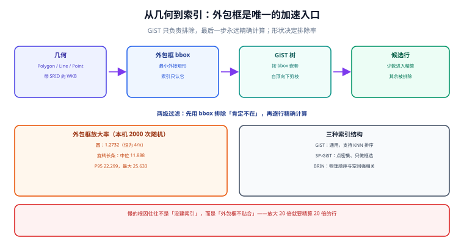

# 空间建模与索引：几何类型与 GiST

选定坐标系之后，下一个决定是「用什么类型存、建什么索引」。这两个决定绑在一起：**GiST 索引建在外包框上，而外包框的含义取决于几何类型与 SRID**。选错类型的后果不是报错，而是「查询结果偏了」或「索引完全没用上」。

::: tip 一句话理解
空间索引不是「给几何加个索引」，而是**给几何的外包框建一棵树**——它只负责快速排除「肯定不在范围里」的对象，最后一步永远要精确计算。理解这句话，就能理解为什么有些查询「加了索引还是慢」。
:::



## 一、`geometry` 还是 `geography`

| 维度 | `geometry` | `geography` |
| --- | --- | --- |
| 数学模型 | 平面（欧氏） | 球面（可切椭球） |
| 默认 SRID | 无（0，可显式指定） | 固定 4326 |
| 距离单位 | 跟随 SRID：4326 是度，3857 是米 | **米** |
| 面积单位 | 跟随 SRID | 平方米 |
| 函数覆盖 | 完整（`ST_Contains`、`ST_Buffer`、`ST_Simplify`…） | **窄**：没有 `ST_Contains`，用 `ST_Covers`；没有 `ST_Buffer` |
| 索引 | GiST / SP-GiST / BRIN | GiST |
| 适用场景 | 需要投影、缓冲、简化、栅格叠加 | 只需「距离 / 包含 / 相交」，且要求米 |

**选择口径**：
1. 需求里出现「米」并且要精确 → 存 `geometry(…, 4326)`，查询时 `::geography` 转一下（索引仍可用，走 GiST 的地理版本）。
2. 需求里有缓冲、简化、叠加分析 → 必须 `geometry`，在合适的投影下算。
3. 只需要「附近 / 落在区域内」且能接受球面近似 → 直接 `geography`，省掉单位换算。

::: danger 混用的两种写法都会「成功但不准」
- `geography` 上写 `ST_Contains(geog, point)` → **函数不存在**，报错（这是好事）。
- `geometry(4326)` 上写 `ST_DWithin(a, b, 1000)` → 语法合法、结果错：这里的 `1000` 是**度**，等于绕地球 2.7 圈，于是「返回全表」。它不报错，还被当成「范围内有 100 万条，索引没建对」。
:::

## 二、几何类型与三个「附加维度」

| 类型 | 用途 | 常见坑 |
| --- | --- | --- |
| `Point` | POI、设备位置 | 一个 `Point` 只有一个坐标，不要用 `MultiPoint` 存「同一条记录多个位置」 |
| `LineString` | 道路、轨迹、配送路线 | 轨迹点数过多会让索引与瓦片都变慢（见[围栏与轨迹](../GeoFence/index.md)） |
| `Polygon` | 行政区、围栏、配送范围 | 自相交、重复点、环未闭合 → 包含判定反直觉 |
| `MultiPolygon` | 多块区域（如海岛县） | `ST_Contains` 对 Multi 的语义与「任一子面包含」一致，但要留意空洞 |
| `GeometryCollection` | 混合类型 | 多数索引与简化函数对它的支持最弱，**能拆就拆** |

**Z / M 维度**：`POINT Z` 的高度**不参与 2D 索引与 2D 谓词**。也就是说，`ST_DWithin` 在三维数据上仍然是「平面距离」。需要三维距离必须显式用 `ST_3DDistance`，并且索引帮不上忙。

```sql
-- Z 维度被忽略的实证形状（本机未跑，按官方文档语义编写）
SELECT ST_Distance(
         ST_MakePoint(0, 0, 0),
         ST_MakePoint(0, 0, 1000)
       ) AS d2d,           -- 0：只比 x/y
       ST_3DDistance(
         ST_MakePoint(0, 0, 0),
         ST_MakePoint(0, 0, 1000)
       ) AS d3d;           -- 1000
```

## 三、索引：三种结构，三种适用面

| 索引 | 结构 | 擅长 | 不擅长 | 建法 |
| --- | --- | --- | --- | --- |
| **GiST** | R 树（外包框嵌套） | 任意几何、范围查询、KNN 排序 | 极高密度点（树深、重叠框多） | `USING gist (geom)` |
| **SP-GiST** | 四叉树 / k-d 树 | 点数据、分布均匀、只做「包含于框」 | 线/面、需要 KNN 排序 | `USING spgist (geom)` |
| **BRIN** | 块级 min/max | 物理顺序与空间顺序强相关（按时间追加的轨迹） | 随机写入 | `USING brin (geom)` |

**为什么 GiST 是默认选择**：它把每个几何的**外包框**存进树里，查询时先用外包框快速排除大部分行（`&&` 运算符），再对留下的候选做精确计算。所以：

- 谓词里有 `&&`（或能自动加上的函数，如 `ST_DWithin`、`ST_Intersects`）→ 索引生效。
- 谓词是 `ST_Distance(a, b) < 1000`（把列包进函数）→ **索引不生效**，全表算距离。

```sql
-- 好：ST_DWithin 内部会先做 && 预过滤
SELECT id FROM poi
WHERE ST_DWithin(geom::geography, ST_SetSRID(ST_MakePoint(116.3975, 39.9087), 4326)::geography, 1000);

-- 差：函数包住列，GiST 无法前置过滤（能出结果，但退化为全表）
SELECT id FROM poi
WHERE ST_Distance(geom::geography, ST_SetSRID(ST_MakePoint(116.3975, 39.9087), 4326)::geography) < 1000;
```

**「预过滤能排除多少」取决于外包框形状**。本机对 2 000 个随机旋转的长条缓冲区算过（脚本不入库）：

| 查询形状 | 外包框面积 ÷ 真实面积 | 含义 |
| --- | --- | --- |
| 圆（半径 r） | **1.2732**（恒为 4/π） | 索引多放 27% 的候选进来 |
| 长宽比 1~8 的旋转椭圆（中位数） | **11.888** | 候选集放大一个量级 |
| 同上，P95 | **22.299** | 最坏一批查询要精算 22 倍的行 |
| 同上，最大值 | **25.633** | — |

**读法**：这就是「加了几何索引还是慢」的算术解释——**索引只按外包框排除**，一条沿对角线延伸的配送路线，其外包框可能覆盖整个城市，于是「索引命中了 50 万行，再逐行精算」。对策不是换索引，而是**把查询形状换掉**（用瓦片/网格预聚合）或**把大几何切开**（`ST_Subdivide`）。

::: warning `ST_Subdivide` 的真正作用不是「变小」，是「让外包框更贴合」
一个跨省的多边形，外包框几乎是整个省。切成 256 个顶点以内的小块后，每块的外包框只覆盖自己那一小片，`&&` 的排除率立刻上升。代价是行数变多、需要额外维护（切分表或物化视图）。
判据：如果 `EXPLAIN (ANALYZE)` 显示 `Rows Removed by Index Recheck` 很大，说明外包框不贴合，先考虑切分再考虑换硬件。
:::

## 四、几何合法性：三类「看起来正常」的坏几何

| 问题 | 症状 | 检测 | 修复 |
| --- | --- | --- | --- |
| **自相交**（蝴蝶结） | `ST_Contains` 结果时真时假；`ST_Area` 可能为负 | `ST_IsValid(geom) = false` | `ST_MakeValid(geom)`（可能返回 MultiPolygon） |
| **环未闭合 / 重复点** | GeoJSON 导出后前端报错 | `ST_NPoints` / `ST_IsClosed` | 重建环：`ST_RemoveRepeatedPoints` + 首尾闭合 |
| **经纬度越界** | `geometry` 静默接受，`geography` 报错 | `CHECK (ST_Y(geom) BETWEEN -90 AND 90)` | 入库前校验，别指望类型 |

```sql
-- 入库闸门：合法性检查写成约束，而不是靠自觉
ALTER TABLE area
  ADD CONSTRAINT area_geom_valid CHECK (ST_IsValid(geom));

-- 巡检：找出历史坏数据（会扫描全表，放在低峰跑）
SELECT id, ST_IsValidReason(geom) AS reason
FROM area
WHERE NOT ST_IsValid(geom)
LIMIT 20;
```

::: danger 不要在生产里直接跑 `UPDATE … SET geom = ST_MakeValid(geom)`
`ST_MakeValid` 可能把 `Polygon` 变成 `MultiPolygon`，甚至改变顶点顺序。这会**打断任何依赖固定几何形状的下游**（瓦片 ID、缓存键、审计快照）。
正确顺序：① 先 `SELECT` 出问题行并导出；② 在副本表上 `ST_MakeValid` 并比对面积差；③ 面积差超过阈值的人工复核；④ 分批 `UPDATE` 并保留原值列。
:::

## 五、表结构：分区、冗余列与「给查询留的后门」

```sql
-- 大表（千万级 POI）：按 tile_id 分区，索引与清理都能按块做
CREATE TABLE poi (
  id        bigint GENERATED ALWAYS AS IDENTITY,
  name      text NOT NULL,
  geom      geometry(Point, 4326) NOT NULL,
  -- 冗余列：由 geom 生成，用于分区与聚合（不是给人看的）
  tile_id   bigint GENERATED ALWAYS AS (
              (ST_Y(geom) * 1000)::bigint * 1000000 + (ST_X(geom) * 1000)::bigint
            ) STORED,
  geohash7  text,
  PRIMARY KEY (id, tile_id)
) PARTITION BY RANGE (tile_id);

CREATE INDEX ON poi USING gist (geom);
CREATE INDEX ON poi (geohash7);           -- 前缀聚合：按 7 位 geohash 分桶
```

**三条取舍**：
1. **冗余列只为查询服务**：`tile_id` / `geohash7` 让「按区域聚合」不必扫几何，代价是存储与写入时的计算。
2. **分区键选「空间格子」而不是时间**：POI 的查询几乎都带范围，按格子分区能让「查一个城市」只碰一两个分区。
3. **不要给 `geom` 同时建 GiST 与 SP-GiST**：两者解决同一类问题，多一个索引只增加写放大。点数据密集且只做框选时才考虑 SP-GiST。

## 六、本页判据

本页判据族 `GMM-A` ~ `GMM-H`，共 8 条。

| 编号 | 判据 | 判定方式 | 不满足时改哪里 |
| --- | --- | --- | --- |
| `GMM-A` | 几何列有明确的类型与 SRID（typmod） | `\d+ 表名` 里显示 `geometry(Point,4326)` | 补 typmod；裸 `geometry` 判不合格 |
| `GMM-B` | `geometry` 与 `geography` 的选择有书面理由 | 表注释或设计文档写明「要米 / 要缓冲」 | 补一行理由即可，不必长篇 |
| `GMM-C` | 空间索引存在且被 `EXPLAIN` 证明可用 | 计划里出现 `Index Scan using ..._geom_idx` | 改写谓词为 `ST_DWithin` / `&&` |
| `GMM-D` | 没有「函数包住列」的谓词出现在高频查询里 | 代码检索 `ST_Distance(` 后接 `<` 比较 | 改成 `ST_DWithin` 或加 `&&` 预过滤 |
| `GMM-E` | 合法性有闸门（约束或入库校验） | `ST_IsValid` 出现在约束/服务层 | 加 `CHECK` 或服务层校验 |
| `GMM-F` | 大几何（顶点 > 1 万）有切分或简化策略 | 存在 `ST_Subdivide` / `ST_Simplify` 的作业 | 见[瓦片](../Tiles/index.md)的按级简化 |
| `GMM-G` | 3D 数据声明了「Z 不参与索引」这一事实 | 文档或注释里有说明 | 补说明；需要 3D 距离时不要指望索引 |
| `GMM-H` | 索引体积与写入代价被量过（不是凭感觉） | 有 `pg_relation_size` 读数或写入压测 | 见验证方式的第 2 条 |

## 七、验证方式

以下 SQL 需要在装好 PostGIS 的库上执行。**本机没有 PostgreSQL/PostGIS 实例，本节命令未实跑**，预期值按官方文档与上文公式给出；请在自己的库上核对后再纳入验收。

```sql
-- 1) 索引是否真的被用上：看 Index Scan 与 Rows Removed by Index Recheck
EXPLAIN (ANALYZE, BUFFERS)
SELECT count(*) FROM poi
WHERE ST_DWithin(geom::geography, ST_SetSRID(ST_MakePoint(116.3975, 39.9087), 4326)::geography, 1000);
-- 预期：出现 Index Scan；Rows Removed by Index Recheck 若远大于返回行数，
--       说明外包框不贴合（见第三节的放大率表）

-- 2) 索引体积（与行数一起看，才能判断「值不值」）
SELECT pg_size_pretty(pg_relation_size('poi_geom_idx')) AS gist_size,
       pg_size_pretty(pg_relation_size('poi'))           AS heap_size;

-- 3) 坏几何盘点
SELECT count(*) FILTER (WHERE NOT ST_IsValid(geom)) AS invalid,
       count(*)                                      AS total
FROM area;
-- 预期：invalid = 0；非 0 时先按第四节顺序处置，不要直接 UPDATE
```

```shell
# 4) 用「同一查询两种写法」证明谓词形式的影响（本机可跑的部分：估算候选放大率）
python -c "import math; print('圆的外包框放大率', round(4/math.pi, 4))"
# 预期：1.2732 —— 与第三节表格第一行一致
```

## 参考资料

- [PostGIS 官方文档 · Geometry / Geography 类型](https://postgis.net/docs/using_postgis_dbmanagement.html)
- [PostGIS 官方文档 · 空间索引（GiST / SP-GiST / BRIN）](https://postgis.net/docs/using_postgis_dbmanagement.html#gist_indexes)
- [PostGIS 官方文档 · `ST_Subdivide`](https://postgis.net/docs/ST_Subdivide.html)
- [PostGIS 官方文档 · `ST_IsValid` 与 `ST_MakeValid`](https://postgis.net/docs/ST_IsValid.html)
- [PostgreSQL 官方文档 · BRIN 索引](https://www.postgresql.org/docs/current/brin.html)
- [本专题 · 空间查询与距离](../Query/index.md)
