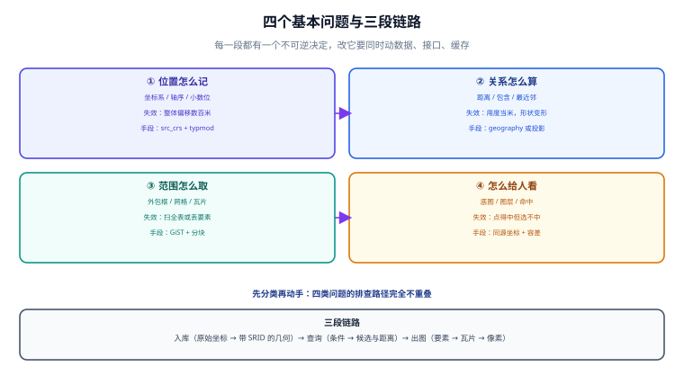

# 总览：四个问题、三段链路与五档成熟度

地图工程看起来是「数据库 + 前端画布」的组合，实际上它只回答四个问题，而每个问题都有独立的失效方式。这一页给出骨架：**先认出手里这件事落在哪个问题上，再决定用哪一层手段去解**。

::: tip 一句话理解
位置问题的本质是**「用哪个参照系、在多粗的格子上、算多远算同一处」**——三个参数一旦没写死，后面的索引、瓦片、渲染全都在补偿一个本来不该存在的错。
:::



## 一、四个基本问题

| 问题 | 工程形态 | 典型失效 | 主要手段 |
| --- | --- | --- | --- |
| **位置怎么记** | 坐标系、精度、轴序 | 同一地点两套坐标差几百米，谁都不报错 | [坐标系与投影](../CRS/index.md) |
| **关系怎么算** | 距离、包含、相交、最近邻 | 用度数当米、边界含不含没定义 | [空间查询](../Query/index.md) |
| **范围怎么取** | 外包框、网格、瓦片 | 查询扫全表；瓦片缝隙或丢要素 | [建模与索引](../Modeling/index.md)、[瓦片](../Tiles/index.md) |
| **怎么给人看** | 底图、图层、命中、交互 | 业务点位整体偏移；点击选不中 | [渲染](../Render/index.md) |

**判断口径**：问一句「如果这里错了，屏幕上会是什么样」。答案是「点整体偏了」→ 第一类；「点是对的但查不到附近的」→ 第二类；「查得到但很慢」→ 第三类；「都对但点不中、看不清」→ 第四类。四类问题的排查路径完全不重叠，**先分类再动手**能省掉大半无效排查。

::: danger 最常见的误判：把坐标系问题当渲染问题
业务方说「地图上的店偏到河里去了」，工程师的第一反应往往是调地图容器的 CSS、换底图、改 `center` 与 `zoom`。但只要偏差是**整体、同向、几百米量级**，那就不是渲染——渲染错会表现为「拉伸、旋转、错位到画布外」，而坐标系错表现为**所有点像被同一阵风刮走**。
判别方法：拿一个已知坐标的地标（如天安门 `116.3975, 39.9087`）打点到页面上，若它也偏，问题在数据源或投影；若它准而 business 数据偏，问题在业务数据的坐标系标注。这条检查只要 2 分钟，能省掉一整天。
:::

## 二、三段链路与各自的「不可逆点」

从一条原始经纬度到屏幕上可点击的要素，要过三段。每段都有一个**过去了就改不动**的决定：

| 段 | 输入 → 输出 | 不可逆点 | 代价 |
| --- | --- | --- | --- |
| **入库** | 原始坐标 → 带 SRID 的几何 | **SRID 与坐标系写进列定义**（`geometry(Point, 4326)`） | 事后改 SRID 要全表 `ST_Transform` 重写 + 重建索引 |
| **查询** | 查询条件 → 候选集与距离 | **距离语义写进接口契约**（米？度？球面？椭球？） | 接口发出去之后，改单位等于改语义，客户端全部要跟 |
| **出图** | 要素 → 瓦片 / GeoJSON → 像素 | **瓦片编号与坐标系绑定**（XYZ + 3857） | 换投影等于换整套瓦片编号，缓存全部作废 |

**为什么叫「不可逆」**：不是技术上改不了，而是**改的时候要同时动数据、接口、缓存三处**。本仓项目侧的经验是：一次 SRID 变更 ≈ 一次小型迁移（DDL + 回填 + 索引重建 + 双写窗口），而一次瓦片编号变更 ≈ 一次全量缓存失效。

```sql
-- 入库段的「不可逆点」就写在这两个词上：geometry / 4326
CREATE TABLE poi (
  id       bigserial PRIMARY KEY,
  name     text NOT NULL,
  geom     geometry(Point, 4326) NOT NULL,   -- 列级 SRID 约束，写错直接报错而不是静默存进去
  tags     text[] DEFAULT '{}',
  created  timestamptz NOT NULL DEFAULT now()
);

-- 索引段：GiST 建在外包框上，这是所有空间谓词能被加速的唯一原因
CREATE INDEX idx_poi_geom ON poi USING gist (geom);
```

::: warning 列级 SRID 约束是「免费的防线」，但只在 geometry 上有效
`geometry(Point, 4326)` 这个 typmod 会让插入 `SRID=3857` 的几何直接失败（`SRID mismatch`），也会拒绝 `POINT Z`。而 `geography` 类型默认就是 4326，不需要写 typmod——它换来的代价是**所有运算走球面模型、函数支持面窄一半**（没有 `ST_Contains`，只有 `ST_Covers`）。两者的取舍见[空间建模](../Modeling/index.md)。
:::

## 三、距离的三档精度：平面、球面、椭球

同一个「多远」，在三种模型下给出的数不一样。本机用 Python 3.13.12 标准库把这三种算法跑了一遍（Haversine 取平均半径 6 371 008.8 m，Vincenty 取 WGS84 椭球 `a=6378137`、`1/f=298.257223563`，脚本不入库）：

| 场景 | Haversine（球面） | Vincenty（椭球） | 差值 |
| --- | --- | --- | --- |
| 北京 → 上海 | 1 067 311.6 m | 1 065 846.5 m | **+1 465.2 m（+0.1375%）** |
| 北京 → 广州 | 1 888 591.7 m | 1 883 499.7 m | **+5 092.0 m（+0.2703%）** |
| 赤道 1° 经度 | 111 195.1 m | 111 319.5 m | −124.4 m（−0.1118%） |
| 北纬 39.9° 1° 经度 | 85 299.3 m | 85 512.6 m | −213.3 m（−0.2494%） |
| 北纬 60° 1° 经度 | 55 597.0 m | 55 799.5 m | −202.5 m（−0.3628%） |

**读法**：球面模型在城市尺度（几十公里内）的误差是**米级到十几米级**，跨省尺度才到**公里级**。所以「骑手距离用户 3 公里」这种需求，Haversine 足够；而「两个城市相距多少公里」「跨省运费按里程计费」，就必须用椭球或直接交给数据库的 `geography`。

::: danger 三档之外还有第四档，而且最容易被当成「精确」
第四档是**投影平面上的欧氏距离**（例如在 `EPSG:3857` 上用 `ST_Distance`）。它的单位确实是米，但那个「米」是被放大的米：北纬 39.9° 处放大 **1.3036 倍**，北纬 60° 处放大 **2.0 倍**（`k = 1/cos φ`，本机按公式算得）。也就是说，在 3857 上量出的 1 000 m，真实地面距离只有约 767 m（39.9°）或 500 m（60°）。
反例写法：`ST_Distance(geom_3857, pt_3857) < 1000` —— 它永远不报错，永远偏大，且**越往北偏得越多**。正确做法是回到 4326 用 `geography`，或在 3857 上按 `cos(lat)` 修正后再比较。
:::

## 四、五档成熟度：先看自己在哪一档

| 档位 | 特征 | 能回答的问题 | 典型故障 |
| --- | --- | --- | --- |
| **L0 散装** | 经纬度存两个 `double` 列，查询用 `between` 拼矩形 | 「这条数据有没有坐标」 | 越界值、0,0 占位、跨日期线的矩形查询错 |
| **L1 有类型** | 用上 `geometry(Point, 4326)` 与 GiST | 「附近 1 公里有哪些」 | 距离单位混用；边界归属不明 |
| **L2 有口径** | 统一坐标系与距离函数；SRID 写进列；接口写明单位 | 「谁离谁多远，误差多大」 | 数据源坐标系未标注（GCJ-02 混入） |
| **L3 有服务** | 瓦片服务 + 索引 + 缓存；前端只吃标准格式 | 「为什么这块区域打开慢」 | 瓦片版本与数据版本不同步 |
| **L4 可验收** | 有基线、有偏移校验、有合规闸门、有容量模型 | 「这次改动会不会让地图变错」 | 过度设计：为 500 个点上了瓦片集群 |

**升级判据**：只有当**当前档位的故障已经在生产上真实发生过**时，才值得升下一档。L0→L1 的门槛通常是「一次全表扫描把接口拖垮」，L2→L3 的门槛通常是「地图打开要 8 秒」。反过来，为了「以后可能有用」提前上 L3，最常见的结局是**多了一套没人维护的瓦片服务**。

## 五、五个必失点

1. **坐标系没标注**：数据表里只有 `lng/lat` 两个数，没有「这是哪个坐标系」的字段。一旦有一批数据来自第三方地图（GCJ-02），就会出现「同一门店两个位置」。
2. **单位靠约定**：接口文档写「距离（米）」，实现里用 4326 直接 `ST_DWithin(..., 0.01)`——它圈的不是 10 m，是**东西向 855 m、南北向 1 110 m**的椭圆（本机实测，北纬 39.9°）。
3. **边界语义没定义**：围栏判定用 `ST_Contains` 还是 `ST_Covers`，决定「正好在边界上的点算不算进入」。这不是数学细节，是**计费与考勤的争议点**。
4. **索引建了但没用上**：谓词写成 `ST_Distance(a, b) < 1000`（函数包住列），GiST 无法前置过滤，退化成全表算距离。
5. **瓦片没有版本**：数据更新后靠 `Cache-Control: max-age` 等过期，用户看到的是**新旧混合**的地图——这一条在[瓦片](../Tiles/index.md)里展开。

## 六、本页判据

本页判据族 `GMP-A` ~ `GMP-H`，共 8 条，针对「还没开始写代码」的那一步。

| 编号 | 判据 | 判定方式 | 不满足时改哪里 |
| --- | --- | --- | --- |
| `GMP-A` | 每个空间列都能说出它的坐标系（EPSG 编号或明确名称） | 列定义或数据字典里有 SRID | 补 SRID；补不出说明数据来源不清，先追溯 |
| `GMP-B` | 每个对外距离字段都写明单位与参照模型（平面/球面/椭球） | 接口文档有「米，WGS84 球面」这类句子 | 补文档；只写「米」不算 |
| `GMP-C` | 两类失效（整体偏移 / 查询慢）有各自的判别步骤 | 排查手册里各有 3 步以内的方法 | 见本页第一节的「判别方法」 |
| `GMP-D` | 当前成熟度档位有明确自评，且与故障史一致 | 能指出「上一次故障属于哪一档的典型故障」 | 降档：没发生过就别提前建服务 |
| `GMP-E` | 空间索引存在且谓词是索引可用的形式（列不被函数包住） | `EXPLAIN` 里出现 `Index Scan` 而非 `Seq Scan` | 改写谓词为 `ST_DWithin` / `&&` |
| `GMP-F` | 边界归属（含边界算不算）已写死并有测试 | 有一条正好落在边界上的用例 | 明确选 `ST_Covers` 或 `ST_Contains` 并加用例 |
| `GMP-G` | 几何合法性有校验入口（入库或巡检） | 存在 `ST_IsValid` 检查或约束 | 补校验；自相交多边形会让包含判定给出反直觉结果 |
| `GMP-H` | 出图数据的坐标系与底图坐标系一致（或有显式转换步骤） | 底图 CRS 与要素 CRS 有对照表 | 统一到 4326 再做前端转换，别让前端猜 |

## 七、验证方式

本页的数字都能复跑。把下面这段存成 `geo_overview.py`（脚本不入库），执行后应得到与上文一致的表：

```python
import math

R = 6371008.8          # 平均半径，米

def haversine(lon1, lat1, lon2, lat2):
    p1, p2 = math.radians(lat1), math.radians(lat2)
    dp, dl = p2 - p1, math.radians(lon2 - lon1)
    h = math.sin(dp / 2) ** 2 + math.cos(p1) * math.cos(p2) * math.sin(dl / 2) ** 2
    return 2 * R * math.asin(math.sqrt(h))

for lat in (0, 39.9042, 45, 60, 85.0511):
    k = 1 / math.cos(math.radians(lat))
    print(f"lat={lat:8.4f} k={k:6.4f} 面积={k * k:7.4f}")

print("北京-上海 球面", round(haversine(116.4074, 39.9042, 121.4737, 31.2304), 1))
```

预期输出（与上文表格一致）：

```text
lat=  0.0000 k=1.0000 面积= 1.0000
lat= 39.9042 k=1.3036 面积= 1.6993
lat= 45.0000 k=1.4142 面积= 2.0000
lat= 60.0000 k=2.0000 面积= 4.0000
lat= 85.0511 k=11.5919 面积=134.3718
北京-上海 球面 1067311.6
```

数据库侧的验证（在已装 PostGIS 的库上执行，`postgis=3.6`）：

```sql
SELECT postgis_full_version();
-- 预期：POSTGIS="3.6.x" ... 且 GEOS/PROJ 版本一并打印

SELECT ST_Distance(
         ST_SetSRID(ST_MakePoint(116.4074, 39.9042), 4326)::geography,
         ST_SetSRID(ST_MakePoint(121.4737, 31.2304), 4326)::geography
       )::numeric(12,1);
-- 预期：约 1065847（默认 spheroid，应与 Vincenty 的 1065846.5 相差 < 10 m）
```

::: warning 别把这个数字写成等值断言
`geography` 的 `ST_Distance` 默认走 **spheroid**（椭球测地线），与手写 Vincenty 的路径不同，末位会有几米差异；换 PROJ 版本时还可能变。判据要写成「与 Vincenty 相差 < 10 m」，不要写「等于 1065846.5」。同理，若这条查询给出的是 **1 067 311 量级**，说明它走的是球面模型（`use_spheroid=false`），而不是椭球——差 1.5 km，正好是第三节那张表北京-上海那一行的「差值」。
:::

## 参考资料

- [PostGIS 官方文档 · 空间查询与索引](https://postgis.net/docs/using_postgis_dbmanagement.html)
- [PostGIS 官方文档 · `ST_DWithin`](https://postgis.net/docs/ST_DWithin.html)
- [EPSG:3857（WGS 84 / Pseudo-Mercator）](https://epsg.io/3857)
- [MapLibre GL JS 文档](https://maplibre.org/maplibre-gl-js/docs/)
- [本专题 · 坐标系与投影](../CRS/index.md)
