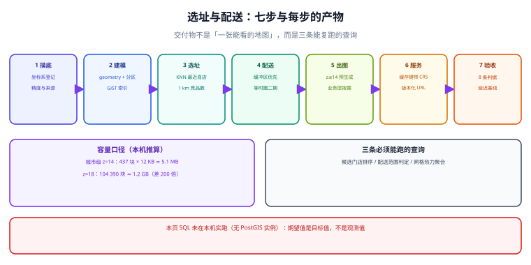

# 实战：门店选址与配送范围

这一页把前面九页串成一条能验收的链路：**从一批坐标，到一个能回答「在哪开店、能送多远、图上怎么看」的系统**。场景设定是连锁零售，规模按中型企业取：500 家门店、300 万 POI、日均 20 万订单地址。

::: tip 一句话理解
选址系统的交付物不是「一张能看的地图」，而是**三条能复跑的查询**：候选门店排序、配送范围判定、区域热力聚合。三条查询都能给出数字，才算交付。
:::



## 一、场景与约束

| 项 | 取值 | 为什么这样定 |
| --- | --- | --- |
| 门店 | 500 家（含计划中 50 家） | 单表足够，不需要分片；但要能按城市/商圈聚合 |
| POI | 300 万条 | 需要 GiST + 分区，验证「索引是否真的生效」 |
| 订单地址 | 日均 20 万，峰值 50 万 | 写入压力在「地址解析后的坐标回填」 |
| 配送半径 | 1~5 km（按门店业态不同） | 决定用圆还是多边形；决定「米」必须真实 |
| 出图 | 内部运营看板 + 对外活动页 | 对外页受合规约束（见[合规](../Compliance/index.md)） |
| 团队 | 2 后端 + 1 前端 + 1 数据 | 不支持「自建瓦片集群」这种量级的运维 |

**第一条取舍**：不做自建底图，用合规底图 + 自己的业务图层；瓦片只预生成 z≤14（城市级），z≥15 走按需。理由见[瓦片](../Tiles/index.md)第二节的容量表——z=18 一个城市范围就是 10 万块瓦片，运维成本远超收益。

## 二、第 1 步：数据摸底与坐标系统一

**产物**：一张「数据源 → 坐标系 → 可信度」登记表。

| 数据源 | 坐标系 | 精度 | 处置 |
| --- | --- | --- | --- |
| 门店台账（自建） | WGS84（历史原因混过 GCJ-02） | 门牌级 | 逐条核对 `src_crs`，混入的按批次重算 |
| 第三方 POI（采购） | GCJ-02 | 50~200 m | 接入层转 WGS84，保留原值 |
| 订单地址（用户填写） | 由地理编码服务返回 GCJ-02 | 100 m~1 km | 只用于「最近门店」粗筛，不用于精确判定 |
| 行政区划 | 标准样图（CGCS2000） | — | 不自绘，不简化 |

```sql
-- 摸底：三类问题一次查出来
SELECT src_crs, count(*) AS n,
       count(*) FILTER (WHERE accuracy_m IS NULL) AS no_accuracy,
       count(*) FILTER (WHERE ST_X(geom) NOT BETWEEN -180 AND 180
                           OR ST_Y(geom) NOT BETWEEN -90 AND 90) AS out_of_range
FROM place
GROUP BY src_crs ORDER BY n DESC;
-- 预期：src_crs 只有 WGS84 一行；out_of_range = 0；no_accuracy 应尽量小
```

**这一步的验收**：`src_crs` 只有一行、`out_of_range = 0`。做不到就不要往下走——后面所有查询都会建立在一个未知偏移上。

## 三、第 2 步：建模与索引

```sql
CREATE TABLE store (
  id        bigint GENERATED ALWAYS AS IDENTITY PRIMARY KEY,
  name      text NOT NULL,
  geom      geometry(Point, 4326) NOT NULL,
  city      text NOT NULL,
  radius_m  int  NOT NULL CHECK (radius_m BETWEEN 500 AND 5000)
);
CREATE INDEX idx_store_geom ON store USING gist (geom);
CREATE INDEX idx_store_city ON store (city);

CREATE TABLE poi (
  id        bigint GENERATED ALWAYS AS IDENTITY,
  geom      geometry(Point, 4326) NOT NULL,
  category  text NOT NULL,
  city      text NOT NULL,
  PRIMARY KEY (id, city)
) PARTITION BY LIST (city);
CREATE INDEX ON poi USING gist (geom);
```

**验收**：`EXPLAIN` 里 KNN 与 `ST_DWithin` 都走 `Index Scan`；`\d+ poi` 能看到分区与索引。若 `poi` 单分区超过 500 万行仍慢，再考虑按格子二级分区，而不是一上来就分。

## 四、第 3 步：选址候选（KNN + 竞争密度）

选址的核心是两句话：**离目标客群近**、**别和自家门店互相吃掉**。

```sql
-- 给定候选点，找最近的 3 家自有门店（判断「是否重叠」）与 1 km 内同类竞品数
WITH cand AS (
  SELECT ST_SetSRID(ST_MakePoint(:lng, :lat), 4326) AS pt
),
near_own AS (
  SELECT s.id, s.name,
         ST_Distance(s.geom::geography, c.pt::geography)::int AS dist_m
  FROM store s, cand c
  ORDER BY s.geom::geography <-> c.pt::geography
  LIMIT 3
),
comp AS (
  SELECT count(*) AS n
  FROM poi p, cand c
  WHERE p.category = :category
    AND ST_DWithin(p.geom::geography, c.pt::geography, 1000)
)
SELECT (SELECT min(dist_m) FROM near_own) AS nearest_own_m,
       (SELECT n FROM comp)               AS competitors_1km;
```

**判据**：候选点的 `nearest_own_m` 应大于「本业态的最小自噬距离」（例如 800 m），否则这家新店会分流老店。这个阈值没有通用值，必须用历史门店的营收数据回归出来，不能拍脑袋。

## 五、第 4 步：配送范围（缓冲区 vs 等时圈）

| 方案 | 做法 | 精度 | 成本 |
| --- | --- | --- | --- |
| **圆形缓冲区** | `ST_Buffer(geom::geography, radius_m)` | 半径是直线距离，忽略路网 | 极低，SQL 一条 |
| **多边形围栏** | 运营手绘/按街道聚合 | 取决于人工 | 低，但难维护 |
| **路网等时圈** | 路径规划服务算 15 分钟可达范围 | 最接近真实 | 需要路网数据与服务，成本高一个量级 |

**建议路线**：先用圆形缓冲区上线（能覆盖 80% 的场景），把「等时圈」作为二期优化。**不要一上来就做等时圈**——它需要路网数据、通行速度模型、跨区限行规则，任何一项缺失都会让结果比圆更不可信。

```sql
-- 圆形配送范围（地理类型，单位是米）
SELECT id, name,
       ST_AsGeoJSON(ST_Buffer(geom::geography, radius_m)::geometry) AS fence
FROM store WHERE id = :id;
```

::: warning `ST_Buffer` 在 `geometry(4326)` 上直接调用会得到一个「度数缓冲」
`ST_Buffer(geom, 5000)` 在没有投影的 4326 几何上，缓冲距离是 **5000 度**——它会返回整个地球。必须先 `::geography`（球面缓冲）或 `ST_Transform` 到米制投影再缓冲。
这个错误极其常见，因为**它不报错**，只是结果覆盖全图。
:::

## 六、第 5 步：出图（分层与版本）

三层：底图（合规、预生成 z≤14）、门店层（点 + 半径圆）、热力层（按网格聚合的订单密度）。

```sql
-- 热力层：按 0.01° 网格聚合，供前端按 zoom 选择精度
SELECT floor(ST_X(geom) / 0.01)::int AS gx,
       floor(ST_Y(geom) / 0.01)::int AS gy,
       count(*) AS orders
FROM order_addr
WHERE created_at >= now() - interval '30 days'
GROUP BY gx, gy
HAVING count(*) >= 5;
```

**版本**：`/tiles/v3/...` 与样式 `/styles/base-v3.json` 同号；业务图层用 `/api/layers/v3/...`。数据更新时换号，旧版本保留 7 天供回滚。

## 七、第 6 步：服务与缓存

| 接口 | 缓存策略 | 失效条件 |
| --- | --- | --- |
| `GET /api/nearby?lng&lat&r` | 不缓存（个性化） | — |
| `GET /api/stores.geojson` | 60 s + ETag | 门店变更 |
| `GET /api/heat?days=30` | 5 min | 订单写入（异步刷新） |
| `GET /tiles/v3/{z}/{x}/{y}.pbf` | 1 年 immutable | 版本号变更 |

**关键**：缓存键必须包含**坐标系与半径**。同一个 `lat/lng` 在不同坐标系下不是同一个地方，少了这一维会串结果。

## 八、第 7 步：验收（8 条判据）

本页判据族 `GMS-A` ~ `GMS-H`，共 8 条。每条都给出「怎么跑、期望什么、不满足时改哪」。

| 编号 | 判据 | 怎么跑 | 期望 | 不满足时改哪 |
| --- | --- | --- | --- | --- |
| `GMS-A` | 坐标系单一且可追溯 | 第二节的摸底 SQL | `src_crs` 一行、`out_of_range=0` | 回到第 1 步 |
| `GMS-B` | 空间索引生效 | `EXPLAIN ANALYZE` 两条查询 | 都是 `Index Scan` | 改谓词（`ST_DWithin`/`<->`） |
| `GMS-C` | 「附近门店」延迟达标 | 压测 50 QPS，p95 | **< 50 ms** | 收窄半径、加候选预聚合 |
| `GMS-D` | 配送范围是真实米 | 取一家门店，量缓冲区直径 | 与 `2×radius_m` 相差 < 1% | 检查是否漏了 `::geography` |
| `GMS-E` | 边界归属一致 | 边界点判定用例 | 与文档一致（含边界） | 统一 `ST_Covers` |
| `GMS-F` | 瓦片首屏可接受 | 首屏 `load`→首帧 | **< 2 s**（城市级，z≤14） | 降低初始 zoom、压瓦片体积 |
| `GMS-G` | 缓存不串结果 | 两个不同坐标系同经纬度请求 | 返回不同结果 | 缓存键加 CRS |
| `GMS-H` | 合规项齐全 | [合规](../Compliance/index.md)自查清单 | 8 项全过 | 该项是上线阻断 |

**容量估算（按本机读数推）**：城市级 0.5°×0.3° 范围在 z=14 是 **437 块瓦片**（见[瓦片](../Tiles/index.md)第二节），每块按 12 KB 估算约 **5.1 MB**——这就是「一个城市预生成到 z=14」的存储量级；乘以城市数即总盘。z=18 是 **104 390 块 / 约 1.2 GB**，量级差 200 倍，所以「全量到 18」在中等团队里几乎不可能是对的。

## 九、验证方式（可直接复制）

```shell
# 1) 附近门店：延迟与结果条数
curl -s -o /dev/null -w "p95 proxy: %{time_total}s\n" \
  "https://<域名>/api/nearby?lng=116.3975&lat=39.9087&r=3000"

# 2) 配送范围直径（GeoJSON 的 bbox 宽度应与 2r 接近）
curl -s "https://<域名>/api/store/42/fence" \
  | python -c "import json,sys;g=json.load(sys.stdin);print(g['bbox'])"
# 期望：bbox 的东西向跨度 ≈ 2 × radius_m / 85512.6 度（北纬 39.9° 每度经度 85 512.6 m）

# 3) 瓦片版本一致性
curl -s https://<域名>/styles/base-v3.json | grep -c '/tiles/v3/'
# 期望：与样式里 source 数量一致；出现 v2 即不合格
```

```sql
-- 4) 索引与候选放大率（recheck 行数 / 返回行数 应 < 10）
EXPLAIN (ANALYZE, BUFFERS)
SELECT count(*) FROM poi
WHERE ST_DWithin(geom::geography, ST_SetSRID(ST_MakePoint(116.3975,39.9087),4326)::geography, 1000);
```

::: warning 本页的 SQL 未在本机实跑
本机没有 PostgreSQL / PostGIS 实例，**本节所有 SQL 与期望值都是按官方文档语义编写的**，没有实测输出。请在自建库上逐条执行后再当验收依据；尤其是 `GMS-C` 的 50 ms 与 `GMS-F` 的 2 s，那是目标值不是观测值。
:::

## 参考资料

- [PostGIS 官方文档 · `ST_Buffer`（geography 重载）](https://postgis.net/docs/ST_Buffer.html)
- [PostGIS 官方文档 · `ST_AsGeoJSON`](https://postgis.net/docs/ST_AsGeoJSON.html)
- [PostGIS 官方文档 · KNN `<->`](https://postgis.net/docs/geometry_distance_knn.html)
- [MapLibre GL JS 文档](https://maplibre.org/maplibre-gl-js/docs/)
- [本专题 · 地图数据合规与离线交付](../Compliance/index.md)
