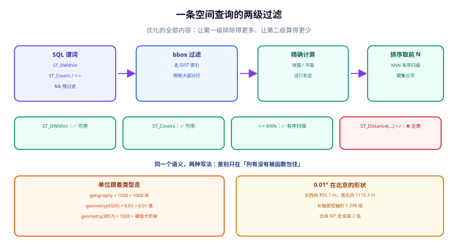

# 空间查询与距离：从「圈一个范围」到「排序取最近」

查询是空间数据真正被使用的地方。这一页只讲一件事：**怎么写谓词，才能既得到正确的结果、又让索引真的起作用**。绝大多数「空间查询慢」，根因不是数据量，而是谓词写法把索引架空了。

::: tip 一句话理解
空间查询有两级：**先用外包框快速排除（`&&`），再逐行精确算**。所有优化都在做同一件事——**让第一级排除得更多**。
:::



## 一、谓词与索引可用性对照

| 写法 | 语义 | 能用 GiST | 备注 |
| --- | --- | --- | --- |
| `a && b` | 外包框相交 | ✅ | 最便宜的预过滤，常用作手写加速 |
| `ST_Intersects(a, b)` | 几何相交（含边界接触） | ✅ | 会自动加 `&&` |
| `ST_DWithin(a, b, r)` | 距离 ≤ r | ✅ | **推荐**：语义即「附近」，且索引友好 |
| `ST_Contains(a, b)` | b 完全在 a 内，**不含边界** | ✅ | 边界点判定为 false |
| `ST_Covers(a, b)` | b 被 a 覆盖，**含边界** | ✅ | 围栏判定通常要这个 |
| `a <-> b` | 距离排序（KNN） | ✅（GiST 有序扫描） | `ORDER BY a <-> b LIMIT n` |
| `ST_Distance(a, b) < r` | 距离小于 r | ❌ | 列被函数包住，退化为全表 |

```sql
-- 推荐写法：5 公里内的门店，按距离排序
SELECT id, name,
       ST_Distance(geom::geography, :pt::geography)::int AS dist_m
FROM store
WHERE ST_DWithin(geom::geography, :pt::geography, 5000)
ORDER BY geom::geography <-> :pt::geography
LIMIT 20;

-- 不推荐：同样语义，但在 100 万行表上是全表算距离
SELECT id FROM store
WHERE ST_Distance(geom::geography, :pt::geography) < 5000;
```

::: danger `ST_DWithin` 的半径单位跟着类型走，这一步错了不会报错
- `geometry(4326)` + `ST_DWithin(..., 0.01)` → 半径是 **0.01 度**，不是一个固定距离。
- `geometry(3857)` + `ST_DWithin(..., 1000)` → 半径是 1 000「投影米」，在高纬度偏大。
- `geography` + `ST_DWithin(..., 1000)` → 半径是 1 000 **真实米**（默认球面），这才是业务想要的。

本机把「0.01 度」在四个纬度上按 WGS84 椭球算了一遍（Vincenty，脚本不入库）：

| 纬度 | 东西向 0.01° | 南北向 0.01° | 南北 ÷ 东西 |
| --- | --- | --- | --- |
| 0° | 1 113.2 m | 1 105.7 m | 0.993 |
| 20° | 1 046.5 m | 1 107.0 m | 1.058 |
| **39.9042°** | **855.1 m** | **1 110.3 m** | **1.298** |
| 60° | 558.0 m | 1 114.1 m | 1.997 |

**读法**：在北京，「0.01 度」圈出的不是一个圆，而是一个**东西 855 m、南北 1 110 m 的椭圆**，长轴是短轴的 1.3 倍；到北纬 60° 变成 2 倍。所以「用度当米」不只是「差一点」，而是**形状都变了**。
:::

## 二、边界语义：`Contains` 与 `Covers` 差在哪

| 函数 | 边界上的点 | 语义 | 典型误用 |
| --- | --- | --- | --- |
| `ST_Contains(poly, pt)` | **false** | 严格内部 | 拿它做考勤围栏 → 站在门口不算打卡 |
| `ST_Covers(poly, pt)` | **true** | 含边界 | 拿它做「严格区域统计」→ 边界点被算进两个区 |
| `ST_Intersects(poly, pt)` | **true**（点接触即相交） | 有公共点 | 语义最宽，慎用于计费 |
| `ST_Within(pt, poly)` | 与 `ST_Contains` 互为反向 | 被包含 | 参数顺序写反会静默返回空集 |

**结论**：围栏、配送范围、行政区归属一律用 `ST_Covers`，并在文档里写死「边界算内」。如果业务要求「边界不算」，那也应该用 `ST_Contains` 并加一条边界用例，而不是两边都写、最后没人知道线上是哪个。

```sql
-- 边界归属的可执行断言（值应为 t，若为 f 说明用的是 ST_Contains）
WITH box AS (
  SELECT ST_MakeEnvelope(116.0, 39.0, 117.0, 40.0, 4326) AS g
)
SELECT ST_Covers(g, ST_SetSRID(ST_MakePoint(117.0, 39.5), 4326)) AS covers_on_edge,
       ST_Contains(g, ST_SetSRID(ST_MakePoint(117.0, 39.5), 4326)) AS contains_on_edge
FROM box;
```

## 三、最近邻（KNN）：为什么必须用 `<->`

`ORDER BY geom <-> :pt` 走的是 GiST 的**有序扫描**：树按外包框距离由近到远展开，取到第 n 个就停。而 `ORDER BY ST_Distance(geom, :pt)` 会**先算全表距离再排序**。

| 写法 | 100 万行表的代价量级 | 说明 |
| --- | --- | --- |
| `ORDER BY geom <-> pt LIMIT 10` | 只碰最近的一小批索引页 | 索引有序扫描 |
| `ORDER BY ST_Distance(geom, pt) LIMIT 10` | 全表距离 + 排序 | 排序还可能落盘 |

::: warning KNN 的「距离」是平面距离，不是真实米
在 `geometry(4326)` 上 `<->` 返回的是**度**，在 `geometry(3857)` 上是**被放大的米**。两种都可用于「排序」（单调性一致，顺序不变），但**不能直接当米数展示**。
要做「按真实距离排序并显示米」：先 `ST_DWithin(geog, pt, r)` 过滤，再用 `ST_Distance(geog, pt)` 排序——此时候选集已经被压到很小，全算距离不贵。这就是「先过滤再精算」的通用形状。
:::

## 四、分页：深分页与「按距离翻页」

`OFFSET 10000` 会让数据库把前 10 000 行都算出来再丢掉。空间查询的翻页更麻烦：**距离是连续值，容易出现并列**。

```sql
-- 键集分页（keyset）：用 (dist, id) 做游标，翻到第几页都是同一个代价
SELECT id, ST_Distance(geom::geography, :pt::geography) AS d
FROM store
WHERE ST_DWithin(geom::geography, :pt::geography, 5000)
  AND (ST_Distance(geom::geography, :pt::geography), id) > (:last_d, :last_id)
ORDER BY ST_Distance(geom::geography, :pt::geography), id
LIMIT 20;
```

**为什么必须带 `id` 做二级排序**：距离相同的两家店，在不同页可能重复出现或整体漏掉——这是「分页丢数据」的经典成因，而它只在有并列值时出现，测试很容易漏。

## 五、聚合：网格、H3 与聚类

| 方案 | 做法 | 优点 | 代价 |
| --- | --- | --- | --- |
| **经纬网格** | `floor(lng/0.01)`、`floor(lat/0.01)` 分桶 | 零依赖、可 SQL 直算 | 高纬度格子变形；跨格边界重复 |
| **Geohash** | 前缀分桶（7 位 ≈ 153 m × 153 m） | 字符串前缀即范围，能走 B 树 | 格子不等等、邻格要查 9 个 |
| **H3** | `h3_latlng_to_cell(pt, 9)` 六边形 | 邻域距离均匀、层级可聚合 | 需要扩展（PostGIS 3.6 的 Windows 包已带 `h3-pg 4.1.4`） |
| **DBSCAN** | `ST_ClusterDBSCAN(geom, eps, minpoints)` | 自动发现簇形状 | 参数敏感、大表慢 |

**选择口径**：报表类聚合用**网格/Geohash**（可预期、可缓存）；「找出热点区域」用 **H3**；「把相邻订单合并成一次配送」用 **DBSCAN**。三者不是替代关系。

## 六、性能：三个必须量出来的数

1. **候选放大率**：`Rows Removed by Index Recheck ÷ 返回行数`。> 10 说明外包框不贴合（见[建模与索引](../Modeling/index.md)第三节的 11.9~25.6 倍实测）。
2. **`geography` 的相对成本**：球面运算比平面运算贵，通常是 2~5 倍量级（**经验口径，随数据分布与版本变化**，不要当基准写进 SLA）。所以「先用 bbox 缩范围，再上 geography」是标准套路。
3. **缓存命中**：同一批瓦片/同一批「附近」查询会被反复请求，缓存键要包含坐标系与半径，否则会串结果。

## 七、本页判据

本页判据族 `GMQ-A` ~ `GMQ-H`，共 8 条。

| 编号 | 判据 | 判定方式 | 不满足时改哪里 |
| --- | --- | --- | --- |
| `GMQ-A` | 高频空间查询的谓词是索引可用形式 | `EXPLAIN` 出现 `Index Scan`，无全表 Seq Scan | 改 `ST_DWithin` / 加 `&&` |
| `GMQ-B` | 距离半径的单位与类型匹配（米 ↔ `geography`） | 代码里半径变量名带 `_m`，且参数是 `geography` | 改类型或显式换算 |
| `GMQ-C` | 边界归属写死并有边界用例 | 有一条正好落在边界的测试数据 | 见第二节 |
| `GMQ-D` | 最近邻查询用 `<->` 而非 `ORDER BY ST_Distance` | 代码检索 `ORDER BY ST_Distance` | 改 `<->`，或先过滤再排序 |
| `GMQ-E` | 分页有稳定的二级排序键 | `ORDER BY` 里有唯一列 | 加 `id` |
| `GMQ-F` | 候选放大率被量过且 < 10 | `EXPLAIN ANALYZE` 的 recheck 行数 | 切分几何或改网格预聚合 |
| `GMQ-G` | 聚合口径写明用哪种网格与精度 | 报表 SQL 里有 `geohash`/`h3`/网格步长 | 补口径；换精度要重算基线 |
| `GMQ-H` | 缓存键包含坐标系、半径与数据版本 | 缓存键结构可读出这三项 | 见[瓦片](../Tiles/index.md)的版本化做法 |

## 八、验证方式

```sql
-- 1) 两种写法的计划对比（本机未跑，需 PostGIS 实例）
EXPLAIN (ANALYZE, BUFFERS) SELECT id FROM store
WHERE ST_DWithin(geom::geography, ST_SetSRID(ST_MakePoint(116.3975,39.9087),4326)::geography, 5000);
-- 预期：Index Scan using store_geom_idx；Execution Time 与返回行数同量级

EXPLAIN (ANALYZE, BUFFERS) SELECT id FROM store
WHERE ST_Distance(geom::geography, ST_SetSRID(ST_MakePoint(116.3975,39.9087),4326)::geography) < 5000;
-- 预期：Seq Scan + Filter；Execution Time 随表线性增长

-- 2) 边界语义断言
SELECT ST_Covers(ST_MakeEnvelope(116,39,117,40,4326), ST_SetSRID(ST_MakePoint(117,39.5),4326)) AS c,
       ST_Contains(ST_MakeEnvelope(116,39,117,40,4326), ST_SetSRID(ST_MakePoint(117,39.5),4326)) AS t;
-- 预期：c = t，t = f
```

```shell
# 3) 「0.01 度」在北京到底是什么形状（本页第一节表格的复算）
python - <<'PY'
import math
def hav(lon1, lat1, lon2, lat2, R=6371008.8):
    p1, p2 = math.radians(lat1), math.radians(lat2)
    dp, dl = p2 - p1, math.radians(lon2 - lon1)
    h = math.sin(dp/2)**2 + math.cos(p1)*math.cos(p2)*math.sin(dl/2)**2
    return 2*R*math.asin(math.sqrt(h))
for lat in (0, 39.9042, 60):
    print(lat, round(hav(116, lat, 116.01, lat), 1), round(hav(116, lat, 116, lat+0.01), 1))
PY
# 预期：
# 0 1112.0 1112.0
# 39.9042 853.0 1112.0
# 60 556.0 1112.0
# 与椭球的 855.1 / 1110.3 相差约 0.1%~0.3%（球面与椭球的固有差，见总览第三节）
```

## 参考资料

- [PostGIS 官方文档 · `ST_DWithin`](https://postgis.net/docs/ST_DWithin.html)
- [PostGIS 官方文档 · 空间关系函数（Contains / Covers / Intersects）](https://postgis.net/docs/ST_Contains.html)
- [PostGIS 官方文档 · KNN 与 `<->`](https://postgis.net/docs/geometry_distance_knn.html)
- [PostGIS 官方文档 · `ST_ClusterDBSCAN`](https://postgis.net/docs/ST_ClusterDBSCAN.html)
- [本专题 · 空间建模与索引](../Modeling/index.md)
