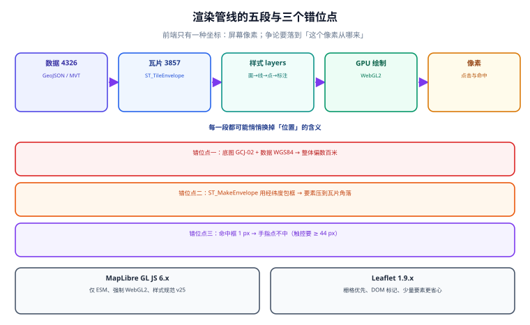

# 前端渲染与交互：矢量瓦片、图层与命中

数据库里的几何要变成屏幕上能点、能筛、能联动的要素，中间隔着渲染引擎。这一页管四件事：**引擎怎么选、图层怎么叠、命中怎么判、坐标怎么对齐**。

::: tip 一句话理解
前端地图只有一种坐标：**屏幕像素**。所有「位置不对」的争论，最后都要落到「这个像素是由哪条记录、经过哪几次变换、投影过来的」这条链上。
:::



## 一、引擎选择：先数要素，再看交互

| 引擎 | 渲染方式 | 适合 | 不适合 |
| --- | --- | --- | --- |
| **MapLibre GL JS 6.x** | WebGL2，矢量瓦片 | 要素多、需要样式表达与倾斜/地形 | 极老设备（强制 WebGL2）、纯静态图 |
| **Leaflet 1.9.x** | DOM / Canvas，栅格优先 | 少量要素、大量自定义 HTML 标记、简单交互 | 十万级要素、复杂样式 |
| **deck.gl** | WebGL，图层化 | 百万级点/线、聚合、三维 | 与底图样式深度耦合的自定义 |

**MapLibre GL JS v6 的三条硬变化**（2026-07-22 发布，6.3.0 于 2026-08-10）：

1. **仅 ESM 分发**：不再提供 UMD 的 `maplibre-gl.js`；`import maplibregl from 'maplibre-gl'` 要改成 `import * as maplibregl from 'maplibre-gl'` 或具名导入。
2. **强制 WebGL2**：WebGL1 被移除。老终端、策略禁用 GPU、纯软件渲染的环境会**整块空白**，而报错只从 `.on('error')` 里出来。
3. **样式规范升到 v25**：旧表达式不再静默失败，改为抛 warning 级别错误。

::: danger 升级 v6 最容易漏的三件事
1. **worker 路径**：打包器（Vite/webpack）下通常还要 `setWorkerUrl()`；跨域 CDN 需要允许 `worker-src blob:`。
2. **`styleimagemissing` 语义变了**：v6 里它只是通知，补图要用 `setMissingStyleImageResolver`。原来在事件回调里 `map.loadImage(...).then(img => map.addImage(...))` 的写法会**丢掉图标但不报错**。
3. **事件类型化**：`map.on` 的事件名有类型约束，旧的字符串拼写错误从「运行时静默不触发」变成「编译期报错」——这是好事，但会一次性暴露一批存量拼写错误。
:::

## 二、图层：顺序决定「谁能看见谁」

矢量地图的绘制顺序由**样式里的 layer 数组顺序**决定（后加的在上）。三条例规：

| 规则 | 原因 | 违反后的症状 |
| --- | --- | --- |
| 面 → 线 → 点/符号，逐层向上 | 面会盖住线，线会盖住点 | 「点被区块颜色盖住」 |
| 标注（symbol）单独一层，放最上 | 标注要避让，且需要压住所有几何 | 标注被线穿过、被面遮挡 |
| 交互层（高亮、选中）放最上且 `pointer-events` 明确 | 命中按图层顺序从上往下 | 点了没反应 / 点到了下层 |

```js
// MapLibre GL JS 6.x：底图 + 业务图层 + 选中高亮
import * as maplibregl from 'maplibre-gl';

const map = new maplibregl.Map({
  container: 'map',
  style: '/styles/base-v3.json',     // 样式与瓦片版本同号
  center: [116.3975, 39.9087],       // [lng, lat] —— 顺序写反是最常见的低级错
  zoom: 12,
  maxTileCacheSize: 200,             // 移动端别用默认值，显存会被瓦片吃满
});

map.on('load', () => {
  map.addSource('store', { type: 'vector', url: '/tiles/v3/tiles.json' });
  map.addLayer({
    id: 'store-point',
    type: 'circle',
    source: 'store',
    'source-layer': 'store',          // 必须与 ST_AsMVT 的图层名一字不差
    paint: { 'circle-radius': 6, 'circle-color': '#2563EB' },
  });
});
```

::: warning `addLayer` 加在 `load` 之后，但数据在 `load` 之前就到了
在 `load` 事件里 `addSource` 时，如果瓦片还在传输，图层会先渲染为空，逐块补齐——这属于正常。**异常的是「一直为空」**：多半是 `source-layer` 写错（大小写、单复数），或瓦片 URL 模板里的 `{z}/{x}/{y}` 被样式解析掉了。排查只需在控制台 `map.getStyle().sources` 里读一次真实配置。
:::

## 三、更新要素：`setData` 全量还是 `setFeatureState` 局部

| 方式 | 适用 | 代价 |
| --- | --- | --- |
| `source.setData(geojson)` | 数据整体替换（筛选、搜索） | 重新解析整个 GeoJSON，要素多时卡顿 |
| `setFeatureState({source, id}, state)` | 单个要素的状态变化（选中、告警） | 只更新状态位，代价极小 |
| `source.updateData(...)`（增量） | 追加/删除少量要素 | 需要 `promoteId` 稳定 |

```js
// 选中：不要重新 setData，改用 feature-state
map.setFeatureState({ source: 'store', id: featureId }, { selected: true });
// 样式里用表达式读取
// paint: { 'circle-color': ['case', ['boolean', ['feature-state', 'selected'], false], '#DC2626', '#2563EB'] }
```

**判据**：如果「点一个点」会触发一次全量 `setData`，那 1 万要素以上就会明显卡顿；正确做法是 `promoteId` + `feature-state`。

## 四、命中：为什么「点不中」

```js
map.on('click', (e) => {
  const hits = map.queryRenderedFeatures(
    [[e.point.x - 6, e.point.y - 6], [e.point.x + 6, e.point.y + 6]],  // 12×12 像素容差
    { layers: ['store-point'] },
  );
  if (hits.length) select(hits[0].properties.id);
});
```

| 失效原因 | 现象 | 处置 |
| --- | --- | --- |
| 命中框是 1 像素 | 手指点不中（移动端） | 扩到 12~20 像素；触控目标建议 ≥ 44 px |
| 图层顺序导致上层容器拦截 | `map.on('click')` 不触发 | 检查 overlay 的 `pointer-events` |
| 要素在瓦片 buffer 里被裁 | 边界上的点一半点不中 | 增大 `buffer`（见[瓦片](../Tiles/index.md)） |
| `queryRenderedFeatures` 在瓦片未加载时 | 偶发「点了没反应」 | 先判 `map.loaded()`，或加 `map.once('idle')` 重试 |

::: danger v6 的一个已知坑：`queryRenderedFeatures` 与瓦片加载竞争
MapLibre v6.3.0 的发布说明里明确修了「加载瓦片数据竞争时 `queryRenderedFeatures` 抛 `Out of bounds`」。也就是说：**旧版本在快速缩放后立刻查询，可能抛异常而不是返回空数组**。
工程做法：查询包一层 `try/catch`，捕获后降级为「空结果 + 打点」，而不是让异常冒泡到全局（否则整个交互队列会卡死）。
:::

## 五、底图与数据的坐标系必须同源

这是「点整体偏移」的第二大来源（第一大是数据本身坐标系错，见[坐标系](../CRS/index.md)）：

| 底图 | 底图坐标系 | 你的数据 | 结果 |
| --- | --- | --- | --- |
| OpenStreetMap / MapLibre 官方样式 | WGS84（4326） | WGS84 | ✅ 对齐 |
| 高德 / 腾讯 JS SDK | GCJ-02 | WGS84 | ❌ 整体偏移数百米 |
| 百度地图 | BD-09 | WGS84 或 GCJ-02 | ❌ 偏移更大，且方向不同 |
| 天地图 | CGCS2000（与 WGS84 厘米级差） | WGS84 | ✅ 可接受 |

**结论**：要么全链路用 WGS84（配 OSM/MapLibre/天地图），要么在接入层把数据统一转成底图的坐标系，**不要在前端临时转换**——前端转换意味着两套坐标同时存在于内存，任何一个组件忘了转就会偏。

## 六、性能：三个最先崩的地方

| 崩点 | 征兆 | 处置 |
| --- | --- | --- |
| 首屏瓦片太多 | `load` 到首帧 > 3 s | 降低初始 zoom、限制 `maxTileCacheSize`、按当前视口裁剪业务图层 |
| 要素太多 | 拖拽掉帧 | 聚合（cluster）、按 zoom 分层显示、必要时上 deck.gl |
| 样式太重 | 首帧 GPU 占用高 | 少用 `fill-extrusion`/`terrain`/大范围 `blur`；减少 symbol 的 `text-field` 动态表达式 |

**聚合的最小做法**：MapLibre 的 GeoJSON source 支持 `cluster: true` + `clusterRadius`，服务端不需要改；要素超过 5 万时再考虑服务端预聚合（按网格返回计数）。

## 七、本页判据

本页判据族 `GMR-A` ~ `GMR-H`，共 8 条。

| 编号 | 判据 | 判定方式 | 不满足时改哪里 |
| --- | --- | --- | --- |
| `GMR-A` | 底图坐标系与业务数据坐标系一致（有对照表） | 文档里能读出底图来源与 CRS | 见第五节 |
| `GMR-B` | 所有坐标入参是 `[lng, lat]` 且有断言 | 代码里有范围检查或命名 `lng/lat` | 加断言；轴序错不会报错 |
| `GMR-C` | 图层顺序符合「面→线→点→标注」 | 读样式里的 layer 数组 | 调整顺序 |
| `GMR-D` | 选中/高亮用 `feature-state`，不全量 `setData` | 代码检索 `setData` 的调用点 | 改 `promoteId` + `feature-state` |
| `GMR-E` | 命中容差 ≥ 12 px，触控目标 ≥ 44 px | 查询框尺寸可读出 | 调整数值 |
| `GMR-F` | `queryRenderedFeatures` 有异常兜底 | 存在 `try/catch` 或 `map.loaded()` 判断 | 见第四节的 v6 坑 |
| `GMR-G` | 引擎版本固定且记录了破坏性变更 | `package.json` 锁版本；有升级记录 | 见第一节的 v6 三条 |
| `GMR-H` | 首屏与拖拽有量化指标（不靠感觉） | 有 `load`→首帧时间、FPS 或掉帧统计 | 用 Performance 面板取一次基线 |

## 八、验证方式

```js
// 浏览器控制台：三段一次性自检
const m = window.__map;                       // 暴露实例便于排查（生产可挂在 debug 开关后）
console.log('loaded', m.loaded());            // 预期 true
console.log('style', m.getStyle().sources);   // 预期看到 source-layer 与 tiles URL
const c = m.getCenter();
console.log('center', c.lng.toFixed(5), c.lat.toFixed(5));  // 与初始化参数一致

// 命中自检：在已知点上取像素坐标再反查
const p = m.project([116.3975, 39.9087]);
console.log('hits', m.queryRenderedFeatures(
  [[p.x - 6, p.y - 6], [p.x + 6, p.y + 6]], { layers: ['store-point'] }).length);
// 预期：>= 1
```

```shell
# 样式与瓦片版本是否同号（版本不同号是「新旧混合」的根因）
curl -s https://<你的域名>/styles/base-v3.json | grep -o '"/tiles/[^"]*"' | head -3
# 预期：都指向 /tiles/v3/...；出现 v2 与 v3 混用即不合格
```

## 参考资料

- [MapLibre GL JS 文档](https://maplibre.org/maplibre-gl-js/docs/)
- [MapLibre GL JS v6 迁移说明](https://maplibre.org/maplibre-gl-js/docs/guides/migrate/)：ESM-only、WebGL2、事件类型化
- [MapLibre Style Spec](https://maplibre.org/maplibre-style-spec/layers/)：layer 顺序与 `source-layer`
- [Leaflet 文档](https://leafletjs.com/reference.html)：栅格优先与 DOM 标记
- [deck.gl 文档](https://deck.gl/docs)：大规模要素的 WebGL 图层
- [本专题 · 瓦片服务与切片](../Tiles/index.md)
