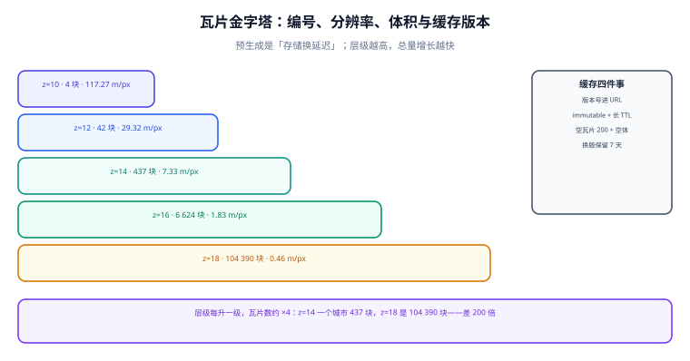

# 瓦片服务与切片：把地图切成可缓存的方块

瓦片（Tile）是把地图切成固定大小方块再按需取用的做法。它解决的是「一张图放不下、也算不完」的问题，代价是把**坐标、精度、缓存、版本**四件事绑进了一个编号里。

::: tip 一句话理解
瓦片编号 `(z, x, y)` 是**坐标系 + 比例尺 + 一块地面范围**三者的合体。所以「换投影」不是改个参数，而是**让所有缓存失效**——这也是瓦片服务最贵的一次重构。
:::



## 一、编号体系：XYZ 与 TMS 的 y 轴是反的

| 体系 | y 方向 | 原点 | 使用者 |
| --- | --- | --- | --- |
| **XYZ**（Google / OSM / MapLibre） | 从上往下 | 左上角（北西） | 绝大多数 Web 地图 |
| **TMS**（OSGeo） | 从下往上 | 左下角（南西） | GDAL、部分自建服务 |

换算只有一行：`y_tms = 2^z - 1 - y_xyz`。**它错了的症状是「地图上下颠倒」**——而且只在某些层级对得上（`z=0` 时两者相同），所以测试很容易漏。

```python
import math

def lonlat_to_tile(lon, lat, z):
    n = 2 ** z
    x = int((lon + 180.0) / 360.0 * n)
    r = math.radians(lat)
    y = int((1.0 - math.log(math.tan(r) + 1.0 / math.cos(r)) / math.pi) / 2.0 * n)
    return x, y

def tile_bounds(z, x, y):
    """返回 XYZ 瓦片的经纬度范围（西, 南, 东, 北）。"""
    n = 2 ** z
    def lon(xx): return xx / n * 360.0 - 180.0
    def lat(yy):
        v = math.pi * (1 - 2 * yy / n)
        return math.degrees(math.atan(math.sinh(v)))
    return lon(x), lat(y + 1), lon(x + 1), lat(y)

print(lonlat_to_tile(116.3975, 39.9087, 14))     # (13489, 6208)，北京天安门
print(tuple(round(v, 5) for v in tile_bounds(14, 13489, 6208)))
# (116.38916, 39.89288, 116.41113, 39.90974)：西、南、东、北
```

::: danger 三个「不报错」的瓦片错误
1. **y 轴反了**：服务端用 TMS，前端按 XYZ 请求 → 地图上下颠倒。`z=0` 与 `z=1` 的部分瓦片还能对上，让人误以为「只有高层级有问题」。
2. **瓦片范围用了 4326 的 `ST_MakeEnvelope(lon1, lat1, lon2, lat2)`**：MVT 的 `ST_AsMVTGeom` 需要**瓦片自己的坐标系**（通常是 3857 的 `ST_TileEnvelope(z, x, y)`）。用经纬度包一个框，要素会被压到瓦片角落。
3. **`extent` 与 `buffer` 传反**：`ST_AsMVTGeom(geom, bounds, extent, buffer, clip)` 的第三、四参数都是整数，传反了照样出瓦片，只是**要素被放大/裁掉**。
:::

## 二、分辨率：每一级「一个像素等于多少米」

瓦片固定 256 px（或 512 px 的 retina 版本），所以分辨率完全由层级决定。本机按 `分辨率 = 地球周长 × cos(lat) ÷ (256 × 2^z)` 算了一遍（北纬 39.9042°，脚本不入库）：

| z | 米/像素 | 覆盖北京五环外接矩形（0.5° × 0.3°）需要 | 估算体积（按 12 KB/瓦片） |
| --- | --- | --- | --- |
| 8 | 469.09 | 2 块 | 24 KB |
| 10 | 117.27 | 4 块 | 48 KB |
| 12 | 29.32 | 42 块 | 504 KB |
| **14** | **7.33** | **437 块** | 5.1 MB |
| 16 | 1.83 | 6 624 块 | 78 MB |
| 18 | 0.46 | **104 390 块** | 1.2 GB |

**读法**：
- 每升一级，瓦片数约 **×4**，单块体积不变——所以「支持到 z=18」不是「多一点细节」，而是**总量翻两个数量级**。
- 12 KB/瓦片是**估算值**（取决于要素密度与简化程度），只用来判断量级；真实体积要用实际产出的瓦片统计。
- 「预生成到哪一级」本质是**存储换延迟**的决定，见第四节。

## 三、MVT：矢量瓦片的最小可用 SQL

```sql
-- 一条查询产出 z/x/y 的 MVT（PostGIS 3.6，需 postgis 扩展，MVT 支持内置）
WITH bounds AS (
  SELECT ST_TileEnvelope(:z, :x, :y) AS geom
),
mvtgeom AS (
  SELECT ST_AsMVTGeom(
           ST_Transform(t.geom, 3857),
           bounds.geom,
           4096,   -- extent：瓦片内部坐标系边长
           256,    -- buffer：瓦片外扩的像素数，防止线在边界被切断
           true    -- clip
         ) AS geom,
         t.id, t.name, t.kind
  FROM store t, bounds
  WHERE ST_Transform(t.geom, 3857) && bounds.geom
)
SELECT ST_AsMVT(mvtgeom.*, 'store', 4096, 'geom', 'id') FROM mvtgeom;
```

**四个参数的作用**：

| 参数 | 典型值 | 影响 |
| --- | --- | --- |
| `extent` | 4096 | 瓦片内部整数坐标的上限；越大精度越高、体积越大 |
| `buffer` | 64 / 256 | 外扩范围，防「线在瓦片边界断开、标注被裁」；过大会让相邻瓦片重复要素 |
| `clip` | `true` | 裁掉瓦片外的部分；关闭会让单块体积暴涨 |
| 图层名 | `store` | 前端 `map.addLayer({source-layer: 'store'})` 要一字不差 |

::: warning 简化容差必须跟层级走，且不能用同一个值
瓦片越小，容忍的误差越小。经验公式：`容差 ≈ 米每像素 × 0.5~1`。z=14 时约 3.7~7.3 m，z=10 时约 59~117 m。
如果所有层级都用同一个容差：
- 用 z=10 的容差 → 高倍缩放下折线变成「折角明显的多边形」；
- 用 z=14 的容差 → 低倍缩放时要素数不变，瓦片体积大、首屏慢。
正确做法是在生成管线里按 z 计算容差，并把「每级容差表」写进服务配置（可审计）。
:::

## 四、预生成还是按需生成

| 方式 | 优点 | 代价 | 适用 |
| --- | --- | --- | --- |
| **预生成**（离线切片） | 延迟最低、可全量上 CDN、结果可复现 | 存储 ×4/级；数据更新要重切；切片任务可能跑几小时 | 底图、变化慢的 POI、全国范围 |
| **按需生成**（SQL 直出） | 数据更新即时可见、无需存储 | 每次请求都要查库；并发高时数据库成为瓶颈 | 业务图层、强实时数据 |
| **混合** | 底图预生成、业务层按需 | 两套链路要分别监控 | 大多数实际系统 |

**决策口径**：先算「每天瓦片请求数 × 命中率」。若 90% 的请求集中在 z≤14（本机表里 437 块/城市级范围），预生成这几级就够；z≥16 的请求量小，按需生成更划算。

## 五、缓存：瓦片服务的生死线

| 手段 | 做法 | 失效形态 |
| --- | --- | --- |
| **版本化路径** | `/tiles/v3/{z}/{x}/{y}.pbf` | 换版本即全量失效，**这是最安全的做法** |
| `Cache-Control: max-age` | 长 TTL + 版本号 | 只有 TTL 没有版本 → 用户看到新旧混合 |
| `ETag` / `Last-Modified` | 协商缓存 | 瓦片是二进制，ETag 计算成本要评估 |
| **CDN 边缘缓存** | 按 URL 缓存，注意回源鉴权 | 带签名的 URL 无法共享缓存 |

```http
HTTP/1.1 200 OK
Content-Type: application/vnd.mapbox-vector-tile
Content-Encoding: gzip
Cache-Control: public, max-age=31536000, immutable
ETag: "v3-14-13489-6208-8f3c"
```

::: danger 「数据更新了但用户看到旧的」几乎总是缓存，不是切片
三个必须能回答的问题：① 瓦片 URL 里有版本号吗？② CDN 的 TTL 多长、能不能主动刷？③ 空瓦片（该区域确实没有数据）返回的是 404、204 还是 200 空体？
第三条尤其容易埋雷：**404 会被 CDN 当「不存在」缓存住**，于是新区块上线后长期拿不到数据。可行做法是「空瓦片返回 200 + 极小的空 MVT（约 20~30 字节）」，并给短 TTL。
:::

## 六、本页判据

本页判据族 `GMT-A` ~ `GMT-H`，共 8 条。

| 编号 | 判据 | 判定方式 | 不满足时改哪里 |
| --- | --- | --- | --- |
| `GMT-A` | 瓦片编号体系（XYZ/TMS）在服务与前端一致 | 用 `z=1` 的四个瓦片比对上下方向 | 统一换算 `y_tms = 2^z-1-y` |
| `GMT-B` | 瓦片范围用 `ST_TileEnvelope` 而非经纬度包框 | 代码检索 `ST_MakeEnvelope` 出现在切片 SQL 里 | 改用 `ST_TileEnvelope` |
| `GMT-C` | `extent` 与 `buffer` 有明确取值且写在配置里 | 配置文件可读出两个数 | 补配置；不要散落在 SQL 里 |
| `GMT-D` | 简化容差按层级给出（有表） | 存在「z → 容差」对照表或计算函数 | 补表；见第三节公式 |
| `GMT-E` | 瓦片 URL 含数据版本号 | URL 形如 `/tiles/v3/...` | 加版本；换版本时旧路径保留一段时间 |
| `GMT-F` | 空瓦片的响应码与 TTL 已定义 | 有文档或代码常量 | 见第五节：200 + 空 MVT + 短 TTL |
| `GMT-G` | 预生成范围有依据（按请求分布算过） | 有「z 分布」的统计或估算 | 补统计；别凭感觉「全量到 18」 |
| `GMT-H` | 瓦片接口有 p95 延迟与命中率监控 | 监控面板存在 | 见[实战](../Practice/index.md)的验收项 |

## 七、验证方式

```shell
# 1) 编号与范围自检（本机可跑，纯标准库）
python -c "
import math
def t(lon,lat,z):
    n=2**z; r=math.radians(lat)
    return int((lon+180)/360*n), int((1-math.log(math.tan(r)+1/math.cos(r))/math.pi)/2*n)
print(t(116.3975,39.9087,14))"
# 预期：(13489, 6208)

# 2) 取一块瓦片，确认类型与压缩
curl -sI "https://<你的域名>/tiles/v3/14/13489/6208.pbf"
# 预期：200，Content-Type: application/vnd.mapbox-vector-tile，Content-Encoding: gzip

# 3) 空区域的表现（决定缓存策略）
curl -s -o /dev/null -w "%{http_code} %{size_download}\n" \
  "https://<你的域名>/tiles/v3/14/0/0.pbf"
# 预期：200 且体积很小（空 MVT），而不是 404
```

```sql
-- 4) 单块瓦片的要素数与体积（PostGIS 侧）
SELECT count(*) AS features, pg_size_pretty(sum(pg_column_size(mvt))::bigint) AS approx
FROM (
  SELECT ST_AsMVT(q.*, 'store', 4096, 'geom') AS mvt
  FROM (
    SELECT ST_AsMVTGeom(ST_Transform(geom,3857), ST_TileEnvelope(14,13489,6208), 4096, 256, true) AS geom, id
    FROM store
    WHERE ST_Transform(geom,3857) && ST_TileEnvelope(14,13489,6208)
  ) q
) s;
-- 预期：features 与 approx 应与第五节「12 KB/瓦片」的量级相符，超出 10 倍说明 buffer 或 clip 配错
```

## 参考资料

- [Mapbox Vector Tile Specification 2.1](https://github.com/mapbox/vector-tile-spec/tree/master/2.1)
- [PostGIS 官方文档 · `ST_AsMVT` / `ST_AsMVTGeom` / `ST_TileEnvelope`](https://postgis.net/docs/ST_AsMVT.html)
- [OSGeo TMS 规范](https://wiki.osgeo.org/wiki/Tile_Map_Service_Specification)：y 轴方向的原始定义
- [MapLibre Style Spec](https://maplibre.org/maplibre-style-spec/)：`source-layer` 与瓦片 URL 模板
- [本专题 · 前端渲染与交互](../Render/index.md)
