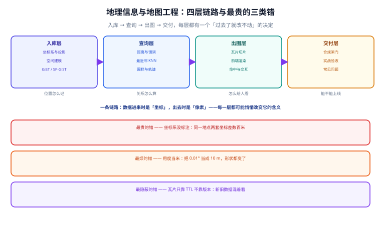

# 地理信息与地图工程

空间数据（Spatial Data）是「带位置的数据」，地图工程是把这些位置**存得下、查得快、画得对**的一整套取舍。本专题面向做门店、配送、出行、巡检、资产分布这类业务的工程师，回答一件最容易被低估的事：**同一批经纬度，在数据库里、在接口里、在屏幕上，可能是三个不同的位置。**

::: tip 一句话理解
地图工程的难点不在「把点画上去」，而在**证明屏幕上的那个点，和你数据库里那条记录，指的是同一个地方**——坐标系、精度、索引、瓦片、合规，任何一层松一格，这句话就不成立。
:::

::: info 本专题与相邻专题的分工
- **空间数据的存储与查询**（坐标系、几何模型、GiST、距离谓词）→ 本专题：从[总览](Overview/index.md)到[空间查询](Query/index.md)。
- **PostgreSQL 本身的安装、SQL 语法、索引原理** → [PostgreSQL](../../DB/Relational/PostgreSQL/Overview/index.md) 与 [数据库内核](../../DB/DatabaseInternals/Overview/index.md)：那边讲「B+ 树与代价模型」，这边讲「GiST 的空间外包框为什么会让预过滤通过率放大一个量级」。
- **图表里的地理可视化**（ECharts 地图、大屏、坐标系配置）→ [数据可视化](../../Frontend/DataVisualization/Overview/index.md)：那是「用图表表达数据」，本专题是「用地图表达位置」，前者的坐标是屏幕坐标，后者的坐标是地球坐标。
- **CDN 与边缘缓存**（瓦片就是典型的可缓存静态资源）→ [边缘计算与 CDN](../../Ops/EdgeCDN/Overview/index.md)：那边讲缓存键与回源比，本专题讲**瓦片编号为什么不能跨版本复用**。
- **移动端与 H5 定位**（权限、精度、后台定位）→ [移动端 H5](../../Frontend/MobileH5/Overview/index.md)：那边管「怎么拿到位置」，本专题管「拿到之后怎么相信它」。
- **数据脱敏与合规**（位置属于个人敏感信息）→ [数据治理](../../DB/DataGovernance/Overview/index.md) 与 [安全加固](../../Ops/SecurityHardening/Overview/index.md)：本专题只写**地图数据本身**的合规红线（审图号、精度上限、不得表示的要素）。
:::

## 目录

- [总览：四个问题、三段链路与五档成熟度](Overview/index.md)
- [坐标系与投影：位置到底怎么记](CRS/index.md)
- [空间建模与索引：几何类型与 GiST](Modeling/index.md)
- [空间查询与距离：从「圈一个范围」到「排序取最近」](Query/index.md)
- [瓦片服务与切片：把地图切成可缓存的方块](Tiles/index.md)
- [前端渲染与交互：矢量瓦片、图层与命中](Render/index.md)
- [地理围栏与轨迹：判定、去抖与抽稀](GeoFence/index.md)
- [地图数据合规与离线交付](Compliance/index.md)
- [实战：门店选址与配送范围](Practice/index.md)
- [常见问题与分诊](FAQ/index.md)

## 专题地图

## 判据纪律

本专题沿用全库写法：**每页 8 条判据，编号形如 `GMX-A`**，逐页前缀唯一，可被 `utils/audit` 下的判据类巡检机械核对。判据不是口号，每条都要回答三个问题：**看什么现象、判定成什么、不满足时改哪里**。

| 页 | 判据族 | 条数 | 这一族管什么 |
| --- | --- | --- | --- |
| 总览 | `GMP-A` ~ `GMP-H` | 8 | 三段链路的边界与成熟度自评 |
| 坐标系 | `GMC-A` ~ `GMC-H` | 8 | 坐标来源、轴序、单位、偏移是否可追溯 |
| 建模与索引 | `GMM-A` ~ `GMM-H` | 8 | 几何类型、SRID 约束、索引选择、合法性 |
| 查询与距离 | `GMQ-A` ~ `GMQ-H` | 8 | 谓词与索引匹配、单位、边界语义、分页 |
| 瓦片 | `GMT-A` ~ `GMT-H` | 8 | 编号体系、范围、简化、缓存与版本 |
| 渲染 | `GMR-A` ~ `GMR-H` | 8 | 底图与数据同源、图层顺序、命中、性能 |
| 围栏与轨迹 | `GMF-A` ~ `GMF-H` | 8 | 触发去重、去抖、抽稀与留存 |
| 合规 | `GML-A` ~ `GML-H` | 8 | 底图来源、审图号、精度红线、离线包 |
| 实战 | `GMS-A` ~ `GMS-H` | 8 | 一次选址链路的端到端验收 |
| 常见问题 | `GMX-A` ~ `GMX-H` | 8 | 症状分诊与口径澄清 |

合计 **10 族 80 条**。

## 事实与口径速览（2026-10 核对）

| 项 | 口径 | 说明 |
| --- | --- | --- |
| 空间数据库 | PostGIS **3.6.x**（3.6.0 于 2025-10-16 发布，2026-04 出 3.6.3 补丁，官方镜像 2026-10 已到 3.6.4） | 要求 PostgreSQL 12~18；3.7 处于 RC；**2026-10 起官方 Debian 镜像切到 trixie + PostGIS 3.6，`*-3.5` 标签停更** |
| 升级副作用 | PG 18 起官方镜像 `VOLUME` 改为 `/var/lib/postgresql`；trixie 的 glibc/ICU 变更可能要求 `REINDEX` 与 `REFRESH COLLATION VERSION` | 这两条都不是几何问题，但会让「升级后查询变慢/排序变了」被误判成空间索引失效 |
| Web 地图引擎 | MapLibre GL JS **6.x**（6.0.0 于 2026-07-22 发布，6.3.0 于 2026-08-10） | v6 起**仅 ESM 分发**、**强制 WebGL2**、TS 目标 ES2022、样式规范 v25；v5 仍可继续用 |
| 栅格瓦片引擎 | Leaflet 1.9.x（DOM/Canvas 渲染，栅格优先） | 与 MapLibre 的分工不是「新旧」，而是「要素数量与图层表达复杂度」 |
| 矢量瓦片规范 | Mapbox Vector Tile Specification **2.1** | 几何用整数坐标 + `extent`（默认 4096）+ `buffer`（常见 64 或 256） |
| 坐标系 | `EPSG:4326`（WGS 84 经纬度）、`EPSG:3857`（WGS 84 / Pseudo-Mercator） | 3857 只保证「形状可用、方向对」，**不保距离也不保面积**：北纬 39.9° 处长度放大 **1.3036 倍**、面积放大 **1.6993 倍** |
| 地图合规 | 《地图管理条例》（国务院令第 664 号，2016-01-01 施行）；《公开地图内容表示规范》（自然资规〔2023〕2 号，2023-02-06 印发） | 行政规范性文件写明**有效期 5 年**（约 2028-02 到期），换版前要复核精度与表示条款 |
| 精度红线（境内公开地图） | 平面精度**不优于 10 m（不含）**、高程**不优于 15 m（不含）**、等高距**不小于 20 m（不含）**；遥感影像地面分辨率**不得优于 0.5 m** | 出自《公开地图内容表示规范》第十九、二十二条；这是「能做多细」的上限，不是建议值 |
| 审图号 | 公开地图需审核并核发审图号，且在适当位置**显著标注** | 直接使用自然资源部标准地图服务（`bzdt.ch.mnr.gov.cn`）的图可不重复送审，但仍须标注审图号 |

::: warning 关于「实测」的诚实标注
本专题的数字分两类，正文逐处标明：**一类是本机可复跑的读数**（Python 3.13.12 标准库，公式与命令写在页面里，脚本不入库）；**另一类是公开资料口径**（PostGIS / MapLibre / 国务院公报）。两类不混排——凡未在本机跑过的，一律写「公开资料口径」，不当成实测。
:::

## 三条底线

1. **坐标系是数据的一部分，不是显示设置**：一条记录如果没说清自己是 4326 还是 GCJ-02，它就不是「位置」，只是一个二元组。
2. **所有距离都必须带单位与参照系**：`ST_DWithin(a, b, 0.01)` 在不同纬度上圈出的面积能差一倍以上，而它不会报错。
3. **地图的合法性在出图之前就要判定**：审图号、精度上限、不得表示的要素，任何一条都是「上线即违规」，不存在灰度。

## 学习路径

| 你现在的位置 | 从哪开始 | 大约要花的时间 |
| --- | --- | --- |
| 手里有一批经纬度，要入库并支持「附近的人」 | [坐标系](CRS/index.md) → [建模与索引](Modeling/index.md) → [查询](Query/index.md) | 1 小时 |
| 要把业务数据画到地图上，用户能点、能筛 | [瓦片](Tiles/index.md) → [渲染](Render/index.md) | 50 分钟 |
| 要做打卡、进出围栏、轨迹回放 | [围栏与轨迹](GeoFence/index.md) → [查询](Query/index.md) | 45 分钟 |
| 要上线对外可见的地图 | [合规](Compliance/index.md)（先看这一页，别最后看） | 30 分钟 |
| 要从零交付一个选址/配送系统 | [实战](Practice/index.md) → 回到上面按需补 | 2 小时 |

## 参考资料

- [PostGIS 官方文档](https://postgis.net/documentation/)：`ST_DWithin`、`ST_AsMVT`、`geography` 类型的权威口径
- [PostGIS 版本与发布说明](https://postgis.net/news/)：3.6 / 3.7 的变更与补丁节奏
- [MapLibre GL JS 文档](https://maplibre.org/maplibre-gl-js/docs/)：v6 的 ESM 与 WebGL2 要求
- [Mapbox Vector Tile Specification 2.1](https://github.com/mapbox/vector-tile-spec/tree/master/2.1)：`extent` / `buffer` / 命令整数的编码规则
- [EPSG:3857 官方定义](https://epsg.io/3857)：名字里带 "Pseudo" 的原因
- [中国政府网 · 地图管理条例（国务院令第 664 号）](https://www.gov.cn/govweb/gongbao/content/2016/content_2979707.htm)
- [中国政府网 · 公开地图内容表示规范（自然资规〔2023〕2 号）](https://www.gov.cn/gongbao/content/2023/content_5752310.htm)
- [自然资源部标准地图服务](http://bzdt.ch.mnr.gov.cn/)：可直接引用的合规底图
