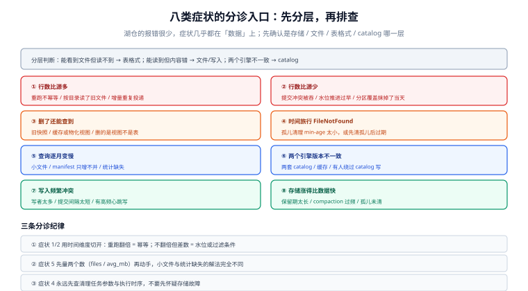

# 常见问题与分诊

湖仓的问题有一个共同特征：**报错信息很少，症状都在「数据」上**。`FileNotFound` 是唯一会明确喊出来的错误，其余九成表现为「行数不对」「数字不对」「越来越慢」「删了还在」。

所以这一页按「症状 → 最可能的原因 → 一条能证伪的命令」组织，而不是按概念组织。分诊的第一条纪律：**先确认是哪一层**（存储 / 文件 / 表格式 / catalog），再谈优化。

## 判据族声明

本页判据族 `LHF-A` ~ `LHF-H`，共 8 条。定义表在第四节。

## 本页不讲什么

- 不讲建表与写入的具体参数，见 [实战](../Practice/index.md)。
- 不讲 compaction 的策略细节，归 [小文件治理](../SmallFiles/index.md)。
- 不讲 catalog 的部署，归 [元数据与 catalog](../Metadata/index.md)。



## 一、八类症状的分诊表

| # | 症状 | 最可能的原因（按概率） | 一条能证伪的命令 |
| --- | --- | --- | --- |
| 1 | 行数比源系统多 | ① 重跑没幂等 ② 按目录读进了旧文件 ③ 增量重复投递 | 同批次跑两次，看行数是否翻倍 |
| 2 | 行数比源系统少 | ① 提交冲突被吞 ② 增量水位推进过早 ③ 分区覆盖抹掉了当天数据 | 查 `snapshots` 的 `operation` 与提交时间 |
| 3 | 删掉的数据还能查到 | ① 旧快照仍被查询 ② 读的是缓存/物化视图 ③ 删的是视图不是表 | `VERSION AS OF` 当前快照再查一次 |
| 4 | 时间旅行报 `FileNotFound` | 孤儿清理 `min-age` 太小，或先清孤儿后过期 | 查清理任务参数与执行时序 |
| 5 | 查询逐月变慢 | ① 小文件 ② manifest 只增不并 ③ 统计缺失 | 看 `files` 的数量与 `avg_mb` |
| 6 | 两个引擎版本不一致 | ① 两套 catalog ② 元数据缓存 ③ 有人绕过 catalog 写 | 两引擎各查 `snapshot_id` |
| 7 | 写入频繁冲突 | ① 写者太多 ② 提交间隔太短 ③ 有高频心跳写 | 统计冲突率与提交间隔 |
| 8 | 存储涨得比数据快 | ① 保留期太长 ② compaction 过频 ③ 孤儿未清 | 算「物理占用 / 逻辑大小」比值 |

三条使用说明：

- **症状 1 与 2 先看时间维度**：同一批次重跑，翻倍是幂等问题；不翻倍但对不上源系统，是增量水位或过滤条件问题。
- **症状 4 不要先怀疑存储**：`FileNotFound` 在湖仓里几乎总是「有人删了还在被引用的文件」，而能做这件事的只有孤儿清理与存储层生命周期规则。
- **症状 5 先量再调**：`avg_mb` 与 `files` 两个数就能区分「小文件」与「统计缺失」，两者的解法完全不同。

## 二、十二问

### 关于选型

**Q1：能不能直接用一个 PostgreSQL 存所有分析数据？**
数据量 < 几百 GB、并发不高时，可以，而且运维成本低一个数量级。超过这个量级后，扩容成本与 DDL 代价会把你推向湖仓。判据是「单表 > 1 亿行且要按多个维度切片」——见 [总览](../Overview/index.md) 的五问决策树。

**Q2：Iceberg 和 Delta 到底选哪个？**
按读者清单选。三个以上引擎要读写同一张表 → Iceberg；主要栈是 Databricks/Spark → Delta。别按「谁的功能多」选，功能已经趋同（deletion vector、variant、row tracking 三家都有）。

**Q3：能不能不用表格式，只用 Parquet + 严格目录约定？**
单写者、只追加、下游只有你一个引擎时可以。一旦出现第二个写者或需要回滚，就必须上表格式。**这个转折点通常发生在「第二个团队接入」那天**，所以要么一开始就上，要么明确写下「不允许多写」的约束。

### 关于写入

**Q4：为什么我的表文件数比行数还多？**
微批太小 + `write.distribution-mode` 没设成 `hash`，每个 task 各写一个小文件。先改分布模式，再上 compaction。

**Q5：`INSERT OVERWRITE` 和 `MERGE` 哪个更适合幂等？**
按粒度选：能按分区整体重算就用 `OVERWRITE`（简单、快）；只能按键更新就用 `MERGE`（要保证源表键唯一）。混用会得到「一半覆盖一半合并」的表。

**Q6：两个作业同时写同一张表，怎么彻底避免冲突？**
三种办法：调度串行（最简单）、按分区隔离（要求分区键能切开写者）、catalog 协调提交（要新版）。**没有第四种**——「加重试」只是降低失败率，不消除冲突。

### 关于读取

**Q7：为什么 `count(*)` 比 `select * limit 10` 慢很多？**
`count(*)` 要读全部文件的元数据（行数统计通常在 footer），`limit 10` 只打开第一个文件。若 `count(*)` 特别慢，先看文件数。

**Q8：增量读为什么把整片历史都重算了一遍？**
compaction 会重写文件，产生一个 `replace` 快照；如果下游只按「快照变了」判断，就会重放。要按 `summary.operation` 过滤，见 [增量读](../IncrementalRead/index.md)。

**Q9：时间旅行能回多久？**
等于快照保留期，不是「永久」。而且**被 `DROP COLUMN` 删掉的列回不来**（数据可能还在，schema 里没有）。

### 关于运维

**Q10：compaction 要不要每天都跑？**
按触发条件跑，不按日历跑。文件数/平均大小达阈值才跑；每天盲跑会把写放大推到 100 倍（日增 1% 时）。

**Q11：删数据要多久才真的消失？**
三段：逻辑删除立即生效（读不到）→ 保留期后快照过期 → 再一个孤儿窗口后物理删除。对外承诺要写三段，见 [保留与清理](../Retention/index.md)。

**Q12：怎么证明「这次优化有效」？**
三个数：扫描字节数、打开文件数、规划耗时。只报「快了 3 倍」没有意义——可能只是缓存命中。

## 三、十二项上线自查

| # | 自查项 | 判据 |
| --- | --- | --- |
| 1 | 表注册在支持 CAS 的 catalog 上 | catalog 类型不是 `hadoop` / `dir` |
| 2 | 建表显式写了 `format-version` | `SHOW TBLPROPERTIES` 有该属性 |
| 3 | 写入有业务唯一键与 `batch_id` | 重跑演练行数不变 |
| 4 | `write.distribution-mode` 已设为 `hash` | 属性可见 |
| 5 | 目标文件大小与数据量匹配 | `avg_mb` 在目标 0.5~1.5 倍 |
| 6 | compaction / manifest 重写 / 过期清理三条调度齐备 | 三条都有最近成功时间 |
| 7 | 孤儿清理 `min-age` ≥ 最长事务 × 2 | 参数可查 |
| 8 | 增量消费按操作类型过滤且幂等 | 代码有分支 + 重放演练 |
| 9 | 关键过滤列有统计（非 `metrics=none`） | 元数据上下界非空 |
| 10 | 关键过滤列有分区或聚簇覆盖 | `EXPLAIN` 有 files pruned |
| 11 | 删除承诺分阶段且写进对外文档 | 文档可搜到保留期数字 |
| 12 | 两个引擎的 `snapshot_id` 一致 | 交叉查询相同 |

## 四、判据表

| 编号 | 规则 | 违反时的样子 | 怎么验证 |
| --- | --- | --- | --- |
| `LHF-A` | 分诊先定位到层（存储/文件/表格式/catalog） | 所有问题都往「引擎 bug」上猜 | 工单模板里有分层字段 |
| `LHF-B` | 每个症状有一条能证伪的命令 | 排查靠试 | 分诊表每行有命令 |
| `LHF-C` | 行数异常先做「重跑对比」 | 反复查 SQL 逻辑 | 有重跑演练步骤 |
| `LHF-D` | 慢查询先量「扫描字节 / 打开文件数」 | 只报时长，优化无方向 | 有这两个指标 |
| `LHF-E` | `FileNotFound` 一律先查清理任务 | 误判为存储故障 | 清理任务有执行日志与参数 |
| `LHF-F` | 版本不一致先查 catalog 与缓存 | 重建表（最贵的错误处置） | 有「catalog 类型 + 缓存」检查清单 |
| `LHF-G` | 十二项自查进上线评审 | 上线后才发现没有 compaction | 发布检查表含这 12 项 |
| `LHF-H` | 术语团队内统一 | 「增量」被理解成「CDC」 | 有术语表且评审引用 |

## 五、术语表

| 术语 | 含义 | 最容易混淆的点 |
| --- | --- | --- |
| **表格式（table format）** | 规定多文件如何组成一张表：快照、模式、分区、删除 | 与「文件格式」（Parquet）不是一回事 |
| **快照（snapshot）** | 某一刻表的完整成员清单 | 不是「备份」：快照共享文件，备份是独立副本 |
| **manifest** | 快照里的文件清单，含列统计与分区统计 | 与「manifest list」是两层 |
| **catalog** | 表名 → 当前元数据位置，并保证提交互斥 | 「文件系统 catalog」没有互斥能力 |
| **提交（commit）** | 写新文件后原子地换指针 | 不是「写完文件」，写完文件对读者不可见 |
| **CoW / MoR** | 写时重写 / 读时合并 | MoR 的「读放大」是长期成本，不是一次性 |
| **deletion vector** | 压缩位图，标记某数据文件中哪些行被删 | 与 position delete 文件解决同一问题，成本不同 |
| **隐藏分区** | 分区值由变换函数算出，不由路径决定 | 「看不到分区目录」不等于「没分区」 |
| **data skipping** | 用元数据排除不需要读的文件 | 它不加速读单个文件 |
| **compaction** | 合并小文件 / 物化删除 | 会伪造增量变更 |
| **孤儿文件** | 存在但不在任何快照里的对象 | 正在写的文件也是「孤儿」，所以清理要设年龄 |
| **保留期** | 快照可回溯的时间长度 | 与「备份保留」是两个独立的数字 |
| **增量读** | 按快照区间读变化 | 交付文件级变化，不是业务行级变更 |

## 验证方式

本页判据以「文档与流程」为主，其中两条可以用一条 SQL 直接判：

```sql
-- LHF-D：慢查询的两个数（Iceberg 元数据表 + 查询引擎统计）
SELECT count(*) AS files, round(sum(file_size_in_bytes)/1024.0/1024/1024, 2) AS total_gb
FROM demo.db.events.files;
-- 与引擎侧报告的「扫描字节」对比：扫描字节 ≈ total_gb → 裁剪完全失效

-- LHF-E：清理任务是否越界（看最近一次孤儿清理的参数与删除量）
SELECT * FROM lake_maintenance_log
WHERE task = 'remove_orphan_files'
ORDER BY ts DESC LIMIT 5;
-- 期望：older_than 远大于最长事务时长；deleted_objects 不出现「刚写入的文件名模式」
```

```text
# LHF-C：行数异常的重跑对比（3 分钟即可完成）
1) SELECT count(*) ... WHERE dt = '2026-10-20';   → N1
2) 重跑该批作业
3) 再查 → N2
4) N2 == N1 → 幂等 OK，去查上游过滤；N2 == 2N1 → 幂等问题
```

## 参考资料

- [Iceberg · 常见问题与排查](https://iceberg.apache.org/docs/latest/)——各引擎的配置与元数据表
- [Delta Lake · 故障排查](https://docs.delta.io/latest/delta-utility.html)——`VACUUM` 与 `FSCK REPAIR TABLE`
- [Trino · Iceberg 元数据表](https://trino.io/docs/current/connector/iceberg.html#metadata-tables)——`$files` / `$snapshots`
- 本站 [分区分表 · 常见问题](/docs/DB/PartitionArchival/FAQ/index.md) · [对象存储 · 常见问题](/docs/Backend/ObjectStorage/FAQ/index.md)
- 相邻：[总览](../Overview/index.md) · [实战](../Practice/index.md) · [小文件治理](../SmallFiles/index.md)
