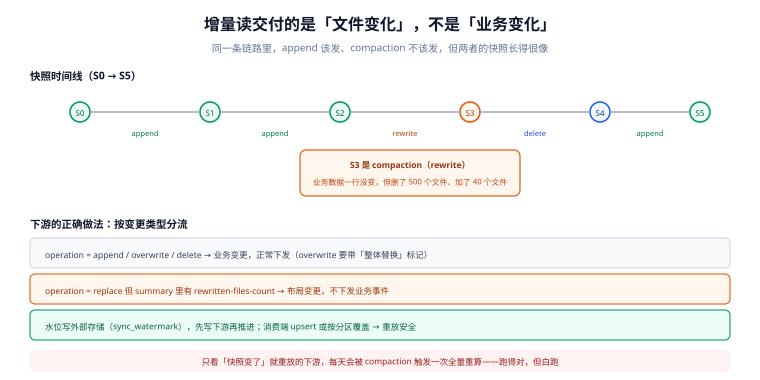

# 增量读：边界与代价

「只处理变化的部分」是所有数据链路省钱的来源，也是湖仓最容易被误解的能力。误解通常长这样：**「表支持增量读」≠「下游拿到的一定是业务变更」**。

湖仓的增量是**文件级 / 快照级**的，不是行级的。一次 compaction 没有改变任何业务数据，但它重写了文件；一次分区覆盖没有新增数据，但它删了又加了一批文件。如果下游把「文件变了」当成「数据变了」，就会得到一份「每天全量重放一遍」的增量管道——跑得挺对，只是没用。

::: tip 一句话理解
增量读交付的是**「这一版比上一版多了/少了哪些文件」**，业务变更语义要由**你自己**从变更类型里筛出来。
:::



*图 1：同一条 S0→S5 快照链上，`append` 该发、`rewrite` 不该发，但两者在快照元数据里长得几乎一样——都只有「新增了哪些文件」。要区分它们，只能靠变更类型（`summary['operation']`）和写入方自己打的 `batch_id` 属性，不能靠文件路径或行数差。*

## 判据族声明

本页判据族 `LHI-A` ~ `LHI-H`，共 8 条。定义表在第六节。

## 本页不讲什么

- 不讲 CDC 的采集侧（Binlog / Debezium / Flink CDC），归 [数据同步与 CDC](/docs/DB/CDC/Overview/index.md)。
- 不讲消息队列的投递语义，归 [消息队列](/docs/Backend/MessageQueue/Overview/index.md)。
- 不讲 compaction 的执行细节，归 [小文件治理](../SmallFiles/index.md)。

## 一、三种「增量」，语义完全不同

| 形态 | 谁支持 | 返回什么 | 典型用途 |
| --- | --- | --- | --- |
| **快照差分（snapshot diff）** | Iceberg（`create_changelog_view` / 两快照 diff）、Delta（CDF） | 两个快照之间新增/删除的**文件**，可展开成行级 `+I/-D` | 对账、抽样校验、低频批同步 |
| **增量扫描（incremental scan）** | Iceberg（`start-snapshot-id` + `end-snapshot-id`）、Hudi（`INCREMENTAL` 查询） | 指定快照区间内**被写入**的记录（含更新） | 小时级同步到下游库 |
| **流式读（streaming read）** | Spark Structured Streaming + Iceberg / Delta / Paimon | 持续轮询新快照，按微批交付 | 分钟级入仓、实时看板 |

三者不能混用：第一种是**事后比对**（要先有两个快照），第二种是**区间读取**（要指定起点），第三种是**持续订阅**（要维护 offset）。

## 二、增量读为什么能省：一组实测比例

一张按天分区的事件表，30 天 × 每天 200 个文件 = 6,000 个文件。一次只改 1 天：

```text
全表重扫：6,000 个文件
增量 diff：  200 个文件（只碰被改的那一天）
比例：30×
```

这个 30× 不是「理论值」——它就是「按天分区 + 按天增量」能带来的全部收益。分区粒度越细，比例越高；但分区越细，小文件越多（见 [小文件治理](../SmallFiles/index.md) 的四面成本），两者是一对直接的权衡。

再看「比对」这一步本身有多贵（本机，纯集合运算，不含 I/O）：

| 规模 | 新增 / 删除 | 集合差耗时 |
| --- | --- | --- |
| 2,000 vs 2,000 | 1,000 / 1,000 | 0.1 ms |
| 20,000 vs 20,000 | 10,000 / 10,000 | 2.0 ms |
| 200,000 vs 200,000 | 100,000 / 100,000 | 29.0 ms |

结论：**比对本身不是瓶颈，读元数据才是**。6,000 个文件按每 manifest 400 条算需要 13 个 manifest，200 个文件只要 1 个——增量读省下的是对象请求与解码，不是 CPU。

## 三、四个前提：缺一个就不该做增量

| 前提 | 缺了会怎样 | 怎么补 |
| --- | --- | --- |
| **① 变更可见性有定义** | 「写入后多久能被增量读到」说不清，下游只能轮询全表 | 明确「提交即可见」，并把 compaction 的延迟单独说明 |
| **② 起点可持久化** | 作业重启后不知道从哪继续，只能全量重来或丢数据 | 水位写进外部存储（表 / KV / 调度器变量），**不写进作业内存** |
| **③ 消费端幂等** | 重放一段区间就重复计数 | 按 `(表, 快照区间)` 或业务键去重 |
| **④ 能区分变更类型** | 把 compaction 当业务变更，下游全量重放 | 按 `snapshot.summary.operation` 过滤，见下一节 |

## 四、compaction 会伪造变更（本页最重要的一节）

`rewrite_data_files`（compaction）的行为是：**读旧文件 → 写新文件 → 提交一个删除旧文件、加入新文件的快照**。对表来说数据没变，对增量读来说这是**一次巨大的变更**。

| 快照操作类型（`summary.operation`） | 业务数据变了吗 | 增量读该不该往下游发 |
| --- | --- | --- |
| `append` | 变了（新增） | **发** |
| `overwrite` / `replace` | 变了（整体替换） | **发**（但要带「全量替换」标记） |
| `delete` | 变了（删除） | **发** |
| `replace`（compaction 的 `rewrite`，Iceberg 里常表现为 `replace`） | **没变** | **不发**，或只发「布局变更」事件 |
| `expire_snapshots` / `remove_orphan_files` | 没变（只清垃圾） | 不发 |

麻烦在于：**compaction 与 overwrite 的 `summary.operation` 可能都是 `replace`**。所以只看 operation 不够，还要看：

- Iceberg 的 `rewrite_data_files` 会在快照 summary 里写 `rewritten-files-count` / `added-files-count`，且**不改变行的 `_row_id`**（v3 才有 row lineage；v2 只能靠行内容比对）。
- Delta 的 `OPTIMIZE` 会在 `_delta_log` 里留下 `operation: OPTIMIZE` 与 `operationMetrics`。
- Hudi 的 compaction 是独立的 instant 类型（`commit` 之外的 `compaction`），时间线上可区分——这是它做得最干净的一点。

::: danger 三种「看起来对」的增量实现
1. **按文件修改时间增量**：`WHERE file_mtime > last_run` 在对象存储上不可靠（`Last-Modified` 是 PUT 时间，compaction 会把老数据写成新时间），而且**列目录本身极慢**。
2. **按业务时间列增量**（`WHERE updated_at > last_watermark`）：遇到**乱序到达**（补数、时区、延迟上报）就永久丢数据；`updated_at` 相等的一批也容易漏。
3. **按 `max(id)` 增量**：自增 id 在分布式写入下不单调（分片各发各的），且更新（update）不产生新 id，**更新永远同步不过去**。
:::

## 五、水位与回放：把「起点」当一等公民

```text
水位（watermark）= 上次成功处理到的 (snapshot_id, 处理时间)
落点：外部存储（推荐一张 sync_watermark 表，主键 = 下游表名）
更新时机：下游写入成功之后（不是之前）
```

三条纪律：

1. **先写下游，再推进水位**。反了就会「水位说处理过，下游其实没写」——这是最常见的数据丢失。
2. **水位要能被人工回拨**。补数时把水位往回拨一段，重放是正常操作，不是异常。
3. **重放必须幂等**。`upsert`（按主键）或「按批次覆盖分区」，二选一。

```sql
-- 水位表的最小结构
CREATE TABLE sync_watermark (
  target      text PRIMARY KEY,        -- 下游表名，如 'dwd.event_flat'
  source      text NOT NULL,           -- 源表，如 'ods.event'
  snapshot_id bigint NOT NULL,         -- 已处理到的快照
  updated_at  timestamptz NOT NULL DEFAULT now(),
  note        text                     -- 回拨原因，人工操作必填
);
```

## 六、判据表

| 编号 | 规则 | 违反时的样子 | 怎么验证 |
| --- | --- | --- | --- |
| `LHI-A` | 增量必须基于快照 / 版本号，不基于文件时间或业务时间列 | 偶发丢数据、补数后重复 | 增量条件里没有 `mtime` / `updated_at` 作为唯一依据 |
| `LHI-B` | 增量消费必须过滤变更类型 | compaction 触发下游全量重放 | 代码里有 `operation` 判断分支 |
| `LHI-C` | 水位落在外部存储，且在下游写成功后推进 | 重启后重复或丢数 | 有 `sync_watermark` 类表；推进顺序可在日志中看出 |
| `LHI-D` | 水位可人工回拨且有审计 | 补数只能整表重跑 | 有 `note` 字段与回拨记录 |
| `LHI-E` | 消费端幂等（upsert 或覆盖分区） | 重放一次翻一倍 | 重放演练：同一区间跑两次，下游行数不变 |
| `LHI-F` | compaction 与增量消费的调度有先后约束 | 下游读到 compaction 中间态 | 调度依赖图里 compaction 与下游任务的关系有说明 |
| `LHI-G` | 增量链路有「新鲜度」指标 | 延迟 6 小时没人知道 | 有 `now - max(committed_at)` 的监控 |
| `LHI-H` | 全量重扫有兜底路径 | 增量坏了只能等修好 | 存在 `--full-refresh` 开关与执行记录 |

## 验证方式

```sql
-- LHI-B：看最近 20 个快照的操作类型分布，确认 compaction 没有混在 append 里
SELECT snapshot_id, committed_at, summary['operation'] AS op,
       summary['added-data-files'] AS added, summary['deleted-data-files'] AS deleted
FROM demo.db.events.snapshots
ORDER BY committed_at DESC LIMIT 20;
-- 期望：能看到独立的 replace / rewrite 快照；若所有快照都是 append 而文件数在下降，
--       说明 compaction 是用「覆盖整个分区」实现的，下游必然被误导

-- LHI-F / LHI-G：新鲜度（本表最后一次提交距今多久）
SELECT max(committed_at) AS last_commit,
       now() - max(committed_at) AS lag
FROM demo.db.events.snapshots;
-- 期望：lag < 一个调度周期 + 5 分钟；持续增大说明写侧卡住
```

```text
# LHI-E：重放幂等的最小验证
1) 记下游行数 N1
2) 把水位回拨一个快照区间，重跑增量
3) 再记 N2
4) 期望 N1 == N2（upsert 幂等）；若 N2 > N1，去重键选错了
```

## 参考资料

- [Iceberg · Incremental reads](https://iceberg.apache.org/docs/latest/spark-queries/#incremental-read)——`start-snapshot-id` 的语义
- [Iceberg · 快照 summary 字段](https://iceberg.apache.org/spec/#snapshot-summary)——`operation` 与 `added/deleted-files`
- [Delta Lake · Change Data Feed](https://docs.delta.io/latest/delta-change-data-feed.html)——CDF 的开启与读取
- [Hudi · Incremental query](https://hudi.apache.org/docs/querying_data#incremental-query)——instant 区间语义
- 本站 [CDC 一致性](/docs/DB/CDC/Consistency/index.md) · [幂等与状态机](/docs/Backend/IdempotencyStateMachine/Replay/index.md)
- 相邻：[提交协议](../WritePath/index.md) · [小文件治理](../SmallFiles/index.md) · [常见问题](../FAQ/index.md)
