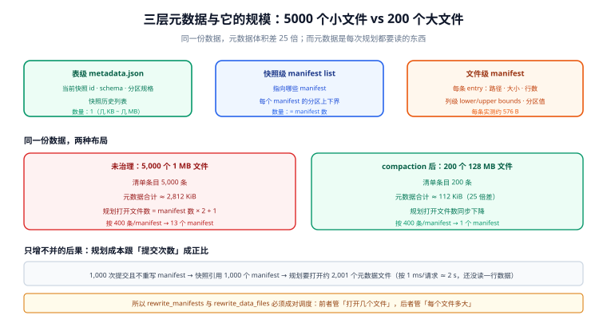

# 元数据层与 catalog

湖仓里最容易被低估的就是这一层。数据文件是「死的」，写完就不动；**元数据是「活的」**——每提交一次就多一份，每查一次就要读一遍。一张表的查询延迟、规划时间、乃至对象存储的账单，最终都记在元数据的账上。

这一页回答三个问题：元数据到底有几层、每层多大；catalog 到底在保证什么；元数据是怎么一步步腐化的。

::: tip 一句话理解
元数据层是**「一张表的索引」**，catalog 是**「索引的指针 + 唯一写者」**。前者决定「查得有多快」，后者决定「两个写者会不会打架」。
:::

## 判据族声明

本页判据族 `LHM-A` ~ `LHM-H`，共 8 条。定义表在第七节。

## 本页不讲什么

- 不讲提交重试与冲突判定，归 [提交协议](../WritePath/index.md)。
- 不讲快照过期与孤儿清理的执行，归 [保留与清理](../Retention/index.md)。
- 不讲各 catalog 产品的部署，只给职责与选型判据。

## 一、三层元数据与各自的量级



| 层 | 文件名 | 内容 | 单份大小 | 数量级 |
| --- | --- | --- | --- | --- |
| 表级 | `metadata.json`（v1/v2）或外置 metadata（v3） | 当前快照 id、schema、分区规格、属性、快照历史列表 | 几 KB ~ 几 MB（快照历史长了会涨） | **1** |
| 快照级 | `snap-<id>.avro`（manifest list） | 这一版引用了哪些 manifest、每个 manifest 的分区上下界 | 每 manifest 约 100~200 B | manifest 数 |
| 文件级 | `manifest-xxx.avro` | 每个数据文件的路径、格式、大小、行数、列级统计、分区值 | 每条 entry 约 **300~600 B** | 数据文件数 |

本机按「一条带完整 lower/upper bounds 的 manifest entry」序列化出 **576 B**（JSON 近似，Avro 编码后通常更小，但量级一致）。用这个数就能把「小文件」的元数据代价算出来：

```text
5000 个 1 MB 小文件  → 5000 × 576 B ≈ 2812 KiB 元数据
200 个 128 MB 文件   →  200 × 576 B ≈ 112 KiB 元数据
元数据体积相差 25 倍；而数据量完全相同
```

这 2.8 MB 不是「占空间」的问题，是**每次规划都要读**的问题。同一次 `SELECT` 在小文件布局下要多读 25 倍的元数据字节、多打开 25 倍的 manifest 条目——这是 [小文件治理](../SmallFiles/index.md) 的第一条论据。

## 二、规划成本：一次查询要打开多少个文件

读者视角的「打开一个文件」在对象存储上是**一次 HTTP 请求 + 一次解码**。规划阶段要打开的元数据文件数 ≈ `manifest 数 × 2 + 1`（manifest list 本身 + manifest + metadata）：

| 提交次数（每次都新增 manifest，不重写） | 快照引用的 manifest 数 | 规划要打开的元数据文件 | 400 条/manifest 时的 `1 ms/请求` 下限 |
| --- | --- | --- | --- |
| 1 | 1 | 3 | 3 ms |
| 100 | 100 | 201 | 0.2 s |
| 1,000 | 1,000 | 2,001 | 2 s |
| 10,000 | 10,000 | 20,001 | 20 s |
| 100,000 | 100,000 | 200,001 | 200 s |

这张表解释了为什么 **manifest 重写（rewrite manifests）是必需动作**而不是优化：它把「N 个只含少量文件的小 manifest」合并成「少量含大量文件的 manifest」，让规划打开的文件数从「跟提交次数成正比」变成「跟数据量成正比」。同样的机制在 Delta 里叫 **checkpoint**（每 10 次提交压一个 Parquet），在 Hudi 里是 **timeline 归档 + 文件组**。

::: danger 只做 compaction 不做 manifest 重写，是半套运维
数据文件从 5000 个合成 200 个之后，**旧 manifest 仍在快照里**（它们记录的是被替换掉的旧文件）。如果只删了数据文件而没有重写 manifest、没有过期快照，规划阶段仍要打开那 N 个 manifest，只是里面大部分 entry 指向已删除的文件。表现是「文件数降下来了，查询没变快」。
:::

## 三、快照链：为什么元数据只增不减

每次提交产生一个新快照，快照之间共享绝大部分 manifest（未变的文件不重复登记）。所以快照链本身很「便宜」——一个快照的成本 ≈ `新 manifest + 新 manifest list + 新 metadata.json`，几 KB 到几十 KB。

但共享是有代价的：**被删掉的数据文件仍被旧快照引用**，因此不能物理删除。这就是「删了还能查到」的机制来源，也是「保留期」这个概念的物理基础：

```text
快照 S1（引用 f1 f2）→ 快照 S2（引用 f1 f3，f2 逻辑删除）
                        └─ f2 仍在存储上，直到 S1 过期
```

`LHM-E` 与 [保留与清理](../Retention/index.md) 的 `LHR-B` 是同一件事的两面：**逻辑删除的可见性由当前快照决定，物理删除的时机由保留策略决定**。

## 四、catalog：它到底在保证什么

catalog 只做三件事，但三件都不能少：

1. **名字解析**：`db.events` → 当前 `metadata.json` 的绝对路径。
2. **提交互斥**：给定「基线快照 id」，只有一个写者能把指针换到新版本（compare-and-swap）。
3. **权限与命名空间**：库、表、角色、授权；通常还是审计的落点。

| 实现 | 提交互斥怎么实现 | 优点 | 风险 |
| --- | --- | --- | --- |
| **Hive Metastore** | 元数据库行锁 + 路径校验 | 生态最广、老引擎都认 | 单点；锁粒度粗；不校验「指针是否被别人改过」，靠乐观检查 |
| **REST catalog**（Iceberg 规范） | 服务端 `POST /commit`，携带 `requirements`（如 `assert-ref-snapshot-id`） | 跨引擎统一；换 catalog 只改配置 | 服务要自己运维；规范实现质量参差 |
| **Apache Polaris**（2026-02 成为 ASF 顶级项目） | 服务端事务 + 表级锁 | 支持联邦（外部 catalog 只读暴露）、细粒度权限 | 联邦只读，写仍归原 catalog |
| **对象存储 + 无 catalog**（裸路径表） | **没有互斥**，靠「文件名不存在」赌运气 | 零部署 | 两个写者会都成功；某些存储无强一致时会读到半个提交 |
| **云托管**（Glue / Unity / S3 Tables） | 服务端 | 免运维、与计算同区 | 迁移成本高；能力受厂商节奏约束 |

::: warning 「文件系统 catalog」不是 catalog
把表目录路径直接写进引擎配置（`spark.sql.catalog.local.type=hadoop`），本质是「没有 catalog」：它只能解析名字，不能保证互斥。单写者、单引擎时它能跑得很好——这正是它危险的地方，**它会在你需要第二个写者的那天失效**，且失效方式是「两个作业都成功、数据少一半」。
:::

## 五、REST catalog 的 commit 契约（读一遍就够）

Iceberg REST 规范里，提交是一个带前置条件的请求：

```json
POST /v1/{prefix}/namespaces/{ns}/tables/{table}
{
  "requirements": [
    { "type": "assert-table-uuid", "uuid": "9c1b..." },
    { "type": "assert-ref-snapshot-id", "ref": "main", "snapshot-id": 8412039482312 }
  ],
  "updates": [
    { "action": "add-snapshot", "snapshot": { "snapshot-id": 8412039482313, "...": "..." } },
    { "action": "set-snapshot-ref", "ref-name": "main", "snapshot-id": 8412039482313 }
  ]
}
```

两点必须读懂：

- `requirements` 是**乐观锁**：服务端发现当前 `main` 不是 `8412039482312` 就返回 **409**，客户端必须**基于新快照重新规划**（不是原地重试同一个请求）。
- `updates` 是**声明式**的：客户端描述「把 ref 从 A 换到 B」，而不是「把文件写进去」。这样服务端才有机会做校验与合并。

这条契约决定了写湖代码的结构：**提交失败不是异常，是正常分支**。见 [提交协议](../WritePath/index.md) 的重试预算。

## 六、元数据腐化的三个征兆

| 征兆 | 读数 | 机制 | 处置 |
| --- | --- | --- | --- |
| 规划时间随提交次数线性上涨 | `EXPLAIN` 的 planning 段 / Trino 的 `Planning Time` | manifest 只增不并 | 定期 `rewrite_manifests` |
| `metadata.json` 体积到 MB 级 | 文件大小 | 快照历史列表过长（保留 3 年 × 每天 100 次提交） | 过期快照 + v3 的外置 metadata |
| 同一张表两个引擎的 `snapshot_id` 不同 | 两次查询 | catalog 缓存 / 两套 catalog / 有人绕过 catalog 改路径 | 统一入口，清缓存，见 `LHM-C` |

## 七、判据表

| 编号 | 规则 | 违反时的样子 | 怎么验证 |
| --- | --- | --- | --- |
| `LHM-A` | 表必须注册在支持 CAS 的 catalog 上 | 两个写者都成功 | catalog 类型不是 `hadoop` / `dir`；并发双写测试只应有一个成功 |
| `LHM-B` | 提交必须带前置条件（基线快照 / 表 uuid） | 静默覆盖别人的提交 | 提交请求里有 `requirements`；日志里能看到 409 分支 |
| `LHM-C` | 表只有一个入口，禁止绕过 catalog 改元数据 | 两个引擎版本不一致 | 两引擎各查一次 `snapshot_id`，必须相同 |
| `LHM-D` | manifest 重写与数据 compaction 同时纳入调度 | 文件数降了但查询没变快 | 调度里同时有 `rewrite_data_files` 与 `rewrite_manifests` |
| `LHM-E` | 保留期内不得物理删除被引用的文件 | 时间旅行报文件不存在 | 时间旅行到保留期内的快照，不报 `FileNotFound` |
| `LHM-F` | `metadata.json` 大小进监控 | 涨到几十 MB 才发现 | 有该文件大小的时序指标或周检 |
| `LHM-G` | 快照历史有上限（保留条数或时长） | 快照列表无限增长 | 表属性里有 `history.expire.max-snapshot-age-ms` 等配置 |
| `LHM-H` | 元数据备份策略与数据一致 | 恢复后表指向不存在的快照 | 备份清单里同时含 `metadata/` 与 `data/`，且做恢复演练 |

## 验证方式

```sql
-- LHM-D：看 manifest 是否在重写（Iceberg 元数据表）
SELECT count(*) AS manifests, sum(added_data_files_count) AS files_added
FROM demo.db.events.manifests;
-- 期望：manifests 数量处于「数据文件数 / 400」的量级，而不是「提交次数」的量级

-- LHM-F / LHM-G：快照数与历史跨度
SELECT count(*) AS snapshots,
       min(committed_at) AS oldest,
       max(committed_at) AS newest
FROM demo.db.events.snapshots;
-- 期望：snapshots 数量与保留策略相符（如保留 7 天 × 每天 24 次 ≈ 168 上下）
```

```shell
# LHM-C：两个引擎对同一张表报同一个版本（升级 catalog 或排查漂移时必跑）
# Iceberg 表的 metadata 位置也能直接看出来
aws s3 cp "s3://lake/warehouse/db/events/metadata/version-hint.text" - 2>/dev/null || true
# 提示：version-hint 是 HDFS 风格 catalog 的产物；用 REST catalog 时它可能过期，不要拿它当真相
```

```text
# LHM-A：并发双写的最小验证（两个终端各跑一次，同时提交）
# 期望：一个成功、一个 409 / CommitFailedException；若两个都成功 → catalog 不具备 CAS
```

## 参考资料

- [Iceberg REST Catalog OpenAPI](https://github.com/apache/iceberg/blob/main/open-api/rest-catalog-open-api.yaml)——`commit` 的 `requirements` / `updates`
- [Iceberg · Maintenance](https://iceberg.apache.org/docs/latest/maintenance/)——`rewrite_manifests`、`expire_snapshots`、`remove_orphan_files`
- [Delta PROTOCOL · Checkpoints](https://github.com/delta-io/delta/blob/master/PROTOCOL.md#checkpoints)——checkpoint 的触发与读取
- [Apache Polaris](https://polaris.apache.org/)——REST catalog 的开源实现与联邦能力
- 本站 [对象存储 · 一致性模型](/docs/Backend/ObjectStorage/ConsistencyModel/index.md) · [数据治理 · 元数据](/docs/DB/DataGovernance/Metadata/index.md)
- 相邻：[表格式](../TableFormat/index.md) · [提交协议](../WritePath/index.md) · [保留与清理](../Retention/index.md)
