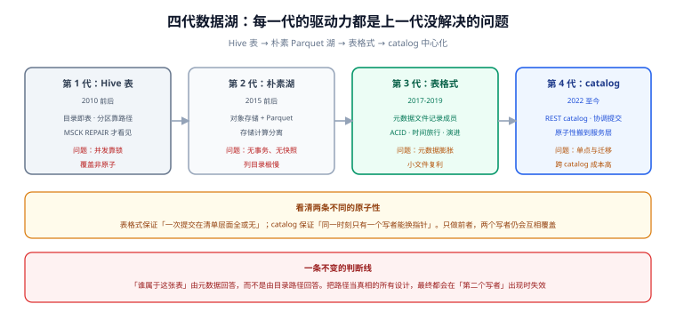

# 总览：四层结构与五个必失点

湖仓这个词被用坏了：有人指「用 S3 存 Parquet」，有人指「买了某个云产品」，有人指「数仓换成 Spark」。三种说法都漏了同一件事——**表语义**。

数据湖的第一性问题是「**这堆文件里，哪些属于这张表**」。Hive 的回答是「路径：目录在就算」；湖仓的回答是「元数据：我记着，我说了算」。整条技术路线上的所有差异——原子提交、时间旅行、增量读、并发写——都是从这一个回答推出来的。

::: tip 一句话理解
数据湖解决「**存得下、算得动**」，湖仓解决「**敢不敢往上写**」。前者是容量问题，后者是正确性问题；把容量方案当成正确性方案用，是这一领域绝大多数事故的来源。
:::

## 判据族声明

本页判据族 `LHO-A` ~ `LHO-H`，共 8 条。定义表在第八节。

## 本页不讲什么

- 不讲四种格式各自的元数据结构，归 [表格式](../TableFormat/index.md)。
- 不讲 catalog 的实现细节与 REST 接口，归 [元数据层与 catalog](../Metadata/index.md)。
- 不讲 compaction 参数与调度，归 [小文件治理](../SmallFiles/index.md)。
- 不讲 Spark / Flink 的算子与调优，归 [大数据生态](/docs/DB/BigData/Overview/index.md)。

## 一、四代数据湖：每一代的驱动力都是「上一代没解决的问题」



| 代 | 时间 | 形态 | 解决了什么 | 引入了什么问题 |
| --- | --- | --- | --- | --- |
| 第 1 代 | 2010 前后 | HDFS + Hive 表（目录即表） | 「存原始数据，用 SQL 查」 | 分区靠路径推断、`MSCK REPAIR` 才能看见新数据；并发靠锁；`INSERT OVERWRITE` 非原子 |
| 第 2 代 | 2015 前后 | 对象存储 + Parquet / ORC（朴素数据湖） | 存储与计算分离，便宜、无限、免运维 | 彻底失去表语义：没有事务、没有快照、列目录极慢、「schema 靠人记」 |
| 第 3 代 | 2017-2019 | 表格式出现（Iceberg / Delta / Hudi） | 用**元数据文件**记录成员与版本，补回 ACID、时间旅行、模式演进 | 元数据本身成为新的性能瓶颈与运维对象（小文件、快照膨胀、catalog 一致性） |
| 第 4 代 | 2022 至今 | catalog 中心化（REST catalog / Polaris / catalog-managed tables） | 把原子性从「存储层猜」搬到「服务层保证」，多引擎、多写者可用 | catalog 成为单点与治理对象；跨 catalog 迁移成本高（表注册、权限、路径全要搬） |

一条容易忽略的线索：**第 3 代与第 4 代解决的是不同层的原子性**。表格式保证「一次提交在清单层面是全或无」，catalog 保证「同一时刻只有一个提交能改指针」。前者的实现是「写新文件 + 换引用」，后者的实现是 compare-and-swap。只做前者，两个写者仍会互相覆盖。

## 二、四层结构：每一层解决一个问题，混层就会互相甩锅

| 层 | 由谁提供 | 解决的问题 | 失效时的表象 |
| --- | --- | --- | --- |
| **存储层** | S3 / OSS / GCS / HDFS | 便宜、无限、持久 | 「文件不见了」「列目录很慢」「PUT 偶尔 503」 |
| **文件格式层** | Parquet / ORC / Avro | 单文件内部怎么组织（列存、编码、统计、row group） | 「扫描量远超预期」「统计信息是空的」「小文件压不动」 |
| **表格式层** | Iceberg / Delta / Hudi / Paimon | 多文件组成一张表：快照、模式、分区、删除 | 「读到一半新一半旧」「删了还在」「并发写互相覆盖」 |
| **catalog 层** | Hive Metastore / REST catalog / Polaris / Glue / Nessie | 表名 → 当前元数据位置，且保证只有一个写者改成功 | 「两个引擎看到不同版本」「建表成功但另一个引擎找不到」 |

分层的意义在于**排障顺序**：遇到「数据不对」，先问「是哪一个文件内容不对（文件层）」，再问「这个文件该不该在这张表里（表格式层）」，最后问「两个写者是不是都以为自己成功了（catalog 层）」。跳过前两层直接怀疑引擎，通常是在浪费一天。

::: info 四层各自的「正确性负责人」
存储层只保证**单对象的原子性**（PUT 成功即完整，这点 S3 从 2020-12 起是强一致的）；文件格式层只保证**单文件可解析**；表格式层保证**多文件的集合视图一致**；catalog 保证**指针的互斥更新**。事故报告里写「存储不可靠」之前，先确认问题是不是出在上面三层。
:::

## 三、湖仓、数据湖、数据仓库：一张判别表

三者的差别不在技术栈，在**「谁回答数据是什么」**与**「写的时候保证什么」**：

| 维度 | 数据仓库（如 PG / 专用 MPP） | 朴素数据湖（Parquet on S3） | 湖仓（表格式 on 对象存储） |
| --- | --- | --- | --- |
| 成员由谁决定 | 系统目录 | 目录路径（约定） | 元数据文件（manifest / log） |
| 一次写多文件是否原子 | 是（事务） | **否** | 是（快照切换） |
| 并发写 | 锁 / MVCC | 互相覆盖 | 乐观并发，输者重试 |
| 模式演进 | `ALTER TABLE`，部分操作要重写 | 靠人记住 | 元数据级演进，**不重写数据** |
| 时间旅行 | 需要额外快照 / 备份 | 无 | 原生（保留期内任意快照） |
| 行级更新 / 删除 | 原生 | 重写整个分区 | CoW 或 MoR（删除文件 / 删除向量） |
| 增量读 | CDC 或时间列 | 靠分区与时间列猜 | 原生（快照差分 / 增量扫描） |
| 单位存储成本 | 高（块存储 / 本地盘） | 最低 | 低（对象存储 + 少量元数据） |
| 高并发点查 | 强（毫秒级） | 弱 | 弱（规划开销 + 对象请求） |
| 典型用途 | 交易库、报表库 | 归档、原始日志 | 分析主库、特征库、数据平台底座 |

**判别式（一句话版）**：如果「两个任务同时写同一份数据」会出事，而你又想用对象存储，那你就需要湖仓；如果只有一个写入者且只追加，朴素数据湖够用；如果你需要毫秒级点查与高并发事务，湖仓不是答案，去看 [ClickHouse](/docs/DB/ClickHouse/index.md) 或关系库。

## 四、五个必失点：全部是「不报错但数据错」

| # | 必失点 | 机制 | 表现 | 判据 |
| --- | --- | --- | --- | --- |
| 1 | **目录当表** | 路径约定代替元数据 | 读到临时文件、旧文件、别人的文件；行数偶尔多一截 | `LHO-A` |
| 2 | **非原子提交** | 对象存储无 `rename`，用「复制 + 删除」模拟 | 两个写者都报成功，后者的清单覆盖前者，前者的文件变孤儿 | `LHO-B` |
| 3 | **元数据漂移** | 表注册在 catalog，但有人绕过 catalog 直接改目录 | 两个引擎看到不同版本；`select` 与 `count` 对不上 | `LHO-C` |
| 4 | **小文件复利** | 文件数进入规划、请求、元数据三个方向 | 数据涨 3 倍、查询慢 20 倍；三个月后没人知道为什么慢 | `LHO-D` |
| 5 | **删除不彻底** | 逻辑删除 ≠ 物理删除；快照还引用着旧文件 | 用户要求「删掉我的数据」，三个月后仍能从旧快照查出来 | `LHO-E` |

前四条是技术问题，第五条是**合规问题**，也是唯一一条「技术上完全正常」却会造成实质损失的：快照保留 30 天意味着**删除请求的真正生效时间是 30 天后**。`LHO-E` 要求把这句话写进对外承诺；[保留与清理](../Retention/index.md) 给了一套可执行的证据链。

## 五、要不要上湖仓：五问决策树

按顺序问，前一问能定性就不用问后面的：

1. **有没有第二个写者？**（另一个团队、另一个引擎、另一个调度）——有 → 需要表格式；没有 → 可以先用朴素数据湖 + 严格约定。
2. **数据要不要被两个以上引擎读？**（Spark 写、Trino 查、Flink 也写）——要 → 需要**开放的**表格式 + REST catalog；只有一个引擎 → 该引擎自带的事务表可能更省事。
3. **有没有行级更新 / 删除？**（用户注销、状态变更、CDC 回灌）——有 → 需要 CoW 或 MoR，且必须算清读放大（见 [表格式](../TableFormat/index.md) 的删除三形态）。
4. **下游要不要增量？**（每小时只处理变化的部分）——要 → 增量读是关键能力，注意 compaction 会伪造变更（见 [增量读](../IncrementalRead/index.md)）。
5. **有没有人负责运维？**（compaction、快照过期、孤儿清理，每周都要跑）——**没有 → 先别上**。湖仓的运维不是「装完就完」，这五个动作停了任何一项，半年内必然出问题。

## 六、四种不该做湖仓的场景

| 场景 | 为什么不该 | 更合适的做法 |
| --- | --- | --- |
| 只有 50 GB、单机就能查完 | 元数据与 catalog 的复杂度远超收益；一个 PG 就够 | [PostgreSQL](/docs/DB/Relational/PostgreSQL/index.md) + 分区表 |
| 毫秒级高并发点查（QPS 上万） | 每次查询都要先读元数据、再发几十个对象请求，规划开销就超过预算 | [ClickHouse](/docs/DB/ClickHouse/index.md)、[Redis](/docs/DB/NoRelational/Redis/index.md) |
| 强事务的账务 / 库存 | 湖仓的隔离级别是「快照隔离」，没有跨表事务与唯一约束 | 关系库，见 [账务系统](/docs/Backend/Ledger/index.md) |
| 数据量小但更新极频繁（每分钟上万次 upsert） | 每次 upsert 都可能产生新文件，compaction 永远追不上 | 先看 [Paimon / Hudi 的流式路线](../TableFormat/index.md) 是否够用，否则回 OLTP 库 |

## 七、一次写入的完整路径（把四层串起来）

以「Spark 往 Iceberg 表追加一批数据」为例，读者视角与写者视角是两条路：

```text
写者                                              读者
① 读当前 metadata.json（拿到 snapshot_id）          
② 写 data file 到 s3://.../data/（此时无人可见）    
③ 写 manifest（列出新文件 + 统计信息）             
④ 写 manifest list（指向新旧全部 manifest）         
⑤ 调 catalog：commit(table, base=旧快照, new=新快照)
   ├─ 成功：指针换到新 metadata.json  ───────────→ ⑥ 读到新快照（完整、一致）
   └─ 失败（有人先提交了）：重试 ①，或放弃          
```

四层在这里各出现一次：② 是存储层与文件格式层；③④ 是表格式层；⑤ 是 catalog 层。**只有 ⑤ 成功之后，②③④ 产出的一切才对世界可见**——这条「先写后换指针」的顺序，就是湖仓能原子提交的全部秘密。

## 八、判据表

| 编号 | 规则 | 违反时的样子 | 怎么验证 |
| --- | --- | --- | --- |
| `LHO-A` | 所有读都必须经由表名，禁止按前缀读数据目录 | 读到临时文件 / 旧文件；行数偶尔多一截 | 全仓搜索 `read.parquet(` 与 `SELECT * FROM parquet.` 形式的路径读，应为 0 处 |
| `LHO-B` | 提交必须走表格式的 commit，禁止「写临时目录 + 改名」 | 两个写者都报成功，数据少一半 | 提交代码里搜 `mv` / `mvObject` / `rename` 的提交实现，应为 0 |
| `LHO-C` | 表的唯一入口是 catalog，禁止绕过它改 `metadata.json` | 两个引擎看到不同版本 | 对同一张表在两个引擎上 `select snapshot_id`（或 `DESCRIBE HISTORY` 首行），值必须相同 |
| `LHO-D` | 文件数与平均文件大小进周报 | 没人知道文件数在涨 | 每周记录 `count(files)` 与 `sum(size)/count(files)`，两项都要有趋势 |
| `LHO-E` | 「删除」的生效时间 = 快照保留期，必须写进对外承诺 | 承诺「立即删除」，实际 30 天后才删 | 对外文档里能搜到保留期数字，且与表属性一致 |
| `LHO-F` | 选型必须回答「谁是第二个写者」 | 上线三个月后第二个引擎接入，发现不能写 | 选型文档里有一节「写者清单」与「未来写者」 |
| `LHO-G` | 运维五个动作有负责人与频率 | compaction 停了半年没人发现 | 调度系统里能查到五类任务的最近成功时间 |
| `LHO-H` | 隔离级别写清楚：快照隔离，无跨表事务 | 业务方以为「扣款与记账是一个事务」 | 设计文档里有「不保证什么」一节 |

## 验证方式

前四条可以用命令直接判，不需要集群：

```shell
# LHO-A：确认没有「按前缀读数据目录」的代码（在读者自己的工程里执行）
grep -rn --include=*.py --include=*.scala --include=*.sql \
  -e 'read\.parquet(' -e 'read\.format("parquet")' -e 'FROM parquet\.' . | grep -v '/test/' || echo "OK: no prefix read"

# LHO-B：确认没有「改名提交」的实现
grep -rn --include=*.py --include=*.scala -e 'mvObject' -e 'rename(' -e '_temporary' . || echo "OK: no rename-based commit"

# LHO-D：从表元数据里直接数文件数与平均大小（Iceberg，Spark SQL）
# 期望：avg_file_size 在目标值的 0.5~1.5 倍之间；files 数量级与「总量 / 目标大小」相符
```

```sql
-- Iceberg 1.10+ / Spark 4.0：文件级画像（snapshot 级）
SELECT count(*) AS files,
       sum(file_size_in_bytes) / 1024 / 1024 AS total_mb,
       avg(file_size_in_bytes) / 1024 / 1024 AS avg_file_mb
FROM demo.db.events.files;
-- 读数解释：avg_file_mb 远小于 128 说明小文件化；files 突然翻倍说明有任务在重复写
```

`LHO-C` 的验证需要两个引擎，一条命令各跑一次：

```sql
-- 引擎 A（Spark）
SELECT snapshot_id FROM demo.db.events.snapshots ORDER BY committed_at DESC LIMIT 1;
-- 引擎 B（Trino / DuckDB iceberg 扩展）
SELECT snapshot_id FROM "demo"."db"."events$snapshots" ORDER BY committed_at DESC LIMIT 1;
-- 期望：两个 snapshot_id 完全相同；不同即 catalog 或缓存有问题
```

## 参考资料

- [Apache Iceberg · 规范](https://iceberg.apache.org/spec/)——快照、manifest、分区演进的定义
- [Delta Lake · 事务日志协议](https://github.com/delta-io/delta/blob/master/PROTOCOL.md)——`_delta_log` 的 action 与 checkpoint
- [Apache Hudi · 表类型](https://hudi.apache.org/docs/table_types)——CoW 与 MoR 的读写代价
- [AWS S3 · 强一致性公告](https://aws.amazon.com/blogs/aws/amazon-s3-update-strong-read-after-write-consistency/)——「单对象 PUT 原子」这条前提的出处
- 本站 [对象存储 · 键空间与请求上限](/docs/Backend/ObjectStorage/KeysLayout/index.md) · [分区分表与冷热分离](/docs/DB/PartitionArchival/Overview/index.md)
- 相邻：[表格式](../TableFormat/index.md) · [元数据与 catalog](../Metadata/index.md) · [常见问题](../FAQ/index.md)
