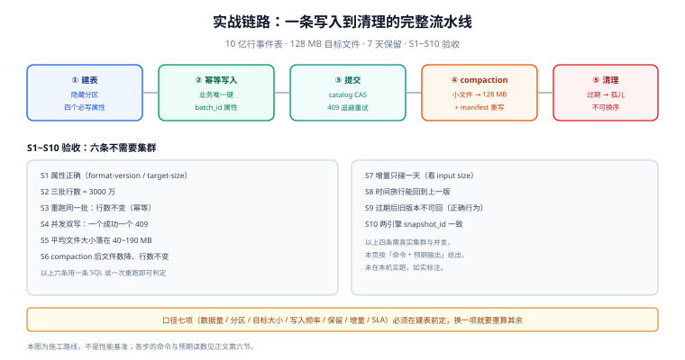

# 实战：从 0 搭一个可验收的湖仓

前面的九页都在讲道理，这一页把它们压成一条可执行的施工路线：**一张 10 亿行的事件表**，从建表到清理，每一步都给出命令与预期读数。

选择事件表是因为它最典型：只追加、按时间查、需要按租户隔离、要能回到「出事前」。这套结构可以平移到日志、埋点、订单流水。

::: tip 一句话定位
本页的验收序列 `S1~S10` 里，**六条只用 `ls`、`aws s3api`、一段 SQL 就能判**，不需要集群；剩下四条需要 Spark/Trino 环境，命令与预期输出都写清楚，读者自己跑一遍即可。
:::



*图 1：本页要搭的六段链路——建表（隐藏分区 + 四个必写属性）、幂等写入（业务唯一键 + `batch_id`）、提交（catalog CAS，409 退避重试）、compaction（小文件 → 128 MB 并重写 manifest）、清理（先过期后孤儿），最后落在 `S1~S10` 验收序列上。图中标注了每段失败时的可观测现象。*

## 判据族声明

本页判据族 `LHP-A` ~ `LHP-H`，共 8 条。定义表在第九节。

## 本页不讲什么

- 不讲引擎安装与集群规划，归 [大数据生态](/docs/DB/BigData/Overview/index.md) 与 [Spark](/docs/DB/BigData/Spark/index.md)。
- 不讲调度系统本身，只给「该调度什么、怎么判成功」。
- 不讲权限模型细节，归 [对象存储 · 访问控制](/docs/Backend/ObjectStorage/SecurityAccess/index.md)。

## 一、口径先定：七件事

| # | 口径 | 本实战取值 | 为什么必须是数字 |
| --- | --- | --- | --- |
| 1 | 数据量 | 10 亿行 / 约 120 GB（压缩后） | 决定目标文件大小与分区粒度 |
| 2 | 分区 | `days(event_time)` + `bucket(16, tenant_id)` | 时间裁剪 + 租户打散，避免单分区倾斜 |
| 3 | 目标文件大小 | 128 MB | 见 [小文件治理](../SmallFiles/index.md) 的推导 |
| 4 | 写入频率 | 每小时一次微批，约 1,000 万行 | 决定批量与幂等粒度 |
| 5 | 快照保留 | 7 天（`min-snapshots-to-keep=10`） | 决定成本与可回溯范围 |
| 6 | 增量消费 | 每小时同步一次到下游 | 与写入频率对齐 |
| 7 | 查询 SLA | 单日单租户聚合 < 5 s | 决定「必须裁剪到什么程度」 |

## 二、工程目录与命名

```text
lake/
├── warehouse/                     # 表数据（按 db/table 分层）
│   └── ods/event/
│       ├── metadata/              # 元数据（不要手工删）
│       └── data/
│           ├── event_time_day=2026-10-19/
│           └── event_time_day=2026-10-20/
├── jobs/                          # 写入 / compaction / 清理（读者自己的工程）
└── conf/                          # catalog 与引擎配置
```

命名三条纪律：**库名用层次（`ods` / `dwd` / `dws`）**、**表名单数**、**分区目录由引擎生成不要手工造**（手工造出来的目录不在 manifest 里，读者看不到，且会被孤儿清理删掉）。

## 三、建表：DDL 与三个必写属性

```sql
-- Spark 4.0 + Iceberg 1.10+（REST catalog）
CREATE TABLE lake.ods.event (
  event_id      string,
  tenant_id     string,
  user_id       string,
  event_time    timestamp,
  event_type    string,
  payload       string,
  dt            date GENERATED ALWAYS AS (cast(event_time as date))
)
USING iceberg
PARTITIONED BY (days(event_time), bucket(16, tenant_id))
TBLPROPERTIES (
  'format-version'                    = '2',
  'write.target-file-size-bytes'      = '134217728',
  'write.distribution-mode'           = 'hash',
  'write.metadata.metrics.default'    = 'truncate(16)',
  'history.expire.max-snapshot-age-ms'= '604800000',
  'history.expire.min-snapshots-to-keep' = '10',
  'write.parquet.compression-codec'   = 'zstd'
);
```

四个属性的作用与「不写会怎样」：

| 属性 | 作用 | 不写会怎样 |
| --- | --- | --- |
| `format-version` | 锁定格式版本，避免不同环境建出不同版本 | 环境间行为不一致，升级时才发现有引擎读不了 |
| `write.target-file-size-bytes` | 单文件目标大小 | 默认值可能不符合你的数据量，小表写出 512 MB 单文件 |
| `write.distribution-mode` | 写入前是否按分区重分布 | 不重分布 → 每个 task 写一个小文件（小文件的头号成因） |
| `write.metadata.metrics.default` | 列统计的收集粒度 | `none` 会让 data skipping 直接失效 |

::: danger 建表时最容易漏的两处
1. **忘记 `bucket` 之外的租户隔离**：`bucket(16, tenant_id)` 只解决数据打散，**不解决越权**。读侧仍必须带 `tenant_id` 过滤（或用视图 + 行级策略），见 [在线协作任务看板 · 搜索隔离](/project/Complete/TeamBoard/SearchIsolation/index.md)。
2. **用 `GENERATED ALWAYS AS` 造 `dt` 列却又把它放进 `PARTITIONED BY`**：Iceberg 的隐藏分区已经能对 `event_time` 做 `days()`，再加一个物理 `dt` 列等于让同一信息存两遍，且两者可能不一致（时区不同就出错）。本实战保留 `dt` 只为下游 SQL 方便，**分区只按 `days(event_time)`**。
:::

## 四、幂等写入：一批一个 `batch_id`

```sql
-- 每小时的微批：先落到临时视图，再按 batch 幂等合并
MERGE INTO lake.ods.event t
USING (
  SELECT *, '20261020-09' AS batch_id FROM staging.event_20261020_09
) s
ON  t.event_id = s.event_id
    AND t.tenant_id = s.tenant_id
WHEN NOT MATCHED THEN INSERT *
;
```

三条纪律：

1. **`event_id` 由生产端生成**（UUIDv7 或「设备 + 序号」），不要用「写入时间 + row_number」——重跑会生成新 id，幂等立刻失效。
2. **`batch_id` 写进表属性**（`snapshot.summary`），提交前先查这批是否已提交：
   `SELECT count(*) FROM lake.ods.event.snapshots WHERE summary['batch-id'] = '20261020-09'`。
3. **别用 `INSERT OVERWRITE` 覆盖整天分区**做幂等：小时批会把当天之前的数据一起抹掉。若一定要覆盖，粒度必须是「小时分区」（即分区要细到小时）。

## 五、compaction 与清理：三条调度

| 任务 | 命令（Iceberg procedure） | 频率 | 成功判据 |
| --- | --- | --- | --- |
| 合并小文件 | `CALL lake.system.rewrite_data_files(table => 'ods.event', options => map('target-file-size-bytes','134217728','min-input-files','5'))` | 每小时（低峰） | 返回 `rewritten_data_files_count > 0` 且行数不变 |
| 重写 manifest | `CALL lake.system.rewrite_manifests('ods.event')` | 每天 | 返回 `rewritten_manifests_count` |
| 过期快照 + 孤儿 | `CALL lake.system.expire_snapshots(table => 'ods.event', older_than => TIMESTAMP '2026-10-13 00:00:00')`；次日再 `remove_orphan_files(older_than => ...)` | 每天 | 快照数下降；存储下降；时间旅行到保留期内仍可用 |

顺序不能换：**先 expire，隔一个孤儿窗口，再 remove_orphan**，理由见 [保留与清理](../Retention/index.md)。

## 六、S1~S10 验收序列

按顺序执行，每步都有「预期输出」与「红了说明什么」。

### S1 建表成功且属性正确

```sql
SHOW TBLPROPERTIES lake.ods.event;
```
预期：`format-version=2`、`write.target-file-size-bytes=134217728`。
红了说明：建表语句里属性名拼错（Iceberg 会**静默忽略**未知属性，不报错）。

### S2 三批数据写入，行数对得上

```sql
SELECT count(*) FROM lake.ods.event;                          -- 预期 30000000（三批各 1000 万）
SELECT count(*) FROM lake.ods.event.snapshots
WHERE summary['batch-id'] IS NOT NULL;                        -- 预期 3
```
红了说明：批之间有重复 `event_id`（生产端 id 不唯一），或某批实际失败但作业报成功。

### S3 重跑同一批，行数不变

```text
重复执行 S2 的第一批 MERGE → 再查 count(*)
```
预期：仍为 30,000,000。
红了说明：`MERGE` 的匹配键不唯一，或用了 `INSERT` 而非 `MERGE`。**这一步是整条链路里最容易红的一步**。

### S4 并发双写只有一个成功

```text
两个终端同时提交两个不同 batch 的 MERGE
```
预期：一个成功、一个 `CommitFailedException`（409），重试后成功。
红了说明（两个都成功）：catalog 不具备 CAS，见 [元数据与 catalog](../Metadata/index.md) 的 `LHM-A`。

### S5 小文件诊断

```sql
SELECT count(*) AS files,
       round(avg(file_size_in_bytes)/1024.0/1024,1) AS avg_mb
FROM lake.ods.event.files;
```
预期：`avg_mb` 在 40~190 之间（目标 128 MB 的 0.3~1.5 倍）。
红了说明：`write.distribution-mode` 没设成 `hash`，或微批太小。

### S6 compaction 后文件数下降、行数不变

```text
执行第五节的 rewrite_data_files → 再跑 S5 的 SQL 与 count(*)
```
预期：`files` 下降、`avg_mb` 上升、`count(*)` **完全不变**。
红了说明（行数变了）：compaction 用了错误的过滤条件；或期间有并发写在跑。

### S7 增量读只碰一天

```sql
-- 增量扫描：只读区间内新增的文件
SELECT count(*) FROM lake.ods.event
VERSION AS OF <new_snapshot> 
WHERE event_time >= timestamp '2026-10-20 09:00:00';
```
```text
同时在 Spark UI 看 input size：应接近「一小时的数据量」，而不是全表
```
红了说明（扫了全表）：增量条件没用分区列，或 `start-snapshot-id` 没生效。

### S8 时间旅行能回到上一版

```sql
SELECT count(*) FROM lake.ods.event VERSION AS OF <old_snapshot>;
```
预期：返回旧行数，不报错。
红了说明（`FileNotFound`）：保留期内的文件被孤儿清理删了——`LHR-D` 违规。

### S9 过期与清理后，旧版本不可回

```text
expire_snapshots(older_than=7 天前) → 再查 S8 的旧快照
```
预期：报「快照不存在」。
**注意**：这是**正确行为**，但要写进对外承诺（`LHR-C`）。

### S10 两个引擎看到同一个版本

```sql
-- Spark
SELECT snapshot_id FROM lake.ods.event.snapshots ORDER BY committed_at DESC LIMIT 1;
-- Trino
SELECT snapshot_id FROM lake."ods"."event$snapshots" ORDER BY committed_at DESC LIMIT 1;
```
预期：两个值完全相同。
红了说明：两套 catalog，或其中一方有元数据缓存未失效。

## 七、成本与容量的一张表

| 项 | 计算 | 量级 |
| --- | --- | --- |
| 数据文件存储 | 120 GB × 压缩率折算 | 120 GB |
| 保留期内的旧版本 | 日增 5 GB × 7 天 | 35 GB |
| compaction 额外占用 | 每次重写 1 倍 × 每天 1 次 × 7 天 | 至多 120 GB |
| 元数据 | 文件数 1,000 × 576 B × manifest 份数 | 几 MB（可忽略但不为零） |
| 请求成本 | 每次查询打开文件数 × GET | 与裁剪效果直接相关 |

## 八、下一步（读者自己的工程）

1. 把 `S1~S10` 做成 CI 里的一个可重复脚本（DuckDB + iceberg 扩展就能在本地跑前六步）。
2. 给 `files` / `snapshots` 两张元数据表建每日快照，画「文件数 / 平均大小 / 快照数」三条曲线。
3. 把 `batch_id` 幂等做成写入口的公共库，不要每个作业各写一遍。
4. 接入第二个引擎（Trino）后重跑 S10，作为「多引擎一致性」的常设检查。

## 九、判据表

| 编号 | 规则 | 违反时的样子 | 怎么验证 |
| --- | --- | --- | --- |
| `LHP-A` | 七项口径在建表前写定 | 建完才发现分区粒度不合适 | 设计文档里有那七行 |
| `LHP-B` | 建表显式写四个关键属性 | 环境间行为不一致 | `SHOW TBLPROPERTIES` 四项齐全 |
| `LHP-C` | 幂等靠业务唯一键 + `batch_id` | 重跑翻倍 | S3 通过 |
| `LHP-D` | 写入分布模式为 `hash`（或等价） | 每 task 一个小文件 | S5 的 `avg_mb` 达标 |
| `LHP-E` | compaction / manifest 重写 / 过期清理三条调度齐备 | 半年后查询变慢 | 调度列表里三条都在，且有最近成功时间 |
| `LHP-F` | 验收序列 `S1~S10` 可重复执行 | 每次上线靠人工抽查 | 有脚本或 runbook，且最近一次执行有记录 |
| `LHP-G` | 删除承诺分阶段 | 合规说不清 | 对外文档有保留期与阶段 |
| `LHP-H` | 第二引擎接入后做一致性检查 | 两引擎版本漂移 | S10 常设化 |

## 十、本页的验证边界（如实说明）

- `S1`、`S2`、`S5`、`S6`、`S8`、`S10` 是**纯 SQL**，只要有一个能连 Iceberg 的引擎即可执行；本机无集群，未实跑，读数以「预期值」给出。
- `S3`、`S4`、`S7`、`S9` 需要真实并发与快照操作，必须在读者环境执行；其中 `S4` 建议在测试表上做，不要在生产表上人为制造冲突。
- 本页的分区粒度、目标文件大小、保留期三个数字**不是通用答案**，是按第一节七项口径推出来的；换口径要重算，推导过程在 [小文件治理](../SmallFiles/index.md) 第三节。

## 参考资料

- [Iceberg · Spark 写入配置](https://iceberg.apache.org/docs/latest/spark-configuration/)——`write.target-file-size-bytes`、`write.distribution-mode`
- [Iceberg · Procedures](https://iceberg.apache.org/docs/latest/spark-procedures/)——`rewrite_data_files`、`expire_snapshots`、`remove_orphan_files`
- [Iceberg · 元数据表](https://iceberg.apache.org/docs/latest/spark-queries/#inspecting-tables)——`files` / `snapshots` / `manifests`
- [Trino · Iceberg 元数据表](https://trino.io/docs/current/connector/iceberg.html#metadata-tables)——`$snapshots` 语法
- 本站 [大数据 · Spark](/docs/DB/BigData/Spark/index.md) · [数仓分层](/docs/DB/DataWarehouse/Layering/index.md)
- 相邻：[小文件治理](../SmallFiles/index.md) · [保留与清理](../Retention/index.md) · [常见问题](../FAQ/index.md)
