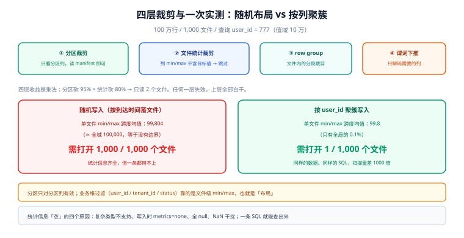

# 引擎接入与 data skipping

同一张湖表，Spark 扫 200 GB，Trino 只扫 4 GB——不是引擎谁强谁弱，而是**它们拿到的统计信息不一样**，或者**表布局让统计信息失效**。

这一页讲「查询为什么只该读它需要的那些文件」，以及四种让这件事失效的原因。它决定了你的湖仓是「便宜的分析库」还是「比全表扫描还慢的摆设」。

::: tip 一句话理解
data skipping = **用元数据把文件排除掉**。它不加速「读一个文件」，它加速「决定哪些文件不用读」。所以它依赖三样东西：分区、文件级统计、数据布局。
:::



*图 1：四层是乘法关系——分区砍 95% × 统计砍 80% → 只读 2 个文件；任何一层失效，上层全部白干。右侧是同一份 100 万行数据的两种布局：随机写入时单文件 `min/max` 跨度均值 99,804（≈ 全域 100,000，等于没有边界），按列聚簇时降到 99.8。*

## 判据族声明

本页判据族 `LHQ-A` ~ `LHQ-H`，共 8 条。定义表在第六节。

## 本页不讲什么

- 不讲引擎内部的执行计划与算子，归 [数据库内核与存储引擎](/docs/DB/DatabaseInternals/Optimizer/index.md) 与 [大数据 · Spark](/docs/DB/BigData/Spark/index.md)。
- 不讲文件内部编码（Parquet 字典 / RLE），只讲「文件级」与「row group 级」裁剪。
- 不讲服务层选型对比，只讲它与湖仓的分工。

## 一、扫描规划的四个筛选层

```text
① 分区裁剪        ：partition 值不匹配 → 整个分区跳过（读 manifest 里的分区统计即可）
② 文件统计裁剪    ：列 min/max 不含目标值 → 跳过该文件
③ row group 裁剪  ：文件内 row group 的 min/max 不含目标值 → 跳过该段
④ 谓词下推        ：把过滤条件下推到扫描器，只解码需要的列
```

四层的收益是**乘法**关系：一个分区 200 个文件，分区裁剪砍掉 95%，文件统计再砍掉 80%，实际只读 2 个文件。反过来，**任何一层失效，上层收益都被浪费**：分区对但文件统计无效（随机布局），等于只做了分区裁剪。

## 二、一张表上的实测：随机布局 vs 聚簇布局

100 万行、1,000 个文件、每文件 1,000 行，查询 `user_id = 777`（值域 10 万）：

| 布局 | 单个文件 min/max 跨度（均值） | 需打开的文件数 | 说明 |
| --- | --- | --- | --- |
| 随机写入（按到达时间落文件） | **99,804**（≈ 全域 100,000） | **1,000 / 1,000（全部）** | 每个文件的 min/max 都铺满全域，统计信息无法排除任何文件 |
| 按 `user_id` 聚簇写入 | **99.8** | **1 / 1,000** | 目标值只可能落在覆盖它的那一个文件里 |

这就是「sort compaction / z-order」的全部价值：**它不改变数据，它改变 min/max 的跨度**。同一份数据、同样的查询，扫描量差 **1000 倍**。

::: warning 「我有分区，所以不用管统计」
分区只对**分区列**有效。绝大多数查询的过滤条件是业务维（`user_id` / `tenant_id` / `status`），这些列不在分区里——它们靠文件级 min/max。只做分区不做聚簇，等于「按天切好，然后每天全扫」。
:::

## 三、统计信息为什么会「空」

data skipping 失效最常见的原因不是布局，是**统计信息根本没写**：

| 原因 | 机制 | 怎么发现 |
| --- | --- | --- |
| **列类型不支持统计** | 复杂类型（`map` / `array` / 嵌套结构）、超长字符串被截断 | 元数据表里该列的 `lower_bounds` / `upper_bounds` 为 null |
| **写入时关闭了统计** | 某些引擎/参数默认不收集（如 `write.metadata.metrics.default=none`） | 表属性里能看到 `metrics` 配置 |
| **统计过期** | 数据文件被重写但统计没更新（少见，多数格式原子更新） | 行的实际 min/max 与元数据不符（抽查） |
| **`NaN` / `null` 干扰** | 全 null 列的上下界为空；浮点 `NaN` 使比较失效 | 该列全 null 或含 NaN |

`LHQ-C` 要求「关键过滤列的统计存在」——这一条能用一条 SQL 直接查，比任何基准测试都快。

## 四、隐藏分区与分区演进

| 方式 | 分区值怎么产生 | 改分区方式的代价 | 查询要写分区条件吗 |
| --- | --- | --- | --- |
| **Hive 风格**（路径分区） | 写入时显式给 `dt=...` | 重写全表 + 改所有查询 | 要（否则全表扫） |
| **隐藏分区**（Iceberg） | 由 `partition spec`（`days(ts)` / `bucket(16, id)`）自动算 | 只影响新写入的文件，旧文件沿用旧 spec | 不用，引擎自动推导 |

隐藏分区的实际价值不在「少写一个条件」，而在**分区可以演进**：从 `days(ts)` 改成 `hours(ts)` 之后，历史数据仍按天分区（旧 spec），新数据按小时——查询 `WHERE ts > ...` 时两种 spec 都能裁剪。用 Hive 风格做这件事要重写全表。

三种常用分区变换的取舍：

| 变换 | 适合 | 风险 |
| --- | --- | --- |
| `days(ts)` / `months(ts)` | 时间序列、按时间过滤 | 数据倾斜（某天特别大） |
| `bucket(N, id)` | 高基数维度（`tenant_id`）均匀打散 | N 一旦定下不宜改（改了就两套桶） |
| `truncate(L, s)` | 字符串前缀（地区码、订单号前缀） | L 太小 → 分区过多 |

## 五、引擎矩阵：谁读、谁写、谁别碰

| 引擎 | 读 | 写 | 定位 |
| --- | --- | --- | --- |
| **Spark 4.0 + Iceberg 1.10+** | ✅ | ✅（v3 支持最完整） | 批处理与写入主力 |
| **Trino** | ✅ | ⚠️（v2 可写，v3 写尚不成熟） | 交互式查询、BI 接入 |
| **Flink** | ✅ | ✅（流式写） | 实时入湖 |
| **DuckDB（iceberg 扩展）** | ✅ | ✅（单机小规模） | 本地分析、CI 里做校验 |
| **StarRocks / Doris** | ✅（外部表 / Catalog） | ⚠️ | 服务层加速，见下 |
| **ClickHouse** | ✅（Iceberg 表函数） | ❌ | 高并发聚合的**服务层**，不是湖仓替代 |

服务层与存储层的分工值得单独一句：**湖仓负责「一份数据、多引擎、便宜」，ClickHouse / StarRocks 负责「毫秒级、高并发、贵」**。标准做法是把湖表按需同步（或直接外表查询）到服务层，用服务层扛看板；不要试图让湖仓自己扛每秒上千次的点查——每次查询都要读元数据 + 发几十个对象请求，规划开销就超预算。

## 六、判据表

| 编号 | 规则 | 违反时的样子 | 怎么验证 |
| --- | --- | --- | --- |
| `LHQ-A` | 常用过滤列必须有分区或聚簇覆盖 | 查询永远全扫 | 对 Top 10 查询做 `EXPLAIN`，看 `filesPruned` / `input_files` |
| `LHQ-B` | 分区粒度由「单分区大小」夹出 | 分区几 MB（碎片）或几 TB（无法裁剪） | 单分区大小落在 1~50 GB 更常见 |
| `LHQ-C` | 关键列的统计信息存在 | 元数据里上下界为空，裁剪失效 | 查元数据表 `lower_bounds` 非空 |
| `LHQ-D` | 聚簇列与 Top 查询的过滤列一致 | 按 `id` 排序但查询按 `tenant_id` 过滤 | 有「查询 → 聚簇列」对照表 |
| `LHQ-E` | 查询走表名，且引擎版本支持该表格式版本 | v3 表在旧引擎上「看不到」 | 引擎矩阵文档 + 各引擎连通性检查 |
| `LHQ-F` | 扫描量进监控 | 只看时长不看字节，优化无方向 | 有 `bytes_scanned` 指标 |
| `LHQ-G` | 服务层与存储层职责清楚 | 用湖仓扛高并发点查，P99 爆炸 | 架构图里两层分开 |
| `LHQ-H` | 分区/聚簇变更走评审并带重写计划 | 改了分区方式导致历史数据读不到 | 变更记录里有重写或兼容方案 |

## 验证方式

```sql
-- LHQ-A / LHQ-C：一次查询的裁剪效果（Spark 4.0，Iceberg）
EXPLAIN EXTENDED
SELECT count(*) FROM demo.db.events
WHERE event_date = date '2026-10-20' AND user_id = 777;
-- 读法：Planning 里应出现 partition pruning 与「files pruned: N / M」；
--       若 M 等于总文件数而 N=0 → 统计信息缺失或布局随机

-- LHQ-C：关键列的统计是否存在（Iceberg files 元数据表）
SELECT count(*) AS files,
       count(lower_bounds['2']) AS has_lb_user_id,
       count(upper_bounds['2']) AS has_ub_user_id
FROM demo.db.events.files;
-- 期望：has_lb_user_id ≈ files；远小于 → 该列统计缺失，裁剪不会生效
```

```sql
-- LHQ-F：扫描量（Trino，看 processedInputPositions / physicalInputBytes）
SELECT query_id, physical_input_bytes / 1024 / 1024 AS mb
FROM system.query_log
WHERE "query" LIKE '%demo.db.events%' AND create_time > now() - interval '1' day
ORDER BY physical_input_bytes DESC LIMIT 10;
-- 期望：mb 与「分区大小 × 命中分区数」同量级；等于全表大小说明裁剪完全失效
```

## 参考资料

- [Iceberg · 扫描规划与统计](https://iceberg.apache.org/spec/#manifests)——manifest 里的列统计结构
- [Iceberg · 分区变换](https://iceberg.apache.org/spec/#partition-transforms)——`days` / `bucket` / `truncate`
- [Trino · Iceberg connector](https://trino.io/docs/current/connector/iceberg.html)——支持的格式版本与下推能力
- [DuckDB · Iceberg 扩展](https://duckdb.org/docs/extensions/iceberg)——本地校验与 CI 用法
- 本站 [数据库内核 · 优化器](/docs/DB/DatabaseInternals/Optimizer/index.md) · [ClickHouse · 分区与索引](/docs/DB/ClickHouse/PartitionIndex/index.md)
- 相邻：[小文件治理](../SmallFiles/index.md) · [表格式](../TableFormat/index.md) · [实战](../Practice/index.md)
