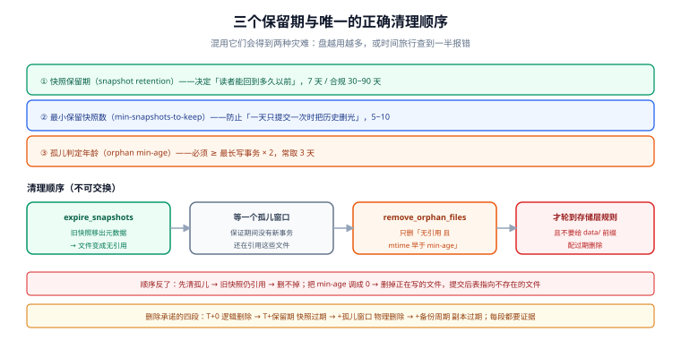

# 时间旅行、保留与孤儿清理

湖仓给了你「回到任意快照」的能力，代价是**所有被引用过的文件都不能删**。于是每张表都有三个不同的「保留期」，混用它们会得到两种灾难：**盘越用越多**，或者**时间旅行查到一半报错**。

这一页把三个保留期分开、把清理顺序写死，并给出一条常被忽略的合规判据：**「删除请求生效」的时间点是保留期之后，不是提交之后**。

::: tip 一句话理解
快照过期（expire）决定**读者还能回到多久以前**；孤儿清理（orphan）决定**没人引用的垃圾何时消失**；两者必须按顺序执行，反了就删掉还在被引用的文件。
:::



*图 1：三个保留期各自管一件事，顺序不可交换。先 `expire_snapshots` 让旧快照移出元数据，文件才变成「无引用」；再等一个孤儿窗口保证期间没有旧事务还在写；最后才 `remove_orphan_files`。反过来做，删的是「此刻恰好没被最新快照引用、但旧快照还要用」的文件。*

## 判据族声明

本页判据族 `LHR-A` ~ `LHR-H`，共 8 条。定义表在第七节。

## 本页不讲什么

- 不讲单库的分区归档与合规删除流程，归 [分区分表与冷热分离](/docs/DB/PartitionArchival/RetentionCompliance/index.md)（判据可直接借用）。
- 不讲备份与容灾，归 [备份与容灾策略](/docs/Ops/BackupDR/Strategy/index.md)。
- 不讲对象存储自身的生命周期规则，归 [对象存储 · 生命周期与成本](/docs/Backend/ObjectStorage/LifecycleCost/index.md)。

## 一、三个保留期，必须分开命名

| 名称 | 控制什么 | 典型值 | 调错的后果 |
| --- | --- | --- | --- |
| **快照保留期**（snapshot retention） | 读者能回到多久以前；旧快照何时从元数据里移除 | 7 天（合规场景 30~90 天） | 太短：出事后无法回到「出事前」；太长：元数据膨胀、存储涨 |
| **最小保留文件数**（min snapshots to keep） | 至少保留几个快照，防止「一天只有一次提交时把历史删光」 | 5~10 | 太小：只剩一个快照，回滚无路 |
| **孤儿判定年龄**（orphan min age） | 文件多久没被任何快照引用才算垃圾 | ≥ 最长事务时长 × 2（常取 3 天） | 太小：删掉**正在写但还没提交**的文件，作业报 `FileNotFound` |

第三条最危险：**正在进行中的写事务里的文件，此刻不被任何快照引用**。如果孤儿清理的年龄阈值小于「最长写事务时长」，它会把人家正在写的文件删掉。这类事故的特征是「白天好好的，凌晨批量作业随机失败」。

## 二、清理的正确顺序

```text
① 过期快照（expire_snapshots）
     └─ 从元数据里移除旧快照 → 它们引用的「独占文件」变成无引用
② 再等一个孤儿年龄窗口
     └─ 保证期间没有新事务还在引用这些文件
③ 清理孤儿（remove_orphan_files，带 min-age）
     └─ 只删「不在任何现存快照里 且 修改时间早于 min-age」的对象
④ 最后才动存储层生命周期规则
     └─ 对象存储的过期规则是「按前缀 + 天数」，它不知道谁在被引用
```

第 ④ 步是最容易被误用的：给 `data/` 前缀配一条「30 天后删除」的生命周期规则，会**绕过表格式的引用检查**，直接删掉仍被快照引用的文件。对象存储的生命周期规则只适合清理 `metadata/` 下明显废弃的旧 `metadata.json`（且要在保留期之后），或者干脆别用。

::: danger 三个「顺序反了」的事故
1. **先删孤儿再过期快照**：孤儿判定基于「当前所有快照」，此时旧快照还在，文件仍被引用 → 一条都删不掉（看起来「清理没生效」）。更糟的是有人为了「让它生效」把 `min-age` 改成 0——下一次就删到了在写的文件。
2. **compaction 之后立刻清理**：compaction 刚写完新文件、提交还没完成时，新文件不被任何快照引用；`min-age=0` 会把它删掉，然后提交成功、表指向一批不存在的文件。**这是湖仓最惨的一种损坏**：元数据完好，数据没了。
3. **用 `rm -rf` 清理 `metadata/` 下的旧文件**：`metadata.json` 之间有引用关系（`previous-metadata`），删掉中间某个会让回滚路径断裂。
:::

## 三、时间旅行：能回答什么，不能回答什么

| 问题 | 能回答吗 | 说明 |
| --- | --- | --- |
| 「昨天这个时候这张表有多少行」 | ✅ | `VERSION AS OF` / `TIMESTAMP AS OF`，落在保留期内 |
| 「这条记录是哪次提交改的」 | ✅（v3 更好） | 逐快照 diff；v3 的 row lineage 能直接给 `_last_updated_sequence` |
| 「回到上周五的状态然后继续写」 | ⚠️ 有条件 | 回滚（rollback）是「把 ref 指回旧快照」，**之后的提交历史会分叉**，要通知所有读者 |
| 「查三个月前被删掉的那列的值」 | ❌ | 列被删后，即使数据文件还在，schema 里也没有这个字段 |
| 「查保留期之前的数据」 | ❌ | 快照已过期，文件可能已被物理删除 |
| 「证明某条数据已经彻底删除」 | ⚠️ 需要证据链 | 见下一节 |

第四行值得单独说：`DROP COLUMN` 只改元数据，数据文件里的那一列**可能还在**（取决于是否重写）。所以「删列」在合规意义上**不是删除**——想真删必须重写文件。

## 四、删除合规：把「生效时间」写进承诺

一个真实的冲突：用户要求「删除我的全部数据」，你在应用层执行了 `DELETE FROM events WHERE user_id = 'u-1'`，提交成功。此刻：

- **读层面**：新快照里查不到 `u-1`，✅。
- **存储层面**：旧数据文件仍在，被 7 天内的快照引用，❌。
- **备份层面**：备份里也有，且备份保留 30 天，❌。

所以对外承诺必须写成三段，且每段都要有证据：

| 阶段 | 承诺 | 证据 |
| --- | --- | --- |
| T+0 | 逻辑删除完成，业务查询不可见 | 新快照上的 `count(*) where user_id=...` = 0 |
| T+保留期 | 旧快照过期，文件成为孤儿 | `expire_snapshots` 的执行记录 + 快照列表 |
| T+保留期+孤儿窗口 | 物理文件删除完成 | 孤儿清理日志 + 对象存储的 `HEAD` 返回 404 |
| T+备份周期 | 备份中的副本随备份过期 | 备份清单与过期记录 |

::: warning 「删除」在湖仓里是一条流水线，不是一个 SQL
把这句话写进对外文档，比任何技术优化都重要：`LHR-C` 要求的不是「删得快」，而是「**能证明删干净了**」。审计时被问「这条数据还在不在」，答案必须是「在哪个阶段、证据是什么」，而不是「我们已经删了」。
:::

## 五、成本：保留期直接乘在存储账单上

```text
表日增 100 GB，快照保留 7 天、期间有 3 次全量 compaction（每次重写 1 倍表大小）
每日新增物理字节 ≈ 100 GB（新增）+ 300 GB（compaction 重写，旧文件在保留期内不删）
稳态物理占用 ≈ 400 GB × 7 天 = 2.8 TB
把保留期从 7 天改成 30 天 → ≈ 12 TB
```

这就是「保留期是成本开关」的含义。优化顺序：**先缩短保留期到业务真正需要的长度，再优化 compaction 频率**——反过来做通常会把账单推得更高。

## 六、保留策略的四个参数（Iceberg 语义）

| 参数 | 含义 | 建议起点 |
| --- | --- | --- |
| `history.expire.max-snapshot-age-ms` | 快照最长保留 | 7 天（`604800000`） |
| `history.expire.min-snapshots-to-keep` | 至少保留几个 | 10 |
| `write.metadata.delete-after-commit.enabled` | 提交后删除旧 `metadata.json` | `true`（保留期之后） |
| `write.metadata.previous-versions-max` | 保留几个历史 `metadata.json` | 100 |

孤儿清理是动作而不是属性：`remove_orphan_files(table, older_than=...)`，`older_than` 必须 **≥ 最长写事务时长 × 2**。

## 七、判据表

| 编号 | 规则 | 违反时的样子 | 怎么验证 |
| --- | --- | --- | --- |
| `LHR-A` | 三个保留期分别有名字与取值 | 团队里「保留 7 天」指哪个说不清 | 配置与文档里三个名字都在 |
| `LHR-B` | 过期快照与孤儿清理按顺序调度 | 清理不生效，或删掉在写的文件 | 调度依赖图里顺序为 expire → orphan |
| `LHR-C` | 删除承诺分阶段，每阶段有证据 | 审计时只能答「已经删了」 | 有删除工单模板，四段证据齐全 |
| `LHR-D` | 孤儿清理的 `min-age` ≥ 最长事务 × 2 | 凌晨作业随机 `FileNotFound` | 参数值可查，且大于事务超时 |
| `LHR-E` | 禁止对数据前缀配置存储层生命周期删除 | 时间旅行随机报错 | 存储桶规则清单里没有 `data/` 前缀的过期规则 |
| `LHR-F` | 时间旅行有保留期提示 | 用户以为能查一年前 | UI/文档里写明可回溯范围 |
| `LHR-G` | 回滚（rollback）需通知读者 | 读者看到「数据倒退」 | 有回滚公告流程与记录 |
| `LHR-H` | 保留期与成本一起评审 | 存储账单季度涨 40% 无人解释 | 保留期变更走评审，且带成本估算 |

## 验证方式

```sql
-- LHR-A / LHR-F：快照跨度是否与保留期一致
SELECT count(*) AS snapshots,
       min(committed_at) AS oldest,
       now() - min(committed_at) AS span
FROM demo.db.events.snapshots;
-- 期望：span ≈ 保留期（略大于，因为 min-snapshots 兜底）；远小于 → 保留期被意外改小

-- LHR-C：逻辑删除后确认新快照不可见
SELECT count(*) FROM demo.db.events WHERE user_id = 'u-1';
-- 期望：0；再查旧快照
SELECT count(*) FROM demo.db.events VERSION AS OF <old_snapshot_id> WHERE user_id = 'u-1';
-- 期望：仍可见 —— 这正是「保留期内未物理删除」的证据，要如实写进承诺
```

```shell
# LHR-D / LHR-E：两条静态检查
# 1) 孤儿清理的 min-age 是否大于事务超时（在调度配置里查）
grep -rn "remove_orphan_files\|orphan" --include=*.py --include=*.yaml . | head
# 2) 对象存储桶是否对数据前缀配了过期规则（有则必须移除）
aws s3api get-bucket-lifecycle-configuration --bucket lake-warehouse
# 期望：规则里没有 Prefix=data/ 的 Expiration
```

```text
# LHR-B：顺序验证（在不影响生产的小表上做）
1) 手动 expire 一个旧快照 → 记录被移除的快照 id
2) 立刻 remove_orphan_files(older_than=0)  → 应删不到任何东西（旧快照刚移除，文件可能仍被其他快照引用）
3) 若删掉了文件且时间旅行报错 → 顺序或 min-age 有问题
```

## 参考资料

- [Iceberg · expire_snapshots](https://iceberg.apache.org/docs/latest/maintenance/#expire-snapshots)——保留期参数
- [Iceberg · remove_orphan_files](https://iceberg.apache.org/docs/latest/maintenance/#delete-orphan-files)——`older_than` 的语义与风险
- [Delta Lake · VACUUM](https://docs.delta.io/latest/delta-utility.html#remove-files-no-longer-referenced-by-a-delta-table)——`retentionDurationCheck` 的保护机制
- [Hudi · Cleaning](https://hudi.apache.org/docs/hoodie_cleaner)——clean 与 compaction 的关系
- 本站 [分区分表 · 保留与合规删除](/docs/DB/PartitionArchival/RetentionCompliance/index.md) · [对象存储 · 生命周期](/docs/Backend/ObjectStorage/LifecycleCost/index.md)
- 相邻：[小文件治理](../SmallFiles/index.md) · [元数据与 catalog](../Metadata/index.md) · [常见问题](../FAQ/index.md)
