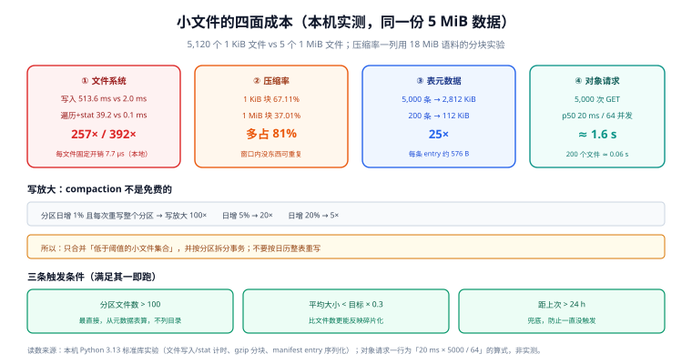

# 小文件治理

小文件是湖仓里唯一「**不管就必然恶化**」的指标。数据量增长是线性的，文件数增长是「作业次数 × 分区数」的乘积——每天 100 次微批 × 24 个分区 = 2,400 个文件/天，一年 87 万个。

这一页把「小文件有多贵」拆成四笔账（都有本机读数），再给一套可执行的治理方案：目标大小怎么定、用哪种 compaction、什么时候跑、跑的时候怎么限流。

::: tip 一句话理解
小文件的成本不是「占空间」，是**四次复利**：文件系统元数据、压缩率、表元数据、对象请求。四笔账同时恶化，所以它比任何单点慢查询都难排查。
:::



*图 1：四笔账在同一份数据上的实测差异。文件系统层 257×/392×，压缩率 67.11% vs 37.01%，表元数据 25×，对象请求数按文件数线性放大——四个方向同时恶化，所以小文件问题从「某一项慢」变成「全链路慢」。*

## 判据族声明

本页判据族 `LHC-A` ~ `LHC-H`，共 8 条。定义表在第七节。

## 本页不讲什么

- 不讲 manifest 重写对规划的影响，归 [元数据层与 catalog](../Metadata/index.md)。
- 不讲快照过期与孤儿清理，归 [保留与清理](../Retention/index.md)。
- 不讲文件内部格式（Parquet 编码 / row group），只讲「文件个数」这一维。

## 一、四面成本，逐个实测

### 1.1 文件系统：同 5 MiB 数据，5,120 个文件对 5 个文件

| 指标 | 5,120 × 1 KiB | 5 × 1 MiB | 倍数 |
| --- | --- | --- | --- |
| 写入耗时 | 513.6 ms | 2.0 ms | **257×** |
| 遍历 + `stat` 耗时 | 39.2 ms | 0.1 ms | **392×** |
| 每个文件的固定开销 | 7.7 µs | —— | —— |

这是本地文件系统的读数。对象存储上「每个文件的固定开销」不是 7.7 µs 而是**一次 HTTP 请求（同区 10~50 ms 量级）**，所以同样的对比在 S3 上是**几千倍**。

### 1.2 压缩率：小块压不动

用仓库自身 2,033 个 Markdown（18.06 MiB）当语料，按不同块大小**各自独立** gzip（模拟「每个文件独立压缩」）：

| 块大小 | 块数 | 压缩后 | 压缩率 |
| --- | --- | --- | --- |
| 1 KiB | 18,497 | 12,710,462 B | **67.11%** |
| 4 KiB | 4,625 | 10,239,549 B | 54.06% |
| 64 KiB | 290 | 7,488,292 B | 39.54% |
| 1 MiB | 19 | 7,010,515 B | **37.01%** |
| 整块 | 1 | 6,977,943 B | 36.84% |

**1 KiB 块比 1 MiB 块多占 81% 的存储**（67.11 vs 37.01）。原因很朴素：压缩算法靠「在窗口内找重复」，块越小，窗口里越没有可重复的东西，每块还要付一次头部与字典成本。Parquet 的列级编码同理——文件太小，dictionary / RLE 全部失效。

### 1.3 表元数据：25 倍

按一条带完整上下界的 manifest entry 约 **576 B** 算（本机序列化读数）：

```text
5,000 个 1 MB 文件 → 2,812 KiB 元数据
  200 个 128 MB 文件 →   112 KiB 元数据   ← 数据量相同
```

这部分在 [元数据层与 catalog](../Metadata/index.md) 已展开：它不是「占空间」，是**每次规划都要读**。

### 1.4 对象请求：串行还是并行，决定你要等多久

```text
5,000 个文件，每个 1 次 GET，同区 p50 = 20 ms
- 串行：5,000 × 20 ms = 100 s
- 64 并发：100 s / 64 ≈ 1.6 s（还要加上服务端限流与连接池排队）
200 个文件，同样 64 并发：0.06 s
```

**这条账解释了「为什么加了机器也没变快」**：瓶颈在请求数，不在 CPU。

## 二、四种成因（按出现频率排序）

| 成因 | 机制 | 特征 | 处置 |
| --- | --- | --- | --- |
| **微批写入** | 流式作业每 10 s 提交一次，每次几个 MB | 文件大小均匀且很小；文件数与运行时长成正比 | 加大微批间隔，或让 Paimon / Hudi 这类 LSM 格式承担高频写 |
| **过度分区** | 按 `(dt, hour, tenant_id)` 三级分区，单分区只有几 MB | 某几个分区文件特别碎 | 减少分区维度，改用聚簇 + 隐藏分区 |
| **频繁小提交** | 每次 `MERGE` / `UPDATE` 都产生新文件 | 更新密集的表文件数 > 行数/万 | CoW→MoR，或提高合并频率 |
| **失败重试残留** | 作业失败留下已写文件，重跑又写一份 | 文件数比预期多一截，且有孤儿 | 孤儿清理 + 提交幂等（见 [提交协议](../WritePath/index.md)） |

## 三、目标文件大小怎么定

目标大小由**两个代价的交点**决定，不是拍脑袋的 128 MB：

```text
读代价 ≈ 文件数 × 单文件固定开销（请求 + 解码 + 打开）
写代价 ≈ 每次重写的字节数 / 目标大小 ... 即「目标越大，一次 compaction 越贵」
```

工程上的算法（可用，且能解释为什么业内是 128~512 MB）：

1. **单文件固定开销**：对象存储 GET + 打开 Parquet footer 约 20~50 ms（同区）。
2. **可接受的文件数**：一次查询希望在 5 s 内完成规划与打开，按 64 并发算 → 文件数上限约 `5 s × 64 / 0.03 s ≈ 10,000`。
3. **数据量除以文件数**：1 TB / 10,000 = 100 MB。→ **目标 128 MB** 正好落在这个量级。
4. 数据量再大就继续增大目标（10 TB → 512 MB 或 1 GB），但**不要超过单任务可承受的重写单位**（一个文件重写失败要整份重来）。
5. 小表（< 10 GB）不要追 128 MB：几百 MB 的表用 32 MB 文件更合适，否则一次 compaction 就把表重写一遍。

::: warning 「目标大小」不是「必须精确命中」
compaction 的输出文件大小会有 ±20% 波动（受行大小、压缩率影响）。判据应该写成「**P50 落在目标值的 0.5~1.5 倍，且 P10 不低于 0.3 倍**」，而不是「每个文件都必须 128 MB」。追精确值会导致反复重写同一批文件。
:::

## 四、三种 compaction 策略

| 策略 | 做什么 | 收益 | 代价 |
| --- | --- | --- | --- |
| **bin-pack（只打包）** | 把小文件按大小拼成大文件，不排序 | 文件数下降；元数据与请求数下降 | 不改善 data skipping（min/max 仍铺满全域） |
| **sort compaction** | 按某列排序后重写 | 文件内 min/max 收窄 → 查询能跳过文件 | **CPU 与 shuffle 成本高**；只对常用过滤列有效 |
| **z-order / 多维聚簇** | 按多列空间填充曲线排序 | 多列组合过滤也能跳过 | 成本更高；维度 > 4 后收益迅速衰减 |

选择判据很简单：**查询是否按某几列做范围过滤且能跳过大量文件**。

- 只解决「慢在打开文件」→ bin-pack 就够。
- 解决「慢在扫描数据量」→ 必须 sort/z-order，且要选对列（见 [引擎接入](../QueryEngine/index.md) 的实测：随机布局 1000/1000 文件全扫，按该列聚簇后只开 1 个）。

## 五、写放大：compaction 不是免费的

```text
5,000 个 1 MB 文件（合计 5 GB）→ 40 个 128 MB 文件
一次全量重写 = 5 GB 的读 + 5 GB 的写
```

更关键的是**频率**：

| 分区日增量 | 每次 compaction 重写整个分区 | 写放大（重写 / 新增） |
| --- | --- | --- |
| 1% | 是 | **100×** |
| 5% | 是 | **20×** |
| 20% | 是 | **5×** |

结论：**永远不要「每次 compaction 都重写整个分区」**。三种收敛手段：

1. **只合并小文件**（bin-pack 的 `min-input-files` 阈值 + `target-file-size`）：未达阈值的小文件集合才被选中。
2. **按分区增量选择**：只处理「新增文件数 > N」的分区。
3. **限制单次处理的字节数**（`max-concurrent-file-group-rewrites` / `max-bytes`），把一次大 compaction 拆成多次小事务。

## 六、调度：四条触发条件与三条限流

| 触发条件 | 阈值示例 | 说明 |
| --- | --- | --- |
| 文件数 / 分区 | > 100 个文件 | 最直接，但需要先统计（可用元数据表算，不必列目录） |
| 平均文件大小 | < 目标值 × 0.3 | 比「文件数」更能反映碎片化 |
| 距上次 compaction | > 24 h | 兜底，防止「一直没触发」 |
| 有新快照且是 `append` | 每次写入后评估 | 避免对只读分区空转 |

| 限流手段 | 作用 |
| --- | --- |
| 并发度（同时重写的文件组数） | 防止把对象存储的 PUT 配额吃满，影响正常写入 |
| 单次字节上限 | 保证一次事务不会长到「提交超时」 |
| 时间窗（避开业务高峰） | 与 [变更窗口](/docs/Ops/ChangeManagement/ChangeWindow/index.md) 同理：I/O 密集任务不要和批处理高峰重叠 |

::: danger compaction 的四个坑
1. **不幂等**：同一批文件被两个 compaction 任务同时处理，第二个提交必然冲突（浪费算力但不损坏数据）；如果实现里用了「按大小选文件」，两次选择的集合可能不同，导致**反复重写同一批**。必须用表级锁或调度串行。
2. **忘记重写 manifest**：数据文件合并了，manifest 还是老的（见 [元数据](../Metadata/index.md) 的警告），查询不会变快。
3. **在事务里跨分区**：一次 compaction 覆盖 30 天分区，中途失败全部回滚，等于白跑；应按分区拆分事务。
4. **把 `VACUUM` / 孤儿清理跑在 compaction 之后立即执行**：还在被旧快照引用的文件会被删掉，时间旅行直接报 `FileNotFound`。顺序必须是「先过期快照，再清理孤儿」。
:::

## 七、判据表

| 编号 | 规则 | 违反时的样子 | 怎么验证 |
| --- | --- | --- | --- |
| `LHC-A` | 目标文件大小有明确取值与依据 | 每个团队自己拍一个数 | 设计文档里有目标值与「为什么是这个数」 |
| `LHC-B` | 平均文件大小进周报 | 恶化半年没人发现 | 有 `avg(file_size)` 的时序 |
| `LHC-C` | compaction 有调度、有触发条件、有最近成功时间 | 停了三个月没人知道 | 调度系统可查最近成功时间 |
| `LHC-D` | compaction 与 manifest 重写成对执行 | 文件数降了但查询没变快 | 两类任务都在调度里 |
| `LHC-E` | 单次 compaction 有字节上限与并发上限 | 跑到一半提交超时、影响正常写入 | 参数存在且非默认无限制 |
| `LHC-F` | compaction 按分区/文件组拆分事务 | 一个大事务失败全部回滚 | 日志里一次 compaction 覆盖的分区数有限 |
| `LHC-G` | 清理顺序为「过期快照 → 孤儿文件」 | 时间旅行报文件不存在 | 调度依赖图里顺序正确 |
| `LHC-H` | 微批间隔与目标文件大小匹配 | 每 10 s 写一次却要求 128 MB 文件 | 微批字节量 × 频率 ≥ 目标大小，或改用 LSM 格式 |

## 验证方式

```sql
-- LHC-B：按分区看文件大小分布（Iceberg files 元数据表）
SELECT partition,
       count(*) AS files,
       round(avg(file_size_in_bytes)/1024.0/1024, 1) AS avg_mb,
       round(min(file_size_in_bytes)/1024.0/1024, 3) AS min_mb,
       round(max(file_size_in_bytes)/1024.0/1024, 1) AS max_mb
FROM demo.db.events.files
GROUP BY partition ORDER BY avg_mb ASC LIMIT 20;
-- 期望：avg_mb 在目标值 0.5~1.5 倍；min_mb 不应长期低于目标的 0.1 倍

-- LHC-C：compaction 是否真的在跑（看 replace/rewrite 类快照的时间分布）
SELECT date_trunc('day', committed_at) AS d, count(*) AS rewrites
FROM demo.db.events.snapshots
WHERE summary['operation'] IN ('replace', 'overwrite')
GROUP BY 1 ORDER BY 1 DESC LIMIT 14;
-- 期望：每天都有；某天为 0 且之后文件数单调上升 → 调度断了
```

```shell
# LHC-A：把目标大小与实际分布对齐（统计口径要写进巡检脚本，别靠肉眼看）
# 一条命令给出「小于目标值 30% 的文件占比」，> 20% 即需要 compaction
```

## 参考资料

- [Iceberg · Maintenance（rewrite_data_files）](https://iceberg.apache.org/docs/latest/maintenance/#compact-data-files)——`target-file-size-bytes`、`min-input-files`
- [Spark · 小文件与分区调优](https://spark.apache.org/docs/latest/sql-performance-tuning.html)——`maxPartitionBytes` 等相邻参数
- [Delta Lake · OPTIMIZE](https://docs.delta.io/latest/optimizations-oss.html#compact-files)——bin-packing 与 Z-Order
- [Paimon · Compaction](https://paimon.apache.org/docs/master/maintenance/compact/)——LSM 的异步 compaction
- 本站 [对象存储 · 生命周期与成本](/docs/Backend/ObjectStorage/LifecycleCost/index.md) · [分区分表 · 分区维护](/docs/DB/PartitionArchival/PartitionOps/index.md)
- 相邻：[元数据与 catalog](../Metadata/index.md) · [保留与清理](../Retention/index.md) · [引擎接入](../QueryEngine/index.md)
