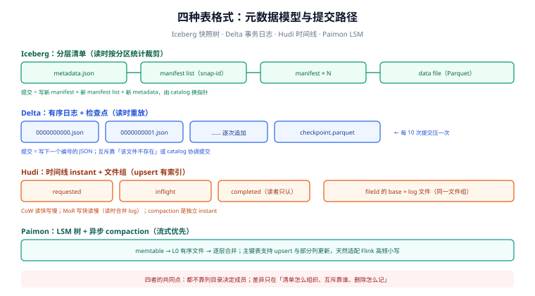

# 表格式：三种元数据模型与两种删除语义

「表格式」听起来抽象，它其实只回答四个问题：

1. **谁是这张表的成员**——一组数据文件的确定性清单；
2. **这一刻的版本是什么**——一个不可变的快照号；
3. **上一版在哪**——快照链，用于时间旅行与增量；
4. **哪些行被删了**——按文件重写（CoW），还是记一份删除清单（MoR）。

四个格式（Iceberg / Delta / Hudi / Paimon）的差别，几乎全部落在「这四个答案用什么结构存、存在哪」上。选型时的纠结大多来自没把这件事拆开：多数团队真正需要的只是「改分区不用重写数据」+「两个引擎能同时写」，而这两条在不同格式里的实现代价差好几倍。

::: tip 一句话理解
表格式 = **一份不可变的清单 + 一个原子的指针**。清单可以分很多层（manifest 树）也可以是一条日志（`_delta_log`），但都必须满足：换指针的那一步是全或无。
:::

## 判据族声明

本页判据族 `LHT-A` ~ `LHT-H`，共 8 条。定义表在第七节。

## 本页不讲什么

- 不讲 catalog 的实现与 REST 接口，归 [元数据层与 catalog](../Metadata/index.md)。
- 不讲并发提交的重试与冲突处理，归 [提交协议](../WritePath/index.md)。
- 不讲 compaction 的策略与参数，归 [小文件治理](../SmallFiles/index.md)。
- 不评价「哪个格式更好」——只给对照表与判别条件，选型结论必须由写者清单与引擎清单推出来。

## 一、四种元数据模型



### 1.1 Iceberg：快照树

```text
catalog（表名 → metadata.json 的绝对路径）
  └── metadata.json          # 当前快照、schema、分区规格、快照历史（v3 起可外置）
        └── snap-<id>.avro   # manifest list：这一版引用了哪些 manifest
              ├── manifest-a.avro   # 每个 manifest 列 400~1000 个 data file + 列统计 + 分区统计
              ├── manifest-b.avro
              └── ...
                    └── data/xxx.parquet   # 真正的数据
```

三个关键性质：

- **清单分层**：`manifest list` 让「一次规划」不必打开全部 manifest 的数据页即可按分区裁剪（manifest 里带分区字段的上下界）。
- **提交只改一处**：新快照 = 新 manifest（只含新增/删除的文件）+ 新 manifest list（指向新旧全部 manifest）+ 新 `metadata.json`。**旧文件一律不动**。
- **删除是「另记一份」**：position delete 文件里存「哪个数据文件的第几行被删」，读到时做反连接；v3 把这层换成 **deletion vector**（Puffin 文件里的压缩位图，一个数据文件一个）。

### 1.2 Delta Lake：事务日志

```text
table/
  ├── _delta_log/
  │     ├── 00000000000000000000.json   # 每次提交一个文件，内容是 action 列表
  │     ├── 00000000000000000001.json
  │     ├── ...
  │     └── 00000000000000000010.checkpoint.parquet  # 每 10 次提交一个检查点
  └── part-00001-xxx.parquet
```

- **日志即真相**：当前表 = 从最近 checkpoint 开始重放 JSON 提交到末尾。`add` / `remove` / `metaData` / `protocol` 四类 action 就够了。
- **提交 = 写下一个编号的 JSON 文件**，靠「这个文件名必须不存在」实现互斥；这也是它必须依赖一个**支持条件创建**的存储或一个 catalog 的原因（4.x 的 catalog-managed tables 就是把这件事交给 catalog）。
- **checkpoint 是必需的**：不建检查点，重放 10 万次提交要读 10 万个 JSON。
- **删除**：CoW 直接重写文件；MoR 用 deletion vector（4.0 起 kernel 支持读写该特性）。

### 1.3 Hudi：时间线 + 文件组

```text
table/
  ├── .hoodie/
  │     ├── <instant>.commit       # 完成的提交
  │     ├── <instant>.deltacommit  # MOR 的增量提交
  │     └── <instant>.inflight     # 进行中
  └── <partition>/<fileId>_<instant>.parquet   # 文件组 + 基础文件 + 日志文件
```

- **instant 是有状态的动作**：`requested → inflight → completed`，读者只认 `completed`。
- **文件组（file group）**：同一个 `fileId` 的多个版本构成一组，upsert 时定位到组再重写或追加日志块——这是它能做**高效 upsert** 的根本原因（有索引）。
- **表类型决定读放大**：CoW 读快写慢（每次 upsert 重写文件），MoR 写快读慢（读时合并日志块）。

### 1.4 Paimon：LSM + 流式优先

- 元数据是 **snapshot + manifest** 结构，但数据层是 **LSM 树**（多个有序文件 + 分层合并），所以天生适合「高频小写入 + 异步 compaction」。
- 主键表（primary key table）支持真正的 upsert 与部分列更新；append 表才接近 Iceberg 的追加模型。
- 它的设计中心是**分钟级可见的流式入湖**，不是「多引擎开放标准」，跨引擎读取能力弱于 Iceberg。

## 二、四种格式逐项对照

| 维度 | Iceberg | Delta Lake | Hudi | Paimon |
| --- | --- | --- | --- | --- |
| 元数据结构 | 快照树（metadata → manifest list → manifest） | 有序 JSON 日志 + Parquet checkpoint | 时间线 instant + 文件组 | snapshot + manifest（LSM 数据层） |
| 成员清单靠什么 | manifest 显式列出 | 日志重放出的 `add`/`remove` 集合 | 文件组 + instant | manifest |
| 提交互斥靠什么 | catalog 的指针 CAS | 目标文件名不存在（或 catalog 协调提交） | 时间线文件创建 | catalog / 文件系统锁 |
| 规划是否需要列目录 | **不需要** | 不需要（读日志） | 不需要 | 不需要 |
| 行级更新首选 | MoR（position delete / DV）或 CoW | MoR（DV）或 CoW | **原生 upsert（有索引）** | **原生 upsert（LSM）** |
| 分区演进 | 隐藏分区，可原地改 | Liquid clustering（4.x） | 有限 | 有限 |
| 多引擎读写 | **最强**（REST catalog 事实标准） | 强（UniForm + Delta Kernel） | 中 | 弱（Flink 一等） |
| 流式写入体验 | 中（微批） | 中 | 强 | **最强** |
| 增量读 | 快照差分 / 增量扫描 | Change Data Feed | **增量查询是一等能力** | 增量快照 |
| 主要运维负担 | compaction + 快照过期 + manifest 重写 | 日志 checkpoint + compaction + 真空 | compaction + 清理 | compaction（异步自动） |
| 最适合 | 开放分析主库、多引擎 | Databricks / Spark 为中心 | 摄取与 upsert 密集 | Flink 流式入湖 |

::: warning 对照表的正确用法
这张表只能用来**排除**，不能用来**选择**。真正的选型顺序是：① 列出所有要读这张表的引擎 → ② 列出所有要写这张表的作业 → ③ 用这两张清单去表里筛（任何一项「不支持」即出局）→ ④ 在剩下的里选运维最熟的那个。反过来「先选格式再找引擎」是这一领域最贵的错误。
:::

## 三、两种删除语义：CoW 与 MoR 的真实代价

删一行数据，在湖仓里有三条路：

| 做法 | 写代价 | 读代价 | 适用 |
| --- | --- | --- | --- |
| **CoW（copy-on-write）** | 重写整个受影响文件（128 MB 级） | 无额外代价 | 删除比例高（> 10%）、读多写少 |
| **MoR + position delete 文件** | 只写一个小文件（每行约几十字节） | 读时反连接，**删除文件越多越慢** | 频繁少量删除 |
| **MoR + deletion vector（v3 / Delta 4.x）** | 只写一个位图（Puffin） | 读时按位图过滤，开销恒定 | 频繁少量删除，且引擎支持 v3 |

用一组数算清「什么时候该重写」：

```text
表总量 20 GB，每天删 0.1% 的行（约 10 万行 / 天）
- 方案 A（CoW）：每天重写 20 GB → 月写放大 600 GB
- 方案 B（MoR position delete）：每天写 10 万行 × 约 40 B ≈ 4 MB → 月 120 MB
  但读时要反连接：若每天一个小文件、保留 30 天 → 单次查询要打开 30 个删除文件
```

结论不是「MoR 更好」，而是：**MoR 的写省下来的成本，会以「读时打开 N 个删除文件」的形式还给读者**。所以工程上的标准做法是「MoR 写入 + 定期 compaction 把删除物化」——这正是 [小文件治理](../SmallFiles/index.md) 里 compaction 的第二项职责（第一项是合并小文件）。

## 四、格式版本：v2 与 v3 到底差什么

| 能力 | Iceberg v2 | Iceberg v3 | Delta 对应 |
| --- | --- | --- | --- |
| 行级删除 | position delete 文件（每行一条记录） | **deletion vector**（压缩位图，一个数据文件一个） | deletion vectors（4.0 kernel 支持） |
| 行级血缘 | 无 | **row lineage**（每行带 `_row_id` / `_last_updated_sequence`） | row tracking |
| 半结构化类型 | 无 | `variant`（含 shredding，可做列统计） | `variant`（4.0） |
| 默认值 / 时间精度 | 无 / 微秒 | 列默认值 / 纳秒时间戳 | 部分支持 |
| 升级方式 | —— | `ALTER TABLE ... SET TBLPROPERTIES ('format-version'='3')`，**只改元数据** | 升级 reader/writer 协议版本 |

::: danger 版本上最容易犯的三个错
1. **以为「升级只改元数据」= 「升级没有代价」**：新写法产生的新结构，**旧引擎读不了**。v3 表对只认 v2 的引擎是「不可见」的，不是「降级读」。所以升级前必须把「谁读这张表」列全，任何一个引擎不支持就只能留在 v2。
2. **以为 row lineage 是免费的**：v3 要求写入时维护 `_row_id`，这会改变写入路径与文件布局；已有的 v2 文件**没有**这两个字段，历史数据的血缘是空的，只有升级后写入的行才有。
3. **把 deletion vector 当「删除更快」**：DV 省的是**写**，读时仍然要做位图过滤；一张表上积累了成千上万个 DV 而没有 compaction，读性能会以另一种方式退化。
:::

## 五、模式演进：为什么湖仓能做到「不重写」

| 操作 | 传统表 | 湖仓表 | 代价 |
| --- | --- | --- | --- |
| 加列 | `ALTER TABLE ADD COLUMN`（多数引擎即时） | 改元数据里的 schema | O(1) |
| 改列类型（兼容方向） | 部分引擎要重写 | 改元数据 + 读取时强转 | O(1) |
| 删列 | 元数据标记，数据仍在 | 元数据标记，**数据文件不动** | O(1) |
| 重命名列 | 元数据 | 按 **field id** 匹配，改名不影响读 | O(1) |
| 调整列顺序 | 部分引擎要重写 | 元数据 | O(1) |
| 改分区方式 | 重写全表 | **隐藏分区**：只影响新写入的文件 | O(增量) |

「按 field id 而不是按列名」是这条能力的技术根基：文件里存的是 `field_id → value`，元数据里记 `field_id → name`。改名只改元数据，历史文件不用碰。反过来，**用列名做映射的实现（如早期 Hive 表）一改名就全错位**——这是「zombie data」的来源。

## 六、选型速查：三张清单定结论

```text
清单 1（读者）：Trino / Spark / Flink / DuckDB / Snowflake / StarRocks / 自研 …
清单 2（写者）：批作业 / 流作业 / CDC 回灌 / 人工修数 …
清单 3（运维能力）：有没有人每周跑 compaction、过期快照、孤儿清理
```

- 清单 1 里有 ≥ 3 个引擎 → **Iceberg + REST catalog**（其它格式的跨引擎能力都在追赶，但事实标准只有一个）。
- 清单 2 里全是高频 upsert 的 CDC → **Hudi 或 Paimon**（有索引 / LSM，写放大最小）。
- 清单 1 只有 Spark 且已在 Databricks 生态 → **Delta**（工具链与托管能力最省事）。
- 清单 3 的答案是「没有」 → **别自己运维**：选托管服务（S3 Tables / 各家湖仓产品），把五个运维动作交出去。

## 七、判据表

| 编号 | 规则 | 违反时的样子 | 怎么验证 |
| --- | --- | --- | --- |
| `LHT-A` | 选型前必须有「读者清单 + 写者清单」 | 上线后新引擎接不进来 | 选型文档里两张清单存在且逐项标注支持情况 |
| `LHT-B` | 建表时显式写 `format-version`，不用默认值 | 不同环境建出不同版本的表 | `SHOW TBLPROPERTIES` 或 `DESCRIBE EXTENDED` 里有该属性 |
| `LHT-C` | 升级格式版本前核对全部读者的支持情况 | 升级后某个引擎读不到表 | 升级记录里有「引擎 × 支持」表 |
| `LHT-D` | 删除策略（CoW / MoR）与删除比例匹配 | 每天删 30% 还用 MoR，删除文件堆成山 | 删除比例与策略写入设计文档 |
| `LHT-E` | MoR 表必须有 compaction 计划 | 读延迟逐月上升 | 调度里存在该表的 compaction 任务 |
| `LHT-F` | 模式变更只用元数据级操作，不改历史文件 | 改名后历史数据列错位 | 变更后抽查三个月前的分区，字段值仍正确 |
| `LHT-G` | 分区演进后旧分区仍可读 | 改分区方式后历史查询报错 | 用旧分区键与新分区键各查一次 |
| `LHT-H` | 表类型（append / upsert）与业务语义一致 | 追加表被当 upsert 用，产生重复行 | 表定义里有 `primary key` 或明确「只追加」 |

## 验证方式

```sql
-- LHT-B / LHT-H：确认格式版本与表属性（Iceberg on Spark）
SHOW TBLPROPERTIES demo.db.events;
-- 期望：format-version = 2（或 3）；write.delete.mode / write.update.mode 有显式值

-- LHT-D：看删除文件的占比（MoR 表）
SELECT content, count(*) AS files, sum(file_size_in_bytes)/1024/1024 AS mb
FROM demo.db.events.files GROUP BY content;
-- content=0 数据文件，content=1 position delete，content=2 equality delete
-- 期望：删除文件 MB 占比 < 10%，且数量不随时间单调增长（有 compaction 在收）

-- LHT-F：模式变更不影响历史分区
SELECT count(*) FROM demo.db.events
WHERE event_date = date_sub(current_date, 90) AND new_col IS NOT NULL;
-- 期望：不报错（加列后旧文件该列为 NULL 是正常，报错说明映射错位）
```

```shell
# LHT-C：升级前把读者逐个点一遍（每个引擎一条，全部返回同一个 snapshot_id 才算通过）
# 这是升级评审的硬性前置，缺一个引擎的结果就不能升
```

## 参考资料

- [Iceberg Spec · 表元数据](https://iceberg.apache.org/spec/#table-metadata)——`metadata.json` 字段定义
- [Iceberg Spec · v3 变更](https://iceberg.apache.org/spec/#version-3)——deletion vector、row lineage、`variant`
- [Delta PROTOCOL](https://github.com/delta-io/delta/blob/master/PROTOCOL.md)——action 类型与 checkpoint 规则
- [Hudi · 表类型与查询类型](https://hudi.apache.org/docs/table_types)——CoW / MoR 的读写取舍
- [Paimon · 主键表](https://paimon.apache.org/docs/master/primary-key-table/overview/)——LSM 与部分列更新
- 本站 [大数据 · Hive 表](/docs/DB/BigData/Hive/index.md)（目录即表的对照） · [ClickHouse · MergeTree](/docs/DB/ClickHouse/PartitionIndex/index.md)
- 相邻：[总览](../Overview/index.md) · [元数据与 catalog](../Metadata/index.md) · [小文件治理](../SmallFiles/index.md)
