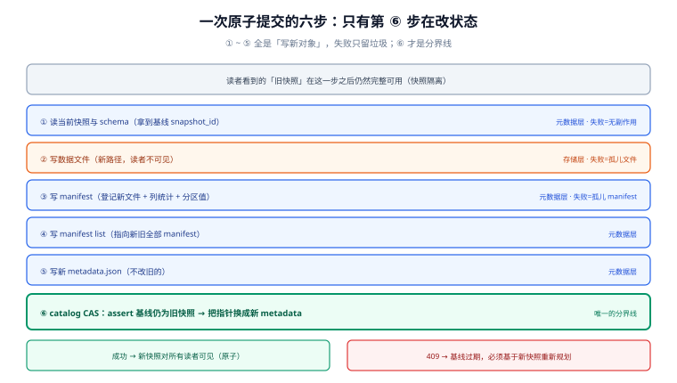

# 提交协议与并发写

湖仓的「事务」与数据库的事务不是一回事：数据库靠锁与回滚段，湖仓靠**「写新文件 + 换一个指针」**。这个设计有一个非常好的性质（读者永远看到完整快照）和一个非常麻烦的后果（**两个写者会同时成功**，除非有人保证指针只能换一次）。

这一页讲的就是那个「除非」：提交协议长什么样、冲突率有多高、重试该怎么设计、多写者该怎么摆。

::: tip 一句话理解
原子性不在存储层，**在 catalog 的那一次 CAS**。所有「提交成功但数据不对」的事故，都能归结为「那次 CAS 没有真正互斥」。
:::

## 判据族声明

本页判据族 `LHW-A` ~ `LHW-H`，共 8 条。定义表在第七节。

## 本页不讲什么

- 不讲 catalog 有哪几种实现，归 [元数据层与 catalog](../Metadata/index.md)。
- 不讲删除语义（CoW / MoR），归 [表格式](../TableFormat/index.md)。
- 不讲 compaction 的调度，归 [小文件治理](../SmallFiles/index.md)。

## 一、一次提交的六步



| 步 | 动作 | 在哪一层 | 失败后世界是什么状态 |
| --- | --- | --- | --- |
| ① | 读当前快照与 schema | 元数据层 | 什么都没发生 |
| ② | 写数据文件（新文件，路径唯一） | 存储层 | 留下孤儿文件，**对读者不可见** |
| ③ | 写 manifest（登记新文件的统计） | 元数据层 | 留下孤儿 manifest |
| ④ | 写 manifest list（指向新旧 manifest） | 元数据层 | 同上 |
| ⑤ | 写新 `metadata.json` | 元数据层 | 同上 |
| ⑥ | **catalog CAS：把指针从旧换成新** | catalog 层 | **这是唯一的分界线**：成功了就全可见，失败了就全不可见 |

关键点：①②③④⑤ 全部是「写新对象」，**不修改任何已有对象**；只有 ⑥ 是「改状态」，而它由 catalog 保证互斥。这个结构让「提交失败」的代价仅仅是留下垃圾（由 [孤儿清理](../Retention/index.md) 回收），而不是「数据半新半旧」。

::: danger 三个「看起来更简单」的错误提交法
1. **写临时目录 + `mv`**：对象存储的 `mv` 是「复制 + 删除」，不是原子操作；两个写者会都成功。**唯一的例外**是同一存储内部的 `rename` 语义（HDFS 有，S3 没有）。
2. **先删后写（`INSERT OVERWRITE` 在裸 Parquet 上）**：删与写之间读者看到空表；中途失败留下半个分区。
3. **自己写 `metadata.json` 并覆盖**：没有 CAS，后写者覆盖前写者；且如果对象存储不是强一致（老版本 S3 的覆盖读），读者可能读到半个 JSON。
:::

## 二、冲突率：它比你想的高，而且会饱和

冲突的产生机制很朴素：写者 A 与 B 都基于快照 `S0` 开始写，A 先提交成功（快照变成 `S1`），B 提交时基线已过期 → **409 / CommitFailedException**。

用 2 秒的提交耗时、不同写者数与提交间隔做一次模拟（本机，固定随机种子）：

| 写者数 | 提交间隔 | 实测冲突率 | 朴素公式 `(n-1)·t/T` |
| --- | --- | --- | --- |
| 2 | 10 s | **17.91%** | 20.00% |
| 2 | 60 s | **3.22%** | 3.33% |
| 4 | 10 s | **44.42%** | 60.00% |
| 4 | 60 s | **9.49%** | 10.00% |
| 8 | 10 s | **72.79%** | 140.00%（不成立） |
| 8 | 60 s | **20.79%** | 23.33% |
| 16 | 10 s | **91.15%** | 300.00%（不成立） |
| 16 | 60 s | **39.30%** | 50.00% |

三个可用的结论：

1. **低并发时公式可用**：`冲突率 ≈ (n-1)·t/T` 在前两行误差 1 个百分点以内，可以直接用来定「提交间隔」。
2. **高并发时公式失效**：概率被 100% 截断，且写者之间互相等待，实际值远低于公式。所以「按公式算出 300% 冲突」不代表系统要崩，**它代表你不该有 16 个写者每 10 秒提交一次这张表**。
3. **冲突率随写者数线性上升**：8 个写者 / 60 s 就有 20.79%。这意味着**每多一个写者，重试预算都要重算**，而不是「上次加了一个写者没事」。

::: warning 重试会放大冲突
冲突后立即重试是最坏的做法：N 个写者同时失败、同时重试，冲突率不降反升（惊群）。必须用**指数退避 + 抖动**：`sleep = random(0, base · 2^attempt)`，并设最大次数。按 20.79% 冲突率、3 次重试算，最终失败概率约 `0.2079³ ≈ 0.9%`——仍不是 0，所以**提交失败必须有告警与补偿，不能只靠重试**。
:::

## 三、多写者的三种摆法

| 摆法 | 怎么保证不冲突 | 代价 | 适用 |
| --- | --- | --- | --- |
| **单写者** | 同一张表只有一个作业能写（调度层串行 / 表级锁） | 写吞吐受限；写者成为单点 | 大多数场景的**默认答案**；尤其适合「每天一次全量合并」 |
| **分区隔离** | 每个写者只写自己的分区（`event_date` / `tenant_id`），冲突概率与「同分区并发」相关 | 分区设计一旦定错就互相踩；跨分区去重做不了 | 按天/按租户的并行入湖 |
| **协调提交（coordinated commit）** | catalog 合并并发提交（Delta 4.x 的 coordinated commits、Iceberg 的 catalog 端合并） | 依赖新版本与特定 catalog；语义有边界 | 高频小批量写入、流式入湖 |

**分区隔离的一个真实陷阱**：`INSERT INTO ... PARTITION (dt='2026-10-20')` 两个作业都写同一天，仍然冲突；但如果存储层支持「分区级独立追加」（如 Hive 的 `INSERT INTO` 直接落新文件 + 元数据追加），冲突会退化成「文件都在，行数翻倍」——**不冲突但重复**。这比冲突更糟，因为它不报错。[增量读](../IncrementalRead/index.md) 的去重就是为这种情况准备的。

## 四、重跑幂等：比并发更常见的故障

写湖作业 90% 的「数据翻倍」不是并发造成的，是**重跑**：任务超时被杀后重试、调度器重放、人工补数。

三条可用做法，按可靠性排序：

1. **按分区覆盖（`INSERT OVERWRITE` 到分区）**：重跑同一分区结果相同。前提是**分区粒度与重跑粒度一致**（按天分区就只能整天重跑）。
2. **按批次号去重**：写入时带 `batch_id`，读时 `QUALIFY row_number() ... = 1` 或建一张 `processed_batch` 表。额外成本是每行多一列。
3. **快照级幂等**：提交前检查「这个 `batch_id` 是否已在快照属性里」，在则跳过。最省空间，但要求提交元数据可写业务属性。

::: danger 用 `MERGE INTO` 做「幂等」的两个反例
1. **源表本身有重复**：`MERGE` 的源里同一个键出现两次，多数实现直接报错（`Cannot perform MERGE as multiple source rows matched`），或在非确定实现下随机取一条——**看起来成功，结果不可复现**。
2. **匹配键不唯一**：用 `(user_id, event_time)` 做键但业务上允许同一毫秒两条事件，`MERGE` 会把它们合并成一条，**静默丢数据**。幂等的前提是「业务键唯一」，不是「SQL 写了 MERGE」。
:::

## 五、提交失败的四种归因

| 现象 | 归因 | 处置 |
| --- | --- | --- |
| `CommitFailedException` / 409，重试后成功 | 正常并发冲突 | 指数退避重试，记录冲突率指标 |
| 409 但重试永远失败 | 有写者在**死循环提交**（如每 100 ms 一次的心跳写） | 找出高频写者，合并或降频 |
| 提交超时但实际成功 | 客户端超时 < 服务端处理时间 | 提交超时设为 `服务端 p99 × 3`；**不要盲目重试**，先查快照是否已推进 |
| `AlreadyExistsException`（同一快照 id） | 重试时复用了同一个 snapshot id | snapshot id 必须每次重新生成（用时间戳 + 随机，不要用固定值） |

第四行是一个很隐蔽的 bug：为了让「重跑幂等」，有人把 snapshot id 固定成 `batch_id`，结果**两个不同的批次撞号**，catalog 直接拒绝或（更糟）把两次提交合并成一个。

## 六、提交侧的三个必设参数

| 参数（Iceberg 语义） | 作用 | 建议起点 |
| --- | --- | --- |
| `commit.retry.num-retries` | 冲突重试次数 | 4 |
| `commit.retry.min-wait-ms` / `max-wait-ms` | 退避区间 | 100 / 10,000（带抖动） |
| `commit.retry.total-timeout-ms` | 总超时，防止无限重试 | 180,000（3 分钟） |

对 Delta：`delta.commit.retries`（默认 30）与 `spark.databricks.delta.retryWriteConflict` 语义相近；Hudi 侧是 `hoodie.cleaner` 与并发写参数。**参数名不同，判据相同**：有上限、有退避、有总超时。

## 七、判据表

| 编号 | 规则 | 违反时的样子 | 怎么验证 |
| --- | --- | --- | --- |
| `LHW-A` | 提交必须走表格式的 commit，禁止改名 / 覆盖元数据 | 两个写者都成功、数据少一半 | 代码里搜 `mv` / `rename` / 直接写 `metadata.json` 的实现，应为 0 |
| `LHW-B` | 提交必须带基线前置条件 | 静默覆盖 | 请求/日志中可见 `assert-ref-snapshot-id` 或等价机制 |
| `LHW-C` | 重试必须有上限、退避与抖动 | 冲突风暴，写者互相打死 | 参数存在且非「立即无限重试」 |
| `LHW-D` | 冲突率进监控 | 冲突率悄悄从 3% 涨到 40% | 有 commit 冲突次数 / 总提交数的时序 |
| `LHW-E` | 写者清单化，新增写者需评审 | 第四个写者上线后夜里全是 409 | 设计文档里有写者清单与提交间隔 |
| `LHW-F` | 重跑幂等靠分区覆盖或批次号，不靠「大概不会重跑」 | 补一次数就翻倍 | 有重跑演练：同一批次连跑两次，行数不变 |
| `LHW-G` | snapshot id 每次新生成 | 重试撞号，catalog 拒绝或合并 | 提交代码里 id 由时间戳 + 随机生成 |
| `LHW-H` | 提交超时 ≥ 服务端 p99 × 3，且超时后先查后重试 | 超时重试导致重复提交 | 配置项有值；超时分支有「先查快照」的代码 |

## 验证方式

```text
# LHW-F：重跑幂等的最小验证（不需要集群，按你们的分区覆盖口径执行）
1) 跑一次作业 → SELECT count(*) FROM t WHERE dt='2026-10-20';   记为 N1
2) 原样再跑一次 → 同一个 SELECT;                                记为 N2
3) 期望 N1 == N2；若 N2 == 2*N1 → 不是幂等，是追加
```

```sql
-- LHW-D：冲突率（Iceberg，从提交日志/审计表统计；没有审计表就只能靠客户端埋点）
SELECT date_trunc('hour', ts) AS h,
       count(*) FILTER (WHERE outcome = 'conflict') AS conflicts,
       count(*) AS commits,
       round(100.0 * count(*) FILTER (WHERE outcome = 'conflict') / count(*), 2) AS conflict_pct
FROM lake_commit_audit
WHERE ts > now() - interval '7 days'
GROUP BY 1 ORDER BY 1;
-- 期望：conflict_pct < 5%；> 20% 说明写者太多或提交间隔太短
```

```shell
# LHW-A：确认没有「改名式提交」（在写湖工程里执行）
grep -rn --include=*.py --include=*.scala -e 'mvObject' -e 'rename(' -e '_temporary' . \
  | grep -v test || echo "OK: no rename-based commit"
```

## 参考资料

- [Iceberg REST · commit 接口](https://github.com/apache/iceberg/blob/main/open-api/rest-catalog-open-api.yaml)——`requirements` 与 409 语义
- [Iceberg · Reliability](https://iceberg.apache.org/docs/latest/reliability/)——`commit.retry.*` 参数
- [Delta Lake 4.0 · Coordinated Commits](https://delta.io/blog/2025-09-25-delta-lake-40/)——catalog 协调提交的动机
- [Hudi · 并发控制](https://hudi.apache.org/docs/concurrency_control)——OCC 与 NBCC
- 本站 [幂等与状态机工程](/docs/Backend/IdempotencyStateMachine/Overview/index.md) · [分布式锁与选主](/docs/Backend/DistributedLock/Overview/index.md)
- 相邻：[元数据与 catalog](../Metadata/index.md) · [增量读](../IncrementalRead/index.md) · [保留与清理](../Retention/index.md)
