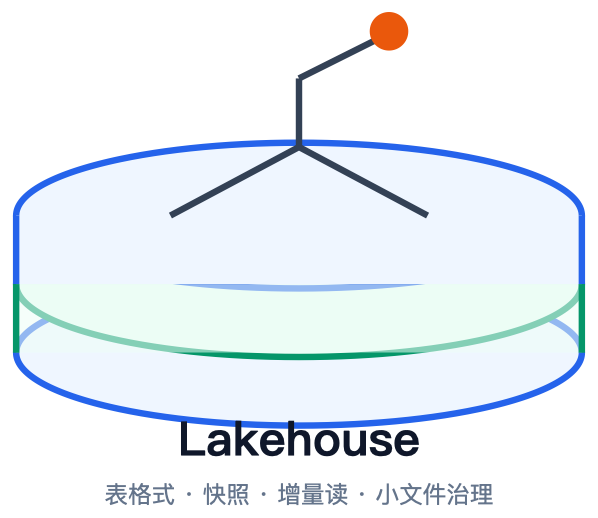
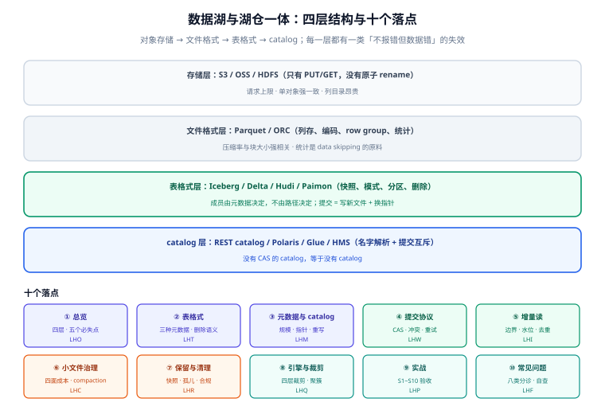

# 数据湖与湖仓一体

数据湖最常见的失败不是「存不下」，而是**存下来了但不是一个表**：目录里躺着几十万个 Parquet 文件，谁也不知道哪些属于「今天这份数据」，改一条记录要重写一整天分区，两个任务同时往同一个目录写会互相覆盖，出了问题连「昨天那份长什么样」都复原不了。

湖仓（Lakehouse）要解决的就是这件事：**在对象存储之上补一层表语义**——快照、事务、模式演进、时间旅行、增量读。这一层不是某个引擎的功能，而是一种**文件格式**（Iceberg / Delta / Hudi / Paimon）。本专题讲的就是这层格式的工程面：元数据怎么组织、提交怎么保证原子、小文件怎么治理、增量读的边界在哪、保留与删除怎么合规。

::: tip 一句话理解
湖仓 = **对象存储**（便宜、无限、只有 PUT/GET）+ **表格式**（谁属于这张表、这一版是什么、上一版在哪）+ **catalog**（表名指向哪个版本，且只能有一个人改成功）。三者缺一，你得到的就只是一个「放 Parquet 的目录」。
:::

## 与相邻专题的分工

「数据湖」「湖仓」「数仓」「大数据平台」四个词在不同团队里指的不是一回事，边界先写死：

| 专题 | 讲什么 | 与本专题的关系 |
| --- | --- | --- |
| 本专题 | **表格式的工程面**：元数据结构、提交协议、增量读边界、小文件治理、保留与清理、引擎接入 | —— |
| [大数据生态](/docs/DB/BigData/Overview/index.md) | 批 / 流 / 湖仓三条路线、Hadoop / Spark / Flink / Hive 的组件分层与选型 | 那边回答「这套栈由哪些组件组成」，本专题回答「**存下来的这批文件凭什么算一张表**」 |
| [Hive 与 Hive 表](/docs/DB/BigData/Hive/index.md) | 分区目录 + 元数据库、`MSCK REPAIR`、Hive SQL | Hive 表是**目录即表**：分区靠路径推断、提交靠重命名、并发靠锁。本专题的四种格式都是对这套模型的替代，[表格式](./TableFormat/index.md) 给了逐项对照 |
| [Spark](/docs/DB/BigData/Spark/index.md) | 算子、shuffle、执行计划、调优 | Spark 是**写湖的主力引擎**，但不负责表语义；`INSERT OVERWRITE` 在裸 Parquet 上是「先删后写」，在 Iceberg 上是一个快照 |
| [ClickHouse](/docs/DB/ClickHouse/index.md) | MergeTree、分区索引、物化视图 | ClickHouse 是**服务层**（毫秒级高并发聚合），湖仓是**存储层**（便宜、开放、多引擎）。二者是上下游，不是替代，见 [引擎接入](./QueryEngine/index.md) |
| [数仓建模与分层](/docs/DB/DataWarehouse/Layering/index.md) | ODS / DWD / DWS / ADS 分层、维度建模、口径 | 那边管**表里放什么**，本专题管**表怎么存、怎么演进、怎么清理**；湖仓让分层从「库」变成「一层层表」 |
| [数据同步与 CDC](/docs/DB/CDC/Overview/index.md) | Binlog 解析、Debezium、Flink CDC、一致性快照 | CDC 是**增量数据的来源**，本专题的 [增量读](./IncrementalRead/index.md) 是**增量数据的消费方式**；两者常在 `MERGE INTO` 处接线 |
| [对象存储工程](/docs/Backend/ObjectStorage/Overview/index.md) | 键空间、校验和、去重、生命周期、预签名 | 湖仓把对象存储当**块设备**用，所以那边的「每前缀 3,500 PUT/s」「ETag 不等于 MD5」「列目录很贵」三条限制直接决定写湖的形态 |
| [分区分表与冷热分离](/docs/DB/PartitionArchival/index.md) | 单库内的分区、归档、保留期、合规删除 | 分区原则相通，但**实现完全不同**：单库分区是 `DETACH`，湖仓是「改元数据 + 删文件」；保留与合规删除的判据可以直接借用 |
| [数据治理 · 元数据与血缘](/docs/DB/DataGovernance/Metadata/index.md) | 技术元数据、业务元数据、血缘、指标口径 | 湖仓的 `metadata.json` 是**技术元数据的原生来源**（schema、快照、文件级统计），治理侧应采集它而不是再手工登记一遍 |
| [在线协作任务看板 · 附件直传](/project/Complete/TeamBoard/AttachmentDirectUpload/index.md) | 真实项目里的预签名直传与提交幂等 | 那边是**单对象写**，本专题是**多文件事务提交**；「幂等」在两处的含义不同，[提交协议](./WritePath/index.md) 会点明差别 |

## 专题地图

| 页面 | 内容 | 适合谁读 |
| --- | --- | --- |
| [总览：四层结构与五个必失点](./Overview/index.md) | 数据湖四代演进、存储/文件/表格式/catalog 四层分工、五个「不报错但数据错」的失效、要不要上湖仓的决策树 | 所有人，先读 |
| [表格式：三种元数据模型](./TableFormat/index.md) | Iceberg 快照树、Delta 事务日志、Hudi 时间线、Paimon LSM、行级删除三形态、v2 与 v3 | 做选型与建表的人，**必读** |
| [元数据层与 catalog](./Metadata/index.md) | 三层元数据、manifest 规模实测、catalog 的职责与四种实现、REST 规范、快照链与 manifest 重写 | 建表与运维的人，**重点读** |
| [提交协议与并发写](./WritePath/index.md) | 一次 commit 的六步、原子性从哪来、乐观并发与重试预算、多写者三种模式、重跑幂等 | 写湖任务与平台的人，**重点读** |
| [增量读：边界与代价](./IncrementalRead/index.md) | 三种增量的区别、四个前提、compaction 会伪造变更、水位与去重、消费端幂等 | 做同步与下游链路的人，**必读** |
| [小文件治理](./SmallFiles/index.md) | 小文件的四面成本（实测）、四种成因、三种 compaction 策略、目标文件大小怎么算、调度与限流 | 运维与平台的人，**重点读** |
| [时间旅行、保留与孤儿清理](./Retention/index.md) | 快照保留三档、expire 与 orphan 的顺序、时间旅行能答什么、删除合规与湖仓的冲突 | 运维、合规、值班的人 |
| [引擎接入与 data skipping](./QueryEngine/index.md) | 引擎矩阵、扫描规划四步、统计信息与聚簇（实测 1000/1000 对 1/1000）、隐藏分区 | 查数据的人与调优的人 |
| [实战：从 0 搭一个可验收的湖仓](./Practice/index.md) | 10 亿行事件表：建表 DDL、幂等写入、compaction 调度、保留清理、S1~S10 验收序列 | 要照着做的人 |
| [常见问题与分诊](./FAQ/index.md) | 八类症状分诊表、十二问、十二项上线自查、术语表 | 所有人 |

## 四条底层判断（先记住这四句）

| 判断 | 含义 | 违反它的典型后果 |
| --- | --- | --- |
| **对象存储没有 rename，只有 PUT** | 目录改名是「复制 + 删除」，不是原子操作；因此**原子性只能靠「换一个指针」** | 用「先写 `_temporary`，再 `mv` 到正式目录」实现提交，在 S3 上中途失败会留下半个分区，且两个写者能同时成功 |
| **表 = 元数据，不是目录** | 谁是这张表的成员由 manifest / log 决定，路径只是习惯 | 用 `spark.read.parquet("s3://lake/events/")` 直接读目录，会读到正在写的临时文件、被删除的旧文件、别人的测试文件 |
| **快照是读的边界，不是写的边界** | 每个快照对读者完全一致；写者之间要靠乐观并发去抢那个指针 | 「边写边读」不加快照隔离，读者会看到一半新一半旧，聚合结果对不上 |
| **小文件是复利成本** | 文件数进元数据、进规划、进请求数，三个方向同时放大 | 上线三个月查询从 2 s 变成 40 s，而数据量只涨了 3 倍——多出来的时间全在打开文件 |

## 成熟度五档

湖仓这件事最容易「建完就完」：能 `select count(*)` 就算交付，然后没人再碰 compaction 与保留策略。按下面五档对照，只补当前档位的下一件事：

| 档位 | 特征 | 只补一件事 |
| --- | --- | --- |
| L0 | Parquet 直接落目录，靠路径分区，`MSCK REPAIR` 加分区 | 先读 [总览](./Overview/index.md) 的五个必失点，确认你最可能踩哪一个 |
| L1 | 用了 Iceberg / Delta，但只在单个引擎里写，catalog 还是文件系统 | 补 [元数据层与 catalog](./Metadata/index.md)：把表注册进真正的 catalog |
| L2 | 多引擎能读同一张表，但两个写任务偶尔互相覆盖 | 补 [提交协议](./WritePath/index.md)：重试预算 + 写者隔离 |
| L3 | 提交不出错了，但查询越来越慢、对象数越来越多 | 补 [小文件治理](./SmallFiles/index.md)：目标文件大小 + 调度 + 限流 |
| L4 | 性能稳住了，但存储成本只涨不降、删数据删不干净 | 补 [保留与孤儿清理](./Retention/index.md)：快照过期、孤儿清理、合规删除的证据链 |

## 判据族总览

十个页面各八条，共 **80** 条。写法统一为「规则 + 违反时的样子 + 怎么验证」，每页末尾给出可执行命令与预期读数。

| 页面 | 判据族 | 覆盖的约定 | 条数 |
| --- | --- | --- | --- |
| [总览](./Overview/index.md) | `LHO-A` ~ `LHO-H` | 四层分工、五个必失点、选型决策 | 8 |
| [表格式](./TableFormat/index.md) | `LHT-A` ~ `LHT-H` | 元数据模型、删除语义、格式版本 | 8 |
| [元数据与 catalog](./Metadata/index.md) | `LHM-A` ~ `LHM-H` | 三层元数据、指针、规划成本、重写 | 8 |
| [提交协议](./WritePath/index.md) | `LHW-A` ~ `LHW-H` | 原子提交、冲突重试、写者隔离、重跑 | 8 |
| [增量读](./IncrementalRead/index.md) | `LHI-A` ~ `LHI-H` | 增量语义、水位、compaction 干扰、去重 | 8 |
| [小文件治理](./SmallFiles/index.md) | `LHC-A` ~ `LHC-H` | 成因、目标大小、策略、调度 | 8 |
| [保留与清理](./Retention/index.md) | `LHR-A` ~ `LHR-H` | 快照过期、孤儿、合规删除、顺序 | 8 |
| [引擎接入](./QueryEngine/index.md) | `LHQ-A` ~ `LHQ-H` | 引擎矩阵、裁剪、统计、聚簇 | 8 |
| [实战](./Practice/index.md) | `LHP-A` ~ `LHP-H` | 建表到验收的全链路 | 8 |
| [常见问题](./FAQ/index.md) | `LHF-A` ~ `LHF-H` | 分诊、自查、术语 | 8 |

## 事实与版本速览（2026-10 核对）

| 事实 | 口径 | 出处 |
| --- | --- | --- |
| Apache Iceberg **format v3** 规范在 **2025 年**获批，能力随 **1.10（2025-09）/ 1.11（2026-05）** 两条发布线交付 | v3 带来 deletion vector、row lineage、`variant` 类型、地理类型；**升级 v2 → v3 只改元数据，不重写数据** | Iceberg 规范与 release notes |
| v3 的**引擎支持不齐**：Spark 4.0 + Iceberg 1.10.x 最完整；开源 Trino 尚未支持写 v3 | 只要栈里有一个引擎读不了 v3，建表就先用 v2，之后 `ALTER TABLE ... SET TBLPROPERTIES ('format-version'='3')` 原地升级 | 各引擎官方文档；社区对照表写「实验性」 |
| Delta Lake **4.0** 于 **2025-09-25** 发布；4.x 线的主线是 catalog-managed tables 与 coordinated commits | 「catalog 管提交」与 Iceberg 的 REST catalog 是同一条路线：**把原子性从文件系统挪到 catalog** | delta.io 官方发布博客 |
| Apache Hudi **1.0** 于 **2025-01** GA，时间线（timeline）重构、二级索引 | Hudi 的设计中心是**摄取与 upsert**，不是多引擎元数据标准 | InfoQ 报道与 Hudi release notes |
| Apache Paimon 走**流式优先**路线，Flink 一等公民，LSM 结构 + 异步 compaction | 它解决的是「分钟级可见 + 高频更新」，不是「PB 级开放表」 | Paimon 官方文档 |
| DuckLake **v1.0**（2026-04）把元数据放进 SQL 库（SQLite / PostgreSQL），并对小更新做 inlining | 思路是「元数据交给数据库」，代价是 catalog 成为单点与容量瓶颈 | DuckLake 项目页 |
| Apache Polaris 于 **2026-02** 成为 ASF 顶级项目；Iceberg **REST catalog** 规范是跨引擎事实标准 | 换 catalog 从「改引擎代码」变成「改配置」 | Apache 基金会公告 |
| 对象存储的**每前缀请求上限**（如 S3 3,500 PUT / 5,500 GET 每秒每前缀）直接约束写湖的并发形态 | 顺序键名会把所有写压到同一个前缀，见 [对象存储 · 键空间](/docs/Backend/ObjectStorage/KeysLayout/index.md) | 云厂商文档 |

::: warning 关于「版本目录」
本专题**不建** `Iceberg-v2/`、`Iceberg-v3/` 这类版本目录，理由三条：

1. **v2 / v3 是同一个格式的两个版本号，不是两代技术栈**。升级是一次元数据写入，同一张表在升级前后都能被同一套 SQL 读写；拆成两个目录会让「同一张表」出现两份互相矛盾的说明。
2. 版本差异是**能力矩阵**（deletion vector、row lineage、`variant`）而不是**用法差异**，用一张对照表 + 页内 `:::info` 标注适用版本就够，参考 [表格式](./TableFormat/index.md) 的版本矩阵。
3. 本库的版本目录先例都对应「**同一主题的多代技术栈、且两代长期并存**」：`docs/Backend/Java/Frame/Spring/Spring5` 与 `Spring6`、`SpringCloud2020` 与 `SpringCloud2022`、`SpringBoot` 下的 `v2`/`v3`/`v4`、`Vue2` 与 `Vue3`。判断标准是「两代是否要各写一遍安装、配置、API」——湖仓格式不满足。

真正存在大版本断层的部分归到各引擎专题（[Spark](/docs/DB/BigData/Spark/index.md)、[Flink](/docs/DB/BigData/Flink/index.md)），它们各自维护版本差异。
:::

## 学习路径

1. **先读总览**，把「四层分工」与「五个必失点」记住——后面九页都在补这五处的细节。
2. **选型前读表格式**：元数据模型决定了并发能力、增量读能力与运维工作量，改它的代价是迁表。
3. **建表前读元数据与 catalog**：catalog 选错，后面所有「原子提交」都是假的。
4. **写完第一批数据就读小文件治理**：小文件是唯一「不管就必然恶化」的指标。
5. **上线前跑一遍 [实战](./Practice/index.md) 的 S1~S10**：十条验收里有六条只用 `ls`、`aws s3api`、一段 SQL 就能判，不需要集群。
6. **出问题时先分诊**：[常见问题](./FAQ/index.md) 按「读不到 / 读到旧的 / 越读越慢」三分，比从头读元数据结构快。

## 三条最容易踩的坑

::: danger 三个「不报错但数据错」的写法
1. **直接把目录当表读**：`spark.read.parquet("s3://lake/events/")` 这类「按前缀读」会连**未提交的临时文件**和**已逻辑删除但尚未物理删除的文件**一起读进来。表现是「行数偶尔多一截」「聚合偶尔翻倍」，而且**没有任何报错**。正确做法是永远经由表名读，让 manifest 决定成员。
2. **用「写临时目录 + 改名」实现提交**：对象存储没有原子的 `rename`，`mv` 实际是复制 + 删除。两个写者同时提交时会**都成功**，后者的清单覆盖前者，前者的文件变成孤儿——日志里两条 `SUCCESS`，数据少一半。正确做法是让 catalog 做 compare-and-swap，见 [提交协议](./WritePath/index.md)。
3. **把 compaction 当纯优化**：compaction 会重写数据文件，于是**增量读会看到「一批本来没变的数据」**。下游按 `snapshot_id` 做增量同步时，会把整片历史重新处理一遍（幂等没做就是重复计数）。正确做法是增量消费按「变更类型」过滤，且消费端必须幂等，见 [增量读](./IncrementalRead/index.md)。
:::

## 参考资料

- [Apache Iceberg 官方站](https://iceberg.apache.org/)——规范、`format-version` 与各引擎接入
- [Iceberg Spec · v3](https://iceberg.apache.org/spec/#version-3)——deletion vector、row lineage 的定义
- [Delta Lake 4.0 发布说明](https://delta.io/blog/2025-09-25-delta-lake-40/)——catalog-managed tables 与 coordinated commits
- [Apache Hudi 文档](https://hudi.apache.org/docs/overview)——timeline 与表类型（CoW / MoR）
- [Apache Paimon 文档](https://paimon.apache.org/)——LSM 结构与流式写入
- [Iceberg REST Catalog 规范](https://github.com/apache/iceberg/blob/main/open-api/rest-catalog-open-api.yaml)——`commit` 接口与并发语义
- 本站 [大数据生态](/docs/DB/BigData/Overview/index.md) · [数仓建模](/docs/DB/DataWarehouse/Overview/index.md) · [对象存储工程](/docs/Backend/ObjectStorage/Overview/index.md)
- 相邻：[总览](./Overview/index.md) · [实战](./Practice/index.md) · [常见问题](./FAQ/index.md)
