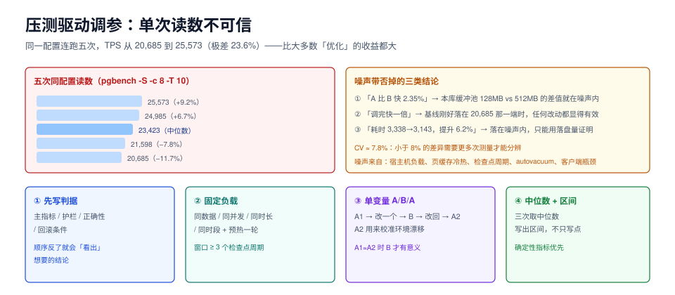

# 压测驱动的调参：单次读数不可信

调参的最后一个环节是「证明它有用」，而这一步最容易被做成一门玄学：改完跑一次压测，数字变大就写「提升 15%」，变小就再跑一次。**同一份配置连跑五次，本机 TPS 从 20,685 到 25,573，极差 23.6%**——比大多数「优化」的收益都大。

这一页给一套能复核的验证流程：固定负载、单变量、噪声带、判据先行、回滚条件。



本页判据族 `TPL-A` ~ `TPL-H`，共 8 条。定义表见文末「本页判据」一节。

## 一、噪声有多大：同配置连跑五次

台架：PostgreSQL 18.6，`shared_buffers=128MB`，`pgbench -S -c 8 -j 4 -T 10`（只读），同一台机器、同一个容器、配置完全不变，连跑五次：

| 第 n 次 | TPS | 相对中位数 |
| --- | --- | --- |
| 1 | 25,573.1 | +9.2% |
| 2 | 24,985.5 | +6.7% |
| 3（中位数） | **23,423.2** | — |
| 4 | 21,597.9 | −7.8% |
| 5 | 20,684.9 | −11.7% |

- **极差（max/min）= 1.236**，即最慢一次比最快一次慢 **23.6%**。
- 变异系数（标准差 ÷ 均值）≈ **7.8%**。

::: danger 这个噪声带直接否掉了三类结论
1. **「A 比 B 快 2.35%」**：本库第一节里 `shared_buffers` 128 MB（24,571.7）vs 512 MB（23,993.6）差 2.35%——**完全在噪声内，不能作为「512 MB 更慢」的证据**。
2. **「调完快了一倍」**：如果基线只跑了一次、刚好落在 20,685 那一端，任何改动都会显得「提升 20%」。
3. **「耗时从 3,338 ms 降到 3,143 ms，提升 6.2%」**：同样落在噪声带内。work_mem 的收益只能用**落盘量归零**证明，不能用耗时证明。
:::

## 二、噪声从哪来

| 来源 | 表现 | 怎么控制 |
| --- | --- | --- |
| 宿主机其他负载 | 同一台机器上跑着别的容器/构建 | 压测期间独占机器，或固定时间窗 |
| 页缓存预热状态 | 第一次跑冷、后面跑热 | 每次先跑一轮不计数的预热 |
| 检查点周期 | 压测窗口跨过检查点 | 时长 ≥ 3 个检查点周期，或临时固定检查点 |
| 自动清理 | autovacuum 恰好在压测时启动 | 压测前 `VACUUM ANALYZE`，并观察 `pg_stat_activity` |
| 客户端瓶颈 | pgbench 自身 CPU 打满 | 客户端与库分离；`-j` 接近客户端核数 |
| 云盘突发额度 | 前 30 秒 IOPS 高、之后掉 | 压测时长 ≥ 5 分钟 |

本机五次的差异主要来自最后两项：容器与宿主机共享 CPU，且 `-T 10` 的窗口太短，正好跨过检查点。

## 三、一套可复核的流程

### 3.1 第一步：写判据（在改动之前）

先写下「这次改动要改善哪个指标、改善多少才算成功、劣化多少就回滚」。**顺序不能反**——先跑再看数，一定会「看出」想要的结论。

| 判据类型 | 示例 | 说明 |
| --- | --- | --- |
| 主指标 | p95 延迟下降 ≥ 20%（连续 3 次中位数） | 只允许一个主指标 |
| 护栏指标 | TPS 下降不超过 5%；CPU 不超过 80% | 防止「优化一个、牺牲另一个」 |
| 正确性 | 结果集与改动前逐行一致 | 参数改动也可能改变语义（如 `work_mem` 影响 `Sort` 稳定性） |
| 回滚条件 | p99 劣化 > 30% 持续 10 分钟 | 上线后的自动回滚依据 |

### 3.2 第二步：固定负载

```shell
# 固定数据集（scale 决定数据量，务必写进报告）
docker exec ptlab pgbench -U postgres -i -s 20 lab

# 预热一轮，不计入统计
docker exec ptlab pgbench -U postgres -S -c 8 -j 4 -T 30 lab

# 正式测量：3 次，每次 60 秒（≥ 3 个检查点周期）
for i in 1 2 3; do
  docker exec ptlab pgbench -U postgres -S -c 8 -j 4 -T 60 lab | grep -E "^tps|latency average"
done
```

三条硬要求：**同一数据集、同一并发、同一时长、同一时段**。少一条，两次读数就不可比。

### 3.3 第三步：单变量 A/B/A

```text
A1（基线）→ 改一个参数 → B（新配置）→ 改回 → A2（再测基线）
```

`A2` 的作用是**校准漂移**：如果 `A2` 与 `A1` 差了 15%，说明这段时间机器状态变了，`B` 的读数不可信。

| 结果形态 | 判读 |
| --- | --- |
| `B` 明显好于 `A1` 与 `A2`，且 `A1 ≈ A2` | 改动有效 |
| `B` 好于 `A1` 但 `A2` 也变好 | 环境漂移，重测 |
| `B` 在 `A1`/`A2` 之间 | 无效果，别写进报告 |

### 3.4 第四步：用中位数与区间表达

```text
结论模板：p95 从 128.9 ms 降到 96.4 ms（3 次中位数，区间 92.1~101.7），
          TPS 从 23,423 变为 23,890（在噪声带 ±8% 内，视为不变）。
```

**「区间」比「点」重要**：只写一个数，读者无法判断它是否显著；写了区间，读者能自己判断。

## 四、哪些指标适合当判据

| 指标 | 稳定性 | 适合当主指标 | 说明 |
| --- | --- | --- | --- |
| p95 / p99 延迟 | 中 | ✅ | 需要足够样本量，短窗口的 p99 不可信 |
| TPS / QPS | 中 | ✅（配合护栏） | 受噪声影响大，必须多次取中位数 |
| 落盘字节数（`temp_bytes`） | **高** | ✅ | 确定性指标，一次就够 |
| 缓存命中率 | 高 | ❌ | 高稳定但**与性能无因果**（见[内存预算](../MemoryBudget/index.md)） |
| WAL 字节数（`wal_bytes`） | **高** | ✅ | 确定性指标，适合验证写放大 |
| 检查点 `sync` 耗时 | 中 | ⚠️ | 适合发现尖峰，不适合当验收 |
| CPU 使用率 | 中 | 护栏 | 只作护栏，不作主指标 |

::: tip 优先选「确定性指标」
`temp_bytes`、`wal_bytes`、`n_dead_tup`、`Sort Method` 这些是**状态量**，同样的输入必然得到同样的输出，一次测量就够。延迟与吞吐是**统计量**，永远需要多次与区间。**能用状态量验证的改动，不要用耗时验证。**
:::

## 五、五个常见错误

1. **同时改三个参数**。读数变好不知道归因给谁，变差也不知道回滚哪个。**一次只动一个**，哪怕这样要跑三轮。
2. **在开发机上测生产参数**。开发机没有真实的页缓存压力、没有真实的并发、没有真实的磁盘。参数的价值高度依赖环境。
3. **压测窗口太短**。10 秒的窗口里，检查点、autovacuum、日志轮转都可能只发生一次，读数被单个事件支配。**≥ 3 个检查点周期**是下限。
4. **用平均值掩盖分布**。平均延迟 5 ms 可能是「99% 的请求 1 ms + 1% 的请求 400 ms」。**至少给 p95 与 p99**。
5. **改完不上监控**。压测通过不等于生产通过——生产的数据分布、并发模式、访问路径都不同。**上线后要用同一套判据看一周**。

## 六、一份可复核的报告长什么样

```markdown
## 调参报告：orders 库 work_mem 4MB → 16MB

- 环境：PG 18.6，8C16G，数据 290 MB（pgbench scale 20），并发 32
- 改动：仅 work_mem（全局 4MB → 16MB），其余保持默认
- 基线（A1/A2）：报表查询 p95 = 3,410 / 3,380 ms；temp_bytes 增量 72 MB
- 新配置（B）：报表查询 p95 = 3,180 / 3,150 ms；temp_bytes 增量 0
- 护栏：OLTP TPS 23,423 → 23,180（−1.0%，噪声带内）
- 结论：落盘归零（确定性证据）；延迟改善 6.7%，落在噪声带边缘，不作为主证据
- 回滚条件：p99 > 4,500 ms 持续 10 分钟，或容器内存 > 80%
```

注意最后两行：**主证据用的是确定性指标，延迟只作为参考**。这样的报告别人能复核，也能反驳。

## 七、验证

```shell
# 1) 噪声带自测：同配置连跑 5 次，算出极差
for i in 1 2 3 4 5; do
  docker exec ptlab pgbench -U postgres -S -c 8 -j 4 -T 10 lab | grep "^tps"
done
```

预期：极差在 10%~25% 之间（本机 23.6%）。**极差越小，你的结论能分辨的差异就越小**。

```sql
-- 2) 确定性指标：改动前后各采一次
SELECT temp_files, temp_bytes FROM pg_stat_database WHERE datname = current_database();
SELECT wal_bytes, wal_fpi, wal_records FROM pg_stat_wal;
```

```shell
# 3) 三次取中位数（报告里要写区间，不要只写一个数）
```

## 本页判据

| 编号 | 判据 | 看什么现象 | 不满足时改哪里 |
| --- | --- | --- | --- |
| `TPL-A` | 先有判据后有压测 | 报告开头写了主指标、护栏、回滚条件 | 补写判据再动手 |
| `TPL-B` | 测过噪声带 | 有同配置 3~5 次的极差读数 | 先测噪声，再谈优化幅度 |
| `TPL-C` | 单变量改动 | 每轮只改一个参数 | 拆成多轮 |
| `TPL-D` | A/B/A 结构 | 有改回基线后的复测 | 补 A2 校准漂移 |
| `TPL-E` | 主证据是确定性指标 | `temp_bytes` / `wal_bytes` / `Sort Method` 出现在结论里 | 用状态量替换耗时比值 |
| `TPL-F` | 结论带区间 | 写成「中位数 + 区间」而非单点 | 补 3 次读数与区间 |
| `TPL-G` | 窗口 ≥ 3 个检查点周期 | 单次压测 ≥ 3 × `checkpoint_timeout` | 延长到 60 秒以上 |
| `TPL-H` | 上线后复测 | 有生产环境的同判据读数 | 上线一周内复测并对比 |

## 参考资料

- PostgreSQL 18 · `pgbench`：<https://www.postgresql.org/docs/18/pgbench.html>
- PostgreSQL 18 · `pg_stat_statements`：<https://www.postgresql.org/docs/18/pgstatstatements.html>
- PostgreSQL 18 · `pg_stat_database`（`temp_bytes`）：<https://www.postgresql.org/docs/18/monitoring-stats.html#MONITORING-PG-STAT-DATABASE-VIEW>
- PostgreSQL Wiki · Tuning Your PostgreSQL Server：<https://wiki.postgresql.org/wiki/Tuning_Your_PostgreSQL_Server>
- Google SRE Book · 监控分布式系统（分位数与统计口径）：<https://sre.google/sre-book/monitoring-distributed-systems/>
