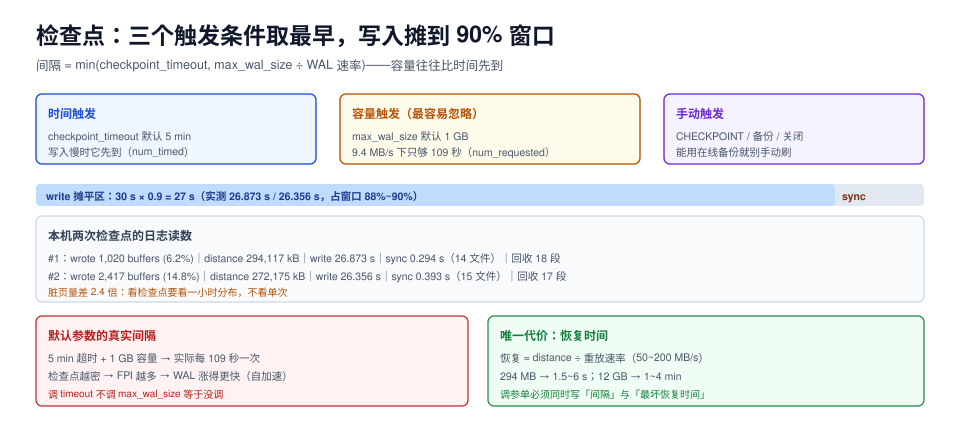

# 检查点节奏：把刷盘摊平到一条时间线

检查点（checkpoint）干三件事：把脏页刷到数据文件、把 WAL 刷到「这个点之前的日志可以丢」、让崩溃恢复只需要重放这个点之后的日志。三件事都不难，难的是**它把平时零散的随机写，改成了一次集中的批量写**——节奏没定好，数据库就会周期性地「抽一下」。

这一页给检查点的频率算式、`max_wal_size` 与 `checkpoint_timeout` 谁说了算、以及本机的检查点日志读数。



本页判据族 `TPC-A` ~ `TPC-H`，共 8 条。定义表见文末「本页判据」一节。

## 一、一次检查点到底做了什么

```text
1. 记录 redo 点：这个 LSN 之前的所有修改，数据文件里都已经落盘
2. 刷脏页：把 shared_buffers 里所有脏页写到数据文件
3. 刷 WAL 并 sync：保证 redo 点之前的 WAL 已经持久
4. 回收/删除旧 WAL 段：redo 点之前的段不再需要
```

第 2 步是性能的关键：`shared_buffers` 里有 16,384 个页（128 MB），一次检查点可能刷出上万个页。如果全部在检查点开始那一刻集中写，会形成一个巨大的 IO 尖峰——所以 PG 用 `checkpoint_completion_target` 把这批写**均匀摊到「检查点间隔 × target」的时间窗里**。

```text
摊平窗口 = checkpoint_timeout × checkpoint_completion_target
默认     = 5 min × 0.9 = 4.5 min
```

## 二、谁决定检查点频率：三个触发条件取最早

| 触发条件 | 参数 | 什么时候先到 |
| --- | --- | --- |
| 时间 | `checkpoint_timeout`（默认 5 min） | 写入速率低、WAL 攒得慢时 |
| WAL 容量 | `max_wal_size`（默认 1 GB） | **写入速率高时，这个先到** |
| 手动 | `CHECKPOINT` / 备份 / 关闭 | 运维动作 |

真正的频率是：

```text
检查点间隔 = min( checkpoint_timeout,  max_wal_size ÷ WAL 生成速率 )
```

代入本机实测：`pgbench -N -c 8` 在 30 秒间隔下产生 **272~294 MB** WAL，即约 **9.4 MB/s**。

| 配置 | 计算 | 实际间隔 |
| --- | --- | --- |
| `checkpoint_timeout=30s`、`max_wal_size=1GB` | min(30s, 1024/9.4 = 109s) | **30 s**（时间先到） |
| `checkpoint_timeout=5min`、`max_wal_size=1GB`（默认） | min(300s, 109s) | **109 s**（容量先到） |
| `checkpoint_timeout=15min`、`max_wal_size=4GB` | min(900s, 436s) | **436 s**（容量先到） |

::: danger 默认值在写入型负载下是「每 109 秒一次」
很多人以为默认是「5 分钟一次检查点」，于是把 `checkpoint_timeout` 调大就以为放慢了节奏。**只要 `max_wal_size` 没跟着放大，间隔就由 WAL 容量决定**——本机 9.4 MB/s 的写入速率下，1 GB 只够跑 109 秒。而检查点越频繁，整页写（FPI）就越多（见[写放大](../WriteAmplification/index.md)），WAL 又涨得更快，形成一个自我加速的环。
:::

## 三、本机检查点日志读数

台架：PostgreSQL 18.6，`shared_buffers=128MB`（16,384 页），`checkpoint_timeout=30s`，`max_wal_size=1GB`，`checkpoint_completion_target=0.9`，`log_checkpoints=on`，`pgbench -N -c 8 -j 4 -T 60`。

```text
LOG:  checkpoint starting: time
LOG:  checkpoint complete: wrote 1020 buffers (6.2%), wrote 3 SLRU buffers;
      0 WAL file(s) added, 0 removed, 18 recycled;
      write=26.873 s, sync=0.294 s, total=27.190 s; sync files=14,
      longest=0.162 s, average=0.021 s;
      distance=294117 kB, estimate=294117 kB
LOG:  checkpoint starting: time
LOG:  checkpoint complete: wrote 2417 buffers (14.8%), wrote 37 SLRU buffers;
      0 WAL file(s) added, 0 removed, 17 recycled;
      write=26.356 s, sync=0.393 s, total=26.833 s; sync files=15,
      longest=0.366 s, average=0.027 s;
      distance=272175 kB, estimate=272175 kB
```

| 检查点 | 写入缓冲页 | 占缓冲池 | WAL 距离 | `write` 耗时 | 占 30 s 窗口 | `sync` 耗时 | 回收 WAL 段 |
| --- | --- | --- | --- | --- | --- | --- | --- |
| #1 | 1,020 | 6.2% | 294,117 kB | 26.873 s | **89.6%** | 0.294 s | 18 |
| #2 | 2,417 | 14.8% | 272,175 kB | 26.356 s | **87.9%** | 0.393 s | 17 |

怎么读这张表：

1. **`write` 占了窗口的 88%~90%**，正好等于 `checkpoint_completion_target = 0.9`。这就是「摊平」的实际形态：**检查点几乎一直在慢慢写**，而不是在某一刻猛写。摊平的好处是尖峰消失，代价是后台写几乎不停。
2. **`sync` 只有 0.3~0.4 秒**（14~15 个文件 `fsync`，最长单次 0.366 秒）。真正的风险点在这：`sync` 是**不可摊平**的，它必须等所有写完成才能 `fsync`。磁盘队列一深，`longest` 就会飙升。
3. **每 30 秒回收 17~18 个 WAL 段**（每段 16 MB，约 272~288 MB），与 `distance` 对得上。回收得太快说明「WAL 刚写完就被扔」，这些段本来可以留着做增量备份——`min_wal_size` 就是留的这个余量（默认 80 MB）。
4. **两次检查点的脏页量差 2.4 倍**（1,020 vs 2,417），因为写入是随机的，不是每个 30 秒窗口刷的页数都一样。**看检查点不能看单次，要看一小时的分布**。

::: warning `write` 高不等于有问题
`write=26.9 s` 只说明「后台写线程一直在干活」，不代表前台查询在等。真正要盯的是 **`sync` 的 `longest`** 和**前台 p99**：如果前台 p99 的峰值总出现在检查点 `sync` 那一两秒，才是真的被检查点拖住。
:::

## 四、四个参数的联动

| 参数 | 默认 | 调大之后 | 代价 |
| --- | --- | --- | --- |
| `checkpoint_timeout` | 5 min | 检查点更稀、FPI 更少、WAL 更小 | 崩溃恢复时间变长（要重放更多 WAL） |
| `max_wal_size` | 1 GB | 允许攒更多 WAL，减少「容量先到」 | 磁盘上 WAL 段更多；恢复更久 |
| `min_wal_size` | 80 MB | 保留更多旧段，避免反复创建删除 | 占磁盘；影响不大 |
| `checkpoint_completion_target` | 0.9 | 摊得更平 | 超过 0.9 后一旦落后就来不及，反而更容易被强制检查点 |

四个参数的调整顺序：

```text
1. 先量 WAL 生成速率（pg_stat_wal.wal_bytes 的每秒增量）
2. 用 期望间隔 × 速率 反推 max_wal_size（并留 1.5 倍余量）
3. 再设 checkpoint_timeout（通常 15~30 min，与恢复时间目标匹配）
4. completion_target 保持 0.9，一般不动
```

以本机 9.4 MB/s 为例，希望「15 分钟一次检查点」：

```text
max_wal_size = 15 min × 60 s × 9.4 MB/s × 1.5（余量） ≈ 12.7 GB
```

这个值远超默认 1 GB——**这就是「为什么写入型库的 `max_wal_size` 必须放大」的算式依据**，而不是「看别人写 8 GB 就抄 8 GB」。

## 五、恢复时间：调大的唯一代价

检查点间隔越长，崩溃后要重放的 WAL 越多：

```text
恢复时间 ≈ WAL 距离 ÷ 重放速率
```

本机 `distance` 294 MB，重放速率取决于磁盘顺序读 + CPU，经验值 **50~200 MB/s**，即 1.5~6 秒。如果 `max_wal_size` 放到 12 GB，恢复时间可能到 **1~4 分钟**。

::: danger 不要把 `max_wal_size` 调到「恢复时间超过 SLA」
调参单里必须同时写两个数：**检查点间隔**与**最坏恢复时间**。只写前者的调参单是不完整的——出故障时才发现「恢复要 8 分钟」，而 SLA 是 3 分钟，这时没有任何参数能救。
:::

## 六、验证：三个读数

```sql
-- 1) 看检查点是「按时」还是「按量」触发的（PG 17+）
SELECT num_timed AS 按时触发, num_requested AS 按量触发,
       write_time, sync_time, buffers_written
FROM pg_stat_checkpointer;
```

预期：写入型负载下 `num_requested` 应该接近 0。如果它持续增长，说明**容量先到**，`max_wal_size` 太小。

```sql
-- 2) WAL 生成速率（用它反推 max_wal_size）
SELECT pg_size_pretty(wal_bytes) AS 累计WAL, wal_records, wal_fpi, wal_buffers_full
FROM pg_stat_wal;
-- 连续采两次，间隔 60 秒，差值 ÷ 60 就是速率
```

```sql
-- 3) 检查点是否在拖前台
SELECT query, round(mean_exec_time::numeric,1) AS mean_ms, calls
FROM pg_stat_statements
WHERE mean_exec_time > 1000 ORDER BY mean_exec_time DESC LIMIT 5;
-- 再与 log 里 sync 的时刻对齐，看 p99 峰值是否落在同一秒
```

## 本页判据

| 编号 | 判据 | 看什么现象 | 不满足时改哪里 |
| --- | --- | --- | --- |
| `TPC-A` | 知道实际间隔由谁决定 | 能算出 `min(timeout, max_wal_size ÷ 速率)` | 先测速率，再反推两个参数 |
| `TPC-B` | `num_requested` 接近 0 | `pg_stat_checkpointer.num_requested` 长时间不增长 | 放大 `max_wal_size` |
| `TPC-C` | `write` 占窗口 ≈ completion_target | `write` 时间 / 间隔 ≈ 0.9 | 偏离太多说明窗口算错或 IO 跟不上 |
| `TPC-D` | 盯 `sync` 的 `longest` | 单次 `fsync` 最长耗时 | 超过 1 秒要查磁盘队列与云盘突发额度 |
| `TPC-E` | `min_wal_size` 留了余量 | 不小于单次增量备份的 WAL 量 | 调到 1~4 GB |
| `TPC-F` | 恢复时间有上界 | 调参单里写了「最坏重放多少 WAL、多少秒」 | 按 `distance ÷ 重放速率` 估算并写进 SLA |
| `TPC-G` | 用小时级分布看检查点 | 有一小时的 `buffers_written` 分布，不只看单次 | 采集 `log_checkpoints` 后做统计 |
| `TPC-H` | 备份与检查点解耦 | 备份用的是 `pg_basebackup` 而非 `CHECKPOINT` 手动触发 | 改用在线备份工具，避免人为制造尖峰 |

## 参考资料

- PostgreSQL 18 · 预写日志与检查点配置：<https://www.postgresql.org/docs/18/runtime-config-wal.html>
- PostgreSQL 18 · `pg_stat_checkpointer`：<https://www.postgresql.org/docs/18/monitoring-stats.html#MONITORING-PG-STAT-CHECKPOINTER-VIEW>
- PostgreSQL 18 · `pg_stat_wal`：<https://www.postgresql.org/docs/18/monitoring-stats.html#MONITORING-PG-STAT-WAL-VIEW>
- PostgreSQL 18 · 日志文件中的检查点输出（`log_checkpoints`）：<https://www.postgresql.org/docs/18/runtime-config-logging.html>
- MySQL 8.4 · 与检查点对应的 redo 容量参数 `innodb_redo_log_capacity`：<https://dev.mysql.com/doc/refman/8.4/en/innodb-parameters.html#sysvar_innodb_redo_log_capacity>
