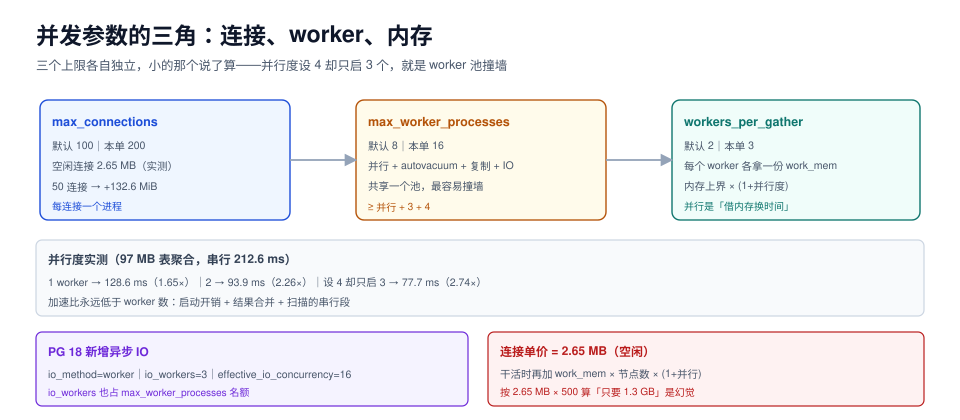

# 并发参数：连接数、并行度与内存的三角

并发参数不是「同时能跑多少活」，而是**同时能跑多少活而不把内存吃光、不把 CPU 切换光**。三个参数管着这个三角：`max_connections`（多少连接）、`max_worker_processes`（多少后台进程）、`max_parallel_workers_per_gather`（一条查询拆几份）。

这一页给连接的单价、并行的收益曲线、以及三个上限之间「谁先撞墙」的判断方法。



本页判据族 `TPN-A` ~ `TPN-H`，共 8 条。定义表见文末「本页判据」一节。

## 一、连接的单价：本机实测 2.65 MB

台架：PostgreSQL 18.6，`shared_buffers=128MB`，容器基线（无业务连接）**153.5 MiB**，然后开 50 个连接各跑 `pg_sleep(25)`（空闲但活着），4 秒后采样。

| 状态 | 容器内存 | 相对基线 |
| --- | --- | --- |
| 基线（仅后台进程） | 153.5 MiB | — |
| **+50 个空闲连接** | 286.1 MiB | **+132.6 MiB** |
| 全部退出后 | 153.6 MiB | 回落到基线 |

**每个空闲连接 ≈ 2.65 MB**。这个数只包含「连接本身」，不含它执行查询时的工作内存。所以内存预算要写成两项：

```text
连接内存 = max_connections × 2.7 MB（固定）+ 活跃并发数 × work_mem × 节点数 × (1+并行度)（浮动）
```

::: warning 2.65 MB 是「空闲」的价，不是「干活」的价
一个连接一旦开始跑大排序，它会额外拿 `work_mem`（可能 64 MB）；如果走了并行，还会拉起 worker 进程，每个 worker 再拿一份。**按 2.65 MB × 500 算出来的「只要 1.3 GB」是幻觉**，真实的账要用浮动项。
:::

## 二、并行度：收益曲线不是直线

台架：97 MB 表上的聚合查询（`sum(id), count(*) where pad like '%abc%'`），`work_mem=4MB`，只改 `max_parallel_workers_per_gather`。

| 并行度设置 | 实际启动 worker | 执行时间 | 相对串行加速 |
| --- | --- | --- | --- |
| 0（串行） | 0 | 212.6 ms | 1.00× |
| 1 | 1 | 128.6 ms | **1.65×** |
| 2 | 2 | 93.9 ms | **2.26×** |
| 4 | 3（受 `max_parallel_workers` 限制） | 77.7 ms | **2.74×** |

三个读数要点：

1. **加速比永远低于 worker 数**：2 个 worker 是 2.26×，4 个设置只启动 3 个、拿到 2.74×。差额是并行启动开销、结果合并、以及「扫描本身有串行段」（表的第一个数据块、聚合的 finalize 阶段）。
2. **设 4 只启 3 个**：因为 `max_parallel_workers = 8` 是全局池，而 `max_worker_processes = 8` 是更大的池（并行 worker + autovacuum worker + 逻辑复制 + 后台 worker 都从这里取）。**这两个值不放大，并行度设置就是空话**。
3. **并行吃的是内存**：每个 worker 独立拿一份 `work_mem`。并行度 3 + `work_mem=64MB` = 单查询 256 MB。

```sql
-- 三个上限的关系：小的那个说了算
SHOW max_worker_processes;            -- 总池，默认 8
SHOW max_parallel_workers;            -- 并行子池，默认 8
SHOW max_parallel_workers_per_gather; -- 单查询，默认 2
SHOW autovacuum_max_workers;          -- 维护子池，默认 3
```

::: danger `max_worker_processes = 8` 是个隐形天花板
默认值 8 意味着：3 个 autovacuum + 2 个并行查询 worker + 1 个逻辑复制 apply + 1 个后台 worker = 7，只剩 1 个。想把并行度提到 4，必须**同时**放大 `max_worker_processes`（建议 `max_parallel_workers + autovacuum_max_workers + 4`），否则设置会被静默截断——`EXPLAIN` 里 `Workers Planned: 4` 而 `Workers Launched: 3` 就是这个原因。
:::

## 三、PG 18 的新参数：异步 IO

PostgreSQL 18 引入了异步 IO 框架（本机实测默认值）：

| 参数 | 默认 | 作用 | 什么时候动 |
| --- | --- | --- | --- |
| `io_method` | `worker` | 用后台 worker 做异步读；可选 `sync`（退回同步） | 云盘/本地 NVMe 上先保持 `worker` |
| `io_workers` | `3` | 异步 IO 的 worker 数量 | 高 IOPS 设备、大顺序扫描多时加到 4~8 |
| `effective_io_concurrency` | `16` | 规划器假设的并发 IO 数 | SSD 可设 100~200；机械盘 2 |

这三项是 PG 18 才有的，**老版本的调参单里没有它们**，直接抄旧文章会漏掉。同时注意 `io_workers` 也占 `max_worker_processes` 的名额——又一个「池子共享」的例子。

## 四、三方谁先撞墙：三步诊断

```sql
-- 第一步：连接数是否接近上限
SELECT count(*) AS 当前连接, current_setting('max_connections')::int AS 上限,
       round(100.0 * count(*) / current_setting('max_connections')::int, 1) AS 使用率
FROM pg_stat_activity;
```

使用率 > 70% 且大量连接处于 `idle` → **连接池没起作用**，不是 `max_connections` 太小。

```sql
-- 第二步：连接在等什么
SELECT state, wait_event_type, wait_event, count(*)
FROM pg_stat_activity WHERE backend_type = 'client backend'
GROUP BY 1,2,3 ORDER BY 4 DESC;
```

大量 `idle in transaction` → 应用事务边界太长（见[连接治理](../../Middleware/ConnectionGovernance/index.md)）；大量 `ClientRead` → 应用侧慢。

```sql
-- 第三步：后台进程是否被池子卡住
SELECT backend_type, count(*) FROM pg_stat_activity GROUP BY 1 ORDER BY 2 DESC;
```

`parallel worker` 长期占满而 `Workers Launched < Workers Planned` → `max_worker_processes` 不够。

## 五、连接池：参数对比「加连接」便宜

| 方案 | 单连接成本 | 上限 | 代价 |
| --- | --- | --- | --- |
| 直接加 `max_connections` | 2.65 MB + 调度开销 | 受内存与 CPU 限制 | 每个连接一个进程，上下文切换成本上升 |
| **事务级连接池**（PgBouncer `pool_mode=transaction`） | 池内连接数固定 | 应用侧可开上千 | 会话级状态（`SET`、临时表、`LISTEN`）会丢 |
| 会话级连接池（`session` 模式） | 同直连 | 同上 | 兼容性最好，但省不了多少 |

::: tip 经验值：连接数 ≈ CPU 核数 × 2~4
本机 8 核，活跃并发 **16~32** 就够。再多的连接只是在抢 CPU 时间片，不会提高吞吐——这与「连接池大小」的结论一致（见[连接池与连接治理](../../ConnectionPool/index.md)的膝点实测）。
:::

## 六、MySQL 的对照：线程模型不同，账也不同

| 项 | PG 18.6 | MySQL 8.4.11 |
| --- | --- | --- |
| 并发模型 | 每连接一个**进程** | 每连接一个**线程**（`thread_cache_size` 复用） |
| 空闲连接成本 | 约 **2.65 MB**（本机实测） | 约 256 KB~1 MB（线程栈 + 会话缓冲） |
| 并行 | 进程级 worker（`max_worker_processes`） | 无查询内并行（8.4 仍为单线程执行） |
| 缓冲参数 | `work_mem`（按节点） | `sort_buffer_size` / `join_buffer_size`（按连接预分配） |

MySQL 的连接更便宜，所以「开很多连接」在 MySQL 上比 PG 更常见；但 MySQL 的 `sort_buffer_size` 是**按连接预分配**，连接数一多就变成常驻内存，这是另一种形态的同一个问题。

## 七、验证

```sql
-- 1) 连接单价（在测试实例上量，别在生产量）
--    基线内存 → 开 50 个空闲连接 → 再采一次，差值 ÷ 50
SELECT count(*) FROM pg_stat_activity;
```

```sql
-- 2) 并行是否真的启动
EXPLAIN (ANALYZE, COSTS OFF)
SELECT sum(id) FROM t_sort WHERE pad LIKE '%abc%';
-- 预期：Workers Planned 与 Workers Launched 相等；不等就是池子不够
```

```sql
-- 3) 内存上界没被突破
SELECT sum(setting::bigint) * 8 / 1024 AS shared_mb FROM pg_settings WHERE name = 'shared_buffers';
-- 再对照预算表里的「工作内存上界」，确认没超
```

## 本页判据

| 编号 | 判据 | 看什么现象 | 不满足时改哪里 |
| --- | --- | --- | --- |
| `TPN-A` | 连接单价有实测值 | 有「基线 + 50 连接」的内存差值 | 在测试实例上量一次，别用博客数字 |
| `TPN-B` | 内存上界含浮动项 | 预算里写了 `活跃并发 × work_mem × (1+并行度)` | 补上浮动项，否则会低估 10 倍 |
| `TPN-C` | 三个 worker 上限成比例 | `max_worker_processes ≥ max_parallel_workers + autovacuum_max_workers + 4` | 按此式重设三个值 |
| `TPN-D` | `Workers Launched = Workers Planned` | `EXPLAIN ANALYZE` 两值相等 | 放大 `max_worker_processes` |
| `TPN-E` | 并行度与 `work_mem` 联动 | 高并行场景下 `work_mem` 已下调 | 按 `work_mem × (1+并行度)` 重算 |
| `TPN-F` | 连接使用率有阈值告警 | 使用率 > 70% 且大量 `idle` 能被告警 | 加告警，并把处置指向连接池而非加连接 |
| `TPN-G` | 有连接池且模式明确 | PgBouncer/ProxySQL 的 `pool_mode` 写清了 | 事务级池要列出「不兼容的会话状态」 |
| `TPN-H` | PG 18 异步 IO 参数已评估 | 调参单里有 `io_method` / `io_workers` / `effective_io_concurrency` | 补上，NVMe 上可把 `effective_io_concurrency` 提到 100+ |

## 参考资料

- PostgreSQL 18 · 连接与认证配置：<https://www.postgresql.org/docs/18/runtime-config-connection.html>
- PostgreSQL 18 · 并行查询参数：<https://www.postgresql.org/docs/18/runtime-config-query.html#GUC-MAX-PARALLEL-WORKERS-PER-GATHER>
- PostgreSQL 18 · 异步 IO（`io_method` / `io_workers`）：<https://www.postgresql.org/docs/18/runtime-config-resource.html#GUC-IO-METHOD>
- PostgreSQL 18 · `pg_stat_activity`：<https://www.postgresql.org/docs/18/monitoring-stats.html#MONITORING-PG-STAT-ACTIVITY-VIEW>
- PgBouncer 官方文档（池模式）：<https://www.pgbouncer.org/config.html>
- MySQL 8.4 · 连接与线程参数：<https://dev.mysql.com/doc/refman/8.4/en/server-system-variables.html>
