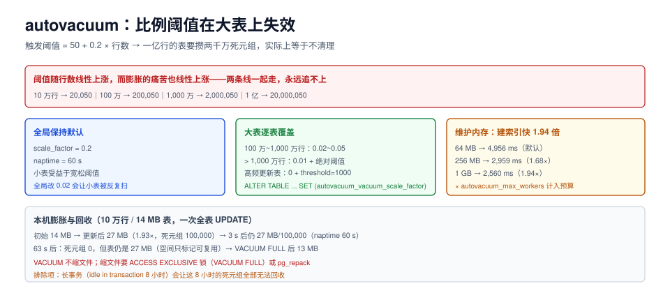

# 维护参数：autovacuum 的 20% 阈值在大表上失效

autovacuum 是「自动清理」，但它的默认参数在**大表上几乎等于关闭**：触发条件是「死元组超过 20%」，而 1,000 万行的表要攒够 200 万个死元组才会动一次。等到它动的时候，表已经膨胀了两倍、索引已经多扫了几百页。

这一页回答：默认阈值为什么在大表上失效、per-table 参数怎么设、`maintenance_work_mem` 值多少，以及膨胀了怎么收。



本页判据族 `TPM-A` ~ `TPM-H`，共 8 条。定义表见文末「本页判据」一节。

## 一、autovacuum 干三件事

| 任务 | 触发者 | 参数 | 不做会怎样 |
| --- | --- | --- | --- |
| 清理死元组 | autovacuum launcher | `autovacuum_vacuum_threshold` / `scale_factor` | 表与索引膨胀、扫描变慢 |
| 更新统计信息 | autovacuum launcher | `autovacuum_analyze_threshold` / `scale_factor` | 执行计划劣化（选错索引/连接方式） |
| 防事务 ID 回卷 | 强制 | `autovacuum_freeze_max_age`（默认 2 亿） | 库被强制只读（最后的防线） |

三件事里，**只有第三件是硬约束**，前两件做不做取决于阈值——所以「autovacuum 开着」不等于「表不会膨胀」。

## 二、阈值公式：`50 + 20% × 行数`

```text
触发阈值 = autovacuum_vacuum_threshold（默认 50） + autovacuum_vacuum_scale_factor（默认 0.2） × 表的活元组数
```

| 表行数 | 触发所需死元组 | 意味 |
| --- | --- | --- |
| 10 万 | **20,050** | 一次全表更新就会触发 |
| 100 万 | **200,050** | 需要改 20% 的行 |
| 1,000 万 | **2,000,050** | 需要改 200 万行 |
| 1 亿 | **20,000,050** | 实际上等于「不清理」 |

这张表说明：**比例阈值对小表友好、对大表失效**。而大表恰恰是最经不起膨胀的——它的索引更深、扫描更贵、膨胀带来的额外 IO 更多。

## 三、本机实测：一次全表更新 = 1.93 倍体积

台架：PostgreSQL 18.6，10 万行、`repeat('x',100)` 的 14 MB 表，默认 autovacuum 参数（`scale_factor=0.2`、`naptime=60s`）。

| 时刻 | 表大小 | 死元组 | 说明 |
| --- | --- | --- | --- |
| 初始（`VACUUM ANALYZE` 后） | 14 MB | 0 | 干净状态 |
| 全表 `UPDATE` 后 | **27 MB（1.93 倍）** | 100,000 | 每行产生新版本，旧版本变死元组 |
| 3 秒后 | 27 MB | 100,000 | `naptime` 默认 60 s，还没轮到 |
| 63 秒后 | 27 MB | **0** | 已清理，但**文件没变小** |
| `VACUUM FULL` 后 | **13 MB** | 0 | 重写整表才真正回收 |

三个必须记住的事实：

1. **膨胀是 1.93 倍**，不是「一点点」。一次「改一遍所有行」的批量作业，在磁盘上留下近两倍的痕迹。
2. **`VACUUM` 只标记空间可复用，不缩文件**。表大 27 MB 但死元组为 0，说明空间已经在「空闲列表」里等下次插入复用。**只有 `VACUUM FULL`（或 `pg_repack`）才会真的变小**，而它会持有 `ACCESS EXCLUSIVE` 锁。
3. **60 秒的 `naptime` 意味着「清理最多晚一分钟」**。对高频更新的小表，这一分钟里查询要多扫很多死元组。

## 四、`maintenance_work_mem`：建索引快 1.94 倍

台架：97 MB、100 万行表上 `CREATE INDEX ON t_sort(pad)`，只改 `maintenance_work_mem`。

| `maintenance_work_mem` | 建索引耗时 | 相对 64 MB |
| --- | --- | --- |
| 64 MB（默认） | 4,956 ms | 1.00× |
| 256 MB | 2,959 ms | **1.68×** |
| 1 GB | 2,560 ms | **1.94×** |

这个参数同时影响：`CREATE INDEX`、`VACUUM`、`ALTER TABLE ADD FOREIGN KEY` 的验证阶段。它**不是每连接**的，而是「每个维护操作」的上限，所以可以设得比较大（8 核 16 GB 的库设 512 MB~1 GB 很常见）。

::: danger `maintenance_work_mem` 会被 autovacuum 同时乘
`autovacuum_max_workers = 3` 时，最坏情况是 3 个 autovacuum 各拿一份 `maintenance_work_mem`。设 1 GB 就可能吃掉 3 GB。**它也在内存预算表里**，不是「维护时才用、不算账」。
:::

## 五、per-table 参数：大表必须单独设

```sql
-- 1,000 万行的表：死元组超过 1%（10 万）就清理
ALTER TABLE orders SET (
  autovacuum_vacuum_scale_factor = 0.01,
  autovacuum_vacuum_threshold = 10000,
  autovacuum_analyze_scale_factor = 0.005
);

-- 高频更新的小表（计数、状态位）：更激进
ALTER TABLE counters SET (
  autovacuum_vacuum_scale_factor = 0.0,
  autovacuum_vacuum_threshold = 1000
);
```

| 表类型 | `scale_factor` | `threshold` | 理由 |
| --- | --- | --- | --- |
| < 10 万行、低频更新 | 默认 0.2 | 50 | 默认够用 |
| 100 万~1,000 万行 | 0.02~0.05 | 1,000~10,000 | 比例阈值在大表上太松 |
| > 1,000 万行 | 0.01 | 10,000 | 必须靠绝对阈值兜底 |
| 高频更新（计数、状态） | 0 | 100~1,000 | 按绝对条数触发 |
| 只插入不更新（日志表） | 默认 | 默认 | 死元组少，但要注意 freeze |

::: warning 全局改 `scale_factor` 是错的
把全局 `autovacuum_vacuum_scale_factor` 从 0.2 改成 0.02，会让**所有小表**被极频繁地扫描（1,000 行的表每 20 行变化就清理一次），CPU 白白被吃掉。**正确做法是全局保持默认，只给大表加 per-table 覆盖**。
:::

## 六、膨胀了怎么收：三条路径

| 方法 | 锁级别 | 磁盘需求 | 适用 |
| --- | --- | --- | --- |
| `VACUUM`（普通） | `SHARE UPDATE EXCLUSIVE` | 无额外空间 | 日常；只回收可复用空间 |
| `VACUUM FULL` | **`ACCESS EXCLUSIVE`** | 需要等表大小的空闲空间 | 小表、可停机窗口 |
| `pg_repack`（扩展） | 短暂 `ACCESS EXCLUSIVE`（两次） | 需要等表大小的空间 | 大表在线整理 |
| `pg_squeeze` / 逻辑重建 | 类似 | 同上 | 大表、可接受复制延迟 |

```sql
-- 判断该不该收：死元组占比 + 表大小
SELECT relname,
       n_live_tup, n_dead_tup,
       round(100.0 * n_dead_tup / nullif(n_live_tup + n_dead_tup, 0), 1) AS dead_pct,
       pg_size_pretty(pg_total_relation_size(relid)) AS total_size,
       last_autovacuum, last_autoanalyze
FROM pg_stat_user_tables
WHERE n_dead_tup > 10000
ORDER BY n_dead_tup DESC LIMIT 20;
```

判读：`dead_pct` > 20% 且 `total_size` > 1 GB → 排一次 `pg_repack`；`last_autovacuum` 是几小时前 → 阈值太松或长事务挡住了回收。

::: danger 长事务会让 autovacuum「白跑」
autovacuum 只能回收「所有活跃事务都不再需要」的版本。一个开了 8 小时的 `idle in transaction` 连接，会让这 8 小时内产生的死元组全部无法回收——**表一直涨，autovacuum 日志显示"跑了"，但死元组没降**。排查：

```sql
SELECT pid, state, now() - xact_start AS xact_age, left(query, 40)
FROM pg_stat_activity
WHERE xact_start IS NOT NULL
ORDER BY xact_start LIMIT 5;
```
:::

## 七、统计信息：`default_statistics_target`

| 参数 | 默认 | 作用 | 什么时候调 |
| --- | --- | --- | --- |
| `default_statistics_target` | 100 | 每列采多少个样本（直方图桶数） | 数据倾斜严重、`EXPLAIN` 行数估计差 10 倍以上 |
| `autovacuum_analyze_scale_factor` | 0.1 | 多少比例的行变化后重新统计 | 大表降到 0.005~0.02 |

```sql
-- 单列提高采样精度（只影响这一列）
ALTER TABLE orders ALTER COLUMN status SET STATISTICS 500;
ANALYZE orders (status);
```

代价：`pg_statistic` 变大、`ANALYZE` 变慢。**只给真的倾斜的列调**，不要全局提到 1000。

## 八、验证

```sql
-- 1) 大表是否都有 per-table 覆盖
SELECT relname, reloptions FROM pg_class
WHERE relkind = 'r' AND reltuples > 1000000 AND reloptions IS NULL;
-- 预期：结果为空，或每行都有 autovacuum_vacuum_scale_factor
```

```sql
-- 2) 死元组占比与最近清理时间
SELECT relname, n_dead_tup,
       round(100.0 * n_dead_tup / nullif(n_live_tup + n_dead_tup, 0), 1) AS dead_pct,
       last_autovacuum
FROM pg_stat_user_tables ORDER BY n_dead_tup DESC LIMIT 5;
-- 预期：dead_pct < 20%，last_autovacuum 在 1 小时内
```

```sql
-- 3) 建索引耗时是否符合预期（维护窗口前自测）
\timing on
CREATE INDEX CONCURRENTLY idx_test ON t_sort (pad);
-- 预期：与 maintenance_work_mem 提升后的基线（本机 1 GB → 2,560 ms）同量级
```

## 本页判据

| 编号 | 判据 | 看什么现象 | 不满足时改哪里 |
| --- | --- | --- | --- |
| `TPM-A` | 大表有 per-table 阈值 | 千万行级表的 `reloptions` 里有 `autovacuum_vacuum_scale_factor` | 按第五节表加覆盖 |
| `TPM-B` | 全局阈值不动 | 全局 `scale_factor` 仍是 0.2（或接近） | 改回默认，只对大表覆盖 |
| `TPM-C` | 膨胀率有监控 | 有 `n_dead_tup / (live + dead)` 指标与 20% 阈值告警 | 加到监控 |
| `TPM-D` | 知道 `VACUUM` 不缩文件 | 运维手册里写明了「缩文件要 `VACUUM FULL`/`pg_repack`」 | 补文档，并给出锁级别 |
| `TPM-E` | `maintenance_work_mem` 进了预算 | 预算表里含「× autovacuum_max_workers」的最坏情况 | 按 3× 计入预算 |
| `TPM-F` | 长事务有告警 | `idle in transaction` 超过 5 分钟能被告警 | 加告警，并按第七节的 SQL 定位 |
| `TPM-G` | 统计目标只对倾斜列调 | `pg_attribute.attstattarget` 只有少数列非默认 | 收回全局调整，改成列级 |
| `TPM-H` | `last_autovacuum` 不为空 | 大表的 `last_autovacuum` 不是 NULL | 若为 NULL，说明从未清理过，查阈值与 launcher 状态 |

## 参考资料

- PostgreSQL 18 · autovacuum 参数：<https://www.postgresql.org/docs/18/runtime-config-autovacuum.html>
- PostgreSQL 18 · `VACUUM` 与 `VACUUM FULL`：<https://www.postgresql.org/docs/18/sql-vacuum.html>
- PostgreSQL 18 · 统计信息与 `default_statistics_target`：<https://www.postgresql.org/docs/18/runtime-config-query.html#GUC-DEFAULT-STATISTICS-TARGET>
- PostgreSQL 18 · 日常 vacuum 实践（Wiki）：<https://wiki.postgresql.org/wiki/Introduction_to_VACUUM,_ANALYZE,_EXPLAIN,_and_INDEX>
- pg_repack 官方文档：<https://reorg.github.io/pg_repack/>
