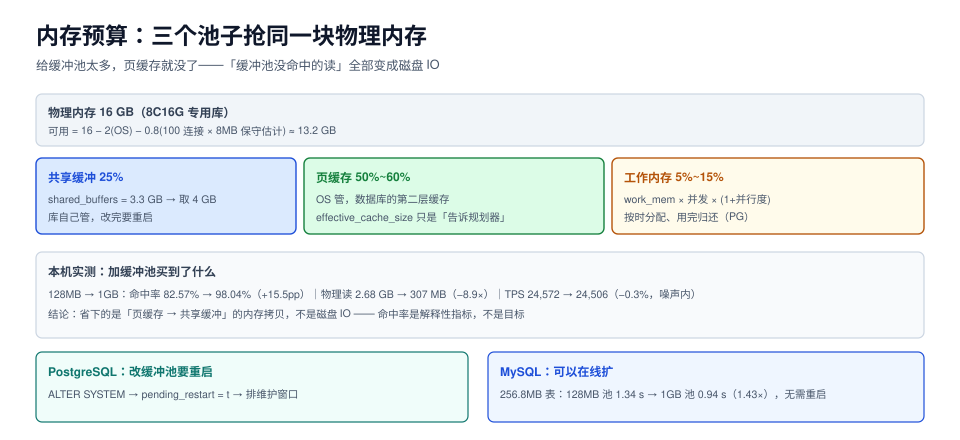

# 内存预算：命中率是最会骗人的指标

一台库的内存有三个「池子」：**共享缓冲**（库自己管）、**页缓存**（操作系统管）、**工作内存**（每条查询临时用）。调参的第一件事不是把哪个池子放大，而是先决定**三个池子各分多少**——因为它们在抢同一块物理内存。

这一页给内存分配的算式、命中率的正确用法，以及「加缓冲池到底有没有用」的实测判据。



本页判据族 `TPB-A` ~ `TPB-H`，共 8 条。定义表见文末「本页判据」一节。

## 一、三个池子的分工

| 池子 | 谁在管 | 存什么 | 访问代价 | 典型占比 |
| --- | --- | --- | --- | --- |
| **共享缓冲**（`shared_buffers` / `innodb_buffer_pool_size`） | 数据库自己 | 数据页、索引页 | 进程内内存拷贝，纳秒级 | 物理内存的 25%（专用库可到 40%） |
| **页缓存**（OS page cache） | 操作系统 | 数据文件的一个副本 | 一次 `read()` 系统调用，微秒级 | 剩下的绝大部分（50%~60%） |
| **工作内存**（`work_mem` / `sort_buffer_size` 等） | 每条查询 | 排序、哈希、聚合的中间结果 | 纯内存计算 | 按并发峰值算，通常 5%~15% |

::: danger 最常见的错误：把 70% 内存给缓冲池
在 Linux 上，数据库读文件走的是「共享缓冲 → 页缓存 → 磁盘」两级。给缓冲池 70% 内存，页缓存只剩 20%，结果是**缓冲池里没命中的那些读，全部要去碰磁盘**。实测里 128 MB 缓冲池的命中率只有 82.57%，但 TPS 和 1 GB 缓冲池完全一样——因为没命中的 17% 被页缓存接住了。把页缓存压到很小，这 17% 就真的变成磁盘 IO 了。
:::

## 二、预算算式

### 2.1 先减掉不可动的部分

```text
可用内存 = 物理内存 − OS 预留（约 1~2 GB）− 同机其他服务 − 连接级固定开销
```

连接级固定开销容易被忽略：每个后端进程有自己的栈、目录缓存、会话状态。一条空闲连接按 **5~10 MB** 估（PG 的 `pg_backend_memory_contexts` 能看到实际值，常见 1~3 MB，但加上 `temp_buffers` 等上限后按 5 MB 更安全）。

```text
连接开销 = max_connections × 8 MB     -- 保守估计
```

100 个连接 = 800 MB，这部分在 `max_connections` 调大时会跟着涨。

### 2.2 再分三个池子

```text
shared_buffers        = 可用内存 × 25%          -- 专用库；混部降到 15%
effective_cache_size  = 可用内存 × 65%          -- 只是给规划器的提示，不占内存
work_mem 上界         = 可用内存 × 40% ÷ 最大并发数 ÷ (1 + 并行度)
maintenance_work_mem  = 可用内存 × 5%（单实例同时最多 autovacuum_max_workers 个任务）
```

注意 `effective_cache_size` 是**估算值，不真占内存**——它告诉优化器「除了缓冲池，操作系统还缓存了多少页」。填小了会让优化器低估索引扫描的收益，填大了会让它高估。

### 2.3 代入一台 8 核 16 GB 的专用库

```text
可用内存 = 16 GB − 2 GB(OS) − 0.8 GB(100 连接) ≈ 13.2 GB
shared_buffers       = 13.2 × 25% ≈ 3.3 GB      → 取 4 GB（2 的幂，便于对齐大页）
effective_cache_size = 13.2 × 65% ≈ 8.6 GB      → 取 8 GB
work_mem 上界        = 13.2 × 40% ÷ 32 ÷ 3 ≈ 55 MB → 取 16 MB（留余量给突发）
maintenance_work_mem = 13.2 × 5% ≈ 660 MB       → 取 512 MB
```

这四个数就是整份调参单的「收入表」，后面每一个参数都要从这张表里出。

## 三、加缓冲池到底有没有用：本机实测

台架：`pgbench -S`（只读，全在索引上做点查），scale 20 ≈ 290 MB 数据，8 客户端 × 4 线程，20 秒，PostgreSQL 18.6。

| `shared_buffers` | TPS | 平均延迟 | 命中率 | 物理读（块） | 物理读（字节） |
| --- | --- | --- | --- | --- | --- |
| 128 MB（默认） | 24,571.7 | 0.326 ms | 82.57% | 342,859 | 2.68 GB |
| 512 MB | 23,993.6 | 0.333 ms | 98.00% | 38,390 | 307 MB |
| 1 GB | 24,506.2 | 0.326 ms | 98.04% | 38,390 | 307 MB |

三个读数结论：

1. **物理读降了 8.9 倍**（2.68 GB → 307 MB），说明缓冲池确实起作用了——同样 20 秒，从存储层要的数据少了近九成。
2. **TPS 没变**（−2.4% / −0.3%），因为这台机器空闲内存足够，页缓存本来就命中；省掉的是「页缓存 → 共享缓冲」的内存拷贝，量级远小于查询本身的 CPU 成本。
3. **命中率从 82.57% 到 98.00% 的这 15 个百分点，一分钱性能都没买到**。

::: tip 什么时候加缓冲池真的有用
当**页缓存装不下热集**时才有用。判断方法：`shared_buffers` 加完之后如果 TPS 没动，去看 `pg_stat_io` 里 `reads` 是否下降——下降了说明「本来就不慢」，没下降说明热集比你以为的大。真正需要加缓冲池的场景是：**混部机器**（页缓存被别人抢）、**容器内存受限**（`--memory` 限制了页缓存可用量）、**热集远大于内存**（此时加缓冲池只是把淘汰点往后推，改善有限，该做的是分区或加机器）。
:::

## 四、`effective_cache_size`：改它不会变快，只会变计划

本机实测（97 MB 表 + `pad` 上的索引，同一条 `count(*) where pad like 'abc%'`，强制走索引扫描）：

| `effective_cache_size` | 索引扫描总成本 | 相对变化 |
| --- | --- | --- |
| 64 MB | 59,173.07 | 基线 |
| 4 GB | 57,917.20 | **−2.1%** |
| 64 GB | 57,917.20 | −2.1%（与 4 GB 相同） |

从 64 MB 到 4 GB 只让成本降了 2.1%，再往上填没有变化。原因：这个参数影响的是「重复读同一页时假设它还在缓存里」的那部分成本，而这个查询几乎要把索引全扫一遍，第一次读的代价（`random_page_cost` = 4）占了大头。

```sql
-- 观察成本怎么变：只改会话，不动全局
SET effective_cache_size = '64MB';
EXPLAIN SELECT count(*) FROM t_sort WHERE pad LIKE 'abc%';

SET effective_cache_size = '4GB';
EXPLAIN SELECT count(*) FROM t_sort WHERE pad LIKE 'abc%';
```

::: warning 这个参数的真正用途
它不是性能旋钮，而是**纠正优化器的悲观假设**。当你的库有 64 GB 内存、热集 20 GB，但 `effective_cache_size` 还留着默认 4 GB 时，优化器会低估索引扫描、偏向全表扫。它值不值得改，取决于「改完计划有没有变」——计划没变就等于没改。
:::

## 五、MySQL 的对照：缓冲池可以在线扩

同样的实验在 MySQL 8.4.11 上做（2M 行、**256.8 MB** 表，`SELECT sum(crc32(pad))` 全表扫描三次）：

| 配置 | 第 1 次 | 第 2 次 | 第 3 次 | 每次物理读页数 | 是否重启 |
| --- | --- | --- | --- | --- | --- |
| 缓冲池 128 MB（重启后冷态） | 1.11 s | 1.34 s | 1.36 s | 116 / 2,749 / 2,749 | 需要（为清空缓冲池） |
| 缓冲池 1 GB（**在线扩容**） | 1.31 s | 0.94 s | 0.94 s | 1,269 / 0 / 0 | **不需要** |

两个读数值得记住：

1. **热起来之后 1.43 倍差距**（1.34 s → 0.94 s），这是「表装不装得进缓冲池」的真实代价：256 MB 的表对 128 MB 池子来说刚好装不下，于是每次扫描都要从存储层补 2,749 页。
2. **MySQL 的缓冲池可以在线扩**（`SET GLOBAL innodb_buffer_pool_size`），PG 的 `shared_buffers` 必须重启。这决定了操作窗口：**PG 改缓冲池要排维护窗口，MySQL 可以在低峰期直接改**。这也是「为什么 PG 的缓冲池一旦定错，很多人宁愿将错就错」的现实原因。

```sql
-- MySQL：在线扩容，观察进度
SET GLOBAL innodb_buffer_pool_size = 1073741824;      -- 1 GB
SHOW GLOBAL STATUS LIKE 'Innodb_buffer_pool_resize_status%';
```

```sql
-- PostgreSQL：改完必须重启，且要确认 pending_restart
ALTER SYSTEM SET shared_buffers = '4GB';
SELECT name, setting, pending_restart FROM pg_settings WHERE name = 'shared_buffers';
-- 输出 pending_restart = t，说明还没生效
```

## 六、四个容易踩的边界

1. **大页（huge pages）**：`shared_buffers` 超过 8 GB 时，普通 4 KB 页的页表开销会很明显。PG 的 `huge_pages` 默认 `try`，只在 OS 预留了大页时才用；MySQL 8.4 在 Linux 上会自动尝试。**没有预留大页时 `try` 不会报错，只会静默退回普通页**，别以为开了。
2. **容器内存限制**：`docker run --memory=4g` 时，页缓存也算在这 4 GB 里。此时按 25% 给缓冲池就可能把页缓存挤到几乎没有——容器里建议降到 **15%~20%**，并把 `--shm-size` 单独给足（PG 的并行查询用共享内存）。
3. **`temp_buffers` 与 `work_mem` 不是一回事**：前者是临时表的页缓存（默认 8 MB/连接），后者是排序哈希的工作区。两者相乘才是「一个连接最坏能吃多少」。
4. **不要一边加缓冲池一边加 `work_mem`**：它们是同一块内存的两个出口，同时加等于没做预算。**先定缓冲池，再用剩下的算 `work_mem` 上界**。

## 七、验证：三个命令确认预算落地

```sql
-- 1) 实际生效值（不是配置文件里的值）
SELECT name, setting, unit, pending_restart FROM pg_settings
WHERE name IN ('shared_buffers','work_mem','maintenance_work_mem','effective_cache_size');
```

预期：`shared_buffers = 524288`（8 kB 单位，即 4 GB）、`pending_restart = f`。

```sql
-- 2) 缓冲池与存储层各读了多少（PG 16+ 的 pg_stat_io）
SELECT backend_type, object, reads, hits,
       round(100.0 * hits / nullif(reads + hits, 0), 2) AS hit_pct
FROM pg_stat_io WHERE object = 'relation' ORDER BY reads DESC;
```

预期：`client backend` 一行有 `hits`，`reads` 明显小于 `hits`；`checkpointer`/`background writer` 的 `reads` 很小。

```sql
-- 3) 页缓存是否被挤掉（宿主机）
-- free -h 的 buff/cache 列；若可用内存长期 < 5%，说明预算给多了
```

`free -h` 里 `available` 长期低于总内存 10%，就是「预算给多了」的信号——此时查询会开始出现规律性的 IO 抖动。

## 本页判据

| 编号 | 判据 | 看什么现象 | 不满足时改哪里 |
| --- | --- | --- | --- |
| `TPB-A` | 有显式预算表 | 能查到缓冲池 / 工作内存 / 维护内存 / OS 预留各占多少 | 按第二节算式重算并写进调参单 |
| `TPB-B` | 缓冲池 ≤ 物理内存 40% | 专用库 25% 左右，容器/混部 15%~20% | 超了就降，把余量还给页缓存 |
| `TPB-C` | 命中率只作解释 | 验收指标里没有「命中率 ≥ 99%」这类条目 | 换成 p95/p99 延迟与吞吐 |
| `TPB-D` | `effective_cache_size` 接近真实可用页缓存 | 值约为物理内存的 60%~75% | 按 `可用内存 − shared_buffers` 重设 |
| `TPB-E` | 加缓冲池前后有物理读对比 | 有 `pg_stat_io.reads` 或 `Innodb_buffer_pool_reads` 的前后值 | 补一次固定负载的对照 |
| `TPB-F` | 知道改动是否需要重启 | 调参单标了「重启 / reload / 会话级」 | PG 的 `shared_buffers` 标为重启级 |
| `TPB-G` | 容器场景单独核算 | 容器内存限制下缓冲池占比已下调 | 降到 15%~20%，并给足 `shm-size` |
| `TPB-H` | 页缓存没被挤干 | 宿主机 `available` 长期 > 10% | 下调缓冲池或加内存 |

## 参考资料

- PostgreSQL 18 · 资源消耗参数（`shared_buffers` / `effective_cache_size`）：<https://www.postgresql.org/docs/18/runtime-config-resource.html>
- PostgreSQL 18 · `pg_stat_io` 视图：<https://www.postgresql.org/docs/18/monitoring-stats.html#MONITORING-PG-STAT-IO-VIEW>
- PostgreSQL Wiki · Tuning Your PostgreSQL Server：<https://wiki.postgresql.org/wiki/Tuning_Your_PostgreSQL_Server>
- MySQL 8.4 · 在线配置缓冲池大小：<https://dev.mysql.com/doc/refman/8.4/en/innodb-buffer-pool-resize.html>
- MySQL 8.4 · `innodb_buffer_pool_size`：<https://dev.mysql.com/doc/refman/8.4/en/innodb-parameters.html#sysvar_innodb_buffer_pool_size>
