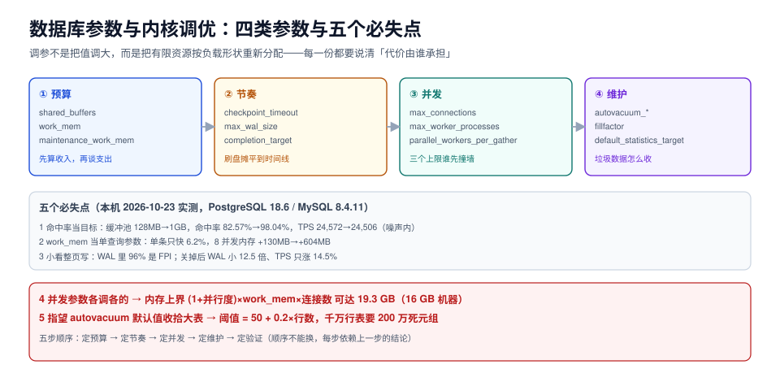

# 总览：四类参数与决策顺序

参数有几百个，但在「让这台库在它的负载下跑得稳」这件事上，真正需要决策的只有四类：**预算（内存怎么分）、节奏（刷盘怎么摊）、并发（同时干多少活）、维护（垃圾数据怎么收）**。顺序错了，后面全靠猜。

这一页先给四类参数的边界与五项必失点，再用一条「从症状到参数」的路径把后面九页串起来。



本页判据族 `TPO-A` ~ `TPO-H`，共 8 条。定义表见文末「本页判据」一节。

## 一、为什么「按手册调一遍」几乎总是失效

手册给的是**默认值**，默认值的目标不是「快」，而是「在任何机器上都不出事」。所以它必然偏保守：

| 参数 | 官方默认 | 默认值在保护什么 | 代价 |
| --- | --- | --- | --- |
| `shared_buffers`（PG） | 128 MB | 保证 512 MB 内存的机器也能起来 | 大内存机器的缓存能力被浪费 90% |
| `work_mem`（PG） | 4 MB | 100 个连接各开几个排序也不至于 OOM | 大排序全部落盘 |
| `innodb_buffer_pool_size`（MySQL） | 128 MB | 同上 | 同上 |
| `max_wal_size`（PG） | 1 GB | 磁盘小、写入慢的机器不会把盘写满 | 检查点被迫更频繁，写放大上升 |
| `autovacuum_vacuum_scale_factor` | 0.2 | 小表也不会被反复扫描 | 大表几乎永远等不到清理 |

::: tip 一句话理解
默认值不是「最优点」，而是「任何机器都不会挂的点」。调参就是**用「已知这台机器有多大」这条信息，把安全边际换成性能**。
:::

而安全边际一旦换错方向，就会出现下面五种典型失效。

## 二、五个必失点

### 2.1 必失点一：把命中率当目标

本机实测（`pgbench -S`，scale 20 ≈ 290 MB 数据，8 客户端，20 秒）：

| `shared_buffers` | TPS | 平均延迟 | 缓存命中率 | 物理读块数 | 物理读字节 |
| --- | --- | --- | --- | --- | --- |
| 128 MB | 24,571.7 | 0.326 ms | 82.57% | 342,859 | 2.68 GB |
| 512 MB | 23,993.6 | 0.333 ms | 98.00% | 38,390 | 307 MB |
| 1 GB | 24,506.2 | 0.326 ms | 98.04% | 38,390 | 307 MB |

物理读少了 **8.9 倍**，TPS 变化在 **−2.4% ~ −0.3%** 之间——完全落在噪声里（同一配置连测 5 次，TPS 从 20,685 到 25,573，极差 **23.6%**，见[压测驱动的调参](../BenchmarkLoop/index.md)）。

原因是这台机器的空闲内存足够把整个 290 MB 数据集放进操作系统页缓存；`shared_buffers` 小只是让数据多走一次「页缓存 → 共享缓冲」的内存拷贝。**命中率量的是「库自己缓存了多少」，不是「查询等了多久」**。

### 2.2 必失点二：把 `work_mem` 当单查询参数

`work_mem` 的全名是「每个排序 / 哈希 / 聚合节点可用的内存」，而一条查询可能同时有多个这样的节点，每个连接可以同时跑一条查询，每个并行 worker 也各拿一份。

本机实测（1M 行、97 MB 表、全排序、并行关闭）：

| `work_mem` | 排序方式 | 内存 / 落盘 | 耗时 |
| --- | --- | --- | --- |
| 1 MB | external merge | 落盘 77,336 kB | 3,338 ms |
| 4 MB | external merge | 落盘 77,344 kB | 3,226 ms |
| 64 MB | external merge | 落盘 77,304 kB | 3,389 ms |
| 96 MB | external merge | 落盘 77,312 kB | 3,914 ms |
| **128 MB** | **quicksort** | **内存 110,514 kB** | **3,143 ms** |

从 1 MB 到 96 MB（96 倍）没有一次切换成内存排序——因为切换点在「够不够装下整个结果集」，而不是「够不够大」。切换之后耗时只从 3,338 ms 降到 3,143 ms，**快 6.2%**。真正的代价在并发：8 个并发排序同时跑，进程峰值内存 4 MB / 64 MB / 256 MB 分别是 **587 MiB / 1.04 GiB / 1.37 GiB**（基线 457 MiB）。

### 2.3 必失点三：以为「开了 full_page_writes 只是多写一点」

本机实测（`pgbench -N`，8 客户端，15 秒）：

| 配置 | TPS | WAL 总量 | 其中整页副本（FPI） | 每条 WAL 记录平均 |
| --- | --- | --- | --- | --- |
| `full_page_writes = on`（重启后第一段） | 3,292.1 | 263.0 MB | 30,973 张 ≈ 254 MB（**96%**） | 1,177 B |
| `full_page_writes = on`（同一进程后续一段） | 3,007.2 | 174.3 MB | 20,152 张 ≈ 165 MB（**95%**） | 882 B |
| `full_page_writes = off` | 3,441.6 | **14.0 MB** | 0 | 60 B |

关掉之后 WAL **小了 12.5 倍**，TPS 只涨 **14.5%**。这个不对称正是危险所在：**本机几乎感觉不到，而下游（归档、复制、备份、云盘流量）全部要按 WAL 体积付费**。

### 2.4 必失点四：并发参数各调各的

`max_connections`、`work_mem`、`max_parallel_workers_per_gather` 三个参数共同决定内存上界：

```text
内存上界 ≈ (1 + max_parallel_workers_per_gather) × work_mem × max_connections + shared_buffers + 维护内存
```

默认值代入：`(1 + 2) × 4 MB × 100 + 128 MB ≈ 1.3 GB`——很安全。把 `work_mem` 提到 64 MB 而别的都不动：`3 × 64 × 100 + 128 ≈ 19.3 GB`——**一台 16 GB 的机器会被自己撑死**。这不是理论推演：本机 8 并发 × 256 MB 时进程峰值已经到 1.37 GiB。

### 2.5 必失点五：指望 autovacuum 默认值收拾大表

本机实测（10 万行、14 MB 表，一次全表 `UPDATE`）：

| 时刻 | 表大小 | 死元组 |
| --- | --- | --- |
| 初始（`VACUUM ANALYZE` 后） | 14 MB | 0 |
| 全表更新后 | 27 MB（**1.93 倍**） | 100,000 |
| 3 秒后 | 27 MB | 100,000（`autovacuum_naptime` 默认 60 s，还没轮到） |
| 63 秒后 | 27 MB | 0（已清理） |
| `VACUUM FULL` 后 | **13 MB** | 0 |

默认触发阈值是 `50 + 0.2 × 行数`：10 万行表要 20,050 个死元组，1,000 万行表要 **2,000,050** 个。也就是说**表越大，越晚清理，而它恰恰最经不起膨胀**。

## 三、五步决策顺序

顺序不能换：每一步都依赖上一步的结论。

| 步骤 | 动作 | 产出 | 依赖 |
| --- | --- | --- | --- |
| ① 定预算 | 这台机器有多少内存可以给库、多少必须留给页缓存与 OS | 一张内存分配表（缓冲池 / 工作内存 / 维护内存 / 预留） | 机器规格、是否与别的服务混部 |
| ② 定节奏 | 每秒产生多少 WAL、检查点多久一次、单次刷盘多少 | `max_wal_size`、`checkpoint_timeout`、`completion_target` | ①的磁盘与 IO 能力 |
| ③ 定并发 | 同时在跑多少连接、多少并行 worker、每个用多少工作内存 | `max_connections`、`work_mem`、并行度、池大小 | ①的剩余内存、②的延迟目标 |
| ④ 定维护 | 垃圾产生速率、可接受的膨胀倍数、维护窗口 | autovacuum 阈值、`maintenance_work_mem`、统计目标 | ①的剩余内存、③的窗口 |
| ⑤ 定验证 | 固定负载、单变量 A/B、噪声带、回滚条件 | 一份可复核的调参报告 | ①~④全部 |

::: warning 顺序为什么不能换
先调 `work_mem` 再定预算，等于「先花钱再算收入」；先调检查点再算 WAL 速率，等于「先定闹钟再问几点睡」。**每一次调整都要写在「上一步的结论」之下**，否则多参数同时动，读数变化无法归因——见[压测驱动的调参](../BenchmarkLoop/index.md)。
:::

## 四、从症状到参数

| 症状 | 最可能相关的参数 | 先去哪页 |
| --- | --- | --- |
| 缓冲池读写比难看、但延迟正常 | `shared_buffers` / `effective_cache_size` | [内存预算](../MemoryBudget/index.md) |
| 大查询偶发慢十倍、磁盘 IO 抖 | `work_mem` | [work_mem](../WorkMem/index.md) |
| 每秒写入不高但 WAL 涨得飞快 | `full_page_writes` / `wal_compression` / 检查点间隔 | [写放大](../WriteAmplification/index.md) |
| 定时尖峰（整分钟、整五分钟） | `checkpoint_timeout` / `max_wal_size` / `completion_target` | [检查点节奏](../Checkpoint/index.md) |
| 并发一上来内存就满、被 OOM kill | `work_mem` × `max_connections` / 并行度 | [并发参数](../Concurrency/index.md) |
| 表只增不减、`n_dead_tup` 常年很高 | autovacuum 三个参数 / `maintenance_work_mem` | [维护参数](../Maintenance/index.md) |
| 改完参数「感觉快了」，第二天又慢回去 | 没有固定负载与噪声带 | [压测驱动的调参](../BenchmarkLoop/index.md) |

## 五、本专题的实测口径

后面每一页的读数都来自同一套台架，方便交叉比对：

```shell
# PostgreSQL 18.6（Docker，独立容器，不影响宿主机其他实例）
docker run -d --name ptlab -e POSTGRES_PASSWORD=lab -e POSTGRES_DB=lab \
  --shm-size=1g postgres:18

# 数据集：pgbench scale 20 ≈ 290 MB；另建 1M 行 / 97 MB 排序表、10 万行膨胀表
docker exec ptlab pgbench -U postgres -i -s 20 lab
docker exec ptlab psql -U postgres -d lab -c \
  "create table t_sort as select g as id, md5(g::text)||md5((g*7)::text) as pad from generate_series(1,1000000) g;"

# MySQL 8.4.11（对照：缓冲池能否在线扩容）
docker run -d --name ptlab-mysql -e MYSQL_ROOT_PASSWORD=lab mysql:8.4
```

三条口径约定：

1. **只改一个参数**，其余保持默认，改完 `pg_reload_conf()` 或重启，并记录是否 `pending_restart`。
2. **同一台机器、同一时间段**跑对照，避免和宿主机其他容器抢 IO。
3. **读数写成「三次以上的中位数 + 极差」**，单次读数只用来发现方向，不用来下结论。

## 本页判据

| 编号 | 判据 | 看什么现象 | 不满足时改哪里 |
| --- | --- | --- | --- |
| `TPO-A` | 每个改动都有归属类别 | 调参单里每个参数都标了「预算 / 节奏 / 并发 / 维护」 | 补分类；无法归类的参数先不动 |
| `TPO-B` | 有显式的内存分配表 | 文档里能查到缓冲池、工作内存、维护内存各占多少 | 按[内存预算](../MemoryBudget/index.md)的算式重算 |
| `TPO-C` | 不用命中率下结论 | 报告里命中率只作为解释，不作为验收指标 | 换成延迟分位与吞吐 |
| `TPO-D` | `work_mem` 有并发放大算式 | 能算出「最坏情况下的总内存」 | 按 `(1+并行度) × work_mem × 连接数` 重算 |
| `TPO-E` | WAL 体积有预算 | 每日 WAL 生成量与归档/复制带宽对得上 | 见[写放大](../WriteAmplification/index.md) |
| `TPO-F` | 大表 autovacuum 单独设阈值 | 千万行级表有 per-table 覆盖 | `ALTER TABLE ... SET (autovacuum_vacuum_scale_factor=0.02)` |
| `TPO-G` | 有固定负载的基线 | 存在一份「调参前」的基线读数（同负载同并发） | 先补基线，再谈优化 |
| `TPO-H` | 有回滚条件 | 每个参数都写了「出现什么现象就改回去」 | 补回滚阈值（如 p99 劣化 > 30% 持续 10 分钟） |

## 参考资料

- PostgreSQL 18 · 服务器配置参数总表：<https://www.postgresql.org/docs/18/runtime-config.html>
- PostgreSQL Wiki · Tuning Your PostgreSQL Server：<https://wiki.postgresql.org/wiki/Tuning_Your_PostgreSQL_Server>
- PostgreSQL 18 · 异步 IO（`io_method` / `io_workers`）：<https://www.postgresql.org/docs/18/runtime-config-resource.html#GUC-IO-METHOD>
- MySQL 8.4 · InnoDB 参数：<https://dev.mysql.com/doc/refman/8.4/en/innodb-parameters.html>
- pgbench 官方文档：<https://www.postgresql.org/docs/18/pgbench.html>
