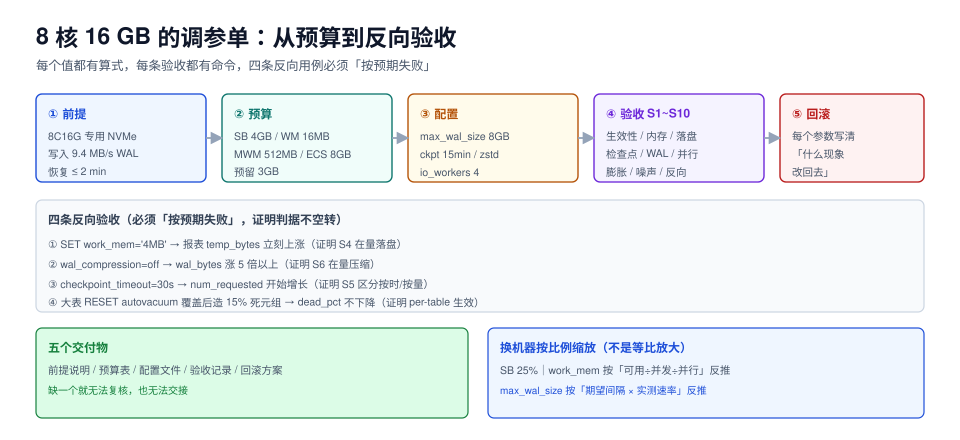

# 实战：8 核 16 GB 的一份调参单

前面八页都是「单个参数怎么定」，这一页把它们合成一份**可以直接拿去用、也能被验收**的调参单：一台 8 核 16 GB、专用、写入型 + 报表混合负载的 PostgreSQL 18.6 库。



本页判据族 `TPX-A` ~ `TPX-H`，共 8 条。定义表见文末「本页判据」一节。

## 一、先写前提，再写参数

调参单的第一段必须写清「这套值对什么成立」——换一台机器、换一个负载，就得重算。

| 项 | 本单取值 | 为什么是这个前提 |
| --- | --- | --- |
| 机器 | 8 核 / 16 GB / 本地 NVMe | 云盘与机械盘的 `effective_io_concurrency` 差一个数量级 |
| 部署 | 专用（只跑这一个库实例） | 混部要把缓冲池降到 15%~20% |
| 负载 | 写 9.4 MB/s WAL、读以点查 + 日报表为主 | 写速率决定 `max_wal_size`，读模式决定 `work_mem` |
| 版本 | PostgreSQL 18.6 | 18 才有 `io_method` / `io_workers` |
| 恢复目标 | 崩溃恢复 ≤ 2 分钟 | 决定 `max_wal_size` 的上界 |

## 二、内存预算表

```text
可用内存 = 16 GB − 2 GB(OS) − 0.8 GB(连接固定开销) ≈ 13.2 GB
```

| 用途 | 参数 | 取值 | 占可用内存 | 依据 |
| --- | --- | --- | --- | --- |
| 共享缓冲 | `shared_buffers` | **4 GB** | 30% | 25% 起步，取 2 的幂便于对齐大页 |
| 规划器提示 | `effective_cache_size` | **8 GB** | 0（不占） | 约等于「页缓存 + 共享缓冲」 |
| 工作内存 | `work_mem` | **16 MB** | 上限 40% | `13.2×0.4 ÷ 32 活跃 ÷ 3(并行) ≈ 55 MB`，取 16 MB 留余量 |
| 维护内存 | `maintenance_work_mem` | **512 MB** | 最坏 3×=1.5 GB | autovacuum 最多 3 个并发 |
| 预留 | — | 约 3 GB | — | 临时表、连接突发、OS 抖动 |

## 三、完整配置片段

```ini [postgresql.conf]
# ---- 内存 ----
shared_buffers = 4GB
effective_cache_size = 8GB
work_mem = 16MB
maintenance_work_mem = 512MB
huge_pages = try

# ---- WAL 与检查点 ----
wal_level = replica
max_wal_size = 8GB
min_wal_size = 1GB
checkpoint_timeout = 15min
checkpoint_completion_target = 0.9
wal_compression = zstd
full_page_writes = on

# ---- 并发 ----
max_connections = 200
max_worker_processes = 16
max_parallel_workers = 12
max_parallel_workers_per_gather = 3
io_method = worker
io_workers = 4
effective_io_concurrency = 100

# ---- 异步提交与刷盘 ----
synchronous_commit = on
wal_buffers = 16MB

# ---- 维护 ----
autovacuum = on
autovacuum_max_workers = 3
autovacuum_naptime = 30s

# ---- 规划器 ----
random_page_cost = 1.1
default_statistics_target = 100

# ---- 日志 ----
log_checkpoints = on
log_autovacuum_min_duration = 1000ms
log_min_duration_statement = 1000
```

每个值都能在预算表或前面几页找到算式。**没有算式支撑的值不许写进调参单**——这是这份文档能被复核的前提。

```sql
-- 大表单独覆盖 autovacuum（见维护参数页）
ALTER TABLE orders SET (
  autovacuum_vacuum_scale_factor = 0.01,
  autovacuum_vacuum_threshold = 10000
);
-- 高频更新的状态表
ALTER TABLE order_status SET (
  autovacuum_vacuum_scale_factor = 0.0,
  autovacuum_vacuum_threshold = 1000,
  fillfactor = 80
);
```

## 四、十个验收点（S1~S10）

验收不是「看一眼监控」，而是**每条都能被执行、都有预期输出**。

### S1 生效性：配置真的加载了

```sql
SELECT name, setting, unit, pending_restart FROM pg_settings
WHERE name IN ('shared_buffers','work_mem','max_wal_size','checkpoint_timeout',
               'wal_compression','io_method','max_parallel_workers_per_gather');
```

预期：`shared_buffers = 524288`（8 kB 单位 = 4 GB）、`wal_compression = zstd`、`io_method = worker`、`pending_restart = f`。

### S2 内存没被吃爆

```shell
docker stats --no-stream <container>     # 或 free -h
```

预期：稳态 RSS ≤ 12 GB；压测峰值 ≤ 14 GB；`available` 始终 > 1 GB。

### S3 大查询不再落盘

```sql
EXPLAIN (ANALYZE, COSTS OFF) SELECT id, pad FROM t_sort ORDER BY pad;
```

预期：`Sort Method: quicksort  Memory: ...`（16 MB 的 `work_mem` 对 108 MB 的排序仍然落盘——所以**这类语句必须走 `SET LOCAL work_mem='256MB'`**，见 S4）。

### S4 报表语句用会话级放大

```sql
BEGIN;
SET LOCAL work_mem = '256MB';
SET LOCAL max_parallel_workers_per_gather = 0;
SELECT ... ORDER BY ...;   -- 报表主查询
COMMIT;
```

预期：`pg_stat_database.temp_bytes` 在报表期间**零增长**。

### S5 检查点不再「按量」触发

```sql
SELECT num_timed, num_requested FROM pg_stat_checkpointer;
```

预期：一小时内 `num_requested` 不增长（`max_wal_size=8GB` 在 9.4 MB/s 下够 14 分钟，`checkpoint_timeout=15min` 刚好接上）。

### S6 WAL 体积回到合理区间

```sql
SELECT pg_size_pretty(wal_bytes) AS wal, wal_fpi, wal_records,
       round(100.0 * wal_fpi * 8192 / nullif(wal_bytes, 0), 1) AS fpi_pct
FROM pg_stat_wal;
```

预期：`fpi_pct` 仍高（这是 FPI 的本质），但**总 WAL 字节比未压缩时小 5~6 倍**；同步确认复制链路带宽占用下降。

### S7 并行真的启动了

```sql
EXPLAIN (ANALYZE, COSTS OFF) SELECT sum(id), count(*) FROM t_sort WHERE pad LIKE '%abc%';
```

预期：`Workers Planned: 3`、`Workers Launched: 3`（相等）。不等说明 `max_worker_processes` 不够。

### S8 大表不再膨胀

```sql
SELECT relname, n_dead_tup,
       round(100.0 * n_dead_tup / nullif(n_live_tup + n_dead_tup, 0), 1) AS dead_pct
FROM pg_stat_user_tables WHERE reltuples > 1000000 ORDER BY n_dead_tup DESC LIMIT 5;
```

预期：`dead_pct < 10%`，`last_autovacuum` 在 30 分钟内。

### S9 噪声带内没退化（护栏）

```shell
for i in 1 2 3; do docker exec ptlab pgbench -U postgres -S -c 32 -j 8 -T 60 lab | grep "^tps"; done
```

预期：三次中位数不低于调参前基线的 **95%**。低于就回滚——**优化写路径不能牺牲点查**。

### S10 四条「必须失败」的反向验收

正向验收只能证明「现在是好的」，反向验收才能证明「判据真的在测东西」。

| 反向操作 | 预期失败现象 | 证明什么 |
| --- | --- | --- |
| `SET work_mem='4MB'` 后跑 S4 的报表 | `temp_bytes` 立刻上涨 | S4 的判据不是摆设 |
| `wal_compression=off` 后跑 S6 | `wal_bytes` 涨 5 倍以上 | S6 真的在量压缩 |
| `checkpoint_timeout=30s` 后跑 S5 | `num_requested` 开始增长 | S5 能区分「按时」与「按量」 |
| 大表 `ALTER TABLE ... RESET (autovacuum_...)` 后造 15% 死元组 | `dead_pct` 不下降 | S8 的 per-table 覆盖真的生效 |

::: tip 反向验收是「判据的单元测试」
四条里有任意一条**没有**按预期失败，说明这条判据是空转的（测的东西不敏感）。**先让判据红一次，再让它绿**，比直接看绿可信得多。
:::

## 五、交付物清单

一份完整的调参交付应该包含五个文件（或五个章节），缺一个就无法复核：

| 交付物 | 内容 | 谁看 |
| --- | --- | --- |
| 前提说明 | 机器规格、部署形态、负载特征、版本、恢复目标 | 交接的人 |
| 预算表 | 内存分配、WAL 预算、连接预算 | 容量规划 |
| 配置文件 | 完整 `postgresql.conf` 片段 + per-table 覆盖 | 运维执行 |
| 验收记录 | S1~S10 的命令与实际输出（含反向验收） | 复核的人 |
| 回滚方案 | 每个参数的「什么现象改回去」 | 值班的人 |

## 六、换机器怎么办：一张缩放表

| 机器规格 | `shared_buffers` | `work_mem` | `max_wal_size` | `max_connections` |
| --- | --- | --- | --- | --- |
| 4C8G 混部 | 1 GB（12%） | 4 MB | 2 GB | 100 |
| 8C16G 专用（本单） | 4 GB（25%） | 16 MB | 8 GB | 200 |
| 16C64G 专用 | 16 GB（25%） | 32 MB | 32 GB | 400 |
| 32C128G 专用 | 32 GB（25%） | 32 MB | 64 GB | 500（配合连接池） |

规则：**内存按 25% 缩放到缓冲池，`work_mem` 按「可用内存 ÷ 并发 ÷ 并行度」反推，`max_wal_size` 按「期望间隔 × 实测 WAL 速率」反推**。三个值都不是「越大越好」，而是「各自有上界」。

## 七、MySQL 版的一句话对照

同一台机器上如果换 MySQL 8.4：

| 项 | PG 18.6 | MySQL 8.4.11 |
| --- | --- | --- |
| 缓冲池 | `shared_buffers = 4GB`（**需重启**） | `innodb_buffer_pool_size = 8~12GB`（**可在线改**，占总内存 50%~70%，因为 MySQL 没有依赖页缓存的第二层） |
| 工作内存 | `work_mem = 16MB`（按节点） | `sort_buffer_size = 2MB`、`join_buffer_size = 2MB`（按连接预分配） |
| 日志容量 | `max_wal_size = 8GB` | `innodb_redo_log_capacity = 4GB`（8.0.30+，默认 100 MB 偏小） |
| 并行 | `max_parallel_workers_per_gather = 3` | 8.4 仍无查询内并行 |
| 刷盘 | `synchronous_commit = on` | `innodb_flush_log_at_trx_commit = 1` + `sync_binlog = 1` |

**MySQL 的缓冲池可以给到 50%~70%**，因为它不用页缓存兜第二层；PG 给到 25% 就行，多给是浪费（实测命中率涨 15 个百分点、TPS 不动）。

## 本页判据

| 编号 | 判据 | 看什么现象 | 不满足时改哪里 |
| --- | --- | --- | --- |
| `TPX-A` | 调参单有前提段 | 机器、部署、负载、版本、恢复目标五要素齐全 | 补前提，否则值无法复现 |
| `TPX-B` | 每个值都有算式 | 参数表里有「依据」列 | 补算式来源（本专题对应页） |
| `TPX-C` | 有预算表 | 内存、WAL、连接三项都有分配 | 按第二、三节补 |
| `TPX-D` | 验收可执行 | S1~S10 都是命令 + 预期输出 | 把「看一眼」改写成命令 |
| `TPX-E` | 有反向验收 | 至少四条「必须失败」的用例 | 补反向用例 |
| `TPX-F` | 有回滚条件 | 每个参数写了「什么现象改回去」 | 补阈值与观察窗 |
| `TPX-G` | 大表有 per-table 覆盖 | `pg_class.reloptions` 里能看到 | 按第三节 SQL 执行 |
| `TPX-H` | 换机器有缩放规则 | 有按规格的比例表 | 补缩放表并说明每项的算式 |

## 参考资料

- PostgreSQL 18 · 服务器配置：<https://www.postgresql.org/docs/18/runtime-config.html>
- PostgreSQL Wiki · Tuning Your PostgreSQL Server：<https://wiki.postgresql.org/wiki/Tuning_Your_PostgreSQL_Server>
- PostgreSQL 18 · `pg_settings`：<https://www.postgresql.org/docs/18/view-pg-settings.html>
- MySQL 8.4 · InnoDB 启动参数：<https://dev.mysql.com/doc/refman/8.4/en/innodb-parameters.html>
- MySQL 8.4 · `innodb_redo_log_capacity`：<https://dev.mysql.com/doc/refman/8.4/en/innodb-parameters.html#sysvar_innodb_redo_log_capacity>
