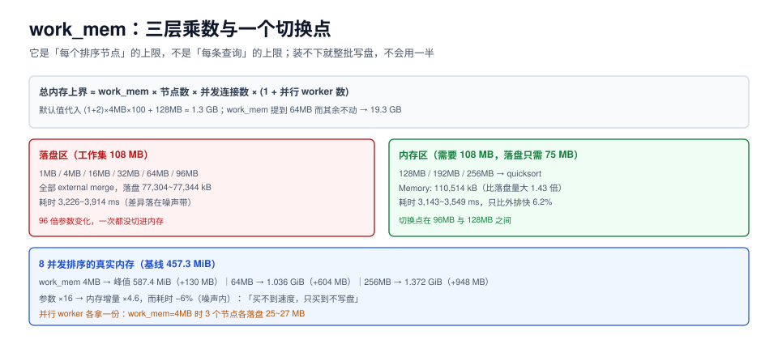

# work_mem：排序落盘与内存放大的乘数

`work_mem` 是 PostgreSQL 里被误用最多的参数：它既不是「一条查询能用的内存」，也不是「越大越快」。它的准确语义是**每个排序 / 哈希 / 聚合节点在执行期的内存上限**，而「节点数 × 连接数 × 并行度」才是真正的乘数。

这一页回答三件事：什么时候排序会落盘、要设多大才不落盘、设大之后内存会放大到什么程度。



本页判据族 `TPW-A` ~ `TPW-H`，共 8 条。定义表见文末「本页判据」一节。

## 一、语义：一个 `work_mem` 会被乘几次

```text
总内存上界 ≈ work_mem × 每查询的排序/哈希节点数 × 并发连接数 × (1 + 并行 worker 数)
```

四个乘数各自独立：

| 乘数 | 什么时候变大 | 典型倍数 |
| --- | --- | --- |
| 节点数 | 一条 SQL 里多个 `ORDER BY` / `GROUP BY` / `DISTINCT` / hash join | 1~4 |
| 连接数 | 应用连接池的活跃连接 | 10~200 |
| 并行 worker | `max_parallel_workers_per_gather` > 0 且计划走了并行 | 1~3 |
| 递归/CTE | 递归 CTE 的每一层工作区 | 1~N |

::: danger 不要用「单条查询够不够」来决定 `work_mem`
默认 4 MB 的库里，一条大排序可能要 108 MB。把它调到 128 MB「让这条查询进内存」，在 100 连接 × 3 并行的最坏情况下，上界变成 `128 MB × 4 × 100 = 51 GB`。**参数是全局的，查询是局部的**——两者混在一起算，就是这个参数最大的坑。
:::

## 二、什么时候落盘：本机实测切换点

台架：1M 行、**97 MB** 表（`t_sort`，`id int` + `pad text` 64 字符），全量 `ORDER BY pad`，并行关闭，PostgreSQL 18.6。

| `work_mem` | 排序方式 | 内存 / 落盘量 | 耗时 |
| --- | --- | --- | --- |
| 1 MB | external merge | 落盘 77,336 kB | 3,338 ms |
| 4 MB（默认） | external merge | 落盘 77,344 kB | 3,226 ms |
| 16 MB | external merge | 落盘 77,328 kB | 3,496 ms |
| 32 MB | external merge | 落盘 77,304 kB | 3,359 ms |
| 64 MB | external merge | 落盘 77,304 kB | 3,389 ms |
| 96 MB | external merge | 落盘 77,312 kB | 3,914 ms |
| **128 MB** | **quicksort** | **内存 110,514 kB** | **3,143 ms** |
| 192 MB | quicksort | 内存 110,514 kB | 3,549 ms |
| 256 MB | quicksort | 内存 110,514 kB | 3,153 ms |

三个反直觉的读数：

1. **1 MB 到 96 MB（96 倍）都没有切换成内存排序**。原因是 PG 的判定很干脆：装不下就整批写盘（分多个 run 再归并），不会「用 96 MB 装一部分」。
2. **需要 128 MB 才装下 108 MB 的排序**。落盘只写了 75 MB，比内存里的 108 MB 还小——因为磁盘上的 run 文件是紧凑格式，没有每元组的 24 字节头。**判断 `work_mem` 够不够，不能看落盘字节数乘 1.2，要看 `Sort Method` 那一行。**
3. **内存排序只比外排快 6.2%**（3,143 ms vs 3,338 ms），而这个差值本身就落在噪声带里（同一配置重复测的极差可达 23.6%，见[压测驱动的调参](../BenchmarkLoop/index.md)）。

::: tip 所以 `work_mem` 的验收判据是「有没有落盘」，不是「快了多少」
`EXPLAIN (ANALYZE)` 里的 `Sort Method` 与 `Disk Usage` 是确定性的，`Execution Time` 不是。**用 `pg_stat_database.temp_bytes` 的增量当判据**：调到目标值后，这类查询的 `temp_bytes` 应该归零。
:::

## 三、落盘的代价到底在哪

| 代价 | 表现 | 何时致命 |
| --- | --- | --- |
| **写临时文件** | `temp_bytes` 上涨，`/pgsql_tmp` 增长 | 临时目录和数据目录在同一块盘上，写临时文件会和 WAL 抢 IO |
| **多轮归并** | 落盘量远大于 `work_mem` 时，归并轮数上升 | 结果集是 `work_mem` 的几十倍时，归并退化成多趟扫描 |
| **内存压力下的连锁** | 落盘不占内存，但临时文件的页缓存占 | 并发大排序时，页缓存被临时文件挤占，反倒影响正常查询 |
| **不可见的放大** | `temp_files` 计数看不出大小 | 只看次数会以为「只有几个临时文件」，实际每次几个 GB |

本机读数：`work_mem = 4 MB` 时，一次全量排序的 `pg_stat_database.temp_bytes` 增加 **72 MB**，`temp_files` 增加 **3** 个（并行归并的分片）。同样的查询在 `work_mem = 128 MB` 下 `temp_bytes` 增量为 **0**。

## 四、并发放大：8 个并发排序的真实内存

台架：8 个 `psql` 会话同时跑「全量排序 + 计数」，每个会话 `SET work_mem`，并行关闭，容器总内存 8 GB，基线（无查询）进程占用 **457.3 MiB**。

| `work_mem` | 8 并发峰值 | 相对基线增量 | 单查询是否落盘 |
| --- | --- | --- | --- |
| 4 MB | 587.4 MiB | **+130 MB** | 落盘 72 MB |
| 64 MB | 1.036 GiB（约 1,061 MB） | **+604 MB** | 落盘 72 MB |
| 256 MB | 1.372 GiB（约 1,405 MB） | **+948 MB** | 内存 108 MB |

读数解读：

- `work_mem` 从 4 MB 到 64 MB（**16 倍**），内存增量从 130 MB 到 604 MB（**4.6 倍**）——不是 16 倍，因为每个排序的实际需求受结果集大小限制（本例约 108 MB）。
- 从 64 MB 到 256 MB（**4 倍**），增量只从 604 MB 到 948 MB（**1.6 倍**）——因为这时已经全部进内存，再加也是浪费。
- **这就是「设置超过实际需要」的浪费形态**：不是线性爆炸，而是「一旦跨过切换点，就把整个结果集搬进内存」。

::: warning 并行查询会把 `work_mem` 再乘一次
`work_mem = 4 MB`、计划里有 2 个并行 worker 时，同一时刻有 **3 个排序节点**在跑，各自落盘 **25~27 MB**（总计 77 MB，与单进程落盘量相同，但由三个进程分摊）。**每个 worker 都独立拿一份 `work_mem`**，所以「并行度提高 3 倍 = 内存上界提高 3 倍」，这一点在 8 核机器上很容易被忽略。
:::

## 五、怎么定这个值：三步

### 5.1 第一步：找出真正落盘的语句

```sql
-- 需要先 CREATE EXTENSION pg_stat_statements;
SELECT queryid,
       round(mean_exec_time::numeric, 1) AS mean_ms,
       calls,
       temp_blks_written,
       pg_size_pretty(temp_blks_written * 8192) AS temp_written,
       left(query, 60) AS q
FROM pg_stat_statements
WHERE temp_blks_written > 0
ORDER BY temp_blks_written DESC
LIMIT 10;
```

预期：能看到「哪几条 SQL 在写临时文件、一共写了多少」。**没有 `pg_stat_statements` 时用 `pg_stat_database.temp_bytes` 只能看到总量，看不到语句。**

### 5.2 第二步：估结果集大小

```sql
-- 在副本上跑一次，看排序节点的实际内存需求
EXPLAIN (ANALYZE, COSTS OFF)
SELECT id, pad FROM t_sort ORDER BY pad;
-- 看 "Sort Method: external merge  Disk: 77336kB" 这一行
```

按经验：需要的 `work_mem` ≈ 落盘量 × **1.5**（本例 77 MB × 1.5 ≈ 115 MB，实测切换点在 96~128 MB 之间，与估算一致）。

### 5.3 第三步：按预算反推，不要按需求正推

```text
work_mem 上界 = 可用内存 × 40% ÷ 最大并发 ÷ (1 + 并行度)
```

8 核 16 GB 专用库、活跃连接 32、并行度 2：

```text
13.2 GB × 40% ÷ 32 ÷ 3 ≈ 55 MB
```

如果 55 MB 不够那几条大查询用，**不要全局调大**，而是：

| 做法 | 写法 | 适用 |
| --- | --- | --- |
| **会话级** | `SET LOCAL work_mem = '256MB';` | 报表任务、批处理，用完即还原 |
| **角色级** | `ALTER ROLE report_user SET work_mem = '256MB';` | 报表账号的所有连接 |
| **函数级** | `CREATE FUNCTION ... SET work_mem = '256MB'` | 固定入口的存储过程 |
| **语句级** | `/*+ Set(work_mem 256MB) */`（需 pg_hint_plan） | 单条顽固语句 |

```sql
-- 报表任务的典型写法：只在事务里放大，结束自动还原
BEGIN;
SET LOCAL work_mem = '256MB';
SET LOCAL max_parallel_workers_per_gather = 0;   -- 避免 worker 各拿一份
SELECT ... ORDER BY ...;
COMMIT;
```

## 六、MySQL 的对照：`sort_buffer_size` 更危险

| 项 | PostgreSQL `work_mem` | MySQL `sort_buffer_size` |
| --- | --- | --- |
| 作用域 | 每个排序/哈希/聚合节点 | 每次排序操作（每连接可同时多个） |
| 分配时机 | 需要时按需分配，上限即 `work_mem` | **连接建立时按需预分配**（首次排序即分配满） |
| 超限行为 | 写临时文件、多轮归并 | 写临时文件（`Sort_merge_passes` 上升） |
| 建议值 | 4~64 MB | 256 KB~4 MB（默认 256 KB） |

MySQL 的 `sort_buffer_size` 之所以建议「小」，是因为它按连接分配且**不可动态回收**，100 个连接各 16 MB 就是 1.6 GB 常驻。PG 的 `work_mem` 是「用时才分配、用完归还」，所以可以设得比 MySQL 大一个数量级——但乘数逻辑两者相同。

## 七、验证

```sql
-- 1) 目标语句是否还在落盘
EXPLAIN (ANALYZE, COSTS OFF, SUMMARY ON)
SELECT id, pad FROM t_sort ORDER BY pad;
-- 预期：Sort Method: quicksort  Memory: 110514kB（不再是 external merge）
```

```sql
-- 2) 全局临时文件增量归零
SELECT temp_files, pg_size_pretty(temp_bytes) FROM pg_stat_database WHERE datname = current_database();
-- 预期：跑完目标语句后两次采样 temp_bytes 不变
```

```sql
-- 3) 内存没被吃爆
-- 另开会话压测时观察：docker stats / ps -o rss 的峰值不超过预算表中「工作内存」一项
```

## 本页判据

| 编号 | 判据 | 看什么现象 | 不满足时改哪里 |
| --- | --- | --- | --- |
| `TPW-A` | 全局值按预算反推 | 全局 `work_mem` 满足 `≤ 可用内存×40% ÷ 并发 ÷ (1+并行度)` | 全局调到算出的上界，个别语句用 `SET LOCAL` |
| `TPW-B` | 用「是否落盘」验收 | 目标语句的 `Sort Method` 已是 `quicksort` 或 `Memory` | 按「落盘量 × 1.5」估需求 |
| `TPW-C` | 有 `temp_bytes` 前后对照 | 调参前后各采一次 `pg_stat_database.temp_bytes` | 补采样，别用耗时当唯一证据 |
| `TPW-D` | 大查询用会话级放大 | 报表/批处理路径里有 `SET LOCAL work_mem` | 补上，并成对 `RESET` 或包在事务里 |
| `TPW-E` | 并行度与 `work_mem` 一起算 | 调参单里写明了「并行 worker 各拿一份」 | 高 `work_mem` 场景下临时关并行 |
| `TPW-F` | 临时目录有独立空间 | `temp_tablespaces` 指向独立盘或独立容量配额 | 配独立表空间，避免临时文件写满数据盘 |
| `TPW-G` | 不靠单次耗时下结论 | 报告里 `work_mem` 的收益用落盘量或 `temp_bytes` 表达 | 耗时差值落在噪声带内时不要写成「提升 X%」 |
| `TPW-H` | MySQL 场景用更小的值 | `sort_buffer_size` 在 256 KB~4 MB 量级 | 按连接数×值核算常驻内存 |

## 参考资料

- PostgreSQL 18 · `work_mem`：<https://www.postgresql.org/docs/18/runtime-config-resource.html#GUC-WORK-MEM>
- PostgreSQL 18 · `EXPLAIN` 输出中的 `Sort Method`：<https://www.postgresql.org/docs/18/using-explain.html>
- PostgreSQL 18 · `pg_stat_statements`：<https://www.postgresql.org/docs/18/pgstatstatements.html>
- MySQL 8.4 · `sort_buffer_size`：<https://dev.mysql.com/doc/refman/8.4/en/server-system-variables.html#sysvar_sort_buffer_size>
- MySQL 8.4 · 内部临时表与 `Sort_merge_passes`：<https://dev.mysql.com/doc/refman/8.4/en/internal-temporary-tables.html>
