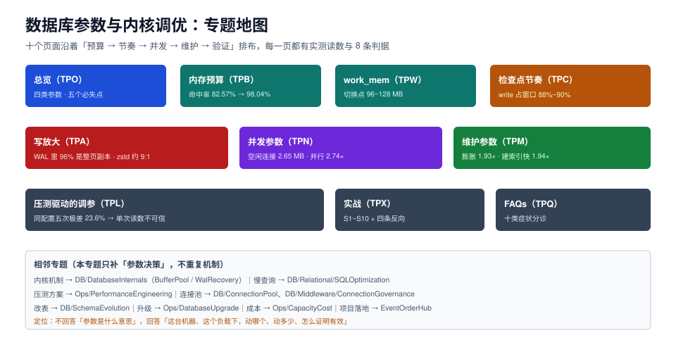

# 数据库参数与内核调优

参数调优真正难的不是「这个参数是什么意思」，而是**在一台具体机器、一个具体负载上，哪个参数该动、动到多少、动完怎么证明它真的有用**。同一台 8 核 16 GB 的库，把 `shared_buffers` 从 128 MB 调到 1 GB，命中率涨了 15 个百分点，TPS 一动不动；把 `work_mem` 从 4 MB 调到 64 MB，单条查询快了 6%，八并发时内存多吃了 600 MB。

本专题面向要为一套库「出一份调参单」的人：不回答参数手册怎么读，而回答**预算怎么分、节奏怎么定、并发怎么限、膨胀怎么收、改动怎么验证**——每一项都给可复算的算式和本机实测读数。

::: tip 一句话理解
调参不是「把参数调大」，而是**把有限的资源按负载的形状重新分配**；每动一个参数，都要先写下「这次动的是哪一份资源、代价由谁承担」。
:::

::: info 本专题与相邻专题的分工
- **页、缓冲池、WAL 的内部机制** → [数据库内核](../DatabaseInternals/index.md)：那里讲「LRU 链表怎么转、redo 怎么重放」，本专题从「机制已知，参数怎么定」接手。
- **慢查询怎么读执行计划** → [SQL 优化与慢查询](../Relational/SQLOptimization/SlowQuery/index.md)：那里逐条改 SQL 与索引，本专题只处理「改不动 SQL 时，参数能不能救」。
- **压测工具怎么用、指标怎么取** → [性能工程](../../Ops/PerformanceEngineering/index.md)：那里讲压测方案与指标口径，本专题讲「压出来的两组数怎么判成有效或噪声」。
- **连接池参数（池大小、超时、探活）** → [连接池与连接治理](../ConnectionPool/index.md)、[连接治理](../Middleware/ConnectionGovernance/index.md)：那里是「池」的账，本专题只算「池背后每个后端连接吃多少内存」。
- **DDL 与表结构变更** → [在线 Schema 演进](../SchemaEvolution/index.md)：`maintenance_work_mem` 会影响建索引速度，但改表流程归那一边。
- **大版本升级前后的参数兼容** → [数据库大版本升级](../../Ops/DatabaseUpgrade/index.md)：升级会重置统计信息与执行计划，参数要跟着复核。
- **容量与成本** → [容量与成本](../../Ops/CapacityCost/index.md)：本专题给「单机能扛多少」的算式，那边给「扛不住时买什么」。
- **项目侧的库参数落地** → [EventOrderHub 技术基线](../../../project/Complete/EventOrderHub/TechBaseline/index.md)：项目页写死了七个组件的版本，本专题给出这些版本的默认值与改动理由。
- **容器与宿主内核参数** → [Kubernetes](../../Ops/Kubernetes/index.md)：`vm.overcommit_memory`、`transparent_hugepage` 这类宿主参数归运维侧，本专题只讲库自己的参数。
- **备份与恢复** → [备份与容灾](../../Ops/BackupDR/index.md)：WAL 体积直接影响备份增量，本专题的写放大页是那边的输入。
:::

## 目录

- [总览：四类参数与决策顺序](Overview/index.md)
- [内存预算：命中率是最会骗人的指标](MemoryBudget/index.md)
- [work_mem：排序落盘与内存放大的乘数](WorkMem/index.md)
- [检查点节奏：把刷盘摊平到一条时间线](Checkpoint/index.md)
- [写放大：WAL 里 96% 是整页副本](WriteAmplification/index.md)
- [并发参数：连接数、并行度与内存的三角](Concurrency/index.md)
- [维护参数：autovacuum 的 20% 阈值在大表上失效](Maintenance/index.md)
- [压测驱动的调参：单次读数不可信](BenchmarkLoop/index.md)
- [实战：8 核 16 GB 的一份调参单](Practice/index.md)
- [常见问题与症状分诊](FAQ/index.md)

## 专题地图

## 判据纪律

沿用全库写法：**每页 8 条，编号形如 `TPO-A`**，逐页前缀唯一，可被 `utils/audit` 下的判据类巡检机械核对。每条判据回答三件事：**看什么现象、判成什么、不满足时改哪里**。

| 页 | 判据族 | 这一族管什么 | 条数 |
| --- | --- | --- | --- |
| 总览 | `TPO-A` ~ `TPO-H` | 四类参数、决策顺序、必失点 | 8 |
| 内存预算 | `TPB-A` ~ `TPB-H` | 缓冲池、页缓存、命中率口径 | 8 |
| work_mem | `TPW-A` ~ `TPW-H` | 落盘切换点、并发放大、并行乘数 | 8 |
| 检查点节奏 | `TPC-A` ~ `TPC-H` | 间隔、目标、WAL 容量、尖峰 | 8 |
| 写放大 | `TPA-A` ~ `TPA-H` | 整页副本、双写、备份与复制带宽 | 8 |
| 并发参数 | `TPN-A` ~ `TPN-H` | 连接数、并行度、异步 IO | 8 |
| 维护参数 | `TPM-A` ~ `TPM-H` | autovacuum 阈值、膨胀、统计信息 | 8 |
| 压测驱动 | `TPL-A` ~ `TPL-H` | 固定负载、单变量、噪声带、回滚 | 8 |
| 实战 | `TPX-A` ~ `TPX-H` | 调参单、验收步骤、交付物 | 8 |
| 常见问题 | `TPQ-A` ~ `TPQ-H` | 症状分诊、误判、错误建议 | 8 |

合计 **10 族 80 条**。

## 事实与版本速览

下表只放会影响判据的事实，全部在 **2026-10-23** 用本机容器核对（`postgres:18` → 18.6、`mysql:8.4` → 8.4.11），默认值直接读 `pg_settings` / `SHOW VARIABLES`，不抄二手文章。

| 事实 | 口径（本次实测） |
| --- | --- |
| PostgreSQL 18.6 的八个默认值 | `shared_buffers` **128 MB** / `work_mem` **4 MB** / `maintenance_work_mem` **64 MB** / `effective_cache_size` **4 GB** / `max_wal_size` **1 GB** / `min_wal_size` **80 MB** / `checkpoint_timeout` **5 min** / `checkpoint_completion_target` **0.9** |
| PG 18 新增异步 IO | `io_method = worker`、`io_workers = 3`、`effective_io_concurrency = 16`；这三个是新参数，老版本调参单里没有 |
| `shared_buffers` 改动需要重启 | 改完必须重启进程才生效（`postmaster` 级参数），而 MySQL 的 `innodb_buffer_pool_size` **可在线改**——这是我实测到的最大操作差异 |
| `full_page_writes` 默认开 | 实测关掉后同样负载 WAL 从 **174 MB 降到 14.0 MB（12.5 倍）**，TPS 从 3,007 涨到 3,442（**+14.5%**） |
| 命中率与 TPS 不是一回事 | 缓冲池 128 MB → 512 MB，命中率 **82.57% → 98.00%**，TPS **24,572 → 23,994（−2.4%，在噪声内）** |
| `work_mem` 是「每个排序/哈希节点」的上限 | 1M 行排序需要 **108 MB** 才留在内存里（落盘时写 **75 MB**），而 `work_mem` 要设到 **128 MB** 才切换成 quicksort |
| `work_mem` 会被并发与并行同时放大 | 8 并发 × `work_mem` 4/64/256 MB → 进程峰值 **587 MiB / 1.04 GiB / 1.37 GiB**（基线 457 MiB） |
| autovacuum 阈值 = `50 + 0.2 × 行数` | 10 万行表要 **20,050** 个死元组才触发，1000 万行表要 **2,000,050** 个——大表基本等于「永不触发」 |
| MySQL 8.4.11 的四个默认值 | `innodb_buffer_pool_size` **128 MB** / `innodb_buffer_pool_instances` **1** / `innodb_flush_method` **O_DIRECT** / `innodb_redo_log_capacity` **100 MB** |

## 三条底线

::: danger 三条不可让步的底线
1. **不要用命中率当目标**。实测把 `shared_buffers` 放大 4 倍，命中率从 82.57% 涨到 98.00%，物理读从 342,859 块降到 38,390 块（8.9 倍），但 TPS 一点没动——因为少掉的那些读被操作系统页缓存接住了。命中率是**解释性指标**，延迟和吞吐才是目标。
2. **`work_mem` 不是「越大越好」，它是乘数**。单条查询 3,338 ms → 3,143 ms（只快 6.2%），8 并发时的内存增量却从 +130 MB 涨到 +604 MB（4.6 倍）。**按「最大并发 × work_mem ≤ 内存的 25%」倒推**，而不是按「这条查询想要多少」。
3. **大表必须按表覆盖 autovacuum 参数**。默认 20% 的比例意味着 1,000 万行的表要攒够 200 万个死元组才动一次；实测 10 万行表一次全表更新就膨胀到 **1.93 倍**（14 MB → 27 MB），而 `VACUUM` 只把空间标成可复用，文件大小要 `VACUUM FULL` 才回到 13 MB。
:::

## 阅读顺序

先读[总览](Overview/index.md)拿到「四类参数 + 五步顺序」的全局图，然后按你手上的症状选主线：

- **内存不够、想加缓冲池** → [内存预算](MemoryBudget/index.md) → [work_mem](WorkMem/index.md)
- **写入尖峰、复制延迟、备份变大** → [检查点节奏](Checkpoint/index.md) → [写放大](WriteAmplification/index.md)
- **并发一上就慢、内存被吃光** → [work_mem](WorkMem/index.md) → [并发参数](Concurrency/index.md)
- **表越来越大、查询越来越慢但 SQL 没变** → [维护参数](Maintenance/index.md)
- **要交一份能复核的调参报告** → [压测驱动的调参](BenchmarkLoop/index.md) → [实战](Practice/index.md)

## 参考资料

- PostgreSQL 官方文档 · 服务器配置：<https://www.postgresql.org/docs/18/runtime-config.html>
- PostgreSQL 官方 Wiki · Tuning Your PostgreSQL Server：<https://wiki.postgresql.org/wiki/Tuning_Your_PostgreSQL_Server>
- PostgreSQL 18 发布说明（异步 IO）：<https://www.postgresql.org/docs/18/release-18.html>
- MySQL 8.4 参考手册 · InnoDB 启动参数：<https://dev.mysql.com/doc/refman/8.4/en/innodb-parameters.html>
- MySQL 8.4 参考手册 · 在线修改缓冲池大小：<https://dev.mysql.com/doc/refman/8.4/en/innodb-buffer-pool-resize.html>
- pgbench 官方文档：<https://www.postgresql.org/docs/18/pgbench.html>
