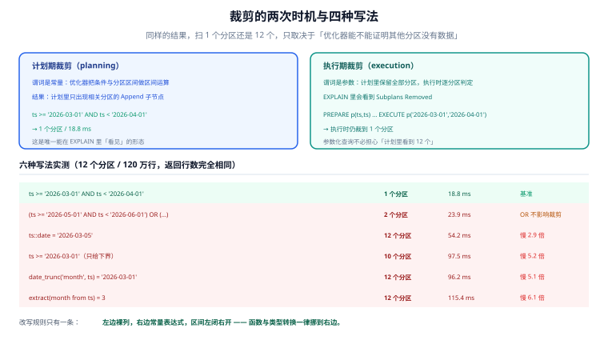

# 跨分区查询：裁剪为什么没生效

分区表上最贵的错误不是「写错 SQL」，而是**写对了但吃不到收益**。这一页把「裁剪」这件事讲到底：它在什么时刻发生、什么写法会让它静默失效、失效之后代价有多大。同时纠正一个流传很广的误解——分区表并不一定让深分页变慢，实测结果恰好相反。

## 判据族声明

本页判据族 `PQ-A` ~ `PQ-H`，共 8 条。定义表在第八节。

## 本页不讲什么

- 不讲分区键怎么选，归 [分区策略](../PartitionStrategy/index.md)。
- 不讲索引在单个分区内怎么建，归 [索引原理](/docs/DB/DatabaseInternals/BPlusTree/index.md)。
- 不讲跨库查询与分布式事务，归 [分库分表](/docs/DB/Relational/Sharding/CrossShard/index.md)。



## 一、裁剪发生在两个时刻

| 时机 | 触发条件 | 裁不掉时 |
| --- | --- | --- |
| **计划期（planning）** | 谓词里是**常量**或可求值的表达式 | 计划里出现全部 `Append` 子节点，执行期再筛 |
| **执行期（execution）** | 谓词来自**参数**（`PREPARE`、`EXECUTE`、嵌套循环的内侧） | 计划期保留所有分区，执行期按实际参数逐分区判断 |

实测证据（12 个分区、120 万行，同一个语义的查询）：

| 写法 | 扫描分区数 | 执行耗时 | 结论 |
| --- | --- | --- | --- |
| `ts >= '2026-03-01' AND ts < '2026-04-01'` | **1** | **18.8 ms** | 基准 |
| `date_trunc('month', ts) = '2026-03-01'` | 12 | 96.2 ms | 慢 5.1 倍 |
| `ts::date = '2026-03-05'` | 12 | 54.2 ms | 慢 2.9 倍 |
| `extract(month from ts) = 3` | 12 | 115.4 ms | 慢 6.1 倍 |
| `ts >= '2026-03-01'`（只给下界） | 10 | 97.5 ms | 慢 5.2 倍 |
| `(ts >= '2026-05-01' AND ts < '2026-06-01') OR (...)` | 2 | 23.9 ms | `OR` 不影响裁剪 |

**六条查询返回的行数完全相同。** 差别只在「优化器能不能在计划里证明：其他分区一定没有符合的行」。

## 二、为什么函数会让裁剪失效

分区裁剪是一个**纯语法层面**的过程：优化器把 `WHERE` 条件与每个分区的区间做**区间运算**。它能算 `ts >= X`，因为这是「列 vs 常量」；它算不了 `date_trunc('month', ts) = X`，因为左边是一个**函数调用**——要判断这个函数在某个区间上的取值，需要知道函数的性质，而优化器只知道有限几个内置函数的单调性。

`ts::date` 也是同一个原因：`timestamptz → date` 的转换结果依赖会话时区（`TimeZone` 参数），优化器不能假定它是稳定的。

::: danger 三种会静默失效的写法
1. **`WHERE date_trunc('month', ts) = ?`**：最常见，因为「按月统计」写起来自然。
2. **`WHERE ts::date = ?`**：为了「按天查」把时间戳转成日期。
3. **`WHERE to_char(ts, 'YYYY-MM') = ?`**：为了「按字符串比较」。

三种都必须改写成**裸列 + 半开区间**：

```sql
-- 按月
WHERE ts >= date_trunc('month', :d) AND ts < date_trunc('month', :d) + interval '1 month'
-- 按天
WHERE ts >= :d::date AND ts < (:d::date + 1)
```

右边是常量表达式，左边是裸列——这才是裁剪能认的形态。
:::

## 三、只给下界：最隐蔽的一种

```sql
WHERE ts >= '2026-03-01'   -- 10 个分区 / 97.5 ms
```

直觉上「只要 3 月以后」，但 3 月以后有 **10 个月**。裁剪只认**闭区间**：没有上界时，所有「可能含有 ≥ 3 月数据」的分区都必须保留。

这条错误在分页接口里特别常见：「查最近 30 天」写成了 `WHERE ts >= now() - interval '30 days'`——这其实是**安全的**，因为 `now()` 只是下界、没有上界的分区确实都可能有数据（未来的分区通常是空表，扫描成本接近 0）。但如果表里已经有未来分区（比如预建了 2 个月的空分区），这条查询会多扫它们。空分区的扫描成本极低，所以**这类写法在小规模下看不出问题，直到未来分区里真的有数据**（比如定时任务把数据写到了 `ts` 为未来时间的分区）。

## 四、全局唯一：物理上做不到

```sql
CREATE UNIQUE INDEX ev_id_uk ON ev (id);
-- ERROR:  unique constraint on partitioned table must include all partitioning columns
-- DETAIL:  UNIQUE constraint on table "ev" lacks column "ts" which is part of the partition key.
```

原因很实在：**唯一性校验必须看到「所有可能重复的行」**。分区之后，两条 `id` 相同的行可能在不同分区里，而数据库不可能为了插一行去扫 12 个分区校验。MySQL 的规则完全一致（`ERROR 1491`，唯一键必须包含分区表达式用到的所有列）。

| 替代方案 | 做法 | 代价 | 适用 |
| --- | --- | --- | --- |
| **复合唯一键** | `UNIQUE (id, ts)` | 同一 `id` 在不同分区可重复；语义变了 | `id` 本身由序列/雪花保证唯一，库级约束只是兜底 |
| **外部唯一性** | 序列、雪花、UUIDv7 保证生成即唯一 | 依赖生成器不重复；无法防「应用层手工写入」 | 绝大多数业务主键 |
| **小索引表** | 建一张非分区的 `id_map(id PRIMARY KEY)` 一起写 | 多一次写入，且要与主表同事务 | 真的需要库级强制唯一 |
| **反范式** | 不分这张表，改用 [分库分表](/docs/DB/Relational/Sharding/IDGeneration/index.md) 的全局 ID | 引入中间件 | 数据量超过单机 |

本机实测：`ALTER TABLE ev ADD CONSTRAINT ev_id_ts_uk UNIQUE (id, ts)` 在 11 个分区、100 万行上耗时 **802 ms**（每个分区各建一次索引）。这不贵，但**语义的变更必须在设计阶段和业务对齐**——「同一个 `id` 可以出现两次」这种事实，晚一天说都是事故。

## 五、跨分区 `JOIN` 与聚合

两个开关默认都是 **off**（本机 `SHOW` 实测）：

```sql
SHOW enable_partitionwise_aggregate;  -- off
SHOW enable_partitionwise_join;       -- off
```

| 开关 | 打开后的效果 | 前提 | 风险 |
| --- | --- | --- | --- |
| `enable_partitionwise_aggregate` | 每个分区先做局部聚合，再合并 | `GROUP BY` 的键包含分区键时收益最大 | 分区多时计划节点暴涨，规划变慢 |
| `enable_partitionwise_join` | 同构分区的两张表按分区对齐 `JOIN` | **两张表的分区方式必须完全一致**（同键、同边界） | 不一致时优化器仍走普通 `JOIN`，白开 |

默认关闭的查询计划长这样（实测 `EXPLAIN`）：

```text
HashAggregate
  Group Key: (date_trunc('month'::text, ev.ts))
  ->  Append
        ->  Seq Scan on ev_202602 ev_1
        ->  Seq Scan on ev_202604 ev_2
        ...
```

**一个 `HashAggregate` 吃下所有分区的行**——聚合的哈希表要装下「全表所有分组」的状态。数据量大时这会先把内存吃满再落盘。打开 `enable_partitionwise_aggregate` 后，计划会变成「每个分区一个 `Partial HashAggregate` + 一次 `Append` + 一次 `Finalize`」，内存峰值与分区大小成正比，而不是与全表成正比。

这个差别在「按月统计一年」这类查询上很明显：分组数只有 12 个时无所谓，分组数是「每个用户 × 每个月」时（几十万组）就是能不能跑完的区别。

## 六、深分页：实测与直觉相反

流传的说法是「分区表的深分页会退化成每个分区各翻一遍，所以更慢」。本机实测（100 万行，`LIMIT 10 OFFSET 500000`）：

| 排序键 | 单表 | 按月分区 | 结论 |
| --- | --- | --- | --- |
| `ORDER BY ts`（**分区键**） | **1027.1 ms**（外部归并排序，落盘 28 MB） | **118.7 ms**（`Append` 天然有序，无排序） | 分区表**快 8.6 倍** |
| `ORDER BY actor, id`（非分区键） | 457.5 ms | 406.9 ms | 两者相当，均在噪声内 |

原因：分区**边界互不重叠**，所以 `Append` 天然保持 `ts` 的顺序，优化器不需要排序；而单表必须把 50 万行全排一遍（内存不够就落盘）。这是分区的一个**额外红利**，前提是「排序键就是分区键」。

反过来，如果分页要按非分区键排序，分区表既不快也不慢——因为两边都得排序。真正的深分页优化仍然靠游标（见 [分页优化](/docs/DB/Relational/SQLOptimization/Pagination/index.md)），分区只是顺带省了一次排序。

## 七、如何验证

```shell
# ① 裁剪是否生效（数 Scan 节点）
docker exec teamboard-sandbox-db-1 psql -U teamboard -d lab160 -tAc \
  "EXPLAIN (COSTS OFF) SELECT count(*) FROM ev WHERE ts >= '2026-03-01' AND ts < '2026-04-01'" \
  | grep -c 'Scan on ev_'
```

**预期输出**：`1`。输出 `12` 即为失效。

```shell
# ② 六种写法逐个对照（一条命令跑完）
for q in "ts >= '2026-03-01' AND ts < '2026-04-01'" \
         "date_trunc('month', ts) = '2026-03-01'" \
         "ts::date = '2026-03-05'" \
         "extract(month from ts) = 3"; do
  printf '%-52s ' "$q"
  docker exec teamboard-sandbox-db-1 psql -U teamboard -d lab160 -tAc \
    "EXPLAIN (COSTS OFF) SELECT count(*) FROM ev WHERE $q" | grep -c 'Scan on ev_'
done
```

**预期输出**：`1` / `12` / `12` / `12`。第二、三、四行是必须改写的那三条。

```shell
# ③ 参数化查询是否走了执行期裁剪
docker exec teamboard-sandbox-db-1 psql -U teamboard -d lab160 -tAc \
  "PREPARE p(timestamptz, timestamptz) AS SELECT count(*) FROM ev WHERE ts >= \$1 AND ts < \$2;
   EXPLAIN (ANALYZE, COSTS OFF) EXECUTE p('2026-03-01','2026-04-01');" | grep -c 'Scan on ev_'
```

**预期输出**：`1`。执行期裁剪生效；计划里可能先出现全部 `Append`（计划期不知道参数），但执行时会 `Subplans Removed`。

```shell
# ④ 唯一约束是否把分区键带进来了
docker exec teamboard-sandbox-db-1 psql -U teamboard -d lab160 -tAc \
  "SELECT conname, pg_get_constraintdef(oid) FROM pg_constraint
    WHERE conrelid='ev'::regclass AND contype='u'"
```

**预期输出**：`ev_id_ts_uk|UNIQUE (id, ts)`。若输出为空，说明唯一性完全靠应用层——必须在设计文档里写明由谁保证。

```shell
# ⑤ 分区级聚合开关的当前值与真实计划
docker exec teamboard-sandbox-db-1 psql -U teamboard -d lab160 -tAc \
  "SHOW enable_partitionwise_aggregate;
   EXPLAIN (COSTS OFF) SELECT date_trunc('month', ts), count(*) FROM ev GROUP BY 1" | head -5
```

**预期输出**：`off` + 顶部一个 `HashAggregate`（不是每个分区一个 `Partial Aggregate`）。分组数大时要评估内存。

```shell
# ⑥ 深分页是否吃到「分区键有序」的红利
docker exec teamboard-sandbox-db-1 psql -U teamboard -d lab160 -tAc \
  "EXPLAIN (ANALYZE, COSTS OFF) SELECT * FROM ev ORDER BY ts LIMIT 10 OFFSET 500000" \
  | grep -E "Append|Sort|Execution Time"
```

**预期输出**：出现 `Append` 而**没有** `Sort`，耗时百毫秒级。若出现 `Sort` + `external merge`，说明排序键不是分区键，红利没了。

```shell
# ⑦ 是否存在跨分区的 `SELECT *`（无谓词扫描）
grep -rn "SELECT \* FROM audit_log" src/main/resources/mapper/*.xml 2>/dev/null | grep -v "WHERE"
```

**预期输出**：无输出。无 `WHERE` 的查询会扫全部分区，在分区表上代价是「全表 + 多次规划」。

```shell
# ⑧ 跨分区 `JOIN` 的两张表分区方式是否一致
docker exec teamboard-sandbox-db-1 psql -U teamboard -d lab160 -tAc \
  "SELECT relname, pg_get_partkeydef(oid) FROM pg_class
    WHERE relname IN ('ev','ev_flat') AND relkind='p'"
```

**预期输出**：参与分区级 `JOIN` 的两张表分区键定义完全一致。不一致时打开开关也没用。

## 八、判据族定义

| 判据 | 规则 | 违反时的样子 | 验证方式 |
| --- | --- | --- | --- |
| `PQ-A` | 时间范围谓词必须是「裸列 + 半开区间」，禁止函数包裹与类型转换 | 结果正确但扫全部分区 | 命令 ①② |
| `PQ-B` | 范围查询必须有上界（或明确论证无上界是安全的） | 扫未来所有分区 | 命令 ② |
| `PQ-C` | 分区表上的唯一性方案必须显式声明（复合键 / 外部生成 / 映射表） | 上线时建不出 `UNIQUE (id)` | 命令 ④ |
| `PQ-D` | 需要分区级聚合时必须评估分组数与内存，并显式设置开关 | 大分组聚合落盘，接口超时 | 命令 ⑤ |
| `PQ-E` | 分区级 `JOIN` 只在两张表分区方式完全一致时开启 | 开关开了但计划仍是普通 `JOIN` | 命令 ⑧ |
| `PQ-F` | 深分页若按分区键排序，应确认计划中无 `Sort` | 白白多一次外部排序 | 命令 ⑥ |
| `PQ-G` | 禁止无谓词的 `SELECT *` 扫描分区父表 | 全分区扫描 + 多次规划 | 命令 ⑦ |
| `PQ-H` | 参数化查询必须验证执行期裁剪确实发生了 | 计划里保留全部分区，执行期未裁剪 | 命令 ③ |

::: info 诚实标注
本页全部读数来自本机 PostgreSQL 18.6（`teamboard-sandbox-db-1`，同一份 12 个月 / 120 万行数据，`shared_buffers` 默认 128 MB）。第三节的「空分区扫描成本极低」是推理，未单独测量。第六节的深分页结论与常见说法相反，因此给出两条对照（分区键排序 / 非分区键排序）与具体计划形态，读者可在自己的库上用命令 ⑥ 复现。
:::

## 参考资料

- [PostgreSQL · Partition Pruning](https://www.postgresql.org/docs/18/ddl-partitioning.html#DDL-PARTITION-PRUNING)——计划期与执行期裁剪的官方说明
- [PostgreSQL · enable_partitionwise_aggregate](https://www.postgresql.org/docs/18/runtime-config-query.html#GUC-ENABLE-PARTITIONWISE-AGGREGATE)——默认值与适用条件
- [PostgreSQL · enable_partitionwise_join](https://www.postgresql.org/docs/18/runtime-config-query.html#GUC-ENABLE-PARTITIONWISE-JOIN)——要求分区方式一致
- [MySQL 8.4 · Partitioning Keys, Primary Keys, and Unique Keys](https://dev.mysql.com/doc/refman/8.4/en/partitioning-limitations-partitioning-keys-unique-keys.html)——同一个唯一性限制在 MySQL 的表述
- 本站 [分页优化](/docs/DB/Relational/SQLOptimization/Pagination/index.md) · [B+ 树原理](/docs/DB/DatabaseInternals/BPlusTree/index.md)
- 相邻：[分区维护](../PartitionOps/index.md) · [冷热分层](../HotColdTiering/index.md)
