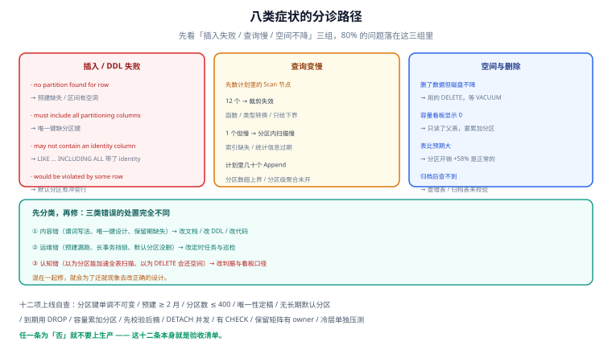

# 常见问题与分诊

这一页按「现象 → 最可能的原因 → 一条能确认的命令」组织。遇到问题时先查症状表，再往下找对应的问答；文末是十二项上线自查，可以直接当验收清单用。

## 判据族声明

本页判据族 `PA-A` ~ `PA-H`，共 8 条。定义表在第六节。

## 本页不讲什么

- 不讲分区键与粒度的推导过程，归 [分区策略](../PartitionStrategy/index.md)。
- 不讲归档流水线的完整实现，归 [在线归档](../OnlineArchive/index.md)。
- 不讲法规口径，归 [保留策略与合规删除](../RetentionCompliance/index.md)。



## 一、八类症状分诊表

| 症状 | 最可能的原因 | 一条确认命令 | 去哪一页 |
| --- | --- | --- | --- |
| 插入报 `no partition of relation "x" found for row` | 下个月的分区没预建，或区间有空洞 | 命令 ①（看最大分区边界） | [分区维护](../PartitionOps/index.md) |
| 查询结果对但明显变慢 | 谓词对分区键做了函数/类型转换 | 命令 ②（数 `Scan` 节点） | [跨分区查询](../CrossPartition/index.md) |
| 建唯一索引/主键报错 | 唯一键没包含分区键 | 命令 ③（看报错原文） | [跨分区查询](../CrossPartition/index.md) |
| `ATTACH` 报 identity / 约束冲突 | 待挂表带 `GENERATED ... AS IDENTITY`，或默认分区有冲突行 | 命令 ④（查 `attidentity`） | [分区维护](../PartitionOps/index.md) |
| `DETACH` 卡住或超时 | 非并发 `DETACH` 拿了父表 `ACCESS EXCLUSIVE`，被长事务挡住 | 命令 ⑤（查阻塞） | [分区维护](../PartitionOps/index.md) |
| 删了历史数据但磁盘没降 | 用的是 `DELETE`，空间留在表里 | 命令 ⑥（看表大小 vs 行数） | [总览](../Overview/index.md) |
| 容量看板显示 0 或恒定值 | 只读了父表 `pg_total_relation_size` | 命令 ⑦（父表 vs 分区累加） | [总览](../Overview/index.md) |
| 归档后审计查不到数据 | 归档只搬未校验，或搬完 `DROP` 且归档表也在冷层未挂载 | 命令 ⑧（查归档表行数） | [在线归档](../OnlineArchive/index.md) |

## 二、十二个高频问题

### 1. 分区到底能让查询快多少？

只有「带分区键的范围查询」会快。本机实测：单月范围 `count(*)` 从 **66.0 ms**（单表全扫）降到 **18.5 ms**（扫 1 个分区），3.6 倍；全表 `count(*)` 反而从 **62.6 ms** 变成 **69.1 ms**（慢 10%）。**如果你的查询都不带时间范围，分区不会带来任何查询收益。**

### 2. 为什么分区之后表反而变大了？

每个分区是独立物理文件，有自己的页头、FSM、索引根页。本机实测同一份数据：单表 93 MB，11 个分区 147 MB，**+58%**。分区数越多，这个比例越高。

### 3. `DELETE` 和 `DETACH` 差多少？

本机实测同一份 10 万行数据：`DELETE` **306.7 ms** + `VACUUM` **103 ms**，表大小从 11 MB 降到 2080 kB；`DETACH` **2.685 ms**，空间立刻归还。**114 倍差距**，且 `DELETE` 还会留下膨胀与 WAL 写入。

### 4. 一定要用默认分区吗？

**不要长期保留。** 它让 `DETACH CONCURRENTLY` 直接不可用（实测报错 `cannot detach partitions concurrently when a default partition exists`），并且 `ATTACH` 新分区时要全表扫默认分区找冲突行（实测报错 `updated partition constraint for default partition ... would be violated by some row`）。只在灰度期用 1~2 个月，且配「行数 > 0 即告警」。

### 5. 分区表能建外键吗？

PostgreSQL 可以（`.pg13` 起支持分区表上的外键，`pg18` 还允许 `NOT VALID` 的外键）。MySQL 不行：**分区 InnoDB 表不支持外键**。跨引擎迁移时这一条最容易漏。

### 6. 一个分区多大合适？

单分区 **1~10 GB** 是经验区间。小于 1 GB 时元数据与规划开销占比高；大于 10 GB 时 `DETACH`、备份、恢复都变重。按月 100 万行、单行 400 B 的表，一个月约 400 MB，**月分区偏小，可以考虑季度分区**——但季度分区会让「删一个月」变成「删一个季度」，取舍要看清理粒度需求。

### 7. 分区数有没有上限？

没有硬上限，但有成本：本机实测**每个分区约 6 µs 规划开销**（11 个分区 0.44 ms、120 个 1.09 ms、365 个 2.55 ms）。真正的问题是**无法裁剪时**：同样是 365 个分区，`WHERE action = ?` 的规划耗时实测 **13.7 ms**，第二次 **51.5 ms**。建议控制在 400 以内，且保证高频查询能裁剪。

### 8. 冷热分离一定要换库吗？

不必。`ALTER TABLE ... SET TABLESPACE` 就能把分区搬到另一块盘，**SQL 一个字都不用改**（本机实测 11 MB 分区搬迁 248 ms，搬完查询 16.3 ms，结果不变）。换库（外部表 / 双写）只在「主库体积影响备份窗口」或「冷数据要被另一类引擎查询」时才值得。

### 9. 归档和备份有什么区别？

备份是**全量时点副本**，用于故障恢复；归档是**按时间段的迁移**，用于降低成本与满足保留策略。两者不能互替：备份里删不掉单条数据（所以合规删除"删不干净"），归档也恢复不了误删的整库。

### 10. 归档之后还能查吗？

能，但入口变了：查 `audit_log_archive`（或 `UNION ALL` 视图），而不是主表。**如果业务方不接受"换入口"，就不要做归档**——只做表空间分层就够了。

### 11. 按用户删除（合规请求）在分区表上怎么做？

`DELETE FROM audit_log WHERE subject_id = ?` 会扫**所有分区**。三个必做：① 每个分区上建 `subject_id` 索引（父表索引会级联）；② 逐分区提交，避免长事务；③ 归档表也要执行同样的删除。这条与"按时间分区"天然冲突，成本要提前算。

### 12. 分区键能不能改？

几乎等于重建表。唯一可行的路径是「建新表 → 双写 → 回填 → 切换 → 删旧表」，与 [分库分表的平滑迁移](/docs/DB/Relational/Sharding/Migration/index.md) 是同一套动作。这也是为什么 [分区策略](../PartitionStrategy/index.md) 把「分区键」列为最难改的决定。

## 三、十二项上线自查

逐条勾，任一条为「否」就不要上生产：

| # | 自查项 | 判定方式 | 对应判据 |
| --- | --- | --- | --- |
| 1 | 分区键单调、不可变、出现在高频查询里 | 命令 ② 结果为 1 | `PS-B` |
| 2 | 分区已预建 ≥ 2 个月，且脚本幂等 | 命令 ①，最后分区边界 ≥ 下下月 | `PO-A` |
| 3 | 分区数 ≤ 400 且可解释 | `count(*)` 分区 = 保留期 × 粒度 | `PS-E` |
| 4 | 唯一性方案已定稿并写进设计文档 | `pg_constraint` 里有含分区键的唯一键，或有明确的「由序列保证」说明 | `PQ-C` |
| 5 | 没有长期保留的默认分区 | 默认分区行数 = 0 或表不存在 | `PO-C` |
| 6 | 所有到期动作都是 `DROP` 而不是 `DELETE` | `grep DETACH/DROP`，无 `DELETE ... WHERE ts <` | `PL-C` |
| 7 | 容量监控累加分区 | 命令 ⑦ 得到非 0 | `PL-D` |
| 8 | 归档流程「先校验后摘」且台账有 evidence | 命令 ⑧ + `retention_log.evidence` | `OA-A` |
| 9 | `DETACH` 使用 `CONCURRENTLY` | `grep DETACH` 全部带 `CONCURRENTLY` | `OA-E` |
| 10 | 待归档分区已建匹配 `CHECK` | `pg_constraint` 有区间约束 | `OA-F` |
| 11 | 保留矩阵覆盖所有大表且每行有 owner | 命令 ⑦ 的表都在矩阵里 | `LC-A` |
| 12 | 冷层延迟单独压测过（清缓存后） | 命令 ⑨ 的 `Buffers read` 显著大于 0 | `HT-E` |

## 四、术语表

| 术语 | 含义 | 最容易混淆的点 |
| --- | --- | --- |
| **分区（partition）** | 一张逻辑表被拆成多个物理表 | 与「分表」不同：分区对应用透明，分表要应用路由 |
| **分区键（partition key）** | 决定一行落在哪个分区的列 | 它同时是「裁剪的依据」和「唯一键的必须成员」 |
| **裁剪（pruning）** | 优化器排除不相关分区的过程 | 发生在计划期与执行期两个时刻，函数包裹会失效 |
| **`ATTACH` / `DETACH`** | 把表挂上/摘下父表 | `DETACH` 不等于删除，数据变成独立表 |
| **默认分区（default partition）** | 兜住所有落不进区间的行 | 它让 `DETACH CONCURRENTLY` 不可用 |
| **冷热分层（tiering）** | 按访问频率把数据放到不同介质 | 与「归档」不同：分层后 SQL 不变，归档要换入口 |
| **归档（archive）** | 把历史数据迁到主库之外 | 归档 ≠ 备份，备份 ≠ 归档 |
| **保留期（retention）** | 数据必须保留的时长 | 法规可能同时要求「至少留」和「不能久留」 |
| **软删（soft delete）** | 用标记代替物理删除 | 合规上不算删除 |
| **膨胀（bloat）** | 删除/更新后留下的死元组占用的空间 | 只有 `VACUUM`（或重写表）能回收 |
| **双向差集** | 两边互相 `EXCEPT` 都为空 | 只比行数发现不了「一漏一多」 |
| **表空间（tablespace）** | 数据文件的存放位置 | 同实例内换盘，不改 SQL |

## 五、如何验证

```shell
# ① 最大分区边界（判断预建是否到位）
docker exec teamboard-sandbox-db-1 psql -U teamboard -d lab160 -tAc \
  "SELECT max(c.relname) FROM pg_class c JOIN pg_inherits i ON i.inhrelid = c.oid
    WHERE i.inhparent = 'ev'::regclass"
```

**预期输出**：形如 `ev_202701`。若小于「下个月」，说明预建任务没跑。

```shell
# ② 裁剪是否生效
docker exec teamboard-sandbox-db-1 psql -U teamboard -d lab160 -tAc \
  "EXPLAIN (COSTS OFF) SELECT count(*) FROM ev WHERE ts >= '2026-03-01' AND ts < '2026-04-01'" \
  | grep -c 'Scan on ev_'
```

**预期输出**：`1`。

```shell
# ③ 唯一键报错原文（确认限制存在）
docker exec teamboard-sandbox-db-1 psql -U teamboard -d lab160 -tAc \
  "CREATE UNIQUE INDEX t_uk ON ev (id)" 2>&1 | grep -o "must include all partitioning columns"
```

**预期输出**：`must include all partitioning columns`。

```shell
# ④ 分区上是否有 identity 列（会导致 ATTACH 失败）
docker exec teamboard-sandbox-db-1 psql -U teamboard -d lab160 -tAc \
  "SELECT count(*) FROM pg_class c JOIN pg_attribute a ON a.attrelid = c.oid
    WHERE c.relname LIKE 'ev_2026%' AND a.attidentity <> ''"
```

**预期输出**：`0`。

```shell
# ⑤ 是否有长事务挡住 DETACH
docker exec teamboard-sandbox-db-1 psql -U teamboard -d lab160 -tAc \
  "SELECT pid, now() - xact_start AS age, state FROM pg_stat_activity
    WHERE xact_start < now() - interval '5 minutes'"
```

**预期输出**：无行。有行时 `DETACH` 会一直等着拿锁。

```shell
# ⑥ 删了数据但空间没降的证据
docker exec teamboard-sandbox-db-1 psql -U teamboard -d lab160 -tAc \
  "SELECT relname, n_live_tup, pg_size_pretty(pg_total_relation_size(relid))
     FROM pg_stat_user_tables WHERE relname = 'ev_202602'"
```

**预期输出**：`n_live_tup` 很小但大小仍是 MB 级 → 膨胀未回收。

```shell
# ⑦ 容量读数（父表 0 vs 分区累加）
docker exec teamboard-sandbox-db-1 psql -U teamboard -d lab160 -tAc \
  "SELECT pg_size_pretty(pg_total_relation_size('ev')),
          pg_size_pretty((SELECT sum(pg_total_relation_size(relid)) FROM pg_partition_tree('ev') WHERE isleaf))"
```

**预期输出**：`0 bytes|111 MB`。

```shell
# ⑧ 归档表是否真的有数据
docker exec teamboard-sandbox-db-1 psql -U teamboard -d lab160 -tAc \
  "SELECT count(*), min(ts), max(ts) FROM ev_archive"
```

**预期输出**：行数与被归档分区相等，时间范围正好是那一个月。

```shell
# ⑨ 冷层真实 IO（清缓存后）
docker exec teamboard-sandbox-db-1 psql -U teamboard -d lab160 -tAc \
  "EXPLAIN (ANALYZE, BUFFERS, COSTS OFF)
   SELECT count(*) FROM ev WHERE ts >= '2026-04-01' AND ts < '2026-05-01'" | grep Buffers
```

**预期输出**：`read` 显著大于 0 才是真实 IO；`read=0` 说明命中页缓存，测不出冷层延迟。

## 六、判据族定义

| 判据 | 规则 | 违反时的样子 | 验证方式 |
| --- | --- | --- | --- |
| `PA-A` | 遇到问题先看分区数与裁剪，再看索引与 SQL | 直接去调索引，方向错了 | 命令 ①② |
| `PA-B` | 「慢」必须先区分「扫了全部分区」与「分区内扫描慢」 | 把裁剪问题当索引问题修 | 命令 ② |
| `PA-C` | 「表变大」必须先看是分区开销还是膨胀 | 误加 `VACUUM FULL` 锁表 | 命令 ⑥⑦ |
| `PA-D` | 「删了没降」必须区分 `DELETE` 与 `DROP` | 反复 `VACUUM` 但空间不降 | 命令 ⑥ |
| `PA-E` | 唯一键报错必须改设计，不能靠去掉约束绕过 | 唯一性失去兜底，出现重复 `id` | 命令 ③ |
| `PA-F` | `ATTACH` 失败先查 identity 与默认分区冲突 | 反复重建表仍失败 | 命令 ④ |
| `PA-G` | 归档后查不到数据必须查「归档表是否有数据 + 是否可访问」 | 以为数据丢了，实际是查错了表 | 命令 ⑧ |
| `PA-H` | 冷热结论必须在清缓存后测，禁止沿用热层读数 | 上线后冷查询超时 | 命令 ⑨ |

::: info 诚实标注
本页所有读数与报错原文来自本机 PostgreSQL 18.6 容器（PG 18.6 / `lab160` 库 / 120 万行合成数据）。第 5 问关于 PostgreSQL 外键支持范围的描述依据官方文档（`pg13` 起分区表支持外键，`pg18` 允许 `NOT VALID` 外键），**未逐版本实测**；MySQL 的「分区表不支持外键」来自 MySQL 8.4 手册。第 6 问的 1~10 GB 是经验区间。
:::

## 参考资料

- [PostgreSQL · Table Partitioning](https://www.postgresql.org/docs/18/ddl-partitioning.html)——分区、裁剪、默认分区的官方定义
- [PostgreSQL · ALTER TABLE](https://www.postgresql.org/docs/18/sql-altertable.html)——`ATTACH` / `DETACH` 的报错条件
- [PostgreSQL · Routine Vacuuming](https://www.postgresql.org/docs/18/routine-vacuuming.html)——膨胀与空间回收
- [MySQL 8.4 · Partitioning Limitations](https://dev.mysql.com/doc/refman/8.4/en/partitioning-limitations.html)——外键与唯一键限制
- 本站 [分库分表 · 平滑迁移](/docs/DB/Relational/Sharding/Migration/index.md) · [索引失效场景](/docs/DB/Relational/MySQL/IndexDeepDive/IndexFailure/index.md)
- 相邻：[总览](../Overview/index.md) · [实战](../Practice/index.md)
