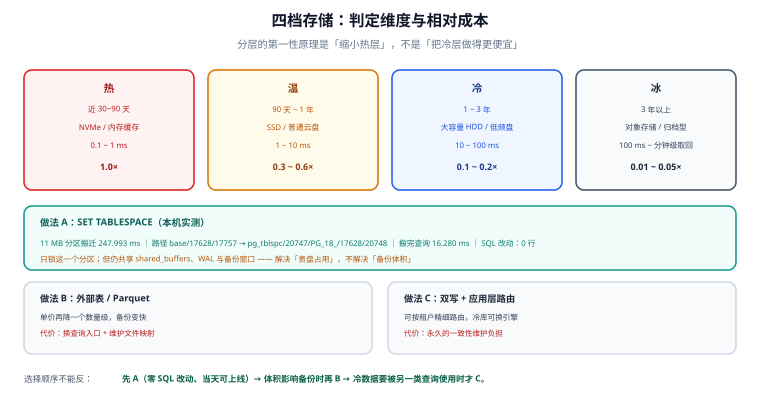

# 冷热分层：四档存储与成本账

「冷热分离」最容易被做成一件看起来很专业、实际没有收益的事：把数据搬到另一个库、改了一堆查询、结果一年省下的钱还不够一次故障的工时。这一页先把「怎么判定冷热」讲清楚（因为大多数团队判错了），再讲三种分层做法各自的代价，最后把成本按 GB·月 摊开算一遍。

## 判据族声明

本页判据族 `HT-A` ~ `HT-H`，共 8 条。定义表在第八节。

## 本页不讲什么

- 不讲「搬走之后怎么删」，归 [在线归档](../OnlineArchive/index.md)。
- 不讲保留期与合规，归 [保留策略与合规删除](../RetentionCompliance/index.md)。
- 不讲压缩算法与列存格式的细节，归 [ClickHouse 专题](/docs/DB/ClickHouse/index.md)。



## 一、四档不是按「时间」分的

大多数团队用「90 天前 = 冷」这种单维度规则。真实的分层依据有四个，缺一个就会分错：

| 维度 | 问题 | 为什么必须问 |
| --- | --- | --- |
| **访问频率** | 这段数据每周被查几次？ | 决定「放哪一层」的主因，但**不能只看总量**——要看到「谁在查、查多少行」 |
| **延迟容忍** | 查询能在 3 秒内返回吗？ | 对象存储的首次字节延迟是毫秒级的几十倍，交互式页面无法接受 |
| **保留义务** | 法规 / 合同要求留多久？ | 合规期内的数据即使「不查」也不能删，只能放冷层 |
| **成本差** | 两层之间的单价差多少？ | 差价小于运维成本时，分层没有意义 |

四档的典型形态：

| 档位 | 典型介质 | 访问延迟量级 | 相对单价 | 放什么 |
| --- | --- | --- | --- | --- |
| **热** | 本地 NVMe / 内存缓存 | 0.1 ~ 1 ms | 1× | 近 30~90 天，交互式查询 |
| **温** | 本地 SSD / 普通云盘 | 1 ~ 10 ms | 0.3 ~ 0.6× | 90 天 ~ 1 年，报表与排障 |
| **冷** | 大容量 HDD / 低频云盘 | 10 ~ 100 ms | 0.1 ~ 0.2× | 1 ~ 3 年，审计追溯 |
| **冰** | 对象存储（标准 / 归档型） | 100 ms ~ 分钟级（取回） | 0.01 ~ 0.05× | 3 年以上，只在被问到时才取 |

::: warning 「时间」只是代理指标
用「90 天前的数据就是冷数据」做规则，在两类系统上必然错：**① 财务/对账系统**：去年的数据每个月结账都要全量扫一遍；**② 审计/风控系统**：三年前的一条记录可能因为一次投诉被反复调取。这两类系统的「冷」应该按**访问模式**判定，而不是按时间。
:::

## 二、冷热判定：三种证据，只有一种长期有效

| 证据来源 | 能回答什么 | 生命周期 | 可信度 |
| --- | --- | --- | --- |
| `pg_stat_user_tables`（`seq_scan` / `idx_scan` / `last_*_scan`） | 最近有没有人扫过这个分区 | **重启或崩溃后清零** | 短期参考 |
| 数据库访问日志 / `pg_stat_statements` | 哪些 SQL 打到了哪些表 | 取决于日志保留（通常 1~7 天） | 中期 |
| **业务侧埋点 / 网关访问日志** | 谁在什么时候查了哪个时间段的数据 | 与日志平台同寿（月~年） | **长期，唯一可用于分层决策** |

本机实测第一条的局限：

```sql
SELECT relname, seq_scan, idx_scan, last_seq_scan, last_idx_scan
  FROM pg_stat_user_tables WHERE relname LIKE 'ev_2026%' ORDER BY relname LIMIT 3;
```

刚 `ANALYZE` 完的表，`seq_scan` 可能是 0——不是没人查，而是**统计被重置过**。用这个数字决定「这个分区可以搬走」，等于用「今天有没有下雨」推断「这里是不是沙漠」。

正确做法是把三层证据叠起来，形成一张**分区级访问台账**：

| 分区 | 行数 | 大小 | 近 30 天查询次数（埋点） | 近 30 天扫描行数（`pg_stat_statements`） | 最近一次查询时间（日志） | 判定 |
| --- | --- | --- | --- | --- | --- | --- |
| `ev_202610` | 10.3 万 | 9.7 MB | 12,400 | 2.1 亿 | 2 分钟前 | 热 |
| `ev_202607` | 10.3 万 | 9.7 MB | 320 | 180 万 | 3 天前 | 温 |
| `ev_202601` | 10.3 万 | 9.7 MB | 4 | 4,000 | 5 周前 | 冷 |
| `ev_202506`（已归档） | —— | —— | 0 | 0 | 从未 | 冰 |

## 三、三种分层做法与各自的代价

### 做法 A：`SET TABLESPACE`（同库、SQL 不变）

把某个分区整体搬到另一块盘上：

```sql
CREATE TABLESPACE cold_slow LOCATION '/pgcold';
ALTER TABLE ev_202604 SET TABLESPACE cold_slow;
```

本机实测：

| 观测项 | 读数 |
| --- | --- |
| `ALTER TABLE ... SET TABLESPACE` 耗时（11 MB / 99,693 行） | **247.993 ms** |
| 物理路径变化 | `base/17628/17757` → `pg_tblspc/20747/PG_18_202506291/17628/20748` |
| 搬完之后查询 | **16.280 ms**（`SELECT count(*)` 落在一个分区上） |
| 需要的 SQL 改动 | **零** |

关键优势：**只锁这一个分区**，其他分区照常读写；SQL 完全不变，ORM 与报表都不用改。代价是仍然在同一个实例上（共享 `shared_buffers`、共享 WAL、共享备份窗口），所以它解决的是「贵盘占用」，不解决「备份体积」。

### 做法 B：外部表 / 归档文件（跨系统）

导出成 Parquet 放对象存储，用 `pg_parquet`、ClickHouse、DuckDB 或 Spark 读回来：

| 优势 | 代价 |
| --- | --- |
| 单价再降一个数量级 | **查询要换入口**（不能再用原来的 SQL 直接 `SELECT`） |
| 主库体积真正下降，备份变快 | 需要维护「哪段数据在哪个文件」的映射 |
| 可以按列裁读（只读需要的列） | 点查一条记录要从上百 MB 文件里捞 |

### 做法 C：应用层双写 / 路由（逻辑分层）

写入时同时写热库与冷库，查询时按时间路由：

| 优势 | 代价 |
| --- | --- |
| 可以按租户/业务线精细路由 | **两次写入的失败处理**是新的分布式事务问题 |
| 冷库可以选完全不同的引擎（列存、搜索） | 跨层查询要应用层归并（分页、排序、去重） |
| 冷库可独立扩容 | 一致性校验变成长期负担 |

::: danger 三种做法的选择顺序不能反
1. **先做 A**（表空间）：零 SQL 改动、可回滚、当天能上线。
2. **数据量超过单机容量或备份窗口**时再做 B（外部表）：这时「换入口」的代价才值得。
3. **只有当冷数据要被另一类查询（全文检索、聚合分析）使用时**才做 C。

反过来做（一上来就双写 + 路由）是最常见的失败路径：为了省 20% 存储成本，引入了一个永久的一致性维护负担。
:::

## 四、成本账：按 GB·月 摊开

假设 38 GB 审计日志（12 个月 × 3.2 GB），当前全在热层：

| 方案 | 热层 | 温层 | 冷层 | 月成本（示意） | 相对 |
| --- | --- | --- | --- | --- | --- |
| 全热 | 38 GB | —— | —— | 38 × 1.0 = 38 单位 | 100% |
| 90 天热 + 其余温 | 9.5 GB | 28.5 GB | —— | 9.5 + 28.5 × 0.4 = 20.9 | 55% |
| 90 天热 + 1 年温 + 历史冷 | 9.5 GB | 19 GB | 9.5 GB | 9.5 + 7.6 + 0.95 = 18.05 | 48% |
| 90 天热 + 其余冰（对象存储） | 9.5 GB | —— | 28.5 GB | 9.5 + 28.5 × 0.03 = 10.36 | 27% |

四点读法：

1. **收益主要来自「热层缩小」**，而不是「冷层有多便宜」。把 38 GB 全搬到冰层只能省 97%，但查询全废；把热层从 38 GB 压到 9.5 GB 就已经省了 45%。
2. **单价是示意量级**（比例来自公开的云盘/对象存储价目，绝对数字随厂商与地域变化），用自己账单里的「元/GB·月」替换即可。
3. **不要忘了请求成本与取回成本**：对象存储按请求计费，冷归档还有取回费与解冻时间。小文件多、查询频繁时，「便宜」会被请求费吃回去。
4. **运维成本要计入**：每多一层就多一套监控、一套校验、一套告警。分层方案的盈亏平衡点，通常在「每月节省 ≥ 0.5 人天」的量级。

## 五、分层之后，查询会变慢多少

这是最容易被忽略的一侧：数据搬到慢盘，**查询延迟会变**。

| 场景 | 热层 | 冷层 | 影响 |
| --- | --- | --- | --- |
| 分区裁剪后的范围 `count(*)` | 18.8 ms | 16.3 ms（本机，同一台机器的另一目录） | **无差异**（预热后都在页缓存里） |
| 冷启动后的首次扫描 | 数十 ms | 数百 ms ~ 数秒 | 明显（需要真实 IO） |
| 按主键点查（有索引） | < 1 ms | 1 ~ 10 ms | 可接受 |
| 跨冷热两层的 `UNION` 报表 | —— | —— | 木桶效应：整条查询按最慢那层算 |

本机 `SET TABLESPACE` 后的 16.3 ms 并不能证明「冷层不慢」——因为 `/pgcold` 和主数据目录在**同一块物理盘**上，页缓存也是同一份。真实环境把冷层放到 HDD 或网络存储后，冷启动首次扫描会明显变慢，这一点**必须在压测里单独测**（清 `shared_buffers` 后跑，见验证命令 ⑥）。

## 六、如何验证

```shell
# ① 每个分区落在哪个表空间（分层的实际状态）
docker exec teamboard-sandbox-db-1 psql -U teamboard -d lab160 -tAc \
  "SELECT c.relname, COALESCE(t.spcname,'pg_default') AS tablespace, pg_relation_filepath(c.oid)
     FROM pg_class c LEFT JOIN pg_tablespace t ON t.oid = c.reltablespace
    WHERE c.relname LIKE 'ev_2026%' ORDER BY c.relname LIMIT 4"
```

**预期输出**：大部分分区的 `tablespace` 为 `pg_default`，被搬走的分区显示 `cold_slow`，路径以 `pg_tblspc/` 开头。

```shell
# ② 搬走之后查询是否仍然正确（分层不改 SQL）
docker exec teamboard-sandbox-db-1 psql -U teamboard -d lab160 -tAc \
  "SELECT count(*) FROM ev WHERE ts >= '2026-04-01' AND ts < '2026-05-01'"
```

**预期输出**：与搬走前的行数完全一致（本例 99693）。若不一致，说明搬动过程中有数据丢失。

```shell
# ③ 表空间实际占用的磁盘（对账用）
docker exec teamboard-sandbox-db-1 sh -c "du -sh /pgcold; du -sh /var/lib/postgresql/18/docker 2>/dev/null || du -sh /var/lib/postgresql"
```

**预期输出**：`/pgcold` 下应有与被搬走分区总大小相当的体积。两个数字长期不匹配，说明 `SET TABLESPACE` 中途失败过（它会留下临时文件）。

```shell
# ④ 三层证据是否齐全（分层决策的依据）
docker exec teamboard-sandbox-db-1 psql -U teamboard -d lab160 -tAc \
  "SELECT relname, seq_scan, idx_scan, last_idx_scan FROM pg_stat_user_tables
    WHERE relname LIKE 'ev_2026%' ORDER BY relname LIMIT 3"
```

**预期输出**：有计数与最近时间。**若全为 0 或时间为空，不能据此分层**——去查埋点与访问日志。

```shell
# ⑤ 冷分区的索引是否还留着（占空间但没用）
docker exec teamboard-sandbox-db-1 psql -U teamboard -d lab160 -tAc \
  "SELECT indexrelid::regclass, pg_size_pretty(pg_relation_size(indexrelid))
     FROM pg_index WHERE indrelid = 'ev_202604'::regclass"
```

**预期输出**：冷分区通常只保留 `(ts)` 一个索引。多个索引时，评估「为冷查询保索引」是否值得。

```shell
# ⑥ 冷层真实 IO 性能（清缓存后测，别在预热状态下结论）
docker exec teamboard-sandbox-db-1 psql -U teamboard -d lab160 -tAc \
  "DISCARD ALL;
   EXPLAIN (ANALYZE, BUFFERS, COSTS OFF)
   SELECT count(*) FROM ev WHERE ts >= '2026-04-01' AND ts < '2026-05-01'" | grep -E "Buffers|Execution"
```

**预期输出**：`Buffers: shared hit=... read=...`。`read` 显著大于 0 时才是真实磁盘 IO 读数；`read=0` 说明全在页缓存里，测不出冷层延迟。

```shell
# ⑦ 是否有跨层的 `UNION` 报表（木桶效应）
grep -rn "UNION.*archive\|UNION.*cold" src/main/resources/mapper/*.xml 2>/dev/null | head -5
```

**预期输出**：无输出，或明确标注为「离线报表」。交互式接口里出现冷热 `UNION`，延迟会被冷层拖住。

```shell
# ⑧ 分层规则是否写在配置里（而不是代码里）
grep -rn "tablespace\|cold_after_days\|hot_days" config/ deploy/ 2>/dev/null | head -5
```

**预期输出**：至少一条命中。写死在代码里的分层阈值，改一次要发一次版。

## 七、判据族定义

| 判据 | 规则 | 违反时的样子 | 验证方式 |
| --- | --- | --- | --- |
| `HT-A` | 冷热判定必须用「访问频率 + 延迟容忍 + 保留义务 + 成本差」四维，不能只看时间 | 财务/审计数据被误判为冷数据，月结时全表扫冷盘 | 命令 ④ |
| `HT-B` | 判定证据必须含业务侧埋点或访问日志，不能只靠 `pg_stat_*` | 重启后统计清零，分层决策全部失效 | 命令 ④ |
| `HT-C` | 分层优先用 `SET TABLESPACE`（零 SQL 改动、只锁单分区） | 一上来就做双写 + 路由，引入永久一致性负担 | 命令 ①② |
| `HT-D` | 搬动后必须校验行数与大小 | 搬动中断留下不完整分区 | 命令 ②③ |
| `HT-E` | 冷层的查询延迟必须单独压测（清缓存后测），不能沿用热层读数 | 上线后冷查询超时，被当成「偶发慢」 | 命令 ⑥ |
| `HT-F` | 冷分区只保留必要索引 | 冷分区上挂着 4 个索引，占空间且拖慢恢复 | 命令 ⑤ |
| `HT-G` | 禁止在交互式接口里做跨冷热层的 `UNION` | 延迟按最慢层算，P99 突然抬升 | 命令 ⑦ |
| `HT-H` | 分层阈值必须是可执行配置，且有 owner | 阈值写死在代码里，改一次发一次版 | 命令 ⑧ |

::: info 诚实标注
`SET TABLESPACE` 的 247.993 ms、路径变化与 16.280 ms 查询耗时均为本机 PostgreSQL 18.6 实测。**本机冷表空间与主数据目录在同一块物理盘**，因此这两条读数不能证明「冷层不慢」；第四节单价为示意比例（来自公开价目量级，非报价），第五节的分层后延迟差异除「同盘」一条外均为量级推断，需在真实介质上用命令 ⑥ 复测。
:::

## 与「对象存储工程」专题的分工（第 173 天补充）

| 问题 | 归本页 | 归[文件与对象存储工程](../../../Backend/ObjectStorage/index.md) |
| --- | --- | --- |
| 库内分区、冷数据下沉、归档表 | ✅ | — |
| 对象级分层（存储类、最小存储期、解冻） | — | ✅ [生命周期与分层成本](../../../Backend/ObjectStorage/LifecycleCost/index.md) |
| 「哪些行该归档」的判定 | ✅ | — |
| 「归档后的那份对象放哪一层、什么时候删」 | — | ✅ [生命周期与分层成本](../../../Backend/ObjectStorage/LifecycleCost/index.md) |

一句话边界：本页的粒度是**分区/表**，专题的粒度是**对象**；两者的时间轴不同步就会同时付两份钱。

::: danger 本页特有的坑：库内归档了，桶里还是热的
典型组合是：`board_events` 按 13 个月 `DETACH` 分区并导出成 Parquet 传到对象存储，但**没有给这个前缀配生命周期**。结果：
- 库里空间释放了（看起来归档成功）；
- 对象存储里那份 Parquet 一直留在 Standard，按 13 个月 × 每月新增量线性增长；
- 三个月后有人问「归档到底省了多少」，答案是「只省了库的，没省桶的」。

归档动作必须成对：`DETACH` 与「给导出前缀配 Transition + Expiration」写在同一次变更里。
:::

## 与「实时风控决策」的分工（第 204 天补充）

第 38 行提到「审计/风控的冷数据会被反复调取」，风控侧的完整口径在这里补齐——决策日志的分层不能只按时间，要按**三种访问模式**分别定：

| 访问模式 | 典型时效 | 谁在查 | 该放哪一层 |
| --- | --- | --- | --- |
| 幂等重放 | 24 小时内 | 决策服务自己（`decision_id` 查结果） | **热**：主库 / KV，带 TTL，见[在线服务](../../../Backend/RiskDecision/Serving/index.md) |
| 客诉与申诉 | 90 天~1 年 | 人工审核、客服 | **温**：按 `created_at` 月分区，索引 `(subject_id, created_at)` |
| 抽样复核与模型回溯 | 1~3 年 | 数据团队 | **冷**：列存/对象存储，按 `scene + 月` 分区 |
| 监管调取 | 按行业要求（常见 5 年） | 合规 | **冷 + 只读副本**，不可删 |

两条只有风控才有的约束：

1. **「热」层的 TTL 是正确性的一部分，不只是性能优化**。幂等记录过期后重算，正是我们要的行为（见[幂等与状态机](../../../Backend/IdempotencyStateMachine/index.md)）；如果为了「省查询」把 TTL 设成 30 天，风控会拿 30 天前的名单继续判今天的人。
2. **`hits[]` 与 `score` 不能归档时丢**。归档表如果只留 `decision_id + action`，一年后的客诉就再也解释不了「当时为什么拦」，而这恰恰是[案件与审核](../../../Backend/RiskDecision/CaseReview/index.md)唯一需要的东西。

## 参考资料

- [PostgreSQL · CREATE TABLESPACE](https://www.postgresql.org/docs/18/sql-createtablespace.html)——表空间的位置约束与权限
- [PostgreSQL · ALTER TABLE · SET TABLESPACE](https://www.postgresql.org/docs/18/sql-altertable.html)——重写文件与锁级别
- [PostgreSQL · Monitoring Database Activity](https://www.postgresql.org/docs/18/monitoring-stats.html)——`pg_stat_user_tables` 各计数器的重置条件
- [PostgreSQL · pg_stat_statements](https://www.postgresql.org/docs/18/pgstatstatements.html)——按 SQL 聚合的访问证据
- 本站 [容量规划与成本治理](/docs/Ops/CapacityCost/index.md) · [附件直传与存储](/docs/Frontend/RichTextEditor/PasteSanitize/index.md)
- 相邻：[在线归档](../OnlineArchive/index.md) · [保留策略与合规删除](../RetentionCompliance/index.md)
