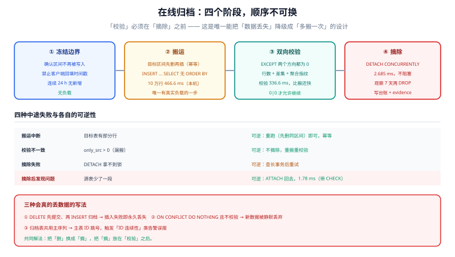

# 在线归档：不停机搬走一段历史

归档的定义只有一句：**把一段历史数据从主表搬到别处，并证明搬完之后「主表少的那部分」与「别处多的那部分」完全相等**。第三句最容易被跳过，而它恰好是唯一能证明「数据没丢」的部分。

这一页给出一条可以照着执行的流水线：冻结边界 → 搬运 → 双向校验 → 摘除 → 可回滚，全部操作都不停业务。

## 判据族声明

本页判据族 `OA-A` ~ `OA-H`，共 8 条。定义表在第八节。

## 本页不讲什么

- 不讲冷热分层的存储选型与成本账，归 [冷热分层](../HotColdTiering/index.md)。
- 不讲「搬到哪里之后怎么删」，归 [保留策略与合规删除](../RetentionCompliance/index.md)。
- 不讲 CDC 的 binlog 解析细节，归 [数据同步与 CDC](/docs/DB/CDC/index.md)。



## 一、两条路线：整段搬 vs 持续同步

| 路线 | 做法 | 适用 | 代价 |
| --- | --- | --- | --- |
| **整段搬（分区）** | `DETACH` 或 `INSERT ... SELECT` 一整个时间区间 | 数据已分区，边界清晰 | 需要一个「冻结边界」的约定 |
| **持续同步（CDC）** | 订阅 binlog / WAL，实时把变更写到归档库 | 未分区的大表、要跨库、要近实时 | 运维复杂（位点、DDL 同步、重复消费） |

判据很简单：**如果表已经按时间分区，用整段搬；如果没有分区、又要持续归档，先做分区再做归档**。CDC 不是「更先进」，它只是「没有清晰边界时的替代品」。

本页只讲整段搬，因为它是唯一能做到「毫秒级摘除 + 双向可证」的路线。

## 二、四阶段流水线

### 阶段 1：冻结边界

**边界必须是「已过去、且不会再被写入」的区间。** 归档 2026-01 的数据，前提是「2026-01 的分区不再接收写入」——这一点由分区保证（区间外的行进不来），但有一个例外：**允许客户端回填历史时间戳**。如果 `created_at` 可以由客户端传入，那么 1 月的数据随时可能新增，任何归档都是错的。

冻结边界的三个检查：

```sql
-- ① 边界之后是否还有写入（按分区看最近插入的最大时间）
SELECT tableoid::regclass, max(ts) FROM ev
 WHERE ts < '2026-02-01' GROUP BY 1;
-- ② 应用侧是否允许回填历史时间（查插入语句，不让客户端传 created_at）
-- ③ 该分区的写入是否已经停止（连续 24 小时无新增）
```

### 阶段 2：搬运

```sql
-- 归档表：同结构、只留必要索引、独立表空间
CREATE TABLE ev_archive (LIKE ev_202601 INCLUDING DEFAULTS INCLUDING CONSTRAINTS);
CREATE INDEX ev_archive_ts_idx ON ev_archive (ts);

-- 搬运（幂等：先删目标区间的同主键行，再插）
BEGIN;
DELETE FROM ev_archive WHERE ts >= '2026-01-01' AND ts < '2026-02-01';
INSERT INTO ev_archive SELECT * FROM ev_202601;
COMMIT;
```

本机实测：`INSERT ... SELECT` 搬 **103,016 行 / 9.7 MB** 耗时 **466.632 ms**。这个量级意味着：

| 数据量 | 预计搬运耗时 | 建议批次 |
| --- | --- | --- |
| 10 万行 | ~0.5 s | 单批 |
| 1000 万行 | ~45 s | 单批可接受（在低峰） |
| 1 亿行 | ~8 分钟 | 按 500 万行分批，批间让出 IO |

`INSERT ... SELECT` 会写 WAL、会占 `shared_buffers`、会和业务争 IO。**它是整个流程里唯一有真实负载的一步**，所以要放在低峰、要能中断续跑。

三条纪律：

1. **不要 `INSERT` 完立刻 `DELETE` 源表**：先校验，校验通过再摘。
2. **目标表先删同区间**：保证重跑幂等（搬一半失败、重跑不会双份）。
3. **不要 `ORDER BY`**：搬运不需要顺序，排序只会多一次临时文件。

### 阶段 3：双向校验

```sql
SELECT (SELECT count(*) FROM (SELECT * FROM ev_202601 EXCEPT SELECT * FROM ev_archive) x) AS only_src,
       (SELECT count(*) FROM (SELECT * FROM ev_archive EXCEPT SELECT * FROM ev_202601) y) AS only_dst,
       (SELECT count(*) FROM ev_archive) AS archived;
```

本机实测：

| 指标 | 读数 | 含义 |
| --- | --- | --- |
| `only_src` | **0** | 源有、目标无 → 漏搬 |
| `only_dst` | **0** | 目标有、源无 → 搬错 / 目标脏数据 |
| `archived` | **103,016** | 与源行数相等 |
| 校验耗时 | **336.618 ms** | 比搬运本身还快（无 WAL） |

三个方向都要有：

| 校验 | 查什么 | 不做的后果 |
| --- | --- | --- |
| **行数** | `count(*)` 相等 | 只能发现「总量错了」，发现不了「一漏一多」 |
| **双向差集** | 两边互相 `EXCEPT` 为空 | 逐行精确，代价是一次全扫 |
| **聚合指纹** | `sum(hashtext(t::text))` 或 `md5(string_agg(...))` | 大数据量时代替差集（差集在 1 亿行上太贵） |

::: tip 大数据量下的校验替代
`EXCEPT` 在千万行以上会显著变慢（要排序或哈希全量）。替代方案是按**分区/批次**分块校验：每 100 万行算一次 `sum(hashtext(row::text))`，两边逐块比对；不一致时再对那一块做精确差集。这样把一次全量比对变成 N 次小比对，失败时还能定位到具体块。
:::

### 阶段 4：摘除

校验通过之后才是摘：

```sql
-- 推荐：不阻塞（前提：无默认分区、不在事务块内）
ALTER TABLE ev DETACH PARTITION ev_202601 CONCURRENTLY;
-- 或者：归档表已独立存在，直接把分区丢掉
DROP TABLE ev_202601;
```

**`DETACH` 与 `DROP` 的区别**：`DETACH` 保留数据（分区变成独立表），适合「先留着观察一周」；`DROP` 直接删文件，适合「归档表已验证、源分区不再需要」。生产上通常先 `DETACH`，观察 7 天后再 `DROP`。

## 三、回滚：`ATTACH` 回去有多快

归档做错了要回滚。回滚的代价取决于**你有没有给待挂的表加匹配的 `CHECK` 约束**：

```sql
-- 带 CHECK：1.78 ms（数据库相信约束，跳过全表校验）
ALTER TABLE ev_202601 ADD CONSTRAINT ev_202601_ts_ck
  CHECK (ts >= '2026-01-01' AND ts < '2026-02-01');
ALTER TABLE ev ATTACH PARTITION ev_202601
  FOR VALUES FROM ('2026-01-01') TO ('2026-02-01');

-- 不带 CHECK：11.58 ms（全表扫描校验 103,016 行）
```

| 写法 | 103,016 行 | 1 亿行（推算） |
| --- | --- | --- |
| 带匹配 `CHECK` | 1.78 ms | 毫秒级 |
| 不带 `CHECK` | 11.58 ms | 分钟级（全表 IO） |

所以归档流程里有一件必须做的事：**在 `DETACH` 之前就给分区加上 `CHECK` 约束**（它同时也让日后的回挂变快）。这条约束对业务无感，只多占一点元数据。

## 四、失败处理：四种中途失败

| 失败点 | 现象 | 处置 |
| --- | --- | --- |
| 搬运中断 | 目标表有部分行 | 重跑（目标表先删同区间 → 幂等） |
| 校验不一致 | `only_src > 0` | **不要摘**；重跑搬运，再校验 |
| 摘除失败 | `DETACH` 报锁超时 | 重试；仍失败则查长事务（`pg_stat_activity`） |
| 摘除后发现问题 | 已 `DETACH`，源表少了一段 | `ATTACH` 回去（毫秒级），再排查 |

第四条是这套流程最大的价值：**因为「校验」在「摘除」之前，所以最坏情况只是「多搬了一次」，而不是「数据没了」**。反过来（先删后搬）一旦失败就是不可逆的。

::: danger 三种会真的丢数据的写法
1. **`DELETE` 之后再 `INSERT` 到归档表**：删除已提交、插入失败，数据永久丢失。
2. **`INSERT` 用 `ON CONFLICT DO NOTHING` 却不校验**：目标表已有脏数据时，新数据被静默丢弃，校验只看行数会「碰巧相等」。
3. **归档表与源表共用主键序列**：归档表的 `id` 默认值会消耗主序列，导致主表 ID 跳号（不影响正确性，但会让「ID 连续性」类告警误报）。
:::

## 五、归档表怎么设计

| 决策 | 建议 | 理由 |
| --- | --- | --- |
| 结构 | 与源分区**完全一致**（列、类型、顺序） | 保证 `ATTACH` 能挂回去 |
| 索引 | 只留 `(时间)` 一个 | 归档表主要按时间范围查；多索引让体积与恢复时间翻倍 |
| 分区 | **不要**再分区 | 归档表通常是「一次写入、很少读」，再分区只会增加维护 |
| 表空间 | 放冷层 | 见 [冷热分层](../HotColdTiering/index.md) |
| 命名 | `源表名_archive`（不按年月） | 按年月建表会让「查历史」变成「先找表名」 |
| 约束 | 保留 `NOT NULL` 与 `CHECK`，**去掉外键** | 外键指向的主表可能已经删了那些行 |

如果归档数据要跨年保留，一张 `ev_archive` 会重新变成大表——这时按年拆成 `ev_archive_2025`、`ev_archive_2026`，并在上面建一个 `UNION ALL` 视图供查询。

## 六、如何验证

```shell
# ① 搬运是否幂等（连跑两次，行数不变）
docker exec teamboard-sandbox-db-1 psql -U teamboard -d lab160 -tAc \
  "BEGIN;
   DELETE FROM ev_archive WHERE ts >= '2026-01-01' AND ts < '2026-02-01';
   INSERT INTO ev_archive SELECT * FROM ev_202601;
   COMMIT;
   SELECT count(*) FROM ev_archive;"
```

**预期输出**：两次都是 `103016`。第二次变大说明幂等被破坏（缺 `DELETE` 前置）。

```shell
# ② 双向差集必须为 0
docker exec teamboard-sandbox-db-1 psql -U teamboard -d lab160 -tAc \
  "SELECT (SELECT count(*) FROM (SELECT * FROM ev_202601 EXCEPT SELECT * FROM ev_archive) a),
          (SELECT count(*) FROM (SELECT * FROM ev_archive EXCEPT SELECT * FROM ev_202601) b)"
```

**预期输出**：`0|0`。任一非 0 都禁止摘除。

```shell
# ③ 摘除是否用了并发模式
grep -rn "DETACH PARTITION" scripts/archive/ 2>/dev/null
```

**预期输出**：都带 `CONCURRENTLY`。不带的必须写明「维护窗口执行」。

```shell
# ④ 回挂的 CHECK 约束是否已提前建好
docker exec teamboard-sandbox-db-1 psql -U teamboard -d lab160 -tAc \
  "SELECT conname FROM pg_constraint WHERE conrelid = 'ev_202601'::regclass AND contype = 'c'"
```

**预期输出**：至少一条形如 `ev_202601_ts_ck` 的区间约束。没有它，回挂要全表扫描。

```shell
# ⑤ 归档表索引数量（应为 1）
docker exec teamboard-sandbox-db-1 psql -U teamboard -d lab160 -tAc \
  "SELECT count(*) FROM pg_index WHERE indrelid = 'ev_archive'::regclass"
```

**预期输出**：`1`。多索引只增加体积。

```shell
# ⑥ 归档任务是否有「先校验后摘」的顺序（代码级检查）
grep -n "EXCEPT\|DETACH" scripts/archive/run.sh 2>/dev/null
```

**预期输出**：`EXCEPT` 出现在 `DETACH` 之前。顺序反了就是「先删后验」。

```shell
# ⑦ 归档后主表是否真的变小（空间归还）
docker exec teamboard-sandbox-db-1 psql -U teamboard -d lab160 -tAc \
  "SELECT pg_size_pretty(sum(pg_total_relation_size(relid))) FROM pg_partition_tree('ev') WHERE isleaf"
```

**预期输出**：比归档前少一个分区的体积（本机约 9.7 MB）。没变小说明 `DETACH` 没成功或数据还在。

```shell
# ⑧ 归档表能否被业务查到（可访问性）
docker exec teamboard-sandbox-db-1 psql -U teamboard -d lab160 -tAc \
  "SELECT count(*) FROM ev_archive WHERE ts >= '2026-01-15' AND ts < '2026-01-16'"
```

**预期输出**：一个非零的行数。归档数据必须能被查回来，否则只是「换了个地方丢」。

## 七、判据族定义

| 判据 | 规则 | 违反时的样子 | 验证方式 |
| --- | --- | --- | --- |
| `OA-A` | 归档必须「先校验后摘除」，顺序不可反 | 数据静默丢失，事后无法恢复 | 命令 ⑥ |
| `OA-B` | 边界必须是「已冻结」的区间，且禁止客户端回填历史时间戳 | 已归档分区又开始长数据 | 见第二节阶段 1 |
| `OA-C` | 搬运必须幂等（目标区间先删再插） | 重跑产生双份数据 | 命令 ① |
| `OA-D` | 校验必须双向差集（或分块指纹），不能只看行数 | 一漏一多时行数相等，误判通过 | 命令 ② |
| `OA-E` | `DETACH` 必须用 `CONCURRENTLY`（或有维护窗口说明） | 摘除时业务读写被阻塞 | 命令 ③ |
| `OA-F` | 待归档分区必须提前建匹配的 `CHECK` 约束 | 回滚 `ATTACH` 从毫秒变分钟 | 命令 ④ |
| `OA-G` | 归档表只保留时间索引，且不再分区 | 归档表体积与恢复时间翻倍 | 命令 ⑤ |
| `OA-H` | 归档数据必须可查回（有查询入口与验证） | 「归档」实际是「丢弃」 | 命令 ⑧ |

::: info 诚实标注
搬运 466.632 ms、校验 336.618 ms、`ATTACH` 1.78 ms / 11.58 ms、`DETACH` 2.685 ms 均为本机 PostgreSQL 18.6 实测（103,016 行 / 9.7 MB 分区）。「1 亿行约 8 分钟」是按本机吞吐线性外推，**未实测**；实际会因 WAL、索引数量、IO 带宽明显偏离。真实生产建议先用 100 万行做基准，再按数据量放大估算。
:::

## 参考资料

- [PostgreSQL · Table Partitioning · Maintenance](https://www.postgresql.org/docs/18/ddl-partitioning.html#DDL-PARTITIONING-MAINTENANCE)——`DETACH` 与 `ATTACH` 的语义与限制
- [PostgreSQL · ALTER TABLE](https://www.postgresql.org/docs/18/sql-altertable.html)——`ATTACH` 时 `CHECK` 约束如何跳过校验
- [PostgreSQL · INSERT](https://www.postgresql.org/docs/18/sql-insert.html)——`INSERT ... SELECT` 的 WAL 与批处理
- [PostgreSQL · Routine Vacuuming](https://www.postgresql.org/docs/18/routine-vacuuming.html)——为什么「删」不等于「空间归还」
- 本站 [数据同步与 CDC](/docs/DB/CDC/index.md) · [备份与恢复](/docs/DB/Relational/PostgreSQL/BackupRestore/index.md)
- 相邻：[冷热分层](../HotColdTiering/index.md) · [保留策略与合规删除](../RetentionCompliance/index.md)
