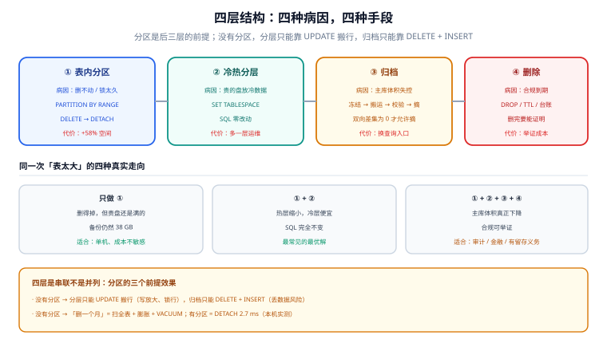
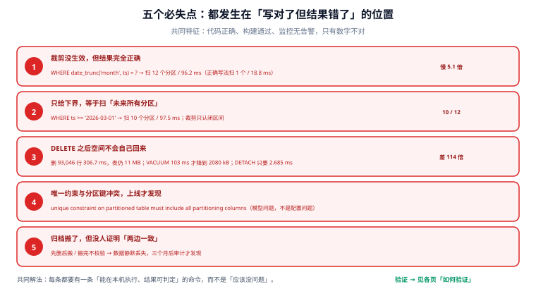

# 总览：四层结构与五个必失点

「表太大」是症状，不是问题。真实的病因有四种：**删不动**（历史数据要清，`DELETE` 越跑越慢）、**搬不走**（冷数据占着最贵的盘）、**算不清**（不知道哪个时间段占了多少空间）、**锁太久**（清理任务一跑，业务就超时）。这四种病因对应四层完全不同的手段，混着用就会「分区也建了、归档也写了，问题一个都没解决」。

## 判据族声明

本页判据族 `PL-A` ~ `PL-H`，共 8 条。定义表在第八节。

## 本页不讲什么

- 不讲 `PARTITION BY` 的具体语法与分区键怎么选，归 [分区策略](../PartitionStrategy/index.md)。
- 不讲 `ATTACH` / `DETACH` 的操作细节与默认分区的坑，归 [分区维护](../PartitionOps/index.md)。
- 不讲裁剪失效的具体写法，归 [跨分区查询](../CrossPartition/index.md)。



## 一、四层结构：谁解决哪一种病因

| 层 | 手段 | 解决的病因 | 代价 | 详细页 |
| --- | --- | --- | --- | --- |
| **① 表内分区** | `PARTITION BY RANGE/LIST/HASH` | 删不动（把 `DELETE` 换成 `DETACH`）、锁太久（DDL 只锁一个分区） | 空间反而更大（本机 +58%）、规划变慢、唯一键受限 | [分区策略](../PartitionStrategy/index.md) |
| **② 冷热分层** | `SET TABLESPACE`、分层存储、对象存储 | 搬不走（贵的盘上只该放热数据） | 需要多块盘 / 多个存储层；跨层查询延迟不同 | [冷热分层](../HotColdTiering/index.md) |
| **③ 归档** | 分区搬到归档表 / 导出到外部存储 | 算不清、主库膨胀 | 需要双向校验与回滚方案；查询历史要换入口 | [在线归档](../OnlineArchive/index.md) |
| **④ 删除** | `DROP TABLE`、`DETACH` + 过期删除、TTL 任务 | 合规到期、成本收敛 | 必须能证明「真的删掉了」，含备份与副本 | [保留与合规删除](../RetentionCompliance/index.md) |

四层是**串联**关系，不是并列：分区是后三层的前提（没有分区，冷热分层就只能靠 `UPDATE ... SET` 搬行，归档就只能靠 `DELETE` + `INSERT`）。

::: tip 一句话选择
**先问「这段数据以后还要不要查」**：还要查 → 分层（搬走但留在库里）；偶尔查 → 归档（搬出主库，按需取回）；不再查 → 删除（有据可查地删掉）。
:::

## 二、五个必失点

这五件事都满足「代码写对了、构建通过了、监控没报警」，但**结果是错的**。本机的实测读数附在后面。

### 必失点 1：裁剪没生效，但结果完全正确

```sql
-- 写法 A：裸列 + 半开区间 → 扫 1 个分区
WHERE ts >= '2026-03-01' AND ts < '2026-04-01'
-- 写法 B：对分区键做函数 → 扫 12 个分区
WHERE date_trunc('month', ts) = '2026-03-01'
```

本机实测（12 个分区、120 万行）：A 扫 **1** 个分区 / **18.8 ms**；B 扫 **12** 个 / **96.2 ms**。两者返回相同的结果，慢 5 倍，**执行计划里没有任何警告**。

### 必失点 2：只给下界，等于扫「未来所有分区」

```sql
WHERE ts >= '2026-03-01'   -- 实测扫 10 个分区，97.5 ms
```

裁剪只认**闭区间**。`>=` 没有上界时，优化器必须保留「2026-03 之后的所有分区」，越往后越多。

### 必失点 3：`DELETE` 之后空间不会自己回来

本机实测：删掉一个分区里的 **93,046 行**耗时 **306.7 ms**，表大小仍是 **11 MB**；随后 `VACUUM` 花 **103 ms**，才降到 **2080 kB**。如果表上有索引，索引膨胀会同步发生——而 `DETACH` 同一个分区只需 **2.685 ms**，空间当场归还。

### 必失点 4：唯一约束与分区键冲突，到了上线才发现

```sql
CREATE UNIQUE INDEX ev_id_uk ON ev (id);
-- ERROR:  unique constraint on partitioned table must include all partitioning columns
-- DETAIL:  UNIQUE constraint on table "ev" lacks column "ts" which is part of the partition key.
```

这不是配置问题，是**模型问题**：分区表上「全局唯一」在物理上做不到（数据库不会去扫所有分区校验唯一性）。唯一可行的替代是把分区键并入唯一键，代价是「同一个 `id` 在不同分区可以重复」。

### 必失点 5：归档搬了，但没人证明「两边一致」

搬运脚本写完就上线，三个月后审计问「2026-03 的数据在哪」，才发现某天归档任务失败、`DELETE` 却照跑了。**必须先校验、后摘除**，且校验方向要**双向**（源有目标无 = 漏搬；目标有源无 = 搬错）。



## 三、一次真实的决策链

假设有张 `audit_log`：每月新增 800 万行、单行 400 字节、保留 13 个月（近 90 天热查、之后只做审计追溯）。把数字代进去：

| 步骤 | 判断 | 结论 |
| --- | --- | --- |
| ① 现在多大 | `800 万 × 400 B × 12 ≈ 38 GB`（不含索引） | 单表 38 GB，`DELETE` 一年前的数据要扫全表 |
| ② 删除频率 | 每月一次，每次删 1/13 | 每月一次全表扫描 + 一次大 `VACUUM`，膨胀峰值约 8% |
| ③ 查询形态 | 90% 带时间范围，10% 按 `actor` 精确查 | 时间范围查询能从裁剪吃到全部收益 |
| ④ 唯一性要求 | 只需 `(id)` 唯一，但 `id` 由序列生成，天然唯一 | **可以放弃库级唯一约束**，改用序列 + 应用侧保证 |
| ⑤ 结论 | 按月 `RANGE(created_at)` 分区 + 保留 13 个分区 + 到期 `DETACH` | 不需要分库分表，也不需要引入第二套存储 |

这张表的关键在第 ④ 行：**唯一性要求决定了分区能不能做**。如果业务真的需要「跨月全局唯一」，那就只能先解决唯一性（改 ID 生成方式、或接受 `(id, month)` 复合键），而不是硬上分区。

## 四、五问决策树

按顺序问，任意一问答「否」就停在那一步：

1. **这段数据以后还要查吗？** 不查了 → 直接进 [保留与合规删除](../RetentionCompliance/index.md)，不必分区。
2. **有稳定的、单调的时间/序列字段吗？** 没有 → 分区键只能选 `HASH`，但它解决不了「删历史」，见 [分区策略](../PartitionStrategy/index.md)。
3. **业务主键需要跨分区唯一吗？** 需要 → 先解决唯一性（改 ID 或接受复合键），否则 [跨分区查询](../CrossPartition/index.md) 会告诉你做不到。
4. **单表删除压力大吗（每次百万行以上）？** 不大 → 分区收益有限，先做索引与归档。
5. **有第二块便宜的存储吗（另一个表空间 / 对象存储）？** 有 → 做 [冷热分层](../HotColdTiering/index.md)；没有 → 只做分区 + 归档，别假装做了分层。

## 五、四种不该做分区的场景

| 场景 | 为什么不该做 | 更合适的做法 |
| --- | --- | --- |
| 表只有几百万行，删除按月几十万行 | 分区的维护成本（预建、监控、迁移脚本）超过收益 | 直接 `DELETE` + 定期 `VACUUM`，或按 `id` 分批删 |
| 查询几乎都不带时间条件，全是按业务主键点查 | 裁剪吃不到收益，反而多一层 `Append` | 把索引做对（见 [索引设计](/docs/DB/Relational/MySQL/IndexDeepDive/Design/index.md)） |
| 需要跨月全局唯一 + 大量跨分区 `JOIN` | 唯一键受限、`JOIN` 退化成 N 次 | 考虑 [分库分表](/docs/DB/Relational/Sharding/index.md) 或在应用层做归并 |
| 单机磁盘不是瓶颈，瓶颈是写入 TPS | 分区不提升写吞吐（反而多一次路由） | 读写分离、批量提交、[LSM 引擎](/docs/DB/DatabaseInternals/LsmTree/index.md) |

## 六、把账算清楚：分区不是免费的

本机实测（同一份 100 万行数据，同样的列与索引）：

| 指标 | 单表 | 按月 11 个分区 | 差异 |
| --- | --- | --- | --- |
| 总大小 | 93 MB | 147 MB | **+58%** |
| 全表 `count(*)` | 62.6 ms | 69.1 ms | **慢 10%** |
| 单月范围 `count(*)` | 66.0 ms（全扫） | 18.5 ms（扫 1 个分区） | **快 3.6 倍** |
| 清掉一个月 | `DELETE` 306.7 ms + `VACUUM` 103 ms | `DETACH` 2.7 ms | **快 114 倍** |

四条读数说明同一件事：**分区把成本从「查询」搬到了「空间与规划」上**。所以它适合「查询本来就带时间范围、清理压力大」的表，不适合「什么都查一点」的表。

空间为什么变大？每个分区都是独立的物理文件，有自己的页头、空闲空间映射与索引根页；11 个小索引的元数据开销明显大于 1 个大索引。这一点在分区数上千时会进一步放大——这也是 [分区策略](../PartitionStrategy/index.md) 要给分区数上界的原因。

## 七、如何验证

```shell
# ① 这段数据到底在几个分区里（裁剪是否生效）
docker exec teamboard-sandbox-db-1 psql -U teamboard -d lab160 -tAc \
  "EXPLAIN (ANALYZE, COSTS OFF) SELECT count(*) FROM ev WHERE ts >= '2026-03-01' AND ts < '2026-04-01'" \
  | grep -c 'Scan on ev_'
```

**预期输出**：`1`。若输出 `12`，说明谓词写法让裁剪失效（见必失点 1、2）。

```shell
# ② 分区总大小 vs 父表大小（父表本身永远是 0 字节）
docker exec teamboard-sandbox-db-1 psql -U teamboard -d lab160 -tAc \
  "SELECT pg_size_pretty(pg_total_relation_size('ev')) AS parent,
          pg_size_pretty(sum(pg_total_relation_size(relid))) AS part_sum
     FROM pg_partition_tree('ev') WHERE isleaf"
```

**预期输出**：`0 bytes|111 MB`。**只查父表会得到 0**，这是最常见的误判来源——监控脚本如果只 `pg_total_relation_size('父表')`，容量永远是 0。

```shell
# ③ 分区清单与各自行数（谁在长、谁该走）
docker exec teamboard-sandbox-db-1 psql -U teamboard -d lab160 -tAc \
  "SELECT tableoid::regclass, count(*) FROM ev GROUP BY 1 ORDER BY 1"
```

**预期输出**：12 行，每行约 9~10 万。若某个分区显著偏大，说明分区键的分布不均匀（见 [分区策略](../PartitionStrategy/index.md) 的倾斜一节）。

```shell
# ④ 唯一键是否把分区键带进来了
docker exec teamboard-sandbox-db-1 psql -U teamboard -d lab160 -tAc \
  "SELECT conname, pg_get_constraintdef(oid) FROM pg_constraint
    WHERE conrelid = 'ev'::regclass AND contype IN ('u','p')"
```

**预期输出**：每条唯一/主键定义的列清单里都含分区键 `ts`。没有唯一键时输出为空——这也是合法状态，但要在设计文档里写明「唯一性由谁保证」。

```shell
# ⑤ 每个分区的最后访问时间（判断冷热的原始依据）
docker exec teamboard-sandbox-db-1 psql -U teamboard -d lab160 -tAc \
  "SELECT relname, seq_scan, idx_scan, last_seq_scan, last_idx_scan
     FROM pg_stat_user_tables WHERE relname LIKE 'ev_2026%' ORDER BY relname LIMIT 3"
```

**预期输出**：有 `seq_scan` / `idx_scan` 计数与最近访问时间。**注意**：统计信息在崩溃或重启后会清空，不能当作长期冷热证据；长期判定要用访问日志或业务埋点（见 [冷热分层](../HotColdTiering/index.md)）。

```shell
# ⑥ 分区数是否已经离谱
docker exec teamboard-sandbox-db-1 psql -U teamboard -d lab160 -tAc \
  "SELECT count(*) FROM pg_partition_tree('ev') WHERE isleaf"
```

**预期输出**：一个可解释的数字（按月分区 + 13 个月保留 ≈ 13~15 个）。超过 200 就要去看 [分区策略](../PartitionStrategy/index.md) 的分区数上界一节。

```shell
# ⑦ 清理任务是不是还在用 DELETE
grep -rn "DELETE FROM audit_log" scripts/ sql/ 2>/dev/null | grep -v "WHERE id IN"
```

**预期输出**：无输出。带时间条件的 `DELETE FROM audit_log WHERE ...` 是「分区做了但没用上」的典型信号。

```shell
# ⑧ 保留期是否写成了可执行的配置（而不是散落在文档里）
grep -rn "retention_days\|保留.*天\|RETENTION" config/ 2>/dev/null | head
```

**预期输出**：至少一条命中，且值能被定时任务读取。写在 Wiki 里的保留期等于没有保留期。

## 八、判据族定义

| 判据 | 规则 | 违反时的样子 | 验证方式 |
| --- | --- | --- | --- |
| `PL-A` | 每张要做生命周期的表，必须明确它落在四层中的哪一层，且写明「不做另外三层」的理由 | 四层都做了一半：分区有了、分层靠 `UPDATE`、归档靠 `DELETE` | 命令 ① + 设计文档对照 |
| `PL-B` | 时间范围查询必须用「裸列 + 半开区间」，禁止对分区键做函数或类型转换 | 结果正确但慢 5 倍，无人察觉 | 命令 ① |
| `PL-C` | 历史清理禁止用无条件 `DELETE`，必须走 `DETACH` / `DROP` | 表持续膨胀，`VACUUM` 越跑越久 | 命令 ⑦ |
| `PL-D` | 容量监控必须累加分区，不能只读父表 | 容量看板长期显示 0 或恒定值 | 命令 ② |
| `PL-E` | 分区表上的唯一性方案必须在设计阶段定稿并写进文档 | 上线时才发现 `UNIQUE (id)` 建不出来 | 命令 ④ |
| `PL-F` | 分区数必须有上界并能解释（按保留期 × 粒度推算） | 分区数随年份线性增长到几百上千，规划耗时跟着涨 | 命令 ⑥ |
| `PL-G` | 保留期必须是可执行配置，且到期动作有 owner | 保留期只写在文档里，没人执行 | 命令 ⑧ |
| `PL-H` | 冷热判定必须有「长期证据」，不能只靠 `pg_stat_user_tables` | 重启后统计清零，冷热判断全部推倒重来 | 命令 ⑤ |

::: info 诚实标注
本页所有毫秒级读数来自本机 PostgreSQL **18.6** 容器（`teamboard-sandbox-db-1`），数据为 12 个月 / 120 万行的合成审计日志，硬件为开发机，**绝对值不可直接外推到生产**，但同机内的相对差异（1 个分区 vs 12 个分区、`DELETE` vs `DETACH`）是可复现的。第 6 节的空间差异含索引与页对齐开销，换引擎（MySQL）后比例会不同，但方向一致。
:::

## 参考资料

- [PostgreSQL · Table Partitioning](https://www.postgresql.org/docs/18/ddl-partitioning.html)——四层结构里「表内分区」的官方定义与限制
- [PostgreSQL · cuidocs: Routine Vacuuming](https://www.postgresql.org/docs/18/routine-vacuuming.html)——为什么 `DELETE` 之后空间不归还
- [PostgreSQL 18 · Release Notes](https://www.postgresql.org/docs/18/release-18.html)——`VACUUM` 默认处理继承子表
- [MySQL 8.4 · Partitioning Overview](https://dev.mysql.com/doc/refman/8.4/en/partitioning-overview.html)——另一种引擎下的同一组约束
- 相邻：[分区策略](../PartitionStrategy/index.md) · [跨分区查询](../CrossPartition/index.md) · [实战](../Practice/index.md)
