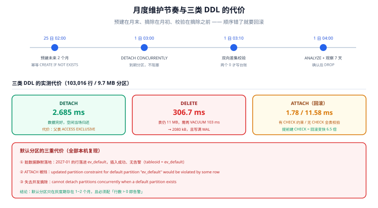

# 分区维护：ATTACH、DETACH 与默认分区

分区表上线之后，真正的工作量全在「日常维护」上：每月预建下个月的分区、每月摘掉过期的那一个、处理落不进任何区间的脏数据、让统计信息跟上、别在业务高峰做 DDL。这一页把这些操作逐个拆开，并把**默认分区**这个看起来方便、实际会咬人的设计讲清楚。

## 判据族声明

本页判据族 `PO-A` ~ `PO-H`，共 8 条。定义表在第八节。

## 本页不讲什么

- 不讲分区键与粒度怎么选，归 [分区策略](../PartitionStrategy/index.md)。
- 不讲摘下来的分区怎么搬到冷存储，归 [在线归档](../OnlineArchive/index.md)。
- 不讲查询怎么写，归 [跨分区查询](../CrossPartition/index.md)。



## 一、五类日常操作

| 操作 | 典型频率 | 主要代价 | 注意点 |
| --- | --- | --- | --- |
| `CREATE TABLE ... PARTITION OF` | 每月一次 | 毫秒级（空表） | 要**提前 2~3 个月**建，别等写入报错 |
| `ATTACH PARTITION` | 回滚、数据搬迁后 | 需要校验分区约束（可被 `CHECK` 约束跳过） | 待挂的表**不能带 identity 列** |
| `DETACH PARTITION` | 每月一次 | 父表 `ACCESS EXCLUSIVE`，会挡读写 | 毫秒级，但**会阻塞**；高并发场景用 `CONCURRENTLY` |
| `DETACH PARTITION ... CONCURRENTLY` | 每月一次（推荐） | 较弱锁、不阻塞 | **有默认分区时不可用**；不能在事务块里执行 |
| `DROP TABLE` | 归档确认后 | 元数据 + 文件删除 | 先确认归档已校验，删了不可回 |

### `DETACH` 到底有多快

本机实测，对一个 **103,016 行 / 9.7 MB** 的分区执行：

```sql
ALTER TABLE ev DETACH PARTITION ev_202601;   -- Time: 2.685 ms
SELECT count(*) FROM ev_202601;              -- 103016（数据完好，只是脱离父表）
```

同一份数据如果用 `DELETE` 清掉：**306.7 ms**，且表大小仍是 11 MB，还要再跑一次 **103 ms** 的 `VACUUM` 才降到 2080 kB。**同一次清理，差 114 倍，还差一次膨胀。**

### `DETACH CONCURRENTLY` 的两个前置条件

```sql
ALTER TABLE ev DETACH PARTITION ev_202603 CONCURRENTLY;
-- 有默认分区时：
-- ERROR:  cannot detach partitions concurrently when a default partition exists
```

两个条件缺一不可：**① 表上没有默认分区；② 不能在事务块（`BEGIN...COMMIT`）里执行**。第二条很容易被迁移框架违反——多数迁移工具默认把整个文件包在一个事务里。

## 二、默认分区：方便是真的，代价也是真的

`CREATE TABLE ev_default PARTITION OF ev DEFAULT;` 的作用是「兜住所有落不进任何区间的行」。听起来是安全网，实际带来三重代价。

### 代价 1：脏数据静默落地

本机实测：插入一条 `2027-01-10` 的记录（当时没有 2027 年的分区）：

```sql
INSERT INTO ev (ts, actor, action) VALUES ('2027-01-10 09:00+08', 1, 'card.move');
SELECT tableoid::regclass, count(*) FROM ev WHERE ts >= '2027-01-01' GROUP BY 1;
--  ev_default |     1
```

插入**成功**，没有任何告警，数据落在默认分区里。等到下个月按计划 `ATTACH` 2027-01 分区时，问题才爆发。

### 代价 2：`ATTACH` 会被默认分区里的冲突行挡住

```sql
ALTER TABLE ev ATTACH PARTITION ev_202701 FOR VALUES FROM ('2027-01-01') TO ('2027-02-01');
-- ERROR:  updated partition constraint for default partition "ev_default" would be violated by some row
```

这条错误意味着：数据库为了挂上新分区，必须**全表扫描默认分区**确认没有落在新区间里的行。默认分区越大，`ATTACH` 越慢；而且在补数据之前，`ATTACH` 永远失败。

正确处置顺序是「先把默认分区里那段数据搬进新表，再 `ATTACH`」：

```sql
-- 1) 建一个同结构的空表
CREATE TABLE ev_202701 (LIKE ev);
-- 2) 把默认分区里那一段搬过去（同事务，可回滚）
WITH moved AS (
  DELETE FROM ev_default WHERE ts >= '2027-01-01' AND ts < '2027-02-01' RETURNING *
)
INSERT INTO ev_202701 SELECT * FROM moved;
-- 3) 再 ATTACH
ALTER TABLE ev ATTACH PARTITION ev_202701 FOR VALUES FROM ('2027-01-01') TO ('2027-02-01');
```

### 代价 3：`DETACH CONCURRENTLY` 直接被禁

就是上一节那条报错。也就是说：**用了默认分区，就失去了「不阻塞地摘分区」这个最重要的能力**——而这恰恰是分区存在的核心理由。

::: danger 默认分区的正确用法
1. **只在灰度期临时存在**：新表上线的前 1~2 个月，用默认分区兜住「区间算错」的写入，同时加一个监控：`SELECT count(*) FROM ev_default`，**只要大于 0 就告警**。
2. **稳定后立刻删掉**：`DROP TABLE ev_default;`（它会连同里面的数据一起消失，删前先确认已搬走）。
3. **永远不要在「已经靠分区删历史」的表上长期保留默认分区**——它会把 `DETACH CONCURRENTLY` 锁死。
:::

## 三、`ATTACH` 前必须处理的三件事

### 1. 身份列不能带进分区

最容易踩的写法是 `CREATE TABLE new_part (LIKE ev INCLUDING ALL)`——`INCLUDING ALL` 会把 `GENERATED ALWAYS AS IDENTITY` 一起复制过来，然后 `ATTACH` 报错：

```sql
-- ERROR:  table "ev_202701" being attached contains an identity column "id"
-- DETAIL:  The new partition may not contain an identity column.
```

正确写法是**只复制需要的属性**：`CREATE TABLE ev_202701 (LIKE ev)`（`LIKE` 默认不含 identity），索引单独建。

### 2. 用 `CHECK` 约束让 `ATTACH` 跳过全表校验

`ATTACH` 默认要扫一遍待挂的表，确认所有行都落在声明区间内。如果你先加一条**能被证明蕴含区间条件的 `CHECK`**，数据库就不再扫：

```sql
ALTER TABLE ev_202601 ADD CONSTRAINT ev_202601_ts_ck
  CHECK (ts >= '2026-01-01' AND ts < '2026-02-01');
ALTER TABLE ev ATTACH PARTITION ev_202601 FOR VALUES FROM ('2026-01-01') TO ('2026-02-01');
```

本机实测（103,016 行的分区）：

| 写法 | `ATTACH` 耗时 | 说明 |
| --- | --- | --- |
| 先加匹配的 `CHECK` | **1.78 ms** | 约束已证明，跳过扫描 |
| 不加 `CHECK` | **11.58 ms** | 全表扫描校验 |
| 倍差 | **6.5 倍** | 数据量线性放大 |

这笔账在「归档回滚」时特别值：要把一个 100 GB 的归档分区挂回来，带 `CHECK` 是毫秒级，不带是分钟级 + 一次全表 IO。

### 3. 待挂表的列顺序与类型必须一致

`ATTACH` 按**列位置**匹配，不按列名。用 `CREATE TABLE ... (LIKE parent)` 建表是安全的；手写 DDL 时列顺序错了，`ATTACH` 会报类型不匹配，或者更糟——类型兼容但语义错位（比如两个 `timestamptz` 列互换），这时**不会报错**。

## 四、索引与统计信息

### 父表上的索引会级联

```sql
CREATE INDEX ev_ts_idx ON ev (ts);   -- 自动在每个分区上各建一个同名索引
```

三条纪律：

1. **不要在父表上反复建同名索引**：每建一次，所有分区各建一次。分区多时这是一次全库写入放大。
2. **父表上不能 `CREATE INDEX CONCURRENTLY`**：实测报错 `cannot create index on partitioned table "ev" concurrently`。要在线建索引，只能**逐个分区** `CONCURRENTLY`，再在父表上 `CREATE INDEX ... ON ONLY` 挂一个「空壳」。
3. **`DETACH` 之后分区上的索引还在**：归档表保留索引会让它变大；只做冷查询的归档分区，通常只留 `(ts)` 一个索引。

### `VACUUM` / `ANALYZE` 在 PostgreSQL 18 的行为变了

PG 18 的不兼容项里有一条直接影响分区运维：**`VACUUM` / `ANALYZE` 默认会处理继承子表**，想保持旧行为要写 `ONLY`。

| 操作 | PG 17 及以前 | PG 18 |
| --- | --- | --- |
| `VACUUM ev` | 只处理父表（分区表父表没有存储，等于空转） | **递归处理所有分区** |
| `VACUUM ONLY ev` | 不存在该语法 | 只处理父表，等价于旧行为 |
| `ANALYZE ev` | 只处理父表 | 递归处理所有分区 |

这条变化对「每月手动 `VACUUM` 每个分区」的脚本是好消息（可以简化成一条），但如果脚本里已经逐个分区跑，升级到 18 后会**重复劳动**——第一次全量 `VACUUM` 会明显变慢。

### 统计信息必须落到分区上

`ANALYZE` 父表不会让分区拥有统计信息（PG 18 起会递归，但仍建议在 `ATTACH` 之后单独 `ANALYZE` 新分区）。新挂上的分区没有统计信息时，优化器会按默认选择率估算，表现为「同一个查询，月初快、月末慢」。

## 五、月度维护节奏（可照抄的表）

| 时点 | 动作 | 判据 |
| --- | --- | --- |
| 每月 1 日 02:00 | 预建未来 2 个月的分区（幂等：`CREATE TABLE IF NOT EXISTS`） | 分区数 = 保留期 + 2 |
| 每月 1 日 03:00 | `DETACH CONCURRENTLY` 到期分区 | 无默认分区；不在事务块内 |
| 每月 1 日 03:10 | 归档校验（双向差集为 0） | 见 [在线归档](../OnlineArchive/index.md) |
| 每月 1 日 04:00 | 对刚 `DETACH` 的表做 `ANALYZE`（若还要查） | `pg_stat_user_tables` 有记录 |
| 每周一 | 检查默认分区行数 = 0、分区数未超上界 | 两个 `count(*)` |
| 每季度 | 用真实数据量重算粒度是否仍合适 | 单分区大小在 1~10 GB |

预建脚本要写成**幂等**的，因为定时任务失败重跑是常态：

```sql
-- 幂等预建：给未来 2 个月建分区，已存在则跳过
DO $$
DECLARE m date;
BEGIN
  FOR m IN SELECT generate_series(date_trunc('month', now())::date,
                                  (date_trunc('month', now()) + interval '2 month')::date,
                                  '1 month')::date LOOP
    EXECUTE format('CREATE TABLE IF NOT EXISTS audit_log_%s PARTITION OF audit_log
                    FOR VALUES FROM (%L) TO (%L)',
                   to_char(m,'YYYYMM'), m, m + interval '1 month');
  END LOOP;
END $$;
```

::: warning `IF NOT EXISTS` 不能救「区间写错」
`CREATE TABLE IF NOT EXISTS ... PARTITION OF` 只跳过「同名表已存在」，不会校验**已存在的那张表区间是否正确**。如果上个月有人手工建了一个区间偏了一天的分区，这个脚本会安静地跳过它，直到写入报 `no partition of relation found for row`。所以预建之后要跟一条校验：**按 `pg_class.relpartbound` 检查区间边界**，见验证命令 ④。
:::

## 六、如何验证

```shell
# ① 分区清单与边界（预建是否到位、边界是否偏）
docker exec teamboard-sandbox-db-1 psql -U teamboard -d lab160 -tAc \
  "SELECT c.relname, pg_get_expr(c.relpartbound, c.oid)
     FROM pg_class c JOIN pg_inherits i ON i.inhrelid = c.oid
    WHERE i.inhparent = 'ev'::regclass ORDER BY c.relname DESC LIMIT 3"
```

**预期输出**：类似 `ev_202701|FOR VALUES FROM ('2027-01-01 00:00:00+08') TO ('2027-02-01 00:00:00+08')`。边界必须是「左闭右开」，且相邻分区的 `TO` 与下一个的 `FROM` 严格相等。

```shell
# ② 默认分区是否为空（长期保留 = 违规）
docker exec teamboard-sandbox-db-1 psql -U teamboard -d lab160 -tAc \
  "SELECT count(*) FROM ev_default"
```

**预期输出**：`0`。表不存在时会报 `relation "ev_default" does not exist`——这也是合格状态（说明已经删掉了）。

```shell
# ③ 是否存在 identity 列导致 `ATTACH` 失败
docker exec teamboard-sandbox-db-1 psql -U teamboard -d lab160 -tAc \
  "SELECT c.relname FROM pg_class c JOIN pg_attribute a ON a.attrelid = c.oid
    WHERE c.relname LIKE 'ev_%' AND a.attidentity <> '' AND a.attnum > 0"
```

**预期输出**：只有 `ev` 自己（父表可以带 identity），**不应该出现任何 `ev_2026xx` 分区**。

```shell
# ④ 区间是否连续（有没有空洞）
docker exec teamboard-sandbox-db-1 psql -U teamboard -d lab160 -c \
  "SELECT c.relname, pg_get_expr(c.relpartbound, c.oid) AS bound
     FROM pg_class c JOIN pg_inherits i ON i.inhrelid = c.oid
    WHERE i.inhparent = 'ev'::regclass ORDER BY c.relname"
```

**预期输出**：把相邻两行的 `TO` 与 `FROM` 逐对比对，必须完全相等。有空洞时插入会报 `no partition of relation "ev" found for row`。

```shell
# ⑤ 新分区是否有统计信息
docker exec teamboard-sandbox-db-1 psql -U teamboard -d lab160 -tAc \
  "SELECT relname, last_analyze, last_autoanalyze FROM pg_stat_user_tables
    WHERE relname = 'ev_202601'"
```

**预期输出**：`last_analyze` 或 `last_autoanalyze` 非空。两个都为空说明该分区从未被分析过，优化器只能猜。

```shell
# ⑥ 父表上是否被误建了 CONCURRENTLY 索引（会失败，检查迁移日志）
grep -rn "CREATE INDEX CONCURRENTLY.*ON \(audit_log\|ev\) " migrations/ 2>/dev/null
```

**预期输出**：无输出。命中则说明迁移脚本里有一句必然失败的语句——它在事务里会直接让整个迁移回滚。

```shell
# ⑦ 摘除动作是否用了 CONCURRENTLY（阻塞检查）
grep -rn "DETACH PARTITION" migrations/ scripts/ 2>/dev/null | grep -v CONCURRENTLY
```

**预期输出**：无输出，或命中处明确标注「维护窗口内执行」。生产环境用非并发 `DETACH` 会拿父表 `ACCESS EXCLUSIVE` 锁。

```shell
# ⑧ 预建任务是否覆盖未来 2 个月
docker exec teamboard-sandbox-db-1 psql -U teamboard -d lab160 -tAc \
  "SELECT count(*) FROM pg_class c JOIN pg_inherits i ON i.inhrelid = c.oid
    WHERE i.inhparent = 'ev'::regclass
      AND c.relname > to_char(now() + interval '1 month', 'YYYYMM')"
```

**预期输出**：≥ 2。为 0 说明预建任务没跑，下个月 1 日写入就会失败。

## 七、判据族定义

| 判据 | 规则 | 违反时的样子 | 验证方式 |
| --- | --- | --- | --- |
| `PO-A` | 分区必须提前 ≥ 2 个月预建，且预建脚本幂等 | 月初写入报 `no partition found` | 命令 ⑧ |
| `PO-B` | 生产环境的 `DETACH` 必须用 `CONCURRENTLY`（无默认分区、不在事务块） | 摘分区时业务读写被阻塞数秒 | 命令 ⑦ |
| `PO-C` | 默认分区只能在灰度期存在，且有「行数 > 0 即告警」 | 脏数据静默落地，`ATTACH` 永久失败 | 命令 ② |
| `PO-D` | 待挂分区禁止带 identity 列 | `ATTACH` 报 `may not contain an identity column` | 命令 ③ |
| `PO-E` | 大分区回挂必须先建匹配的 `CHECK` 约束 | 回挂耗时从毫秒级涨到分钟级 | 见第三节实测表 |
| `PO-F` | 分区边界必须左闭右开且首尾相接 | 区间空洞导致插入失败，区间重叠导致建表失败 | 命令 ①④ |
| `PO-G` | 新分区必须单独 `ANALYZE`，不能只依赖父表 | 月初快月末慢，计划随数据漂移 | 命令 ⑤ |
| `PO-H` | 禁止在分区父表上 `CREATE INDEX CONCURRENTLY` | 迁移脚本必然失败并回滚整个事务 | 命令 ⑥ |

::: info 诚实标注
本页毫秒读数来自本机 PostgreSQL 18.6 容器：`DETACH` 2.685 ms（103,016 行）、`DELETE` 306.7 ms、`VACUUM` 103 ms、`ATTACH` 带 `CHECK` 1.78 ms / 不带 11.58 ms。锁级别（`ACCESS EXCLUSIVE` / `SHARE UPDATE EXCLUSIVE`）来自 PostgreSQL 官方文档的 `ALTER TABLE` 锁表，**未在本机做并发阻塞实测**。`DETACH CONCURRENTLY` 的两条前置条件已在本机逐条复现（默认分区报错、事务块限制来自文档）。
:::

## 参考资料

- [PostgreSQL · ALTER TABLE](https://www.postgresql.org/docs/18/sql-altertable.html)——`ATTACH` / `DETACH` 的语法、锁级别与 `CONCURRENTLY` 限制
- [PostgreSQL · Table Partitioning · Maintenance](https://www.postgresql.org/docs/18/ddl-partitioning.html#DDL-PARTITIONING-MAINTENANCE)——默认分区的行为与 `ATTACH` 校验
- [PostgreSQL 18 · Release Notes](https://www.postgresql.org/docs/18/release-18.html)——`VACUUM` / `ANALYZE` 默认处理继承子表（不兼容项）
- [PostgreSQL · VACUUM](https://www.postgresql.org/docs/18/sql-vacuum.html)——`ONLY` 选项的语义
- 本站 [PostgreSQL 高级特性](/docs/DB/Relational/PostgreSQL/Advanced/index.md) · [备份与恢复](/docs/DB/Relational/PostgreSQL/BackupRestore/index.md)
- 相邻：[分区策略](../PartitionStrategy/index.md) · [在线归档](../OnlineArchive/index.md)
